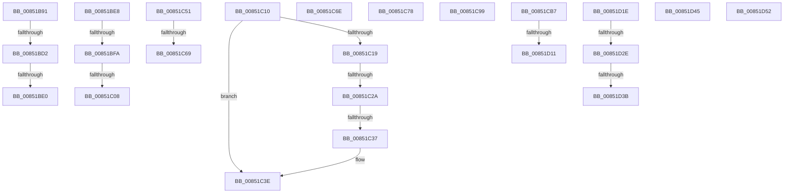

# sub_00851B91

- RVA: `0x00851B91`–`0x00851D65` (길이 `468` bytes)
- VA: `0x0000000140851B91`
- 실행 섹션: `PAGE`
- PDB 이름 있음: `아니요`; PDB Function 태그: `아니요`
- unwind 정보 RVA: `0x00069E58`
- 디코드: `94`개 명령, `468/468` bytes 표시
- 미해석 바이트: `0` (있으면 어셈블리에 `.byte`로 보존)

> 이 문서는 커널 이미지의 기계어와 PDB 기호를 분석해 생성했습니다. 4번과 5번은 함수 원형과 자료형을 바이너리 사용 방식에서 추정한 C 해석이며 원본 소스 복구 결과는 아닙니다.

## 1. Dependencies

- 직접 호출 지점: **12**; 고유 호출 대상: **10**
- 직접 호출자로 확인된 함수: **0**
- RIP 상대 이미지 참조: **1**

### Outgoing calls
- `0x00851BA3` → [KeBugCheckEx](../../text/4F/KeBugCheckEx_function_004FD660.md) (function, `0x004FD660`)
- `0x00851BBB` → [KeBugCheckEx](../../text/4F/KeBugCheckEx_function_004FD660.md) (function, `0x004FD660`)
- `0x00851C40` → [ExFreePoolWithTag](../../poolcode/B8/ExFreePoolWithTag_function_00B82870.md) (function, `0x00B82870`)
- `0x00851C6E` → [ExReleaseFastMutex](../../text/25/ExReleaseFastMutex_function_002519C0.md) (function, `0x002519C0`)
- `0x00851C7B` → [CmpLockDeletedHashEntryExclusiveByKcb](../9B/CmpLockDeletedHashEntryExclusiveByKcb_function_009B3030.md) (function, `0x009B3030`)
- `0x00851C87` → [CmpRemoveKeyHashFromDeletedKcbTable](../9E/CmpRemoveKeyHashFromDeletedKcbTable_function_009EC364.md) (function, `0x009EC364`)
- `0x00851C8F` → [CmpUnlockDeletedHashEntryByKcb](../9B/CmpUnlockDeletedHashEntryByKcb_function_009B3100.md) (function, `0x009B3100`)
- `0x00851CC3` → [CmpCleanUpKcbCacheWithLock](../86/CmpCleanUpKcbCacheWithLock_function_00861F20.md) (function, `0x00861F20`)
- `0x00851D14` → [CmpDereferenceHive](../86/CmpDereferenceHive_function_008632B0.md) (function, `0x008632B0`)
- `0x00851D3B` → [CmpDoQueueLateUnloadWorker](../84/CmpDoQueueLateUnloadWorker_function_0084FB18.md) (function, `0x0084FB18`)
- `0x00851D48` → [guard_dispatch_icall](../../text/6B/guard_dispatch_icall_function_006BAAD0.md) (function, `0x006BAAD0`)
- `0x00851D5B` → [ExFreePoolWithTag](../../poolcode/B8/ExFreePoolWithTag_function_00B82870.md) (function, `0x00B82870`)

### Direct callers
- 이 함수 시작 RVA로 연결되는 직접 call은 확인되지 않았습니다. 간접 호출은 완전히 역산할 수 없습니다.

### Static image references
- `0x00851C51` → RVA `0x00EF58E0` (`.data`; read)

## 2. Other-region calls and transfers

- 다른 실행 섹션으로 향하는 call: **6**
  - `0x00851BA3` → [KeBugCheckEx](../../text/4F/KeBugCheckEx_function_004FD660.md) (`PAGE` → `.text`)
  - `0x00851BBB` → [KeBugCheckEx](../../text/4F/KeBugCheckEx_function_004FD660.md) (`PAGE` → `.text`)
  - `0x00851C40` → [ExFreePoolWithTag](../../poolcode/B8/ExFreePoolWithTag_function_00B82870.md) (`PAGE` → `POOLCODE`)
  - `0x00851C6E` → [ExReleaseFastMutex](../../text/25/ExReleaseFastMutex_function_002519C0.md) (`PAGE` → `.text`)
  - `0x00851D48` → [guard_dispatch_icall](../../text/6B/guard_dispatch_icall_function_006BAAD0.md) (`PAGE` → `.text`)
  - `0x00851D5B` → [ExFreePoolWithTag](../../poolcode/B8/ExFreePoolWithTag_function_00B82870.md) (`PAGE` → `POOLCODE`)
- call이 아닌 외부 분기/꼬리 이동: **21**
  - `0x00851BCC` → [sub_008515D5 + 0x250](Unknown_function_008515D5.md) (`tail-transfer`)
  - `0x00851BDA` → [sub_008515D5 + 0x250](Unknown_function_008515D5.md) (`tail-transfer`)
  - `0x00851BE3` → [sub_008515D5 + 0x253](Unknown_function_008515D5.md) (`tail-transfer`)
  - `0x00851BF4` → [sub_008515D5 + 0x1D9](Unknown_function_008515D5.md) (`tail-transfer`)
  - `0x00851C02` → [sub_008515D5 + 0x1D9](Unknown_function_008515D5.md) (`tail-transfer`)
  - `0x00851C0B` → [sub_008515D5 + 0x1DC](Unknown_function_008515D5.md) (`tail-transfer`)
  - `0x00851C24` → [sub_008515D5 + 0x23B](Unknown_function_008515D5.md) (`tail-transfer`)
  - `0x00851C31` → [sub_008515D5 + 0x23B](Unknown_function_008515D5.md) (`tail-transfer`)
  - `0x00851C4C` → [sub_008515D5 + 0xF8](Unknown_function_008515D5.md) (`tail-transfer`)
  - `0x00851C63` → [sub_008515D5 + 0x23B](Unknown_function_008515D5.md) (`tail-transfer`)
  - `0x00851C69` → [sub_008515D5 + 0x292](Unknown_function_008515D5.md) (`tail-transfer`)
  - `0x00851C73` → [sub_008515D5 + 0x2DA](Unknown_function_008515D5.md) (`tail-transfer`)
  - `0x00851C94` → [sub_008515D5 + 0x165](Unknown_function_008515D5.md) (`tail-transfer`)
  - `0x00851CB2` → [sub_008515D5 + 0x279](Unknown_function_008515D5.md) (`tail-transfer`)
  - `0x00851D0B` → [sub_008515D5 + 0x2DF](Unknown_function_008515D5.md) (`tail-transfer`)
  - `0x00851D19` → [sub_008515D5 + 0x2DF](Unknown_function_008515D5.md) (`tail-transfer`)
  - `0x00851D28` → [sub_008515D5 + 0x2DF](Unknown_function_008515D5.md) (`tail-transfer`)
  - `0x00851D35` → [sub_008515D5 + 0x2DF](Unknown_function_008515D5.md) (`tail-transfer`)
  - `0x00851D40` → [sub_008515D5 + 0x2DF](Unknown_function_008515D5.md) (`tail-transfer`)
  - `0x00851D4D` → [sub_008515D5 + 0xA2](Unknown_function_008515D5.md) (`tail-transfer`)
  - `0x00851D60` → [sub_008515D5 + 0xE8](Unknown_function_008515D5.md) (`tail-transfer`)

## 3. Assembly (complete function range)

```asm
00851B91  45 33 C9                        xor r9d, r9d
00851B94  48 89 7C 24 20                  mov qword ptr [rsp + 0x20], rdi
00851B99  4D 8B C6                        mov r8, r14
00851B9C  41 8D 51 25                     lea edx, [r9 + 0x25]
00851BA0  8D 4A 2C                        lea ecx, [rdx + 0x2c]
00851BA3  E8 B8 BA CA FF                  call 0x1404fd660
00851BA8  CC                              int3
00851BA9  45 33 C9                        xor r9d, r9d
00851BAC  48 89 7C 24 20                  mov qword ptr [rsp + 0x20], rdi
00851BB1  4D 8B C4                        mov r8, r12
00851BB4  41 8D 51 25                     lea edx, [r9 + 0x25]
00851BB8  8D 4A 2C                        lea ecx, [rdx + 0x2c]
00851BBB  E8 A0 BA CA FF                  call 0x1404fd660
00851BC0  CC                              int3
00851BC1  41 F7 86 B8 00 00 00 00 00 04 00  test dword ptr [r14 + 0xb8], 0x40000
00851BCC  0F 84 53 FC FF FF               je 0x140851825
00851BD2  41 80 B8 80 0B 00 00 01         cmp byte ptr [r8 + 0xb80], 1
00851BDA  0F 85 45 FC FF FF               jne 0x140851825
00851BE0  41 B2 01                        mov r10b, 1
00851BE3  E9 40 FC FF FF                  jmp 0x140851828
00851BE8  41 F7 84 24 B8 00 00 00 00 00 04 00  test dword ptr [r12 + 0xb8], 0x40000
00851BF4  0F 84 B4 FB FF FF               je 0x1408517ae
00851BFA  41 80 B8 80 0B 00 00 01         cmp byte ptr [r8 + 0xb80], 1
00851C02  0F 85 A6 FB FF FF               jne 0x1408517ae
00851C08  41 B2 01                        mov r10b, 1
00851C0B  E9 A1 FB FF FF                  jmp 0x1408517b1
00851C10  48 8B 41 18                     mov rax, qword ptr [rcx + 0x18]
00851C14  48 85 C0                        test rax, rax
00851C17  74 25                           je 0x140851c3e
00851C19  48 8B 11                        mov rdx, qword ptr [rcx]
00851C1C  4C 8B 60 10                     mov r12, qword ptr [rax + 0x10]
00851C20  48 39 4A 08                     cmp qword ptr [rdx + 8], rcx
00851C24  0F 85 E6 FB FF FF               jne 0x140851810
00851C2A  48 8B 41 08                     mov rax, qword ptr [rcx + 8]
00851C2E  48 39 08                        cmp qword ptr [rax], rcx
00851C31  0F 85 D9 FB FF FF               jne 0x140851810
00851C37  48 89 10                        mov qword ptr [rax], rdx
00851C3A  48 89 42 08                     mov qword ptr [rdx + 8], rax
00851C3E  33 D2                           xor edx, edx
00851C40  E8 2B 0C 33 00                  call 0x140b82870
00851C45  48 89 BB C0 00 00 00            mov qword ptr [rbx + 0xc0], rdi
00851C4C  E9 7C FA FF FF                  jmp 0x1408516cd
00851C51  48 8B 15 88 3C 6A 00            mov rdx, qword ptr [rip + 0x6a3c88]
00851C58  48 8D 0D 81 3C 6A 00            lea rcx, [rip + 0x6a3c81]
00851C5F  48 39 4A 08                     cmp qword ptr [rdx + 8], rcx
00851C63  0F 85 A7 FB FF FF               jne 0x140851810
00851C69  E9 F9 FB FF FF                  jmp 0x140851867
00851C6E  E8 4D FD 9F FF                  call 0x1402519c0
00851C73  E9 37 FC FF FF                  jmp 0x1408518af
00851C78  48 8B CB                        mov rcx, rbx
00851C7B  E8 B0 13 16 00                  call 0x1409b3030
00851C80  48 8B 4B 20                     mov rcx, qword ptr [rbx + 0x20]
00851C84  49 8B D5                        mov rdx, r13
00851C87  E8 D8 A6 19 00                  call 0x1409ec364
00851C8C  48 8B CB                        mov rcx, rbx
00851C8F  E8 6C 14 16 00                  call 0x1409b3100
00851C94  E9 A1 FA FF FF                  jmp 0x14085173a
00851C99  48 89 48 08                     mov qword ptr [rax + 8], rcx
00851C9D  48 8D 54 24 40                  lea rdx, [rsp + 0x40]
00851CA2  48 89 10                        mov qword ptr [rax], rdx
00851CA5  48 89 01                        mov qword ptr [rcx], rax
00851CA8  48 89 44 24 48                  mov qword ptr [rsp + 0x48], rax
00851CAD  41 80 4E 40 01                  or byte ptr [r14 + 0x40], 1
00851CB2  E9 97 FB FF FF                  jmp 0x14085184e
00851CB7  4C 8B 73 20                     mov r14, qword ptr [rbx + 0x20]
00851CBB  48 8D 54 24 40                  lea rdx, [rsp + 0x40]
00851CC0  48 8B CB                        mov rcx, rbx
00851CC3  E8 58 02 01 00                  call 0x140861f20
00851CC8  65 48 8B 04 25 88 01 00 00      mov rax, qword ptr gs:[0x188]
00851CD1  41 B9 01 00 00 00               mov r9d, 1
00851CD7  41 81 8E A0 00 00 00 80 00 00 00  or dword ptr [r14 + 0xa0], 0x80
00851CE2  49 89 86 50 10 00 00            mov qword ptr [r14 + 0x1050], rax
00851CE9  F0 45 0F C1 8E 8C 10 00 00      lock xadd dword ptr [r14 + 0x108c], r9d
00851CF2  41 83 E1 7F                     and r9d, 0x7f
00851CF6  43 C7 84 8E 90 10 00 00 1F 00 00 00  mov dword ptr [r14 + r9*4 + 0x1090], 0x1f
00851D02  41 8B 86 A0 00 00 00            mov eax, dword ptr [r14 + 0xa0]
00851D09  A8 20                           test al, 0x20
00851D0B  0F 85 A3 FB FF FF               jne 0x1408518b4
00851D11  49 8B CE                        mov rcx, r14
00851D14  E8 97 15 01 00                  call 0x1408632b0
00851D19  E9 96 FB FF FF                  jmp 0x1408518b4
00851D1E  F7 83 B8 00 00 00 00 00 04 00   test dword ptr [rbx + 0xb8], 0x40000
00851D28  0F 84 86 FB FF FF               je 0x1408518b4
00851D2E  80 B9 80 0B 00 00 01            cmp byte ptr [rcx + 0xb80], 1
00851D35  0F 85 79 FB FF FF               jne 0x1408518b4
00851D3B  E8 D8 DD FF FF                  call 0x14084fb18
00851D40  E9 6F FB FF FF                  jmp 0x1408518b4
00851D45  49 8B C6                        mov rax, r14
00851D48  E8 83 8D E6 FF                  call 0x1406baad0
00851D4D  E9 25 F9 FF FF                  jmp 0x140851677
00851D52  48 8B 4B 70                     mov rcx, qword ptr [rbx + 0x70]
00851D56  BA 43 4D 49 6E                  mov edx, 0x6e494d43
00851D5B  E8 10 0B 33 00                  call 0x140b82870
00851D60  E9 58 F9 FF FF                  jmp 0x1408516bd
```

## 4. C-style interpretation (structured pseudocode)

```c
__int64 __fastcall sub_00851B91(__int64 a1, __int64 a2, __int64 a3, int a4)
{
    __int64 result;
    unsigned __int64 v_stack_p20;
    unsigned __int64 v_stack_p40;
    unsigned __int64 v_stack_p48;

    a4 = 0;
    v_stack_p20 = v_rdi;
    result = KeBugCheckEx(a4 + 37 + 44, a4 + 37, v_r14, a4);
    a4 = 0;
    v_stack_p20 = v_rdi;
    result = KeBugCheckEx(a4 + 37 + 44, a4 + 37, v_r12, a4);
}
```

## 5. (Beta) C Style

```c
int64_t sub_00851B91(int64_t Arg1, int64_t Arg2, int64_t Arg3, int32_t Arg4)
{
    int64_t result;
    uint64_t v_stack_p20;
    uint64_t v_stack_p40;
    uint64_t v_stack_p48;

    Arg4 = 0;
    v_stack_p20 = local_rdi;
    result = KeBugCheckEx(Arg4 + 37 + 44, Arg4 + 37, local_r14, Arg4);
    Arg4 = 0;
    v_stack_p20 = local_rdi;
    result = KeBugCheckEx(Arg4 + 37 + 44, Arg4 + 37, local_r12, Arg4);
}
```

## 6. Execution-region graph

[열기: 2D/3D 그래프와 함수 탐색 컨트롤 패널](../../../control-panel.html?section=page&rva=0x00851B91&view=graph)

- 2D 그래프는 위에서 아래로 흐르고, 3D 그래프는 빈 공간을 드래그해 회전합니다. Shift+드래그는 이동, 휠은 확대·축소, 함수 노드 선택은 대상 보고서 이동입니다.

### Static fallback


