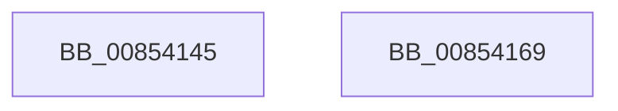

# sub_00854145

- RVA: `0x00854145`–`0x0085416A` (길이 `37` bytes)
- VA: `0x0000000140854145`
- 실행 섹션: `PAGE`
- PDB 이름 있음: `아니요`; PDB Function 태그: `아니요`
- unwind 정보 RVA: `0x00069F0C`
- 디코드: `14`개 명령, `37/37` bytes 표시
- 미해석 바이트: `0` (있으면 어셈블리에 `.byte`로 보존)

> 이 문서는 커널 이미지의 기계어와 PDB 기호를 분석해 생성했습니다. 4번과 5번은 함수 원형과 자료형을 바이너리 사용 방식에서 추정한 C 해석이며 원본 소스 복구 결과는 아닙니다.

## 1. Dependencies

- 직접 호출 지점: **0**; 고유 호출 대상: **0**
- 직접 호출자로 확인된 함수: **0**
- RIP 상대 이미지 참조: **0**

### Outgoing calls
- 직접 디코드된 call 명령이 없습니다.

### Direct callers
- 이 함수 시작 RVA로 연결되는 직접 call은 확인되지 않았습니다. 간접 호출은 완전히 역산할 수 없습니다.

### Static image references
- 디코드된 RIP-relative 메모리 참조가 없습니다.

## 2. Other-region calls and transfers

- 다른 실행 섹션으로 향하는 call: **0**
- 별도 외부 분기/꼬리 이동을 확인하지 못했습니다.

## 3. Assembly (complete function range)

```asm
00854145  CC                              int3
00854146  48 8B 45 50                     mov rax, qword ptr [rbp + 0x50]
0085414A  C7 00 FF FF FF FF               mov dword ptr [rax], 0xffffffff
00854150  48 8B 45 58                     mov rax, qword ptr [rbp + 0x58]
00854154  44 89 10                        mov dword ptr [rax], r10d
00854157  B8 34 00 00 C0                  mov eax, 0xc0000034
0085415C  48 83 C4 70                     add rsp, 0x70
00854160  41 5F                           pop r15
00854162  41 5D                           pop r13
00854164  41 5C                           pop r12
00854166  5B                              pop rbx
00854167  5D                              pop rbp
00854168  C3                              ret
00854169  CC                              int3
```

## 4. C-style interpretation (structured pseudocode)

```c
__int64 __fastcall sub_00854145(void)
{
    __int64 v_rsp;

    *(unsigned int *)(*(unsigned __int64 *)(v_rbp + 80)) = 0xFFFFFFFFULL;
    *(unsigned int *)(*(unsigned __int64 *)(v_rbp + 88)) = (unsigned int)(v_r10);
    v_rsp = (v_rsp) + (112);
    return (unsigned int)(0xC0000034ULL);
}
```

## 5. (Beta) C Style

```c
void sub_00854145(void)
{
    int64_t local_rsp;

    *(uint32_t *)(*(uint64_t *)(local_rbp + 0x50)) = 0xFFFFFFFFULL;
    *(uint32_t *)(*(uint64_t *)(local_rbp + 0x58)) = (uint32_t)(local_r10);
    local_rsp = (local_rsp) + (112);
    return (uint32_t)(0xC0000034ULL);
}
```

## 6. Execution-region graph

[열기: 2D/3D 그래프와 함수 탐색 컨트롤 패널](../../../control-panel.html?section=page&rva=0x00854145&view=graph)

- 2D 그래프는 위에서 아래로 흐르고, 3D 그래프는 빈 공간을 드래그해 회전합니다. Shift+드래그는 이동, 휠은 확대·축소, 함수 노드 선택은 대상 보고서 이동입니다.

### Static fallback


