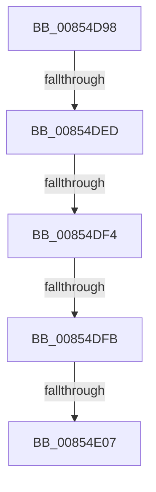

# sub_00854D98

- RVA: `0x00854D98`–`0x00854E30` (길이 `152` bytes)
- VA: `0x0000000140854D98`
- 실행 섹션: `PAGE`
- PDB 이름 있음: `아니요`; PDB Function 태그: `아니요`
- unwind 정보 RVA: `0x00069F54`
- 디코드: `37`개 명령, `152/152` bytes 표시
- 미해석 바이트: `0` (있으면 어셈블리에 `.byte`로 보존)

> 이 문서는 커널 이미지의 기계어와 PDB 기호를 분석해 생성했습니다. 4번과 5번은 함수 원형과 자료형을 바이너리 사용 방식에서 추정한 C 해석이며 원본 소스 복구 결과는 아닙니다.

## 1. Dependencies

- 직접 호출 지점: **2**; 고유 호출 대상: **2**
- 직접 호출자로 확인된 함수: **0**
- RIP 상대 이미지 참조: **1**

### Outgoing calls
- `0x00854DD5` → [RtlInitUnicodeString](../../text/42/RtlInitUnicodeString_function_0042A780.md) (function, `0x0042A780`)
- `0x00854DDF` → [HvpGetCellContextInitialize](HvpGetCellContextInitialize_function_00855F10.md) (function, `0x00855F10`)

### Direct callers
- 이 함수 시작 RVA로 연결되는 직접 call은 확인되지 않았습니다. 간접 호출은 완전히 역산할 수 없습니다.

### Static image references
- `0x00854DE4` → RVA `0x00E0ECA0` (`.data`; read)

## 2. Other-region calls and transfers

- 다른 실행 섹션으로 향하는 call: **1**
  - `0x00854DD5` → [RtlInitUnicodeString](../../text/42/RtlInitUnicodeString_function_0042A780.md) (`PAGE` → `.text`)
- call이 아닌 외부 분기/꼬리 이동: **5**
  - `0x00854DEB` → [sub_00854E39](Unknown_function_00854E39.md) (`tail-transfer`)
  - `0x00854DF2` → [sub_00854E39 + 0x7](Unknown_function_00854E39.md) (`tail-transfer`)
  - `0x00854DF9` → [sub_00854E39 + 0xE](Unknown_function_00854E39.md) (`tail-transfer`)
  - `0x00854E05` → [sub_00854E39 + 0x15](Unknown_function_00854E39.md) (`tail-transfer`)
  - `0x00854E2E` → [sub_00854E68](Unknown_function_00854E68.md) (`tail-transfer`)

## 3. Assembly (complete function range)

```asm
00854D98  49 89 6B 08                     mov qword ptr [r11 + 8], rbp
00854D9C  33 C0                           xor eax, eax
00854D9E  49 89 73 10                     mov qword ptr [r11 + 0x10], rsi
00854DA2  0F 57 C0                        xorps xmm0, xmm0
00854DA5  49 89 7B 18                     mov qword ptr [r11 + 0x18], rdi
00854DA9  48 8B F2                        mov rsi, rdx
00854DAC  48 8B F9                        mov rdi, rcx
00854DAF  4D 89 73 20                     mov qword ptr [r11 + 0x20], r14
00854DB3  49 8D 4B E8                     lea rcx, [r11 - 0x18]
00854DB7  89 44 24 30                     mov dword ptr [rsp + 0x30], eax
00854DBB  33 D2                           xor edx, edx
00854DBD  49 89 43 E0                     mov qword ptr [r11 - 0x20], rax
00854DC1  49 8B E9                        mov rbp, r9
00854DC4  49 89 43 D0                     mov qword ptr [r11 - 0x30], rax
00854DC8  45 0F B6 F0                     movzx r14d, r8b
00854DCC  49 89 43 D8                     mov qword ptr [r11 - 0x28], rax
00854DD0  0F 11 44 24 50                  movups xmmword ptr [rsp + 0x50], xmm0
00854DD5  E8 A6 59 BD FF                  call 0x14042a780
00854DDA  48 8D 4C 24 38                  lea rcx, [rsp + 0x38]
00854DDF  E8 2C 11 00 00                  call 0x140855f10
00854DE4  80 3D B5 9E 5B 00 00            cmp byte ptr [rip + 0x5b9eb5], 0
00854DEB  74 4C                           je 0x140854e39
00854DED  8B 46 18                        mov eax, dword ptr [rsi + 0x18]
00854DF0  A8 10                           test al, 0x10
00854DF2  75 4C                           jne 0x140854e40
00854DF4  66 83 7F 42 00                  cmp word ptr [rdi + 0x42], 0
00854DF9  75 4C                           jne 0x140854e47
00854DFB  F7 87 B8 00 00 00 00 00 00 02   test dword ptr [rdi + 0xb8], 0x2000000
00854E05  75 47                           jne 0x140854e4e
00854E07  BB 71 02 00 C0                  mov ebx, 0xc0000271
00854E0C  48 8B 4C 24 58                  mov rcx, qword ptr [rsp + 0x58]
00854E11  4C 8B B4 24 88 00 00 00         mov r14, qword ptr [rsp + 0x88]
00854E19  48 8B BC 24 80 00 00 00         mov rdi, qword ptr [rsp + 0x80]
00854E21  48 8B 74 24 78                  mov rsi, qword ptr [rsp + 0x78]
00854E26  48 8B 6C 24 70                  mov rbp, qword ptr [rsp + 0x70]
00854E2B  48 85 C9                        test rcx, rcx
00854E2E  75 38                           jne 0x140854e68
```

## 4. C-style interpretation (structured pseudocode)

```c
__int64 __fastcall sub_00854D98(__int64 a1, __int64 a2, unsigned __int8 a3, __int64 a4, __int64 a5, __int64 a6, __int64 a7, __int64 a8, __int64 a9, __int64 a10, __int64 a11, __int64 a12, __int64 a13, __int64 a14, __int64 a15, __int64 a16, __int64 a17)
{
    __int64 result;
    unsigned int v_stack_p30;

    *(unsigned __int64 *)(v_r11 + 8) = v_rbp;
    result = 0;
    *(unsigned __int64 *)(v_r11 + 16) = v_rsi;
    *(unsigned __int64 *)(v_r11 + 24) = v_rdi;
    *(unsigned __int64 *)(v_r11 + 32) = v_r14;
    v_stack_p30 = 0;
    a2 = 0;
    *(unsigned __int64 *)(v_r11 - 32) = 0;
    *(unsigned __int64 *)(v_r11 - 48) = 0;
    *(unsigned __int64 *)(v_r11 - 40) = 0;
    a10 = v_xmm0;
    result = RtlInitUnicodeString(v_r11 - 24, a2, a3, a4);
    result = HvpGetCellContextInitialize(a7, a2, a3, a4);
}
```

## 5. (Beta) C Style

```c
int64_t sub_00854D98(void *Arg1, void *Arg2, uint8_t Arg3, int64_t Arg4, uint64_t Arg5, uint64_t Arg6, int64_t Arg7, uint64_t Arg8, uint64_t Arg9, int64_t Arg10, int64_t Arg11, uint64_t Arg12, uint64_t Arg13, int64_t Arg14, int64_t Arg15, int64_t Arg16, int64_t Arg17)
{
    uint8_t *arg1 = (uint8_t *)Arg1;
    uint8_t *arg2 = (uint8_t *)Arg2;

    int64_t result;
    uint32_t v_stack_p30;

    *(uint64_t *)(local_r11 + 0x8) = local_rbp;
    result = 0;
    *(uint64_t *)(local_r11 + 0x10) = local_rsi;
    *(uint64_t *)(local_r11 + 0x18) = local_rdi;
    *(uint64_t *)(local_r11 + 0x20) = local_r14;
    v_stack_p30 = 0;
    Arg2 = 0;
    *(uint64_t *)(local_r11 - 0x20) = 0;
    *(uint64_t *)(local_r11 - 0x30) = 0;
    *(uint64_t *)(local_r11 - 0x28) = 0;
    Arg10 = v_xmm0;
    result = RtlInitUnicodeString(local_r11 - 24, Arg2, Arg3, Arg4);
    result = HvpGetCellContextInitialize(Arg7, Arg2, Arg3, Arg4);
}
```

### 관측된 메모리 오프셋

구조체 형식이 확인되지 않은 접근은 인자 기준의 오프셋으로만 기록했습니다.

| 기준 인자 | 오프셋 표현 | 폭 (bit) | 접근 |
|---|---:|---:|---|
| `Arg1` | `+ 0x42` | `16` | `R` |
| `Arg1` | `+ 0xB8` | `32` | `R` |
| `Arg2` | `+ 0x18` | `32` | `R` |

## 6. Execution-region graph

[열기: 2D/3D 그래프와 함수 탐색 컨트롤 패널](../../../control-panel.html?section=page&rva=0x00854D98&view=graph)

- 2D 그래프는 위에서 아래로 흐르고, 3D 그래프는 빈 공간을 드래그해 회전합니다. Shift+드래그는 이동, 휠은 확대·축소, 함수 노드 선택은 대상 보고서 이동입니다.

### Static fallback


