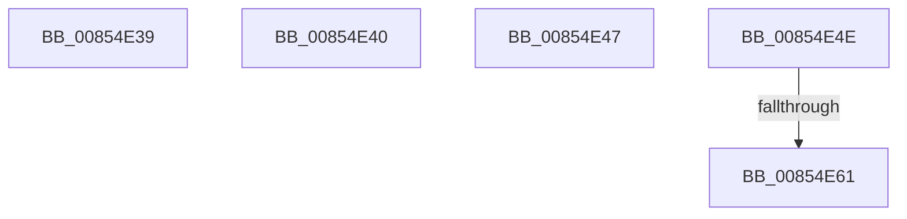

# sub_00854E39

- RVA: `0x00854E39`–`0x00854E68` (길이 `47` bytes)
- VA: `0x0000000140854E39`
- 실행 섹션: `PAGE`
- PDB 이름 있음: `아니요`; PDB Function 태그: `아니요`
- unwind 정보 RVA: `0x00069F88`
- 디코드: `12`개 명령, `47/47` bytes 표시
- 미해석 바이트: `0` (있으면 어셈블리에 `.byte`로 보존)

> 이 문서는 커널 이미지의 기계어와 PDB 기호를 분석해 생성했습니다. 4번과 5번은 함수 원형과 자료형을 바이너리 사용 방식에서 추정한 C 해석이며 원본 소스 복구 결과는 아닙니다.

## 1. Dependencies

- 직접 호출 지점: **0**; 고유 호출 대상: **0**
- 직접 호출자로 확인된 함수: **0**
- RIP 상대 이미지 참조: **0**

### Outgoing calls
- 직접 디코드된 call 명령이 없습니다.

### Direct callers
- 이 함수 시작 RVA로 연결되는 직접 call은 확인되지 않았습니다. 간접 호출은 완전히 역산할 수 없습니다.

### Static image references
- 디코드된 RIP-relative 메모리 참조가 없습니다.

## 2. Other-region calls and transfers

- 다른 실행 섹션으로 향하는 call: **0**
- call이 아닌 외부 분기/꼬리 이동: **5**
  - `0x00854E3E` → [sub_00854D98 + 0x74](Unknown_function_00854D98.md) (`tail-transfer`)
  - `0x00854E45` → [sub_00854D98 + 0x74](Unknown_function_00854D98.md) (`tail-transfer`)
  - `0x00854E4C` → [sub_00854D98 + 0x74](Unknown_function_00854D98.md) (`tail-transfer`)
  - `0x00854E5B` → [sub_00B169F2](../B1/Unknown_function_00B169F2.md) (`tail-transfer`)
  - `0x00854E66` → [sub_00854D98 + 0x74](Unknown_function_00854D98.md) (`tail-transfer`)

## 3. Assembly (complete function range)

```asm
00854E39  BB 71 02 00 C0                  mov ebx, 0xc0000271
00854E3E  EB CC                           jmp 0x140854e0c
00854E40  BB 71 02 00 C0                  mov ebx, 0xc0000271
00854E45  EB C5                           jmp 0x140854e0c
00854E47  BB 71 02 00 C0                  mov ebx, 0xc0000271
00854E4C  EB BE                           jmp 0x140854e0c
00854E4E  8B 47 08                        mov eax, dword ptr [rdi + 8]
00854E51  25 00 00 E0 7F                  and eax, 0x7fe00000
00854E56  3D 00 00 A0 00                  cmp eax, 0xa00000
00854E5B  0F 87 91 1B 2C 00               ja 0x140b169f2
00854E61  BB 71 02 00 C0                  mov ebx, 0xc0000271
00854E66  EB A4                           jmp 0x140854e0c
```

## 4. C-style interpretation (structured pseudocode)

```c
__int64 __fastcall sub_00854E39(void)
{
}
```

## 5. (Beta) C Style

```c
void sub_00854E39(void)
{
}
```

## 6. Execution-region graph

[열기: 2D/3D 그래프와 함수 탐색 컨트롤 패널](../../../control-panel.html?section=page&rva=0x00854E39&view=graph)

- 2D 그래프는 위에서 아래로 흐르고, 3D 그래프는 빈 공간을 드래그해 회전합니다. Shift+드래그는 이동, 휠은 확대·축소, 함수 노드 선택은 대상 보고서 이동입니다.

### Static fallback


