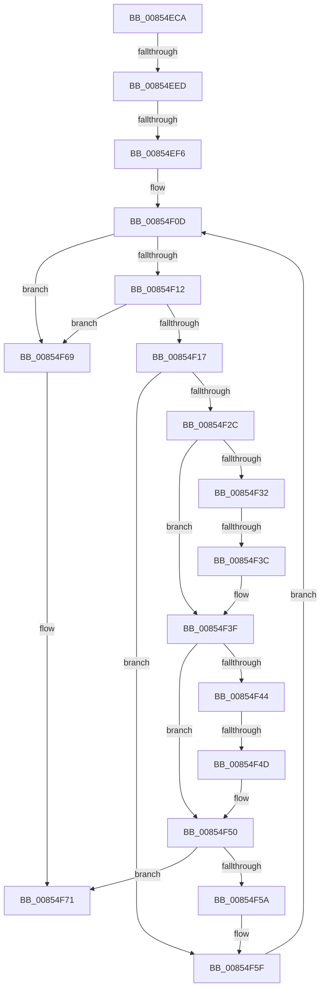

# sub_00854ECA

- RVA: `0x00854ECA`–`0x00854F9C` (길이 `210` bytes)
- VA: `0x0000000140854ECA`
- 실행 섹션: `PAGE`
- PDB 이름 있음: `아니요`; PDB Function 태그: `아니요`
- unwind 정보 RVA: `0x00069FE4`
- 디코드: `55`개 명령, `210/210` bytes 표시
- 미해석 바이트: `0` (있으면 어셈블리에 `.byte`로 보존)

> 이 문서는 커널 이미지의 기계어와 PDB 기호를 분석해 생성했습니다. 4번과 5번은 함수 원형과 자료형을 바이너리 사용 방식에서 추정한 C 해석이며 원본 소스 복구 결과는 아닙니다.

## 1. Dependencies

- 직접 호출 지점: **0**; 고유 호출 대상: **0**
- 직접 호출자로 확인된 함수: **0**
- RIP 상대 이미지 참조: **0**

### Outgoing calls
- 직접 디코드된 call 명령이 없습니다.

### Direct callers
- 이 함수 시작 RVA로 연결되는 직접 call은 확인되지 않았습니다. 간접 호출은 완전히 역산할 수 없습니다.

### Static image references
- 디코드된 RIP-relative 메모리 참조가 없습니다.

## 2. Other-region calls and transfers

- 다른 실행 섹션으로 향하는 call: **0**
- call이 아닌 외부 분기/꼬리 이동: **5**
  - `0x00854EE7` → [sub_00854FDC + 0x40](Unknown_function_00854FDC.md) (`tail-transfer`)
  - `0x00854EF0` → [sub_00854FDC](Unknown_function_00854FDC.md) (`tail-transfer`)
  - `0x00854F36` → [sub_00854FDC + 0x1B](Unknown_function_00854FDC.md) (`tail-transfer`)
  - `0x00854F47` → [sub_00854FDC + 0x30](Unknown_function_00854FDC.md) (`tail-transfer`)
  - `0x00854F9A` → [sub_00854F9C + 0x2A](Unknown_function_00854F9C.md) (`tail-transfer`)

## 3. Assembly (complete function range)

```asm
00854ECA  48 89 6C 24 78                  mov qword ptr [rsp + 0x78], rbp
00854ECF  48 89 74 24 48                  mov qword ptr [rsp + 0x48], rsi
00854ED4  4C 89 64 24 40                  mov qword ptr [rsp + 0x40], r12
00854ED9  4C 89 6C 24 38                  mov qword ptr [rsp + 0x38], r13
00854EDE  4C 89 7C 24 30                  mov qword ptr [rsp + 0x30], r15
00854EE3  4C 8D 78 4C                     lea r15, [rax + 0x4c]
00854EE7  0F 84 2F 01 00 00               je 0x14085501c
00854EED  48 85 DB                        test rbx, rbx
00854EF0  0F 85 E6 00 00 00               jne 0x140854fdc
00854EF6  4C 8B 67 08                     mov r12, qword ptr [rdi + 8]
00854EFA  0F B7 68 48                     movzx ebp, word ptr [rax + 0x48]
00854EFE  B8 E0 FF 00 00                  mov eax, 0xffe0
00854F03  0F B7 3F                        movzx edi, word ptr [rdi]
00854F06  66 D1 EF                        shr di, 1
00854F09  44 8D 68 1F                     lea r13d, [rax + 0x1f]
00854F0D  66 85 FF                        test di, di
00854F10  74 57                           je 0x140854f69
00854F12  66 85 ED                        test bp, bp
00854F15  74 52                           je 0x140854f69
00854F17  41 0F B7 1C 24                  movzx ebx, word ptr [r12]
00854F1C  49 83 C4 02                     add r12, 2
00854F20  41 0F B6 37                     movzx esi, byte ptr [r15]
00854F24  49 FF C7                        inc r15
00854F27  66 3B DE                        cmp bx, si
00854F2A  74 33                           je 0x140854f5f
00854F2C  66 83 FB 61                     cmp bx, 0x61
00854F30  72 0D                           jb 0x140854f3f
00854F32  66 83 FB 7A                     cmp bx, 0x7a
00854F36  0F 87 BB 00 00 00               ja 0x140854ff7
00854F3C  66 03 D8                        add bx, ax
00854F3F  83 FE 61                        cmp esi, 0x61
00854F42  72 0C                           jb 0x140854f50
00854F44  83 FE 7A                        cmp esi, 0x7a
00854F47  0F 87 BF 00 00 00               ja 0x14085500c
00854F4D  66 03 F0                        add si, ax
00854F50  0F B7 C6                        movzx eax, si
00854F53  0F B7 DB                        movzx ebx, bx
00854F56  2B D8                           sub ebx, eax
00854F58  75 17                           jne 0x140854f71
00854F5A  B8 E0 FF 00 00                  mov eax, 0xffe0
00854F5F  66 41 03 FD                     add di, r13w
00854F63  66 41 03 ED                     add bp, r13w
00854F67  EB A4                           jmp 0x140854f0d
00854F69  0F B7 C5                        movzx eax, bp
00854F6C  0F B7 DF                        movzx ebx, di
00854F6F  2B D8                           sub ebx, eax
00854F71  41 F6 86 8C 00 00 00 01         test byte ptr [r14 + 0x8c], 1
00854F79  48 8D 54 24 70                  lea rdx, [rsp + 0x70]
00854F7E  4C 8B 7C 24 30                  mov r15, qword ptr [rsp + 0x30]
00854F83  49 8B CE                        mov rcx, r14
00854F86  4C 8B 6C 24 38                  mov r13, qword ptr [rsp + 0x38]
00854F8B  4C 8B 64 24 40                  mov r12, qword ptr [rsp + 0x40]
00854F90  48 8B 74 24 48                  mov rsi, qword ptr [rsp + 0x48]
00854F95  48 8B 6C 24 78                  mov rbp, qword ptr [rsp + 0x78]
00854F9A  75 2A                           jne 0x140854fc6
```

## 4. C-style interpretation (structured pseudocode)

```c
__int64 __fastcall sub_00854ECA(__int64 a1, __int64 a2, __int64 a3, __int64 a4, __int64 a5, __int64 a6, __int64 a7, __int64 a8, __int64 a9, __int64 a10, __int64 a11, __int64 a12, __int64 a13, __int64 a14, __int64 a15)
{
    __int64 v_r12;
    __int64 v_r15;
    __int64 v_rbp;
    __int64 v_rbx;
    __int64 v_rdi;
    __int64 v_rsi;
    unsigned __int64 v_stack_p30;
    unsigned __int64 v_stack_p38;
    unsigned __int64 v_stack_p40;
    unsigned __int64 v_stack_p48;
    unsigned __int64 v_stack_p78;

    v_stack_p78 = v_rbp;
    v_stack_p48 = v_rsi;
    v_stack_p40 = v_r12;
    v_stack_p38 = v_r13;
    v_stack_p30 = v_r15;
    v_rdi = (unsigned __int16)((*(unsigned __int16 *)(v_rdi)) >> (1));
loc_00854F0D:
    if ((unsigned __int16)(v_rdi) == 0) goto loc_00854F69;
    if ((unsigned __int16)(*(unsigned __int16 *)(result + 72)) == 0) goto loc_00854F69;
    v_r12 = (*(unsigned __int64 *)(v_rdi + 8)) + (2);
    v_r15 = (result + 76) + 1;
    if (((unsigned __int16)(*(unsigned __int16 *)(*(unsigned __int64 *)(v_rdi + 8)))) == ((unsigned __int16)(*(unsigned __int8 *)(result + 76)))) goto loc_00854F5F;
    if (((unsigned __int16)(*(unsigned __int16 *)(*(unsigned __int64 *)(v_rdi + 8)))) < 97) goto loc_00854F3F;
    v_rbx = (unsigned __int16)((*(unsigned __int16 *)(*(unsigned __int64 *)(v_rdi + 8))) + ((unsigned __int16)((unsigned int)(0xFFE0ULL))));
loc_00854F3F:
    if (((unsigned int)(*(unsigned __int8 *)(result + 76))) < 97) goto loc_00854F50;
    v_rsi = (unsigned __int16)((*(unsigned __int8 *)(result + 76)) + ((unsigned __int16)((unsigned int)(0xFFE0ULL))));
loc_00854F50:
    v_rbx = (unsigned int)(((unsigned __int16)(v_rbx)) - ((unsigned int)((unsigned __int16)(v_rsi))));
    if (condition_is_not_equal) goto loc_00854F71;
loc_00854F5F:
    v_rdi = (unsigned __int16)((v_rdi) + ((unsigned __int16)((unsigned int)(0xFFE0ULL) + 31)));
    v_rbp = (unsigned __int16)((*(unsigned __int16 *)(result + 72)) + ((unsigned __int16)((unsigned int)(0xFFE0ULL) + 31)));
    goto loc_00854F0D;
loc_00854F69:
    v_rbx = (unsigned int)(((unsigned __int16)(v_rdi)) - ((unsigned int)((unsigned __int16)(v_rbp))));
loc_00854F71:
}
```

## 5. (Beta) C Style

```c
int64_t sub_00854ECA(int64_t Arg1, int64_t Arg2, int64_t Arg3, int64_t Arg4, uint64_t Arg5, int64_t Arg6, int64_t Arg7, int64_t Arg8, int64_t Arg9, uint64_t Arg10, uint64_t Arg11, uint64_t Arg12, uint64_t Arg13, int64_t Arg14, int64_t Arg15)
{
    int64_t local_r12;
    int64_t local_r15;
    int64_t local_rbp;
    int64_t local_rbx;
    int64_t local_rdi;
    int64_t local_rsi;
    uint64_t v_stack_p30;
    uint64_t v_stack_p38;
    uint64_t v_stack_p40;
    uint64_t v_stack_p48;
    uint64_t v_stack_p78;

    v_stack_p78 = local_rbp;
    v_stack_p48 = local_rsi;
    v_stack_p40 = local_r12;
    v_stack_p38 = local_r13;
    v_stack_p30 = local_r15;
    local_rdi = (uint16_t)((*(uint16_t *)(local_rdi)) >> (1));
loc_00854F0D:
    if ((uint16_t)(local_rdi) == 0) goto loc_00854F69;
    if ((uint16_t)(*(uint16_t *)(result + 0x48)) == 0) goto loc_00854F69;
    local_r12 = (*(uint64_t *)(local_rdi + 0x8)) + (2);
    local_r15 = (result + 76) + 1;
    if (((uint16_t)(*(uint16_t *)(*(uint64_t *)(local_rdi + 0x8)))) == ((uint16_t)(*(uint8_t *)(result + 0x4C)))) goto loc_00854F5F;
    if (((uint16_t)(*(uint16_t *)(*(uint64_t *)(local_rdi + 0x8)))) < 97) goto loc_00854F3F;
    local_rbx = (uint16_t)((*(uint16_t *)(*(uint64_t *)(local_rdi + 0x8))) + ((uint16_t)((uint32_t)(0xFFE0ULL))));
loc_00854F3F:
    if (((uint32_t)(*(uint8_t *)(result + 0x4C))) < 97) goto loc_00854F50;
    local_rsi = (uint16_t)((*(uint8_t *)(result + 0x4C)) + ((uint16_t)((uint32_t)(0xFFE0ULL))));
loc_00854F50:
    local_rbx = (uint32_t)(((uint16_t)(local_rbx)) - ((uint32_t)((uint16_t)(local_rsi))));
    if (condition_is_not_equal) goto loc_00854F71;
loc_00854F5F:
    local_rdi = (uint16_t)((local_rdi) + ((uint16_t)((uint32_t)(0xFFE0ULL) + 31)));
    local_rbp = (uint16_t)((*(uint16_t *)(result + 0x48)) + ((uint16_t)((uint32_t)(0xFFE0ULL) + 31)));
    goto loc_00854F0D;
loc_00854F69:
    local_rbx = (uint32_t)(((uint16_t)(local_rdi)) - ((uint32_t)((uint16_t)(local_rbp))));
loc_00854F71:
}
```

## 6. Execution-region graph

[열기: 2D/3D 그래프와 함수 탐색 컨트롤 패널](../../../control-panel.html?section=page&rva=0x00854ECA&view=graph)

- 2D 그래프는 위에서 아래로 흐르고, 3D 그래프는 빈 공간을 드래그해 회전합니다. Shift+드래그는 이동, 휠은 확대·축소, 함수 노드 선택은 대상 보고서 이동입니다.

### Static fallback


