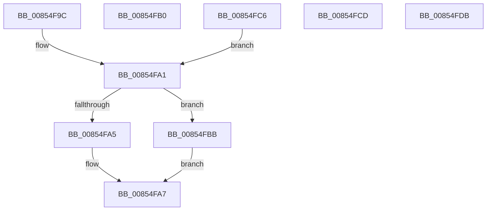

# sub_00854F9C

- RVA: `0x00854F9C`–`0x00854FDC` (길이 `64` bytes)
- VA: `0x0000000140854F9C`
- 실행 섹션: `PAGE`
- PDB 이름 있음: `아니요`; PDB Function 태그: `아니요`
- unwind 정보 RVA: `0x0006A008`
- 디코드: `25`개 명령, `64/64` bytes 표시
- 미해석 바이트: `0` (있으면 어셈블리에 `.byte`로 보존)

> 이 문서는 커널 이미지의 기계어와 PDB 기호를 분석해 생성했습니다. 4번과 5번은 함수 원형과 자료형을 바이너리 사용 방식에서 추정한 C 해석이며 원본 소스 복구 결과는 아닙니다.

## 1. Dependencies

- 직접 호출 지점: **3**; 고유 호출 대상: **3**
- 직접 호출자로 확인된 함수: **0**
- RIP 상대 이미지 참조: **0**

### Outgoing calls
- `0x00854F9C` → [HvpReleaseCellPaged](HvpReleaseCellPaged_function_00855F40.md) (function, `0x00855F40`)
- `0x00854FB1` → [HvpGetCellPaged](HvpGetCellPaged_function_00854CB0.md) (function, `0x00854CB0`)
- `0x00854FC6` → [HvpReleaseCellFlat](HvpReleaseCellFlat_function_0085CC20.md) (function, `0x0085CC20`)

### Direct callers
- 이 함수 시작 RVA로 연결되는 직접 call은 확인되지 않았습니다. 간접 호출은 완전히 역산할 수 없습니다.

### Static image references
- 디코드된 RIP-relative 메모리 참조가 없습니다.

## 2. Other-region calls and transfers

- 다른 실행 섹션으로 향하는 call: **0**
- call이 아닌 외부 분기/꼬리 이동: **1**
  - `0x00854FB6` → [CmpDoCompareKeyName + 0x3A](CmpDoCompareKeyName_function_00854E80.md) (`tail-transfer`)

## 3. Assembly (complete function range)

```asm
00854F9C  E8 9F 0F 00 00                  call 0x140855f40
00854FA1  85 DB                           test ebx, ebx
00854FA3  75 16                           jne 0x140854fbb
00854FA5  33 C0                           xor eax, eax
00854FA7  48 83 C4 50                     add rsp, 0x50
00854FAB  41 5E                           pop r14
00854FAD  5F                              pop rdi
00854FAE  5B                              pop rbx
00854FAF  C3                              ret
00854FB0  CC                              int3
00854FB1  E8 FA FC FF FF                  call 0x140854cb0
00854FB6  E9 FF FE FF FF                  jmp 0x140854eba
00854FBB  C1 FB 1F                        sar ebx, 0x1f
00854FBE  83 E3 FE                        and ebx, 0xfffffffe
00854FC1  8D 43 01                        lea eax, [rbx + 1]
00854FC4  EB E1                           jmp 0x140854fa7
00854FC6  E8 55 7C 00 00                  call 0x14085cc20
00854FCB  EB D4                           jmp 0x140854fa1
00854FCD  B8 02 00 00 00                  mov eax, 2
00854FD2  48 83 C4 50                     add rsp, 0x50
00854FD6  41 5E                           pop r14
00854FD8  5F                              pop rdi
00854FD9  5B                              pop rbx
00854FDA  C3                              ret
00854FDB  CC                              int3
```

## 4. C-style interpretation (structured pseudocode)

```c
__int64 __fastcall sub_00854F9C(void)
{
    __int64 result;
    __int64 v_rbx;
    __int64 v_rsp;

    result = HvpReleaseCellPaged(a1, a2, a3, a4);
loc_00854FA1:
    if ((unsigned int)(v_rbx) != 0) goto loc_00854FBB;
    result = 0;
loc_00854FA7:
    v_rsp = (v_rsp) + (80);
    return result;
loc_00854FBB:
    v_rbx = (unsigned int)((v_rbx) >> (31));
    v_rbx = (unsigned int)((v_rbx) & (0xFFFFFFFEULL));
    goto loc_00854FA7;
}
```

## 5. (Beta) C Style

```c
void sub_00854F9C(void)
{
    int64_t result;
    int64_t local_rbx;
    int64_t local_rsp;

    result = HvpReleaseCellPaged(a1, a2, a3, a4);
loc_00854FA1:
    if ((uint32_t)(local_rbx) != 0) goto loc_00854FBB;
    result = 0;
loc_00854FA7:
    local_rsp = (local_rsp) + (80);
    return result;
loc_00854FBB:
    local_rbx = (uint32_t)((local_rbx) >> (31));
    local_rbx = (uint32_t)((local_rbx) & (0xFFFFFFFEULL));
    goto loc_00854FA7;
}
```

## 6. Execution-region graph

[열기: 2D/3D 그래프와 함수 탐색 컨트롤 패널](../../../control-panel.html?section=page&rva=0x00854F9C&view=graph)

- 2D 그래프는 위에서 아래로 흐르고, 3D 그래프는 빈 공간을 드래그해 회전합니다. Shift+드래그는 이동, 휠은 확대·축소, 함수 노드 선택은 대상 보고서 이동입니다.

### Static fallback


