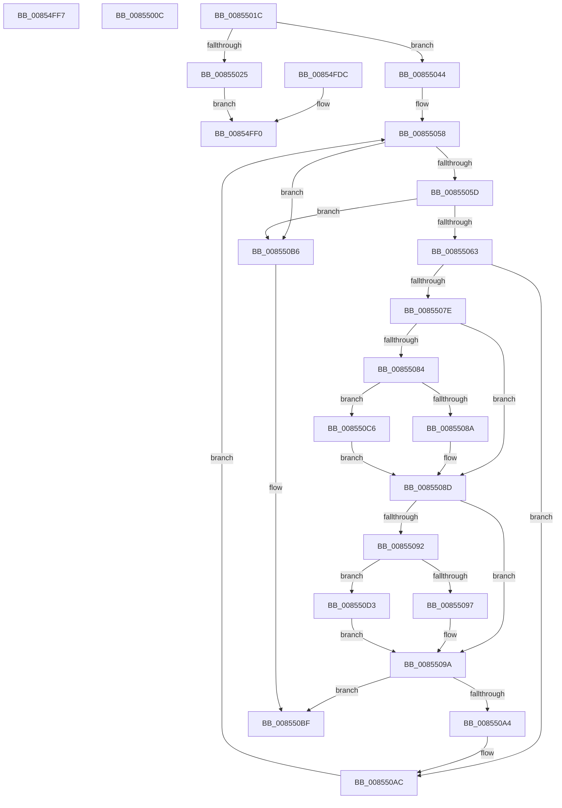

# sub_00854FDC

- RVA: `0x00854FDC`–`0x008550E0` (길이 `260` bytes)
- VA: `0x0000000140854FDC`
- 실행 섹션: `PAGE`
- PDB 이름 있음: `아니요`; PDB Function 태그: `아니요`
- unwind 정보 RVA: `0x0006A020`
- 디코드: `75`개 명령, `260/260` bytes 표시
- 미해석 바이트: `0` (있으면 어셈블리에 `.byte`로 보존)

> 이 문서는 커널 이미지의 기계어와 PDB 기호를 분석해 생성했습니다. 4번과 5번은 함수 원형과 자료형을 바이너리 사용 방식에서 추정한 C 해석이며 원본 소스 복구 결과는 아닙니다.

## 1. Dependencies

- 직접 호출 지점: **6**; 고유 호출 대상: **3**
- 직접 호출자로 확인된 함수: **0**
- RIP 상대 이미지 참조: **0**

### Outgoing calls
- `0x00854FEB` → [CmpCompareTwoCompressedNames](../84/CmpCompareTwoCompressedNames_function_00847610.md) (function, `0x00847610`)
- `0x00854FFA` → [RtlUpcaseUnicodeChar](RtlUpcaseUnicodeChar_function_0085F0F0.md) (function, `0x0085F0F0`)
- `0x0085500F` → [RtlUpcaseUnicodeChar](RtlUpcaseUnicodeChar_function_0085F0F0.md) (function, `0x0085F0F0`)
- `0x0085503D` → [RtlCompareUnicodeStrings](../97/RtlCompareUnicodeStrings_function_009727E0.md) (function, `0x009727E0`)
- `0x008550C9` → [RtlUpcaseUnicodeChar](RtlUpcaseUnicodeChar_function_0085F0F0.md) (function, `0x0085F0F0`)
- `0x008550D6` → [RtlUpcaseUnicodeChar](RtlUpcaseUnicodeChar_function_0085F0F0.md) (function, `0x0085F0F0`)

### Direct callers
- 이 함수 시작 RVA로 연결되는 직접 call은 확인되지 않았습니다. 간접 호출은 완전히 역산할 수 없습니다.

### Static image references
- 디코드된 RIP-relative 메모리 참조가 없습니다.

## 2. Other-region calls and transfers

- 다른 실행 섹션으로 향하는 call: **0**
- call이 아닌 외부 분기/꼬리 이동: **4**
  - `0x00854FF2` → [sub_00854ECA + 0xA7](Unknown_function_00854ECA.md) (`tail-transfer`)
  - `0x00855007` → [sub_00854ECA + 0x75](Unknown_function_00854ECA.md) (`tail-transfer`)
  - `0x00855017` → [sub_00854ECA + 0x86](Unknown_function_00854ECA.md) (`tail-transfer`)
  - `0x008550C1` → [sub_00854ECA + 0xA7](Unknown_function_00854ECA.md) (`tail-transfer`)

## 3. Assembly (complete function range)

```asm
00854FDC  44 0F B7 49 48                  movzx r9d, word ptr [rcx + 0x48]
00854FE1  4D 8B C7                        mov r8, r15
00854FE4  48 8B 4B 08                     mov rcx, qword ptr [rbx + 8]
00854FE8  0F B7 13                        movzx edx, word ptr [rbx]
00854FEB  E8 20 26 FF FF                  call 0x140847610
00854FF0  8B D8                           mov ebx, eax
00854FF2  E9 7A FF FF FF                  jmp 0x140854f71
00854FF7  0F B7 CB                        movzx ecx, bx
00854FFA  E8 F1 A0 00 00                  call 0x14085f0f0
00854FFF  0F B7 D8                        movzx ebx, ax
00855002  B8 E0 FF 00 00                  mov eax, 0xffe0
00855007  E9 33 FF FF FF                  jmp 0x140854f3f
0085500C  0F B7 CE                        movzx ecx, si
0085500F  E8 DC A0 00 00                  call 0x14085f0f0
00855014  0F B7 F0                        movzx esi, ax
00855017  E9 34 FF FF FF                  jmp 0x140854f50
0085501C  0F B7 71 48                     movzx esi, word ptr [rcx + 0x48]
00855020  48 85 DB                        test rbx, rbx
00855023  75 1F                           jne 0x140855044
00855025  0F B7 17                        movzx edx, word ptr [rdi]
00855028  44 8B CE                        mov r9d, esi
0085502B  48 8B 4F 08                     mov rcx, qword ptr [rdi + 8]
0085502F  4D 8B C7                        mov r8, r15
00855032  49 D1 E9                        shr r9, 1
00855035  48 D1 EA                        shr rdx, 1
00855038  C6 44 24 20 01                  mov byte ptr [rsp + 0x20], 1
0085503D  E8 9E D7 11 00                  call 0x1409727e0
00855042  EB AC                           jmp 0x140854ff0
00855044  48 8B 43 08                     mov rax, qword ptr [rbx + 8]
00855048  BF E0 FF 00 00                  mov edi, 0xffe0
0085504D  44 0F B7 23                     movzx r12d, word ptr [rbx]
00855051  66 D1 EE                        shr si, 1
00855054  44 8D 6F 1F                     lea r13d, [rdi + 0x1f]
00855058  66 85 F6                        test si, si
0085505B  74 59                           je 0x1408550b6
0085505D  66 45 85 E4                     test r12w, r12w
00855061  74 53                           je 0x1408550b6
00855063  41 0F B7 1F                     movzx ebx, word ptr [r15]
00855067  49 83 C7 02                     add r15, 2
0085506B  0F B6 28                        movzx ebp, byte ptr [rax]
0085506E  48 FF C0                        inc rax
00855071  48 89 84 24 80 00 00 00         mov qword ptr [rsp + 0x80], rax
00855079  66 3B DD                        cmp bx, bp
0085507C  74 2E                           je 0x1408550ac
0085507E  66 83 FB 61                     cmp bx, 0x61
00855082  72 09                           jb 0x14085508d
00855084  66 83 FB 7A                     cmp bx, 0x7a
00855088  77 3C                           ja 0x1408550c6
0085508A  66 03 DF                        add bx, di
0085508D  83 FD 61                        cmp ebp, 0x61
00855090  72 08                           jb 0x14085509a
00855092  83 FD 7A                        cmp ebp, 0x7a
00855095  77 3C                           ja 0x1408550d3
00855097  66 03 EF                        add bp, di
0085509A  0F B7 C5                        movzx eax, bp
0085509D  0F B7 DB                        movzx ebx, bx
008550A0  2B D8                           sub ebx, eax
008550A2  75 1B                           jne 0x1408550bf
008550A4  48 8B 84 24 80 00 00 00         mov rax, qword ptr [rsp + 0x80]
008550AC  66 41 03 F5                     add si, r13w
008550B0  66 45 03 E5                     add r12w, r13w
008550B4  EB A2                           jmp 0x140855058
008550B6  41 0F B7 C4                     movzx eax, r12w
008550BA  0F B7 DE                        movzx ebx, si
008550BD  2B D8                           sub ebx, eax
008550BF  F7 DB                           neg ebx
008550C1  E9 AB FE FF FF                  jmp 0x140854f71
008550C6  0F B7 CB                        movzx ecx, bx
008550C9  E8 22 A0 00 00                  call 0x14085f0f0
008550CE  0F B7 D8                        movzx ebx, ax
008550D1  EB BA                           jmp 0x14085508d
008550D3  0F B7 CD                        movzx ecx, bp
008550D6  E8 15 A0 00 00                  call 0x14085f0f0
008550DB  0F B7 E8                        movzx ebp, ax
008550DE  EB BA                           jmp 0x14085509a
```

## 4. C-style interpretation (structured pseudocode)

```c
__int64 __fastcall sub_00854FDC(__int64 a1)
{
    __int64 result;
    unsigned __int8 v_stack_p20;
    unsigned __int64 v_stack_p80;

    result = CmpCompareTwoCompressedNames(*(unsigned __int64 *)(v_rbx + 8), *(unsigned __int16 *)(v_rbx), v_r15, *(unsigned __int16 *)(a1 + 72));
loc_00854FF0:
}
```

## 5. (Beta) C Style

```c
int64_t sub_00854FDC(void *Arg1)
{
    uint8_t *arg1 = (uint8_t *)Arg1;

    int64_t result;
    uint8_t v_stack_p20;
    uint64_t v_stack_p80;

    result = CmpCompareTwoCompressedNames(*(uint64_t *)(local_rbx + 0x8), *(uint16_t *)(local_rbx), local_r15, *(uint16_t *)(arg1 + 0x48));
loc_00854FF0:
}
```

### 관측된 메모리 오프셋

구조체 형식이 확인되지 않은 접근은 인자 기준의 오프셋으로만 기록했습니다.

| 기준 인자 | 오프셋 표현 | 폭 (bit) | 접근 |
|---|---:|---:|---|
| `Arg1` | `+ 0x48` | `16` | `R` |

## 6. Execution-region graph

[열기: 2D/3D 그래프와 함수 탐색 컨트롤 패널](../../../control-panel.html?section=page&rva=0x00854FDC&view=graph)

- 2D 그래프는 위에서 아래로 흐르고, 3D 그래프는 빈 공간을 드래그해 회전합니다. Shift+드래그는 이동, 휠은 확대·축소, 함수 노드 선택은 대상 보고서 이동입니다.

### Static fallback


