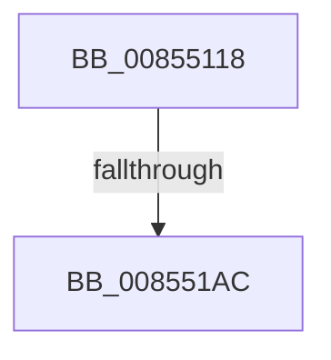

# sub_00855118

- RVA: `0x00855118`–`0x008551B7` (길이 `159` bytes)
- VA: `0x0000000140855118`
- 실행 섹션: `PAGE`
- PDB 이름 있음: `아니요`; PDB Function 태그: `아니요`
- unwind 정보 RVA: `0x0006A058`
- 디코드: `39`개 명령, `159/159` bytes 표시
- 미해석 바이트: `0` (있으면 어셈블리에 `.byte`로 보존)

> 이 문서는 커널 이미지의 기계어와 PDB 기호를 분석해 생성했습니다. 4번과 5번은 함수 원형과 자료형을 바이너리 사용 방식에서 추정한 C 해석이며 원본 소스 복구 결과는 아닙니다.

## 1. Dependencies

- 직접 호출 지점: **4**; 고유 호출 대상: **3**
- 직접 호출자로 확인된 함수: **0**
- RIP 상대 이미지 참조: **0**

### Outgoing calls
- `0x0085517B` → [HvpGetCellContextInitialize](HvpGetCellContextInitialize_function_00855F10.md) (function, `0x00855F10`)
- `0x00855184` → [HvpGetCellContextInitialize](HvpGetCellContextInitialize_function_00855F10.md) (function, `0x00855F10`)
- `0x0085518D` → [CmpAttachToRegistryProcess](../../pagecmrc/BC/CmpAttachToRegistryProcess_function_00BC98E0.md) (function, `0x00BC98E0`)
- `0x00855192` → [CmpLockRegistry](../../pagecmrc/BC/CmpLockRegistry_function_00BC9B34.md) (function, `0x00BC9B34`)

### Direct callers
- 이 함수 시작 RVA로 연결되는 직접 call은 확인되지 않았습니다. 간접 호출은 완전히 역산할 수 없습니다.

### Static image references
- 디코드된 RIP-relative 메모리 참조가 없습니다.

## 2. Other-region calls and transfers

- 다른 실행 섹션으로 향하는 call: **2**
  - `0x0085518D` → [CmpAttachToRegistryProcess](../../pagecmrc/BC/CmpAttachToRegistryProcess_function_00BC98E0.md) (`PAGE` → `PAGECMRC`)
  - `0x00855192` → [CmpLockRegistry](../../pagecmrc/BC/CmpLockRegistry_function_00BC9B34.md) (`PAGE` → `PAGECMRC`)
- call이 아닌 외부 분기/꼬리 이동: **2**
  - `0x008551AA` → [sub_008551B7](Unknown_function_008551B7.md) (`tail-transfer`)
  - `0x008551B1` → [sub_00855882](Unknown_function_00855882.md) (`tail-transfer`)

## 3. Assembly (complete function range)

```asm
00855118  49 89 5B 18                     mov qword ptr [r11 + 0x18], rbx
0085511C  48 8B F9                        mov rdi, rcx
0085511F  49 89 73 E8                     mov qword ptr [r11 - 0x18], rsi
00855123  4D 89 63 E0                     mov qword ptr [r11 - 0x20], r12
00855127  4D 89 73 D0                     mov qword ptr [r11 - 0x30], r14
0085512B  41 BE FF FF FF FF               mov r14d, 0xffffffff
00855131  48 89 45 D0                     mov qword ptr [rbp - 0x30], rax
00855135  B8 FF FF FF FF                  mov eax, 0xffffffff
0085513A  48 89 4C 24 78                  mov qword ptr [rsp + 0x78], rcx
0085513F  48 8D 4C 24 68                  lea rcx, [rsp + 0x68]
00855144  4D 89 7B C8                     mov qword ptr [r11 - 0x38], r15
00855148  45 33 FF                        xor r15d, r15d
0085514B  0F 11 45 80                     movups xmmword ptr [rbp - 0x80], xmm0
0085514F  4C 89 7C 24 68                  mov qword ptr [rsp + 0x68], r15
00855154  45 8B E7                        mov r12d, r15d
00855157  4C 89 7D B0                     mov qword ptr [rbp - 0x50], r15
0085515B  4C 89 4D D8                     mov qword ptr [rbp - 0x28], r9
0085515F  44 89 45 A4                     mov dword ptr [rbp - 0x5c], r8d
00855163  48 89 55 C8                     mov qword ptr [rbp - 0x38], rdx
00855167  0F 11 45 E0                     movups xmmword ptr [rbp - 0x20], xmm0
0085516B  66 89 45 82                     mov word ptr [rbp - 0x7e], ax
0085516F  0F 11 45 F0                     movups xmmword ptr [rbp - 0x10], xmm0
00855173  0F 11 45 00                     movups xmmword ptr [rbp], xmm0
00855177  0F 11 45 90                     movups xmmword ptr [rbp - 0x70], xmm0
0085517B  E8 90 0D 00 00                  call 0x140855f10
00855180  48 8D 4D C0                     lea rcx, [rbp - 0x40]
00855184  E8 87 0D 00 00                  call 0x140855f10
00855189  48 8D 4D E0                     lea rcx, [rbp - 0x20]
0085518D  E8 4E 47 37 00                  call 0x140bc98e0
00855192  E8 9D 49 37 00                  call 0x140bc9b34
00855197  48 8B 77 08                     mov rsi, qword ptr [rdi + 8]
0085519B  45 8B C7                        mov r8d, r15d
0085519E  4C 89 7C 24 48                  mov qword ptr [rsp + 0x48], r15
008551A3  0F BF 5E 42                     movsx ebx, word ptr [rsi + 0x42]
008551A7  83 FB 02                        cmp ebx, 2
008551AA  7C 0B                           jl 0x1408551b7
008551AC  8B C3                           mov eax, ebx
008551AE  83 E8 01                        sub eax, 1
008551B1  0F 85 CB 06 00 00               jne 0x140855882
```

## 4. C-style interpretation (structured pseudocode)

```c
__int64 __fastcall sub_00855118(__int64 a1, __int64 a2, int a3, __int64 a4, __int64 a5, __int64 a6, __int64 a7, __int64 a8, __int64 a9, __int64 a10, __int64 a11, __int64 a12, __int64 a13)
{
    __int64 result;
    __int64 v_r15;
    unsigned __int64 v_stack_p48;
    unsigned __int64 v_stack_p68;
    unsigned __int64 v_stack_p78;

    *(unsigned __int64 *)(v_r11 + 24) = v_rbx;
    *(unsigned __int64 *)(v_r11 - 24) = v_rsi;
    *(unsigned __int64 *)(v_r11 - 32) = v_r12;
    *(unsigned __int64 *)(v_r11 - 48) = v_r14;
    *(unsigned __int64 *)(v_rbp - 48) = result;
    v_stack_p78 = a1;
    *(unsigned __int64 *)(v_r11 - 56) = v_r15;
    v_r15 = 0;
    *(unsigned __int64 *)(v_rbp - 128) = v_xmm0;
    v_stack_p68 = 0;
    *(unsigned __int64 *)(v_rbp - 80) = 0;
    *(unsigned __int64 *)(v_rbp - 40) = a4;
    *(unsigned int *)(v_rbp - 92) = a3;
    *(unsigned __int64 *)(v_rbp - 56) = a2;
    *(unsigned __int64 *)(v_rbp - 32) = v_xmm0;
    *(unsigned __int16 *)(v_rbp - 126) = (unsigned __int16)((unsigned int)(0xFFFFFFFFULL));
    *(unsigned __int64 *)(v_rbp - 16) = v_xmm0;
    *(unsigned __int64 *)(v_rbp) = v_xmm0;
    *(unsigned __int64 *)(v_rbp - 112) = v_xmm0;
    result = HvpGetCellContextInitialize(a13, a2, a3, a4);
    result = HvpGetCellContextInitialize(v_rbp - 64, a2, a3, a4);
    result = CmpAttachToRegistryProcess(v_rbp - 32, a2, a3, a4);
    result = CmpLockRegistry(v_rbp - 32, a2, a3, a4);
    v_stack_p48 = 0;
    result = (unsigned int)(((unsigned int)((unsigned int)((__int16)(*(unsigned __int16 *)(*(unsigned __int64 *)(a1 + 8) + 66))))) - (1));
}
```

## 5. (Beta) C Style

```c
int64_t sub_00855118(void *Arg1, int64_t Arg2, int32_t Arg3, int64_t Arg4, uint64_t Arg5, uint64_t Arg6, uint64_t Arg7, uint64_t Arg8, uint64_t Arg9, uint64_t Arg10, uint64_t Arg11, uint64_t Arg12, int64_t Arg13)
{
    uint8_t *arg1 = (uint8_t *)Arg1;

    int64_t result;
    int64_t local_r15;
    uint64_t v_stack_p48;
    uint64_t v_stack_p68;
    uint64_t v_stack_p78;

    *(uint64_t *)(local_r11 + 0x18) = local_rbx;
    *(uint64_t *)(local_r11 - 0x18) = local_rsi;
    *(uint64_t *)(local_r11 - 0x20) = local_r12;
    *(uint64_t *)(local_r11 - 0x30) = local_r14;
    *(uint64_t *)(local_rbp - 0x30) = result;
    v_stack_p78 = Arg1;
    *(uint64_t *)(local_r11 - 0x38) = local_r15;
    local_r15 = 0;
    *(uint64_t *)(local_rbp - 0x80) = v_xmm0;
    v_stack_p68 = 0;
    *(uint64_t *)(local_rbp - 0x50) = 0;
    *(uint64_t *)(local_rbp - 0x28) = Arg4;
    *(uint32_t *)(local_rbp - 0x5C) = Arg3;
    *(uint64_t *)(local_rbp - 0x38) = Arg2;
    *(uint64_t *)(local_rbp - 0x20) = v_xmm0;
    *(uint16_t *)(local_rbp - 0x7E) = (uint16_t)((uint32_t)(0xFFFFFFFFULL));
    *(uint64_t *)(local_rbp - 0x10) = v_xmm0;
    *(uint64_t *)(local_rbp) = v_xmm0;
    *(uint64_t *)(local_rbp - 0x70) = v_xmm0;
    result = HvpGetCellContextInitialize(Arg13, Arg2, Arg3, Arg4);
    result = HvpGetCellContextInitialize(local_rbp - 64, Arg2, Arg3, Arg4);
    result = CmpAttachToRegistryProcess(local_rbp - 32, Arg2, Arg3, Arg4);
    result = CmpLockRegistry(local_rbp - 32, Arg2, Arg3, Arg4);
    v_stack_p48 = 0;
    result = (uint32_t)(((uint32_t)((uint32_t)((int16_t)(*(uint16_t *)(*(uint64_t *)(arg1 + 0x8) + 0x42))))) - (1));
}
```

### 관측된 메모리 오프셋

구조체 형식이 확인되지 않은 접근은 인자 기준의 오프셋으로만 기록했습니다.

| 기준 인자 | 오프셋 표현 | 폭 (bit) | 접근 |
|---|---:|---:|---|
| `Arg1` | `+ 0x8` | `64` | `R` |

## 6. Execution-region graph

[열기: 2D/3D 그래프와 함수 탐색 컨트롤 패널](../../../control-panel.html?section=page&rva=0x00855118&view=graph)

- 2D 그래프는 위에서 아래로 흐르고, 3D 그래프는 빈 공간을 드래그해 회전합니다. Shift+드래그는 이동, 휠은 확대·축소, 함수 노드 선택은 대상 보고서 이동입니다.

### Static fallback


