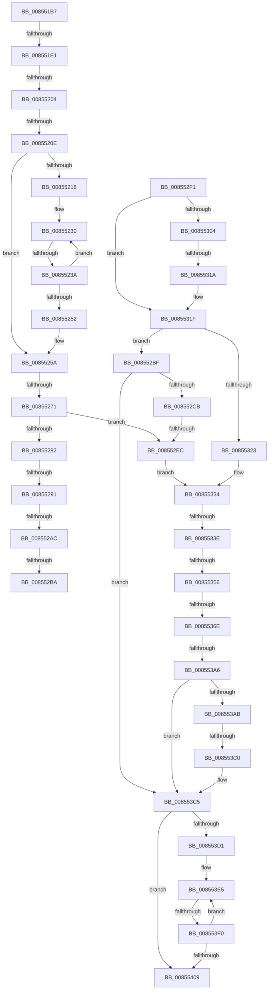

# sub_008551B7

- RVA: `0x008551B7`–`0x00855411` (길이 `602` bytes)
- VA: `0x00000001408551B7`
- 실행 섹션: `PAGE`
- PDB 이름 있음: `아니요`; PDB Function 태그: `아니요`
- unwind 정보 RVA: `0x0006A07C`
- 디코드: `138`개 명령, `602/602` bytes 표시
- 미해석 바이트: `0` (있으면 어셈블리에 `.byte`로 보존)

> 이 문서는 커널 이미지의 기계어와 PDB 기호를 분석해 생성했습니다. 4번과 5번은 함수 원형과 자료형을 바이너리 사용 방식에서 추정한 C 해석이며 원본 소스 복구 결과는 아닙니다.

## 1. Dependencies

- 직접 호출 지점: **7**; 고유 호출 대상: **6**
- 직접 호출자로 확인된 함수: **0**
- RIP 상대 이미지 참조: **0**

### Outgoing calls
- `0x00855240` → [CmpLockKcbShared](../../pagecmrc/BC/CmpLockKcbShared_function_00BC9A1C.md) (function, `0x00BC9A1C`)
- `0x00855264` → [CmpIsKeyDeletedForKeyBody](../../pagecmrc/BC/CmpIsKeyDeletedForKeyBody_function_00BC9480.md) (function, `0x00BC9480`)
- `0x0085531A` → [HvpReleaseCellPaged](HvpReleaseCellPaged_function_00855F40.md) (function, `0x00855F40`)
- `0x00855356` → [HvpGetCellFlat](HvpGetCellFlat_function_00854C60.md) (function, `0x00854C60`)
- `0x00855397` → [CmpQueryKeyValueData](CmpQueryKeyValueData_function_00856650.md) (function, `0x00856650`)
- `0x008553C0` → [HvpReleaseCellPaged](HvpReleaseCellPaged_function_00855F40.md) (function, `0x00855F40`)
- `0x008553F6` → [CmpUnlockKcb](../../pagecmrc/BC/CmpUnlockKcb_function_00BC92C0.md) (function, `0x00BC92C0`)

### Direct callers
- 이 함수 시작 RVA로 연결되는 직접 call은 확인되지 않았습니다. 간접 호출은 완전히 역산할 수 없습니다.

### Static image references
- 디코드된 RIP-relative 메모리 참조가 없습니다.

## 2. Other-region calls and transfers

- 다른 실행 섹션으로 향하는 call: **3**
  - `0x00855240` → [CmpLockKcbShared](../../pagecmrc/BC/CmpLockKcbShared_function_00BC9A1C.md) (`PAGE` → `PAGECMRC`)
  - `0x00855264` → [CmpIsKeyDeletedForKeyBody](../../pagecmrc/BC/CmpIsKeyDeletedForKeyBody_function_00BC9480.md) (`PAGE` → `PAGECMRC`)
  - `0x008553F6` → [CmpUnlockKcb](../../pagecmrc/BC/CmpUnlockKcb_function_00BC92C0.md) (`PAGE` → `PAGECMRC`)
- call이 아닌 외부 분기/꼬리 이동: **17**
  - `0x008551DB` → [sub_00855472 + 0x3B6](Unknown_function_00855472.md) (`tail-transfer`)
  - `0x008551FE` → [sub_00855472 + 0xA](Unknown_function_00855472.md) (`tail-transfer`)
  - `0x00855208` → [sub_00855472 + 0xA](Unknown_function_00855472.md) (`tail-transfer`)
  - `0x00855234` → [sub_00855472 + 0x364](Unknown_function_00855472.md) (`tail-transfer`)
  - `0x0085526B` → [sub_008558BC + 0x68](Unknown_function_008558BC.md) (`tail-transfer`)
  - `0x0085528B` → [sub_00855472 + 0x39F](Unknown_function_00855472.md) (`tail-transfer`)
  - `0x008552A6` → [sub_00855472 + 0x34D](Unknown_function_00855472.md) (`tail-transfer`)
  - `0x008552B4` → [sub_00855472 + 0x61](Unknown_function_00855472.md) (`tail-transfer`)
  - `0x008552BA` → [sub_00855472 + 0x59](Unknown_function_00855472.md) (`tail-transfer`)
  - `0x008552E6` → [sub_00855472 + 0x36D](Unknown_function_00855472.md) (`tail-transfer`)
  - `0x00855314` → [sub_00855472 + 0x395](Unknown_function_00855472.md) (`tail-transfer`)
  - `0x00855338` → [sub_008558BC + 0x89](Unknown_function_008558BC.md) (`tail-transfer`)
  - `0x00855350` → [sub_00855472](Unknown_function_00855472.md) (`tail-transfer`)
  - `0x00855368` → [sub_00855472 + 0x3FC](Unknown_function_00855472.md) (`tail-transfer`)
  - `0x008553A0` → [sub_00855472 + 0x3AE](Unknown_function_00855472.md) (`tail-transfer`)
  - `0x008553BA` → [sub_00855472 + 0x38B](Unknown_function_00855472.md) (`tail-transfer`)
  - `0x008553EA` → [sub_00855472 + 0x35B](Unknown_function_00855472.md) (`tail-transfer`)

## 3. Assembly (complete function range)

```asm
008551B7  4C 89 AC 24 30 01 00 00         mov qword ptr [rsp + 0x130], r13
008551BF  4C 0F BF 6E 42                  movsx r13, word ptr [rsi + 0x42]
008551C4  66 89 5D 80                     mov word ptr [rbp - 0x80], bx
008551C8  4C 89 45 98                     mov qword ptr [rbp - 0x68], r8
008551CC  66 44 89 6C 24 40               mov word ptr [rsp + 0x40], r13w
008551D2  66 44 89 6D 82                  mov word ptr [rbp - 0x7e], r13w
008551D7  66 45 85 ED                     test r13w, r13w
008551DB  0F 85 47 06 00 00               jne 0x140855828
008551E1  4A 89 74 ED 88                  mov qword ptr [rbp + r13*8 - 0x78], rsi
008551E6  4C 8B 45 98                     mov r8, qword ptr [rbp - 0x68]
008551EA  44 0F B7 6D 82                  movzx r13d, word ptr [rbp - 0x7e]
008551EF  66 44 89 6C 24 40               mov word ptr [rsp + 0x40], r13w
008551F5  4C 89 44 24 48                  mov qword ptr [rsp + 0x48], r8
008551FA  4C 39 67 38                     cmp qword ptr [rdi + 0x38], r12
008551FE  0F 85 78 02 00 00               jne 0x14085547c
00855204  4C 39 67 40                     cmp qword ptr [rdi + 0x40], r12
00855208  0F 85 6E 02 00 00               jne 0x14085547c
0085520E  41 0F B7 DF                     movzx ebx, r15w
00855212  66 45 3B FD                     cmp r15w, r13w
00855216  7F 42                           jg 0x14085525a
00855218  48 8D 4D 88                     lea rcx, [rbp - 0x78]
0085521C  4D 8B E0                        mov r12, r8
0085521F  4C 2B E1                        sub r12, rcx
00855222  48 8D 7D 88                     lea rdi, [rbp - 0x78]
00855226  49 83 C4 F0                     add r12, -0x10
0085522A  66 0F 1F 44 00 00               nop word ptr [rax + rax]
00855230  66 83 FB 02                     cmp bx, 2
00855234  0F 8D 9C 05 00 00               jge 0x1408557d6
0085523A  48 8B CF                        mov rcx, rdi
0085523D  48 8B 09                        mov rcx, qword ptr [rcx]
00855240  E8 D7 47 37 00                  call 0x140bc9a1c
00855245  66 FF C3                        inc bx
00855248  48 83 C7 08                     add rdi, 8
0085524C  66 41 3B DD                     cmp bx, r13w
00855250  7E DE                           jle 0x140855230
00855252  48 8B 7C 24 78                  mov rdi, qword ptr [rsp + 0x78]
00855257  4D 8B E7                        mov r12, r15
0085525A  48 8B 5D B0                     mov rbx, qword ptr [rbp - 0x50]
0085525E  48 8B CF                        mov rcx, rdi
00855261  48 8B D3                        mov rdx, rbx
00855264  E8 17 42 37 00                  call 0x140bc9480
00855269  84 C0                           test al, al
0085526B  0F 85 B3 06 00 00               jne 0x140855924
00855271  44 0F B7 46 42                  movzx r8d, word ptr [rsi + 0x42]
00855276  66 44 89 44 24 42               mov word ptr [rsp + 0x42], r8w
0085527C  66 45 85 C0                     test r8w, r8w
00855280  78 6A                           js 0x1408552ec
00855282  49 0F BF C0                     movsx rax, r8w
00855286  66 41 83 F8 02                  cmp r8w, 2
0085528B  0F 8D 80 05 00 00               jge 0x140855811
00855291  4C 8B 64 C5 88                  mov r12, qword ptr [rbp + rax*8 - 0x78]
00855296  41 0F BF 54 24 42               movsx edx, word ptr [r12 + 0x42]
0085529C  0F B7 4F 04                     movzx ecx, word ptr [rdi + 4]
008552A0  4C 89 65 B8                     mov qword ptr [rbp - 0x48], r12
008552A4  3B D1                           cmp edx, ecx
008552A6  0F 85 13 05 00 00               jne 0x1408557bf
008552AC  41 0F B6 44 24 41               movzx eax, byte ptr [r12 + 0x41]
008552B2  84 C0                           test al, al
008552B4  0F 84 19 02 00 00               je 0x1408554d3
008552BA  E9 0C 02 00 00                  jmp 0x1408554cb
008552BF  81 FF 34 00 00 C0               cmp edi, 0xc0000034
008552C5  0F 85 FA 00 00 00               jne 0x1408553c5
008552CB  4C 8B 65 B8                     mov r12, qword ptr [rbp - 0x48]
008552CF  44 0F B7 44 24 42               movzx r8d, word ptr [rsp + 0x42]
008552D5  48 8B 7C 24 78                  mov rdi, qword ptr [rsp + 0x78]
008552DA  41 0F BF 54 24 42               movsx edx, word ptr [r12 + 0x42]
008552E0  0F B7 4F 04                     movzx ecx, word ptr [rdi + 4]
008552E4  3B D1                           cmp edx, ecx
008552E6  0F 85 F3 04 00 00               jne 0x1408557df
008552EC  49 8B F7                        mov rsi, r15
008552EF  EB 43                           jmp 0x140855334
008552F1  8B 5C 24 44                     mov ebx, dword ptr [rsp + 0x44]
008552F5  41 8B FF                        mov edi, r15d
008552F8  41 8B C6                        mov eax, r14d
008552FB  44 8B 34 82                     mov r14d, dword ptr [rdx + rax*4]
008552FF  48 85 D2                        test rdx, rdx
00855302  74 1B                           je 0x14085531f
00855304  41 F6 85 8C 00 00 00 01         test byte ptr [r13 + 0x8c], 1
0085530C  48 8D 54 24 60                  lea rdx, [rsp + 0x60]
00855311  49 8B CD                        mov rcx, r13
00855314  0F 85 ED 04 00 00               jne 0x140855807
0085531A  E8 21 0C 00 00                  call 0x140855f40
0085531F  85 FF                           test edi, edi
00855321  78 9C                           js 0x1408552bf
00855323  48 8B 44 24 78                  mov rax, qword ptr [rsp + 0x78]
00855328  4C 8B 65 B8                     mov r12, qword ptr [rbp - 0x48]
0085532C  89 58 64                        mov dword ptr [rax + 0x64], ebx
0085532F  49 8B 74 24 20                  mov rsi, qword ptr [r12 + 0x20]
00855334  41 83 FE FF                     cmp r14d, -1
00855338  0F 84 07 06 00 00               je 0x140855945
0085533E  F6 86 8C 00 00 00 01            test byte ptr [rsi + 0x8c], 1
00855345  4C 8D 44 24 68                  lea r8, [rsp + 0x68]
0085534A  41 8B D6                        mov edx, r14d
0085534D  48 8B CE                        mov rcx, rsi
00855350  0F 84 1C 01 00 00               je 0x140855472
00855356  E8 05 F9 FF FF                  call 0x140854c60
0085535B  F7 86 A0 00 00 00 00 00 08 00   test dword ptr [rsi + 0xa0], 0x80000
00855365  48 8B D8                        mov rbx, rax
00855368  0F 85 00 05 00 00               jne 0x14085586e
0085536E  48 8B 45 D0                     mov rax, qword ptr [rbp - 0x30]
00855372  4C 8B C3                        mov r8, rbx
00855375  44 8B 4D A4                     mov r9d, dword ptr [rbp - 0x5c]
00855379  41 8B D6                        mov edx, r14d
0085537C  48 89 44 24 30                  mov qword ptr [rsp + 0x30], rax
00855381  49 8B CC                        mov rcx, r12
00855384  8B 85 80 00 00 00               mov eax, dword ptr [rbp + 0x80]
0085538A  89 44 24 28                     mov dword ptr [rsp + 0x28], eax
0085538E  48 8B 45 D8                     mov rax, qword ptr [rbp - 0x28]
00855392  48 89 44 24 20                  mov qword ptr [rsp + 0x20], rax
00855397  E8 B4 12 00 00                  call 0x140856650
0085539C  8B F8                           mov edi, eax
0085539E  85 C0                           test eax, eax
008553A0  0F 89 7A 04 00 00               jns 0x140855820
008553A6  48 85 DB                        test rbx, rbx
008553A9  74 1A                           je 0x1408553c5
008553AB  F6 86 8C 00 00 00 01            test byte ptr [rsi + 0x8c], 1
008553B2  48 8D 54 24 68                  lea rdx, [rsp + 0x68]
008553B7  48 8B CE                        mov rcx, rsi
008553BA  0F 85 3D 04 00 00               jne 0x1408557fd
008553C0  E8 7B 0B 00 00                  call 0x140855f40
008553C5  44 0F B7 6C 24 40               movzx r13d, word ptr [rsp + 0x40]
008553CB  66 45 3B FD                     cmp r15w, r13w
008553CF  7F 38                           jg 0x140855409
008553D1  48 8B 74 24 48                  mov rsi, qword ptr [rsp + 0x48]
008553D6  48 8D 4D 88                     lea rcx, [rbp - 0x78]
008553DA  48 2B F1                        sub rsi, rcx
008553DD  48 8D 5D 88                     lea rbx, [rbp - 0x78]
008553E1  48 83 C6 F0                     add rsi, -0x10
008553E5  66 41 83 FF 02                  cmp r15w, 2
008553EA  0F 8D DD 03 00 00               jge 0x1408557cd
008553F0  48 8B CB                        mov rcx, rbx
008553F3  48 8B 09                        mov rcx, qword ptr [rcx]
008553F6  E8 C5 3E 37 00                  call 0x140bc92c0
008553FB  66 41 FF C7                     inc r15w
008553FF  48 83 C3 08                     add rbx, 8
00855403  66 45 3B FD                     cmp r15w, r13w
00855407  7E DC                           jle 0x1408553e5
00855409  4C 8B AC 24 30 01 00 00         mov r13, qword ptr [rsp + 0x130]
```

## 4. C-style interpretation (structured pseudocode)

```c
__int64 __fastcall sub_008551B7(__int64 a1, __int64 a2, __int64 a3, __int64 a4, __int64 a5, __int64 a6, __int64 a7, unsigned __int16 a8, __int64 a9, __int64 a10, __int64 a11, __int64 a12, __int64 a13, __int64 a14, __int64 a15, __int64 a16, __int64 a17, __int64 a18, __int64 a19, __int64 a20, __int64 a21, __int64 a22, __int64 a23, __int64 a24, __int64 a25, __int64 a26, __int64 a27, __int64 a28, __int64 a29, __int64 a30, __int64 a31, __int64 a32, __int64 a33, __int64 a34, __int64 a35, __int64 a36, __int64 a37, __int64 a38)
{
    __int64 result;
    __int64 v_r12;
    __int64 v_r15;
    __int64 v_rbx;
    __int64 v_rdi;
    __int64 v_rsi;
    unsigned __int64 v_stack_p130;
    unsigned __int64 v_stack_p20;
    unsigned int v_stack_p28;
    unsigned __int64 v_stack_p30;
    unsigned __int16 v_stack_p40;
    unsigned __int16 v_stack_p42;
    unsigned int v_stack_p44;
    unsigned __int64 v_stack_p48;
    unsigned __int64 v_stack_p60;
    unsigned __int64 v_stack_p78;

    v_stack_p130 = v_r13;
    *(unsigned __int16 *)(v_rbp - 128) = (unsigned __int16)(v_rbx);
    *(unsigned __int64 *)(v_rbp - 104) = a3;
    v_stack_p40 = (unsigned __int16)((__int16)(*(unsigned __int16 *)(v_rsi + 66)));
    *(unsigned __int16 *)(v_rbp - 126) = (unsigned __int16)((__int16)(*(unsigned __int16 *)(v_rsi + 66)));
    *(unsigned __int64 *)(v_rbp + (__int16)(*(unsigned __int16 *)(v_rsi + 66)) * 8 - 120) = v_rsi;
    v_stack_p40 = (unsigned __int16)(*(unsigned __int16 *)(v_rbp - 126));
    v_stack_p48 = *(unsigned __int64 *)(v_rbp - 104);
    if (((unsigned __int16)(v_r15)) > ((unsigned __int16)(*(unsigned __int16 *)(v_rbp - 126)))) goto loc_0085525A;
    v_r12 = (*(unsigned __int64 *)(v_rbp - 104)) - (v_rbp - 120);
    v_r12 = (v_r12) + (-16);
loc_00855230:
    result = CmpLockKcbShared(*(unsigned __int64 *)(v_rbp - 120), a2, *(unsigned __int64 *)(v_rbp - 104), a4);
    v_rbx = (unsigned __int16)(((unsigned __int16)(v_r15)) + 1);
    v_rdi = (v_rbp - 120) + (8);
    if (((unsigned __int16)(v_rbx)) <= ((unsigned __int16)(*(unsigned __int16 *)(v_rbp - 126)))) goto loc_00855230;
loc_0085525A:
    result = CmpIsKeyDeletedForKeyBody(a15, *(unsigned __int64 *)(v_rbp - 80), *(unsigned __int64 *)(v_rbp - 104), a4);
    v_stack_p42 = (unsigned __int16)(*(unsigned __int16 *)(v_rsi + 66));
    if (sign_flag) goto loc_008552EC;
    *(unsigned __int64 *)(v_rbp - 72) = *(unsigned __int64 *)(v_rbp + (__int16)((unsigned __int16)(*(unsigned __int16 *)(v_rsi + 66))) * 8 - 120);
loc_008552EC:
    goto loc_00855334;
loc_00855334:
    result = HvpGetCellFlat(v_r15, (unsigned int)((unsigned int)(v_r14)), a13, a4);
    v_stack_p30 = *(unsigned __int64 *)(v_rbp - 48);
    v_stack_p28 = (unsigned int)((unsigned int)(*(unsigned int *)(v_rbp + 128)));
    v_stack_p20 = *(unsigned __int64 *)(v_rbp - 40);
    result = CmpQueryKeyValueData(*(unsigned __int64 *)(v_rbp + (__int16)((unsigned __int16)(*(unsigned __int16 *)(v_rsi + 66))) * 8 - 120), (unsigned int)((unsigned int)(v_r14)), result, (unsigned int)(*(unsigned int *)(v_rbp - 92)));
    if (result == 0) goto loc_008553C5;
    result = HvpReleaseCellPaged(v_r15, a13, result, (unsigned int)(*(unsigned int *)(v_rbp - 92)));
loc_008553C5:
    if (((unsigned __int16)(v_r15)) > a8) goto loc_00855409;
    v_rsi = (a9) - (v_rbp - 120);
    v_rsi = (v_rsi) + (-16);
loc_008553E5:
    result = CmpUnlockKcb(*(unsigned __int64 *)(v_rbp - 120), a13, result, (unsigned int)(*(unsigned int *)(v_rbp - 92)));
    v_r15 = (unsigned __int16)((v_r15) + 1);
    v_rbx = (v_rbp - 120) + (8);
    if (((unsigned __int16)(v_r15)) <= a8) goto loc_008553E5;
loc_00855409:
    return result;
}
```

## 5. (Beta) C Style

```c
int64_t sub_008551B7(int64_t Arg1, int64_t Arg2, int64_t Arg3, int64_t Arg4, uint64_t Arg5, uint64_t Arg6, uint64_t Arg7, uint16_t Arg8, int64_t Arg9, uint64_t Arg10, uint64_t Arg11, uint64_t Arg12, int64_t Arg13, uint64_t Arg14, int64_t Arg15, uint64_t Arg16, uint64_t Arg17, uint64_t Arg18, uint64_t Arg19, uint64_t Arg20, uint64_t Arg21, uint64_t Arg22, uint64_t Arg23, uint64_t Arg24, uint64_t Arg25, uint64_t Arg26, uint64_t Arg27, uint64_t Arg28, uint64_t Arg29, uint64_t Arg30, uint64_t Arg31, uint64_t Arg32, uint64_t Arg33, uint64_t Arg34, uint64_t Arg35, uint64_t Arg36, uint64_t Arg37, int64_t Arg38)
{
    int64_t result;
    int64_t local_r12;
    int64_t local_r15;
    int64_t local_rbx;
    int64_t local_rdi;
    int64_t local_rsi;
    uint64_t v_stack_p130;
    uint64_t v_stack_p20;
    uint32_t v_stack_p28;
    uint64_t v_stack_p30;
    uint16_t v_stack_p40;
    uint16_t v_stack_p42;
    uint32_t v_stack_p44;
    uint64_t v_stack_p48;
    uint64_t v_stack_p60;
    uint64_t v_stack_p78;

    v_stack_p130 = local_r13;
    *(uint16_t *)(local_rbp - 0x80) = (uint16_t)(local_rbx);
    *(uint64_t *)(local_rbp - 0x68) = Arg3;
    v_stack_p40 = (uint16_t)((int16_t)(*(uint16_t *)(local_rsi + 0x42)));
    *(uint16_t *)(local_rbp - 0x7E) = (uint16_t)((int16_t)(*(uint16_t *)(local_rsi + 0x42)));
    *(uint64_t *)(local_rbp + (int16_t)(*(uint16_t *)(local_rsi + 0x42)) * 8 - 0x78) = local_rsi;
    v_stack_p40 = (uint16_t)(*(uint16_t *)(local_rbp - 0x7E));
    v_stack_p48 = *(uint64_t *)(local_rbp - 0x68);
    if (((uint16_t)(local_r15)) > ((uint16_t)(*(uint16_t *)(local_rbp - 0x7E)))) goto loc_0085525A;
    local_r12 = (*(uint64_t *)(local_rbp - 0x68)) - (local_rbp - 120);
    local_r12 = (local_r12) + (-16);
loc_00855230:
    result = CmpLockKcbShared(*(uint64_t *)(local_rbp - 0x78), Arg2, *(uint64_t *)(local_rbp - 0x68), Arg4);
    local_rbx = (uint16_t)(((uint16_t)(local_r15)) + 1);
    local_rdi = (local_rbp - 120) + (8);
    if (((uint16_t)(local_rbx)) <= ((uint16_t)(*(uint16_t *)(local_rbp - 0x7E)))) goto loc_00855230;
loc_0085525A:
    result = CmpIsKeyDeletedForKeyBody(Arg15, *(uint64_t *)(local_rbp - 0x50), *(uint64_t *)(local_rbp - 0x68), Arg4);
    v_stack_p42 = (uint16_t)(*(uint16_t *)(local_rsi + 0x42));
    if (sign_flag) goto loc_008552EC;
    *(uint64_t *)(local_rbp - 0x48) = *(uint64_t *)(local_rbp + (int16_t)((uint16_t)(*(uint16_t *)(local_rsi + 0x42))) * 8 - 0x78);
loc_008552EC:
    goto loc_00855334;
loc_00855334:
    result = HvpGetCellFlat(local_r15, (uint32_t)((uint32_t)(local_r14)), Arg13, Arg4);
    v_stack_p30 = *(uint64_t *)(local_rbp - 0x30);
    v_stack_p28 = (uint32_t)((uint32_t)(*(uint32_t *)(local_rbp + 0x80)));
    v_stack_p20 = *(uint64_t *)(local_rbp - 0x28);
    result = CmpQueryKeyValueData(*(uint64_t *)(local_rbp + (int16_t)((uint16_t)(*(uint16_t *)(local_rsi + 0x42))) * 8 - 0x78), (uint32_t)((uint32_t)(local_r14)), result, (uint32_t)(*(uint32_t *)(local_rbp - 0x5C)));
    if (result == 0) goto loc_008553C5;
    result = HvpReleaseCellPaged(local_r15, Arg13, result, (uint32_t)(*(uint32_t *)(local_rbp - 0x5C)));
loc_008553C5:
    if (((uint16_t)(local_r15)) > Arg8) goto loc_00855409;
    local_rsi = (Arg9) - (local_rbp - 120);
    local_rsi = (local_rsi) + (-16);
loc_008553E5:
    result = CmpUnlockKcb(*(uint64_t *)(local_rbp - 0x78), Arg13, result, (uint32_t)(*(uint32_t *)(local_rbp - 0x5C)));
    local_r15 = (uint16_t)((local_r15) + 1);
    local_rbx = (local_rbp - 120) + (8);
    if (((uint16_t)(local_r15)) <= Arg8) goto loc_008553E5;
loc_00855409:
    return result;
}
```

## 6. Execution-region graph

[열기: 2D/3D 그래프와 함수 탐색 컨트롤 패널](../../../control-panel.html?section=page&rva=0x008551B7&view=graph)

- 2D 그래프는 위에서 아래로 흐르고, 3D 그래프는 빈 공간을 드래그해 회전합니다. Shift+드래그는 이동, 휠은 확대·축소, 함수 노드 선택은 대상 보고서 이동입니다.

### Static fallback


