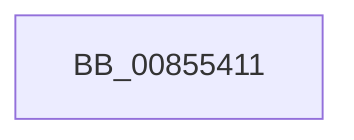

# sub_00855411

- RVA: `0x00855411`–`0x00855451` (길이 `64` bytes)
- VA: `0x0000000140855411`
- 실행 섹션: `PAGE`
- PDB 이름 있음: `아니요`; PDB Function 태그: `아니요`
- unwind 정보 RVA: `0x0006A090`
- 디코드: `11`개 명령, `64/64` bytes 표시
- 미해석 바이트: `0` (있으면 어셈블리에 `.byte`로 보존)

> 이 문서는 커널 이미지의 기계어와 PDB 기호를 분석해 생성했습니다. 4번과 5번은 함수 원형과 자료형을 바이너리 사용 방식에서 추정한 C 해석이며 원본 소스 복구 결과는 아닙니다.

## 1. Dependencies

- 직접 호출 지점: **2**; 고유 호출 대상: **2**
- 직접 호출자로 확인된 함수: **0**
- RIP 상대 이미지 참조: **0**

### Outgoing calls
- `0x00855411` → [CmpUnlockRegistry](../../pagecmrc/BC/CmpUnlockRegistry_function_00BC9A84.md) (function, `0x00BC9A84`)
- `0x0085541A` → [CmpDetachFromRegistryProcess](../../pagecmrc/BC/CmpDetachFromRegistryProcess_function_00BC9920.md) (function, `0x00BC9920`)

### Direct callers
- 이 함수 시작 RVA로 연결되는 직접 call은 확인되지 않았습니다. 간접 호출은 완전히 역산할 수 없습니다.

### Static image references
- 디코드된 RIP-relative 메모리 참조가 없습니다.

## 2. Other-region calls and transfers

- 다른 실행 섹션으로 향하는 call: **2**
  - `0x00855411` → [CmpUnlockRegistry](../../pagecmrc/BC/CmpUnlockRegistry_function_00BC9A84.md) (`PAGE` → `PAGECMRC`)
  - `0x0085541A` → [CmpDetachFromRegistryProcess](../../pagecmrc/BC/CmpDetachFromRegistryProcess_function_00BC9920.md) (`PAGE` → `PAGECMRC`)
- call이 아닌 외부 분기/꼬리 이동: **1**
  - `0x0085544F` → [sub_00855451 + 0x8](Unknown_function_00855451.md) (`tail-transfer`)

## 3. Assembly (complete function range)

```asm
00855411  E8 6E 46 37 00                  call 0x140bc9a84
00855416  48 8D 4D E0                     lea rcx, [rbp - 0x20]
0085541A  E8 01 45 37 00                  call 0x140bc9920
0085541F  48 8B 44 24 48                  mov rax, qword ptr [rsp + 0x48]
00855424  4C 8B BC 24 20 01 00 00         mov r15, qword ptr [rsp + 0x120]
0085542C  4C 8B B4 24 28 01 00 00         mov r14, qword ptr [rsp + 0x128]
00855434  4C 8B A4 24 38 01 00 00         mov r12, qword ptr [rsp + 0x138]
0085543C  48 8B B4 24 40 01 00 00         mov rsi, qword ptr [rsp + 0x140]
00855444  48 8B 9C 24 70 01 00 00         mov rbx, qword ptr [rsp + 0x170]
0085544C  48 85 C0                        test rax, rax
0085544F  74 08                           je 0x140855459
```

## 4. C-style interpretation (structured pseudocode)

```c
__int64 __fastcall sub_00855411(__int64 a1, __int64 a2, __int64 a3, __int64 a4, __int64 a5, __int64 a6, __int64 a7, __int64 a8, __int64 a9, __int64 a10, __int64 a11, __int64 a12, __int64 a13, __int64 a14, __int64 a15, __int64 a16, __int64 a17, __int64 a18, __int64 a19, __int64 a20, __int64 a21, __int64 a22, __int64 a23, __int64 a24, __int64 a25, __int64 a26, __int64 a27, __int64 a28, __int64 a29, __int64 a30, __int64 a31, __int64 a32, __int64 a33, __int64 a34, __int64 a35, __int64 a36, __int64 a37, __int64 a38, __int64 a39, __int64 a40, __int64 a41, __int64 a42, __int64 a43, __int64 a44, __int64 a45, __int64 a46)
{
    __int64 result;

    result = CmpUnlockRegistry(a1, a2, a3, a4);
    result = CmpDetachFromRegistryProcess(v_rbp - 32, a2, a3, a4);
}
```

## 5. (Beta) C Style

```c
int64_t sub_00855411(int64_t Arg1, int64_t Arg2, int64_t Arg3, int64_t Arg4, uint64_t Arg5, uint64_t Arg6, uint64_t Arg7, uint64_t Arg8, int64_t Arg9, uint64_t Arg10, uint64_t Arg11, uint64_t Arg12, uint64_t Arg13, uint64_t Arg14, uint64_t Arg15, uint64_t Arg16, uint64_t Arg17, uint64_t Arg18, uint64_t Arg19, uint64_t Arg20, uint64_t Arg21, uint64_t Arg22, uint64_t Arg23, uint64_t Arg24, uint64_t Arg25, uint64_t Arg26, uint64_t Arg27, uint64_t Arg28, uint64_t Arg29, uint64_t Arg30, uint64_t Arg31, uint64_t Arg32, uint64_t Arg33, uint64_t Arg34, uint64_t Arg35, int64_t Arg36, int64_t Arg37, uint64_t Arg38, int64_t Arg39, int64_t Arg40, uint64_t Arg41, uint64_t Arg42, uint64_t Arg43, uint64_t Arg44, uint64_t Arg45, int64_t Arg46)
{
    int64_t result;

    result = CmpUnlockRegistry(Arg1, Arg2, Arg3, Arg4);
    result = CmpDetachFromRegistryProcess(local_rbp - 32, Arg2, Arg3, Arg4);
}
```

## 6. Execution-region graph

[열기: 2D/3D 그래프와 함수 탐색 컨트롤 패널](../../../control-panel.html?section=page&rva=0x00855411&view=graph)

- 2D 그래프는 위에서 아래로 흐르고, 3D 그래프는 빈 공간을 드래그해 회전합니다. Shift+드래그는 이동, 휠은 확대·축소, 함수 노드 선택은 대상 보고서 이동입니다.

### Static fallback


