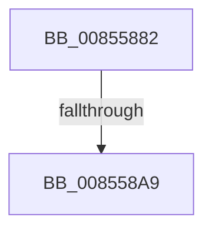

# sub_00855882

- RVA: `0x00855882`–`0x008558BC` (길이 `58` bytes)
- VA: `0x0000000140855882`
- 실행 섹션: `PAGE`
- PDB 이름 있음: `아니요`; PDB Function 태그: `아니요`
- unwind 정보 RVA: `0x0006A0DC`
- 디코드: `13`개 명령, `58/58` bytes 표시
- 미해석 바이트: `0` (있으면 어셈블리에 `.byte`로 보존)

> 이 문서는 커널 이미지의 기계어와 PDB 기호를 분석해 생성했습니다. 4번과 5번은 함수 원형과 자료형을 바이너리 사용 방식에서 추정한 C 해석이며 원본 소스 복구 결과는 아닙니다.

## 1. Dependencies

- 직접 호출 지점: **1**; 고유 호출 대상: **1**
- 직접 호출자로 확인된 함수: **0**
- RIP 상대 이미지 참조: **0**

### Outgoing calls
- `0x00855893` → [CmpAllocatePool](../../text/3C/CmpAllocatePool_function_003CD504.md) (function, `0x003CD504`)

### Direct callers
- 이 함수 시작 RVA로 연결되는 직접 call은 확인되지 않았습니다. 간접 호출은 완전히 역산할 수 없습니다.

### Static image references
- 디코드된 RIP-relative 메모리 참조가 없습니다.

## 2. Other-region calls and transfers

- 다른 실행 섹션으로 향하는 call: **1**
  - `0x00855893` → [CmpAllocatePool](../../text/3C/CmpAllocatePool_function_003CD504.md) (`PAGE` → `.text`)
- call이 아닌 외부 분기/꼬리 이동: **2**
  - `0x008558A3` → [sub_008551B7](Unknown_function_008551B7.md) (`tail-transfer`)
  - `0x008558B7` → [sub_00855411](Unknown_function_00855411.md) (`tail-transfer`)

## 3. Assembly (complete function range)

```asm
00855882  8B D0                           mov edx, eax
00855884  B9 00 01 00 00                  mov ecx, 0x100
00855889  48 C1 E2 03                     shl rdx, 3
0085588D  41 B8 43 4D 36 35               mov r8d, 0x35364d43
00855893  E8 6C 7C B7 FF                  call 0x1403cd504
00855898  48 89 44 24 48                  mov qword ptr [rsp + 0x48], rax
0085589D  4C 8B C0                        mov r8, rax
008558A0  48 85 C0                        test rax, rax
008558A3  0F 85 0E F9 FF FF               jne 0x1408551b7
008558A9  48 8B 45 98                     mov rax, qword ptr [rbp - 0x68]
008558AD  BF 9A 00 00 C0                  mov edi, 0xc000009a
008558B2  48 89 44 24 48                  mov qword ptr [rsp + 0x48], rax
008558B7  E9 55 FB FF FF                  jmp 0x140855411
```

## 4. C-style interpretation (structured pseudocode)

```c
__int64 __fastcall sub_00855882(void)
{
    __int64 result;
    unsigned __int64 v_stack_p48;

    a2 = ((unsigned int)((unsigned int)(result))) << (3);
    result = CmpAllocatePool(256, a2, (unsigned int)(0x35364D43ULL), a4);
    v_stack_p48 = result;
    v_stack_p48 = *(unsigned __int64 *)(v_rbp - 104);
}
```

## 5. (Beta) C Style

```c
void sub_00855882(void)
{
    int64_t result;
    uint64_t v_stack_p48;

    a2 = ((uint32_t)((uint32_t)(result))) << (3);
    result = CmpAllocatePool(256, a2, (uint32_t)(0x35364D43ULL), a4);
    v_stack_p48 = result;
    v_stack_p48 = *(uint64_t *)(local_rbp - 0x68);
}
```

## 6. Execution-region graph

[열기: 2D/3D 그래프와 함수 탐색 컨트롤 패널](../../../control-panel.html?section=page&rva=0x00855882&view=graph)

- 2D 그래프는 위에서 아래로 흐르고, 3D 그래프는 빈 공간을 드래그해 회전합니다. Shift+드래그는 이동, 휠은 확대·축소, 함수 노드 선택은 대상 보고서 이동입니다.

### Static fallback


