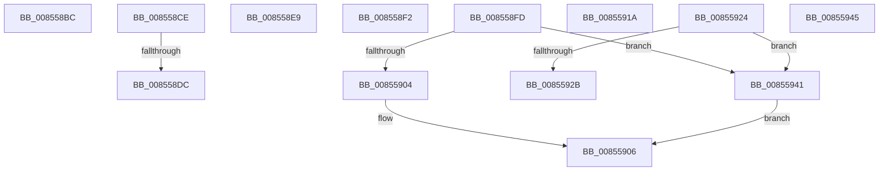

# sub_008558BC

- RVA: `0x008558BC`–`0x0085594F` (길이 `147` bytes)
- VA: `0x00000001408558BC`
- 실행 섹션: `PAGE`
- PDB 이름 있음: `아니요`; PDB Function 태그: `아니요`
- unwind 정보 RVA: `0x0006A100`
- 디코드: `36`개 명령, `147/147` bytes 표시
- 미해석 바이트: `0` (있으면 어셈블리에 `.byte`로 보존)

> 이 문서는 커널 이미지의 기계어와 PDB 기호를 분석해 생성했습니다. 4번과 5번은 함수 원형과 자료형을 바이너리 사용 방식에서 추정한 C 해석이며 원본 소스 복구 결과는 아닙니다.

## 1. Dependencies

- 직접 호출 지점: **1**; 고유 호출 대상: **1**
- 직접 호출자로 확인된 함수: **0**
- RIP 상대 이미지 참조: **0**

### Outgoing calls
- `0x008558C0` → [RtlUpcaseUnicodeChar](RtlUpcaseUnicodeChar_function_0085F0F0.md) (function, `0x0085F0F0`)

### Direct callers
- 이 함수 시작 RVA로 연결되는 직접 call은 확인되지 않았습니다. 간접 호출은 완전히 역산할 수 없습니다.

### Static image references
- 디코드된 RIP-relative 메모리 참조가 없습니다.

## 2. Other-region calls and transfers

- 다른 실행 섹션으로 향하는 call: **0**
- call이 아닌 외부 분기/꼬리 이동: **9**
  - `0x008558C9` → [sub_00855472 + 0x1CE](Unknown_function_00855472.md) (`tail-transfer`)
  - `0x008558D6` → [sub_00855472 + 0x76](Unknown_function_00855472.md) (`tail-transfer`)
  - `0x008558E4` → [sub_00855472 + 0x7B](Unknown_function_00855472.md) (`tail-transfer`)
  - `0x008558ED` → [sub_008551B7 + 0xBF](Unknown_function_008551B7.md) (`tail-transfer`)
  - `0x008558F8` → [sub_008551B7 + 0x123](Unknown_function_008551B7.md) (`tail-transfer`)
  - `0x00855915` → [sub_008551B7 + 0x214](Unknown_function_008551B7.md) (`tail-transfer`)
  - `0x0085591F` → [sub_00855472 + 0x3EA](Unknown_function_00855472.md) (`tail-transfer`)
  - `0x0085593C` → [sub_008551B7 + 0x214](Unknown_function_008551B7.md) (`tail-transfer`)
  - `0x0085594A` → [sub_008551B7 + 0x20E](Unknown_function_008551B7.md) (`tail-transfer`)

## 3. Assembly (complete function range)

```asm
008558BC  41 0F B7 CE                     movzx ecx, r14w
008558C0  E8 2B 98 00 00                  call 0x14085f0f0
008558C5  44 0F B7 F0                     movzx r14d, ax
008558C9  E9 72 FD FF FF                  jmp 0x140855640
008558CE  49 39 9C 24 20 01 00 00         cmp qword ptr [r12 + 0x120], rbx
008558D6  0F 85 0C FC FF FF               jne 0x1408554e8
008558DC  49 8D B4 24 18 01 00 00         lea rsi, [r12 + 0x118]
008558E4  E9 04 FC FF FF                  jmp 0x1408554ed
008558E9  66 41 FF C8                     dec r8w
008558ED  E9 84 F9 FF FF                  jmp 0x140855276
008558F2  41 BE FF FF FF FF               mov r14d, 0xffffffff
008558F8  E9 DD F9 FF FF                  jmp 0x1408552da
008558FD  8B 47 30                        mov eax, dword ptr [rdi + 0x30]
00855900  A8 01                           test al, 1
00855902  74 3D                           je 0x140855941
00855904  B1 01                           mov cl, 1
00855906  84 C9                           test cl, cl
00855908  BF 25 04 00 C0                  mov edi, 0xc0000425
0085590D  B8 7C 01 00 C0                  mov eax, 0xc000017c
00855912  0F 44 F8                        cmove edi, eax
00855915  E9 B1 FA FF FF                  jmp 0x1408553cb
0085591A  49 89 4C D0 F0                  mov qword ptr [r8 + rdx*8 - 0x10], rcx
0085591F  E9 38 FF FF FF                  jmp 0x14085585c
00855924  8B 47 30                        mov eax, dword ptr [rdi + 0x30]
00855927  A8 01                           test al, 1
00855929  74 16                           je 0x140855941
0085592B  B1 01                           mov cl, 1
0085592D  BF 25 04 00 C0                  mov edi, 0xc0000425
00855932  84 C9                           test cl, cl
00855934  B8 7C 01 00 C0                  mov eax, 0xc000017c
00855939  0F 44 F8                        cmove edi, eax
0085593C  E9 8A FA FF FF                  jmp 0x1408553cb
00855941  32 C9                           xor cl, cl
00855943  EB C1                           jmp 0x140855906
00855945  BF 34 00 00 C0                  mov edi, 0xc0000034
0085594A  E9 76 FA FF FF                  jmp 0x1408553c5
```

## 4. C-style interpretation (structured pseudocode)

```c
__int64 __fastcall sub_008558BC(__int64 a1, __int64 a2, unsigned __int16 a3)
{
    __int64 result;

    result = RtlUpcaseUnicodeChar((unsigned __int16)(v_r14), a2, a3, a4);
}
```

## 5. (Beta) C Style

```c
int64_t sub_008558BC(int64_t Arg1, int64_t Arg2, uint16_t Arg3)
{
    int64_t result;

    result = RtlUpcaseUnicodeChar((uint16_t)(local_r14), Arg2, Arg3, a4);
}
```

## 6. Execution-region graph

[열기: 2D/3D 그래프와 함수 탐색 컨트롤 패널](../../../control-panel.html?section=page&rva=0x008558BC&view=graph)

- 2D 그래프는 위에서 아래로 흐르고, 3D 그래프는 빈 공간을 드래그해 회전합니다. Shift+드래그는 이동, 휠은 확대·축소, 함수 노드 선택은 대상 보고서 이동입니다.

### Static fallback


