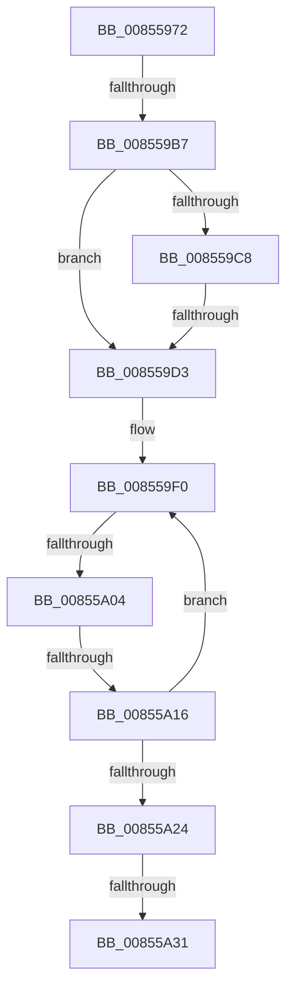

# sub_00855972

- RVA: `0x00855972`–`0x00855A3C` (길이 `202` bytes)
- VA: `0x0000000140855972`
- 실행 섹션: `PAGE`
- PDB 이름 있음: `아니요`; PDB Function 태그: `아니요`
- unwind 정보 RVA: `0x0006A134`
- 디코드: `49`개 명령, `202/202` bytes 표시
- 미해석 바이트: `0` (있으면 어셈블리에 `.byte`로 보존)

> 이 문서는 커널 이미지의 기계어와 PDB 기호를 분석해 생성했습니다. 4번과 5번은 함수 원형과 자료형을 바이너리 사용 방식에서 추정한 C 해석이며 원본 소스 복구 결과는 아닙니다.

## 1. Dependencies

- 직접 호출 지점: **1**; 고유 호출 대상: **1**
- 직접 호출자로 확인된 함수: **0**
- RIP 상대 이미지 참조: **0**

### Outgoing calls
- `0x008559A0` → [HvpGetCellContextInitialize](HvpGetCellContextInitialize_function_00855F10.md) (function, `0x00855F10`)

### Direct callers
- 이 함수 시작 RVA로 연결되는 직접 call은 확인되지 않았습니다. 간접 호출은 완전히 역산할 수 없습니다.

### Static image references
- 디코드된 RIP-relative 메모리 참조가 없습니다.

## 2. Other-region calls and transfers

- 다른 실행 섹션으로 향하는 call: **0**
- call이 아닌 외부 분기/꼬리 이동: **5**
  - `0x008559B1` → [sub_00855C2E](Unknown_function_00855C2E.md) (`tail-transfer`)
  - `0x008559CD` → [sub_00855C81](Unknown_function_00855C81.md) (`tail-transfer`)
  - `0x008559FE` → [sub_00855BD8](Unknown_function_00855BD8.md) (`tail-transfer`)
  - `0x00855A10` → [sub_00855BD8 + 0x14](Unknown_function_00855BD8.md) (`tail-transfer`)
  - `0x00855A2B` → [sub_00855C12](Unknown_function_00855C12.md) (`tail-transfer`)

## 3. Assembly (complete function range)

```asm
00855972  49 89 5B 18                     mov qword ptr [r11 + 0x18], rbx
00855976  4C 8B C9                        mov r9, rcx
00855979  49 89 6B E8                     mov qword ptr [r11 - 0x18], rbp
0085597D  45 33 FF                        xor r15d, r15d
00855980  4D 89 6B D0                     mov qword ptr [r11 - 0x30], r13
00855984  B8 FF FF FF FF                  mov eax, 0xffffffff
00855989  4D 89 7B 08                     mov qword ptr [r11 + 8], r15
0085598D  0F 11 44 24 20                  movups xmmword ptr [rsp + 0x20], xmm0
00855992  49 8D 4B 08                     lea rcx, [r11 + 8]
00855996  66 89 44 24 22                  mov word ptr [rsp + 0x22], ax
0085599B  0F 11 44 24 30                  movups xmmword ptr [rsp + 0x30], xmm0
008559A0  E8 6B 05 00 00                  call 0x140855f10
008559A5  4D 0F BF 41 02                  movsx r8, word ptr [r9 + 2]
008559AA  0F AE E8                        lfence
008559AD  41 83 F8 02                     cmp r8d, 2
008559B1  0F 8D 77 02 00 00               jge 0x140855c2e
008559B7  4B 8B 6C C1 08                  mov rbp, qword ptr [r9 + r8*8 + 8]
008559BC  0F BF 5D 42                     movsx ebx, word ptr [rbp + 0x42]
008559C0  4D 8B E7                        mov r12, r15
008559C3  83 FB 02                        cmp ebx, 2
008559C6  7C 0B                           jl 0x1408559d3
008559C8  8B C3                           mov eax, ebx
008559CA  83 E8 01                        sub eax, 1
008559CD  0F 85 AE 02 00 00               jne 0x140855c81
008559D3  66 89 5C 24 20                  mov word ptr [rsp + 0x20], bx
008559D8  48 8B CD                        mov rcx, rbp
008559DB  41 8B DF                        mov ebx, r15d
008559DE  4C 89 64 24 38                  mov qword ptr [rsp + 0x38], r12
008559E3  0F 1F 40 00                     nop dword ptr [rax]
008559E7  66 0F 1F 84 00 00 00 00 00      nop word ptr [rax + rax]
008559F0  F7 81 B8 00 00 00 00 00 04 00   test dword ptr [rcx + 0xb8], 0x40000
008559FA  48 8D 51 48                     lea rdx, [rcx + 0x48]
008559FE  0F 85 D4 01 00 00               jne 0x140855bd8
00855A04  48 8B 41 50                     mov rax, qword ptr [rcx + 0x50]
00855A08  0F B7 48 18                     movzx ecx, word ptr [rax + 0x18]
00855A0C  8B 00                           mov eax, dword ptr [rax]
00855A0E  A8 01                           test al, 1
00855A10  0F 84 D6 01 00 00               je 0x140855bec
00855A16  8D 1C 4B                        lea ebx, [rbx + rcx*2]
00855A19  48 8B 0A                        mov rcx, qword ptr [rdx]
00855A1C  83 C3 02                        add ebx, 2
00855A1F  48 85 C9                        test rcx, rcx
00855A22  75 CC                           jne 0x1408559f0
00855A24  B8 FF FF 00 00                  mov eax, 0xffff
00855A29  3B D8                           cmp ebx, eax
00855A2B  0F 87 E1 01 00 00               ja 0x140855c12
00855A31  8B D3                           mov edx, ebx
00855A33  B9 00 01 00 00                  mov ecx, 0x100
00855A38  48 83 C2 10                     add rdx, 0x10
```

## 4. C-style interpretation (structured pseudocode)

```c
__int64 __fastcall sub_00855972(__int64 a1, __int64 a2, __int64 a3, __int64 a4, __int64 a5, __int64 a6)
{
    __int64 result;
    __int64 v_r15;
    __int64 v_rbx;
    unsigned __int64 v_stack_p20;
    unsigned __int16 v_stack_p22;
    unsigned __int64 v_stack_p38;

    *(unsigned __int64 *)(v_r11 + 24) = v_rbx;
    *(unsigned __int64 *)(v_r11 - 24) = v_rbp;
    v_r15 = 0;
    *(unsigned __int64 *)(v_r11 - 48) = v_r13;
    *(unsigned __int64 *)(v_r11 + 8) = 0;
    v_stack_p20 = v_xmm0;
    v_stack_p22 = (unsigned __int16)((unsigned int)(0xFFFFFFFFULL));
    a6 = v_xmm0;
    result = HvpGetCellContextInitialize(v_r11 + 8, a2, a3, a1);
    if (((unsigned int)((__int16)(*(unsigned __int16 *)(*(unsigned __int64 *)(a1 + (__int16)(*(unsigned __int16 *)(a1 + 2)) * 8 + 8) + 66)))) < 2) goto loc_008559D3;
    result = (unsigned int)(((unsigned int)((unsigned int)((__int16)(*(unsigned __int16 *)(*(unsigned __int64 *)(a1 + (__int16)(*(unsigned __int16 *)(a1 + 2)) * 8 + 8) + 66))))) - (1));
loc_008559D3:
    v_stack_p20 = (unsigned __int16)((__int16)(*(unsigned __int16 *)(*(unsigned __int64 *)(a1 + (__int16)(*(unsigned __int16 *)(a1 + 2)) * 8 + 8) + 66)));
    v_stack_p38 = 0;
loc_008559F0:
    v_rbx = (unsigned int)((0 + *(unsigned __int16 *)(*(unsigned __int64 *)(*(unsigned __int64 *)(a1 + (__int16)(*(unsigned __int16 *)(a1 + 2)) * 8 + 8) + 80) + 24) * 2) + (2));
    if (*(unsigned __int64 *)(*(unsigned __int64 *)(a1 + (__int16)(*(unsigned __int16 *)(a1 + 2)) * 8 + 8) + 72) != 0) goto loc_008559F0;
    a2 = ((unsigned int)((unsigned int)(v_rbx))) + (16);
    return (unsigned int)(0xFFFFULL);
}
```

## 5. (Beta) C Style

```c
int64_t sub_00855972(int64_t Arg1, int64_t Arg2, int64_t Arg3, int64_t Arg4, uint64_t Arg5, int64_t Arg6)
{
    int64_t result;
    int64_t local_r15;
    int64_t local_rbx;
    uint64_t v_stack_p20;
    uint16_t v_stack_p22;
    uint64_t v_stack_p38;

    *(uint64_t *)(local_r11 + 0x18) = local_rbx;
    *(uint64_t *)(local_r11 - 0x18) = local_rbp;
    local_r15 = 0;
    *(uint64_t *)(local_r11 - 0x30) = local_r13;
    *(uint64_t *)(local_r11 + 0x8) = 0;
    v_stack_p20 = v_xmm0;
    v_stack_p22 = (uint16_t)((uint32_t)(0xFFFFFFFFULL));
    Arg6 = v_xmm0;
    result = HvpGetCellContextInitialize(local_r11 + 8, Arg2, Arg3, Arg1);
    if (((uint32_t)((int16_t)(*(uint16_t *)(*(uint64_t *)(Arg1 + (int16_t)(*(uint16_t *)(Arg1 + 0x2)) * 8 + 0x8) + 0x42)))) < 2) goto loc_008559D3;
    result = (uint32_t)(((uint32_t)((uint32_t)((int16_t)(*(uint16_t *)(*(uint64_t *)(Arg1 + (int16_t)(*(uint16_t *)(Arg1 + 0x2)) * 8 + 0x8) + 0x42))))) - (1));
loc_008559D3:
    v_stack_p20 = (uint16_t)((int16_t)(*(uint16_t *)(*(uint64_t *)(Arg1 + (int16_t)(*(uint16_t *)(Arg1 + 0x2)) * 8 + 0x8) + 0x42)));
    v_stack_p38 = 0;
loc_008559F0:
    local_rbx = (uint32_t)((0 + *(uint16_t *)(*(uint64_t *)(*(uint64_t *)(Arg1 + (int16_t)(*(uint16_t *)(Arg1 + 0x2)) * 8 + 0x8) + 0x50) + 0x18) * 2) + (2));
    if (*(uint64_t *)(*(uint64_t *)(Arg1 + (int16_t)(*(uint16_t *)(Arg1 + 0x2)) * 8 + 0x8) + 0x48) != 0) goto loc_008559F0;
    Arg2 = ((uint32_t)((uint32_t)(local_rbx))) + (16);
    return (uint32_t)(0xFFFFULL);
}
```

## 6. Execution-region graph

[열기: 2D/3D 그래프와 함수 탐색 컨트롤 패널](../../../control-panel.html?section=page&rva=0x00855972&view=graph)

- 2D 그래프는 위에서 아래로 흐르고, 3D 그래프는 빈 공간을 드래그해 회전합니다. Shift+드래그는 이동, 휠은 확대·축소, 함수 노드 선택은 대상 보고서 이동입니다.

### Static fallback


