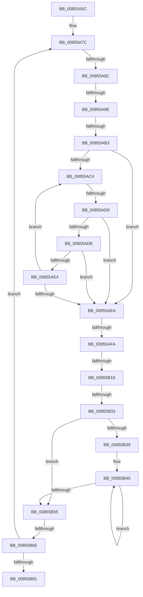

# sub_00855A5C

- RVA: `0x00855A5C`–`0x00855BA7` (길이 `331` bytes)
- VA: `0x0000000140855A5C`
- 실행 섹션: `PAGE`
- PDB 이름 있음: `아니요`; PDB Function 태그: `아니요`
- unwind 정보 RVA: `0x0006A164`
- 디코드: `75`개 명령, `331/331` bytes 표시
- 미해석 바이트: `0` (있으면 어셈블리에 `.byte`로 보존)

> 이 문서는 커널 이미지의 기계어와 PDB 기호를 분석해 생성했습니다. 4번과 5번은 함수 원형과 자료형을 바이너리 사용 방식에서 추정한 C 해석이며 원본 소스 복구 결과는 아닙니다.

## 1. Dependencies

- 직접 호출 지점: **2**; 고유 호출 대상: **2**
- 직접 호출자로 확인된 함수: **0**
- RIP 상대 이미지 참조: **0**

### Outgoing calls
- `0x00855B16` → [HvpGetCellFlat](HvpGetCellFlat_function_00854C60.md) (function, `0x00854C60`)
- `0x00855B6E` → [HvpReleaseCellPaged](HvpReleaseCellPaged_function_00855F40.md) (function, `0x00855F40`)

### Direct callers
- 이 함수 시작 RVA로 연결되는 직접 call은 확인되지 않았습니다. 간접 호출은 완전히 역산할 수 없습니다.

### Static image references
- 디코드된 RIP-relative 메모리 참조가 없습니다.

## 2. Other-region calls and transfers

- 다른 실행 섹션으로 향하는 call: **0**
- call이 아닌 외부 분기/꼬리 이동: **8**
  - `0x00855A86` → [sub_00855BF3](Unknown_function_00855BF3.md) (`tail-transfer`)
  - `0x00855A98` → [sub_00855C3C](Unknown_function_00855C3C.md) (`tail-transfer`)
  - `0x00855AAD` → [sub_00855C3C + 0x8](Unknown_function_00855C3C.md) (`tail-transfer`)
  - `0x00855ACA` → [sub_00855C1A](Unknown_function_00855C1A.md) (`tail-transfer`)
  - `0x00855AF4` → [sub_00855CD6](Unknown_function_00855CD6.md) (`tail-transfer`)
  - `0x00855B10` → [sub_00855BF3 + 0x15](Unknown_function_00855BF3.md) (`tail-transfer`)
  - `0x00855B2D` → [sub_00855CB3](Unknown_function_00855CB3.md) (`tail-transfer`)
  - `0x00855B68` → [sub_00855C1A + 0xA](Unknown_function_00855C1A.md) (`tail-transfer`)

## 3. Assembly (complete function range)

```asm
00855A5C  48 89 74 24 58                  mov qword ptr [rsp + 0x58], rsi
00855A61  66 41 89 1E                     mov word ptr [r14], bx
00855A65  41 BD FF FF 00 00               mov r13d, 0xffff
00855A6B  66 41 89 5E 02                  mov word ptr [r14 + 2], bx
00855A70  49 89 46 08                     mov qword ptr [r14 + 8], rax
00855A74  66 D1 EB                        shr bx, 1
00855A77  48 89 7C 24 50                  mov qword ptr [rsp + 0x50], rdi
00855A7C  F7 85 B8 00 00 00 00 00 04 00   test dword ptr [rbp + 0xb8], 0x40000
00855A86  0F 85 67 01 00 00               jne 0x140855bf3
00855A8C  48 8B 45 50                     mov rax, qword ptr [rbp + 0x50]
00855A90  0F B7 70 18                     movzx esi, word ptr [rax + 0x18]
00855A94  8B 00                           mov eax, dword ptr [rax]
00855A96  A8 01                           test al, 1
00855A98  0F 84 9E 01 00 00               je 0x140855c3c
00855A9E  0F B7 45 42                     movzx eax, word ptr [rbp + 0x42]
00855AA2  66 2B DE                        sub bx, si
00855AA5  66 89 44 24 22                  mov word ptr [rsp + 0x22], ax
00855AAA  66 85 C0                        test ax, ax
00855AAD  0F 85 91 01 00 00               jne 0x140855c44
00855AB3  48 89 6C 24 28                  mov qword ptr [rsp + 0x28], rbp
00855AB8  0F B7 4D 42                     movzx ecx, word ptr [rbp + 0x42]
00855ABC  49 8B FF                        mov rdi, r15
00855ABF  66 85 C9                        test cx, cx
00855AC2  78 26                           js 0x140855aea
00855AC4  0F B7 C1                        movzx eax, cx
00855AC7  83 F8 02                        cmp eax, 2
00855ACA  0F 83 4A 01 00 00               jae 0x140855c1a
00855AD0  48 8B 7C C4 28                  mov rdi, qword ptr [rsp + rax*8 + 0x28]
00855AD5  4C 39 BF C8 00 00 00            cmp qword ptr [rdi + 0xc8], r15
00855ADC  75 0C                           jne 0x140855aea
00855ADE  83 7F 28 FF                     cmp dword ptr [rdi + 0x28], -1
00855AE2  75 06                           jne 0x140855aea
00855AE4  66 83 E9 01                     sub cx, 1
00855AE8  79 DA                           jns 0x140855ac4
00855AEA  48 8B 97 C8 00 00 00            mov rdx, qword ptr [rdi + 0xc8]
00855AF1  48 85 D2                        test rdx, rdx
00855AF4  0F 85 DC 01 00 00               jne 0x140855cd6
00855AFA  48 8B 4F 20                     mov rcx, qword ptr [rdi + 0x20]
00855AFE  4C 8D 84 24 80 00 00 00         lea r8, [rsp + 0x80]
00855B06  8B 57 28                        mov edx, dword ptr [rdi + 0x28]
00855B09  F6 81 8C 00 00 00 01            test byte ptr [rcx + 0x8c], 1
00855B10  0F 84 F2 00 00 00               je 0x140855c08
00855B16  E8 45 F1 FF FF                  call 0x140854c60
00855B1B  48 8B D0                        mov rdx, rax
00855B1E  0F B7 CB                        movzx ecx, bx
00855B21  49 8B 46 08                     mov rax, qword ptr [r14 + 8]
00855B25  F6 42 02 20                     test byte ptr [rdx + 2], 0x20
00855B29  4C 8D 0C 48                     lea r9, [rax + rcx*2]
00855B2D  0F 84 80 01 00 00               je 0x140855cb3
00855B33  66 44 3B FE                     cmp r15w, si
00855B37  73 1C                           jae 0x140855b55
00855B39  48 8D 42 4C                     lea rax, [rdx + 0x4c]
00855B3D  0F B7 D6                        movzx edx, si
00855B40  0F B6 08                        movzx ecx, byte ptr [rax]
00855B43  48 8D 40 01                     lea rax, [rax + 1]
00855B47  66 41 89 09                     mov word ptr [r9], cx
00855B4B  4D 8D 49 02                     lea r9, [r9 + 2]
00855B4F  48 83 EA 01                     sub rdx, 1
00855B53  75 EB                           jne 0x140855b40
00855B55  48 8B 4F 20                     mov rcx, qword ptr [rdi + 0x20]
00855B59  48 8D 94 24 80 00 00 00         lea rdx, [rsp + 0x80]
00855B61  F6 81 8C 00 00 00 01            test byte ptr [rcx + 0x8c], 1
00855B68  0F 85 B6 00 00 00               jne 0x140855c24
00855B6E  E8 CD 03 00 00                  call 0x140855f40
00855B73  49 8B 46 08                     mov rax, qword ptr [r14 + 8]
00855B77  66 41 03 DD                     add bx, r13w
00855B7B  0F B7 CB                        movzx ecx, bx
00855B7E  66 C7 04 48 5C 00               mov word ptr [rax + rcx*2], 0x5c
00855B84  48 8B 6D 48                     mov rbp, qword ptr [rbp + 0x48]
00855B88  48 85 ED                        test rbp, rbp
00855B8B  0F 85 EB FE FF FF               jne 0x140855a7c
00855B91  4C 8B AC 24 88 00 00 00         mov r13, qword ptr [rsp + 0x88]
00855B99  48 8B 7C 24 50                  mov rdi, qword ptr [rsp + 0x50]
00855B9E  48 8B 74 24 58                  mov rsi, qword ptr [rsp + 0x58]
00855BA3  4D 89 75 00                     mov qword ptr [r13], r14
```

## 4. C-style interpretation (structured pseudocode)

```c
__int64 __fastcall sub_00855A5C(__int64 a1, __int64 a2, __int64 a3, __int64 a4, __int64 a5, __int64 a6, __int64 a7, __int64 a8, __int64 a9, __int64 a10, __int64 a11, __int64 a12, __int64 a13, __int64 a14, __int64 a15, __int64 a16, __int64 a17)
{
    __int64 result;
    __int64 v_rbx;
    unsigned __int16 v_stack_p22;
    unsigned __int64 v_stack_p28;
    unsigned __int64 v_stack_p50;
    unsigned __int64 v_stack_p58;

    v_stack_p58 = v_rsi;
    *(unsigned __int16 *)(v_r14) = (unsigned __int16)(v_rbx);
    *(unsigned __int16 *)(v_r14 + 2) = (unsigned __int16)(v_rbx);
    *(unsigned __int64 *)(v_r14 + 8) = result;
    v_rbx = (unsigned __int16)((v_rbx) >> (1));
    v_stack_p50 = v_rdi;
loc_00855A7C:
    v_rbx = (unsigned __int16)((v_rbx) - ((unsigned __int16)(*(unsigned __int16 *)(*(unsigned __int64 *)(v_rbp + 80) + 24))));
    v_stack_p22 = (unsigned __int16)(*(unsigned __int16 *)(v_rbp + 66));
    v_stack_p28 = v_rbp;
    if (sign_flag) goto loc_00855AEA;
loc_00855AC4:
    if ((*(unsigned __int64 *)(*(unsigned __int64 *)(v_rsp + (unsigned __int16)(*(unsigned __int16 *)(v_rbp + 66)) * 8 + 40) + 200)) != v_r15) goto loc_00855AEA;
    if ((*(unsigned int *)(*(unsigned __int64 *)(v_rsp + (unsigned __int16)(*(unsigned __int16 *)(v_rbp + 66)) * 8 + 40) + 40)) != -1) goto loc_00855AEA;
    a1 = (unsigned __int16)((*(unsigned __int16 *)(v_rbp + 66)) - (1));
    if (!sign_flag) goto loc_00855AC4;
loc_00855AEA:
    result = HvpGetCellFlat(*(unsigned __int64 *)(*(unsigned __int64 *)(v_rsp + (unsigned __int16)(*(unsigned __int16 *)(v_rbp + 66)) * 8 + 40) + 32), (unsigned int)(*(unsigned int *)(*(unsigned __int64 *)(v_rsp + (unsigned __int16)(*(unsigned __int16 *)(v_rbp + 66)) * 8 + 40) + 40)), a16, a4);
    if (((unsigned __int16)(v_r15)) >= ((unsigned __int16)(*(unsigned __int16 *)(*(unsigned __int64 *)(v_rbp + 80) + 24)))) goto loc_00855B55;
loc_00855B40:
    *(unsigned __int16 *)(*(unsigned __int64 *)(v_r14 + 8) + (unsigned __int16)(v_rbx) * 2) = (unsigned __int16)(*(unsigned __int8 *)(result + 76));
    a2 = ((unsigned __int16)(*(unsigned __int16 *)(*(unsigned __int64 *)(v_rbp + 80) + 24))) - (1);
    if (condition_is_not_equal) goto loc_00855B40;
loc_00855B55:
    result = HvpReleaseCellPaged(*(unsigned __int64 *)(*(unsigned __int64 *)(v_rsp + (unsigned __int16)(*(unsigned __int16 *)(v_rbp + 66)) * 8 + 40) + 32), a16, a16, *(unsigned __int64 *)(v_r14 + 8) + (unsigned __int16)(v_rbx) * 2 + 2);
    v_rbx = (unsigned __int16)((v_rbx) + ((unsigned __int16)((unsigned int)(0xFFFFULL))));
    *(unsigned __int16 *)(*(unsigned __int64 *)(v_r14 + 8) + (unsigned __int16)(v_rbx) * 2) = 92;
    if (*(unsigned __int64 *)(v_rbp + 72) != 0) goto loc_00855A7C;
    *(unsigned __int64 *)(a17) = v_r14;
    return *(unsigned __int64 *)(v_r14 + 8);
}
```

## 5. (Beta) C Style

```c
int64_t sub_00855A5C(int64_t Arg1, int64_t Arg2, int64_t Arg3, int64_t Arg4, void *Arg5, uint64_t Arg6, uint64_t Arg7, uint64_t Arg8, uint64_t Arg9, int64_t Arg10, int64_t Arg11, uint64_t Arg12, uint64_t Arg13, uint64_t Arg14, uint64_t Arg15, int64_t Arg16, void *Arg17)
{
    uint8_t *arg5 = (uint8_t *)Arg5;
    uint8_t *arg17 = (uint8_t *)Arg17;

    int64_t result;
    int64_t local_rbx;
    uint16_t v_stack_p22;
    uint64_t v_stack_p28;
    uint64_t v_stack_p50;
    uint64_t v_stack_p58;

    v_stack_p58 = local_rsi;
    *(uint16_t *)(local_r14) = (uint16_t)(local_rbx);
    *(uint16_t *)(local_r14 + 0x2) = (uint16_t)(local_rbx);
    *(uint64_t *)(local_r14 + 0x8) = result;
    local_rbx = (uint16_t)((local_rbx) >> (1));
    v_stack_p50 = local_rdi;
loc_00855A7C:
    local_rbx = (uint16_t)((local_rbx) - ((uint16_t)(*(uint16_t *)(*(uint64_t *)(local_rbp + 0x50) + 0x18))));
    v_stack_p22 = (uint16_t)(*(uint16_t *)(local_rbp + 0x42));
    v_stack_p28 = local_rbp;
    if (sign_flag) goto loc_00855AEA;
loc_00855AC4:
    if ((*(uint64_t *)(*(uint64_t *)(local_rsp + (uint16_t)(*(uint16_t *)(local_rbp + 0x42)) * 8 + 0x28) + 0xC8)) != local_r15) goto loc_00855AEA;
    if ((*(uint32_t *)(*(uint64_t *)(local_rsp + (uint16_t)(*(uint16_t *)(local_rbp + 0x42)) * 8 + 0x28) + 0x28)) != -1) goto loc_00855AEA;
    Arg1 = (uint16_t)((*(uint16_t *)(local_rbp + 0x42)) - (1));
    if (!sign_flag) goto loc_00855AC4;
loc_00855AEA:
    result = HvpGetCellFlat(*(uint64_t *)(*(uint64_t *)(local_rsp + (uint16_t)(*(uint16_t *)(local_rbp + 0x42)) * 8 + 0x28) + 0x20), (uint32_t)(*(uint32_t *)(*(uint64_t *)(local_rsp + (uint16_t)(*(uint16_t *)(local_rbp + 0x42)) * 8 + 0x28) + 0x28)), Arg16, Arg4);
    if (((uint16_t)(local_r15)) >= ((uint16_t)(*(uint16_t *)(*(uint64_t *)(local_rbp + 0x50) + 0x18)))) goto loc_00855B55;
loc_00855B40:
    *(uint16_t *)(*(uint64_t *)(local_r14 + 0x8) + (uint16_t)(local_rbx) * 2) = (uint16_t)(*(uint8_t *)(result + 0x4C));
    Arg2 = ((uint16_t)(*(uint16_t *)(*(uint64_t *)(local_rbp + 0x50) + 0x18))) - (1);
    if (condition_is_not_equal) goto loc_00855B40;
loc_00855B55:
    result = HvpReleaseCellPaged(*(uint64_t *)(*(uint64_t *)(local_rsp + (uint16_t)(*(uint16_t *)(local_rbp + 0x42)) * 8 + 0x28) + 0x20), Arg16, Arg16, *(uint64_t *)(local_r14 + 0x8) + (uint16_t)(local_rbx) * 2 + 2);
    local_rbx = (uint16_t)((local_rbx) + ((uint16_t)((uint32_t)(0xFFFFULL))));
    *(uint16_t *)(*(uint64_t *)(local_r14 + 0x8) + (uint16_t)(local_rbx) * 2) = 92;
    if (*(uint64_t *)(local_rbp + 0x48) != 0) goto loc_00855A7C;
    *(uint64_t *)(arg17) = local_r14;
    return *(uint64_t *)(local_r14 + 0x8);
}
```

### 관측된 메모리 오프셋

구조체 형식이 확인되지 않은 접근은 인자 기준의 오프셋으로만 기록했습니다.

| 기준 인자 | 오프셋 표현 | 폭 (bit) | 접근 |
|---|---:|---:|---|
| `Arg5` | `+ 0x28` | `32` | `R` |
| `Arg5` | `+ 0xC8` | `64` | `R` |
| `Arg17` | `+ 0x0` | `64` | `W` |

## 6. Execution-region graph

[열기: 2D/3D 그래프와 함수 탐색 컨트롤 패널](../../../control-panel.html?section=page&rva=0x00855A5C&view=graph)

- 2D 그래프는 위에서 아래로 흐르고, 3D 그래프는 빈 공간을 드래그해 회전합니다. Shift+드래그는 이동, 휠은 확대·축소, 함수 노드 선택은 대상 보고서 이동입니다.

### Static fallback


