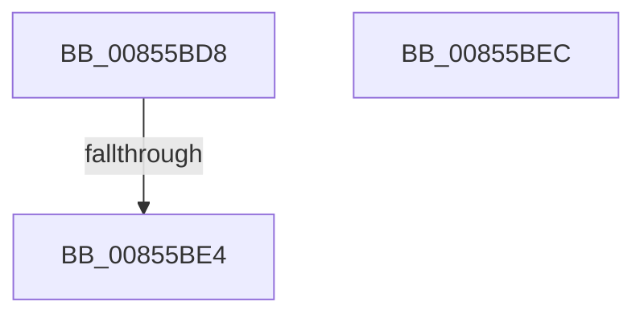

# sub_00855BD8

- RVA: `0x00855BD8`–`0x00855BF3` (길이 `27` bytes)
- VA: `0x0000000140855BD8`
- 실행 섹션: `PAGE`
- PDB 이름 있음: `아니요`; PDB Function 태그: `아니요`
- unwind 정보 RVA: `0x0006A1B0`
- 디코드: `7`개 명령, `27/27` bytes 표시
- 미해석 바이트: `0` (있으면 어셈블리에 `.byte`로 보존)

> 이 문서는 커널 이미지의 기계어와 PDB 기호를 분석해 생성했습니다. 4번과 5번은 함수 원형과 자료형을 바이너리 사용 방식에서 추정한 C 해석이며 원본 소스 복구 결과는 아닙니다.

## 1. Dependencies

- 직접 호출 지점: **0**; 고유 호출 대상: **0**
- 직접 호출자로 확인된 함수: **0**
- RIP 상대 이미지 참조: **0**

### Outgoing calls
- 직접 디코드된 call 명령이 없습니다.

### Direct callers
- 이 함수 시작 RVA로 연결되는 직접 call은 확인되지 않았습니다. 간접 호출은 완전히 역산할 수 없습니다.

### Static image references
- 디코드된 RIP-relative 메모리 참조가 없습니다.

## 2. Other-region calls and transfers

- 다른 실행 섹션으로 향하는 call: **0**
- call이 아닌 외부 분기/꼬리 이동: **3**
  - `0x00855BDE` → [sub_00855972 + 0x92](Unknown_function_00855972.md) (`tail-transfer`)
  - `0x00855BE7` → [sub_00855972 + 0x7E](Unknown_function_00855972.md) (`tail-transfer`)
  - `0x00855BEE` → [sub_00855972 + 0xA7](Unknown_function_00855972.md) (`tail-transfer`)

## 3. Assembly (complete function range)

```asm
00855BD8  48 8B 02                        mov rax, qword ptr [rdx]
00855BDB  48 85 C0                        test rax, rax
00855BDE  0F 84 20 FE FF FF               je 0x140855a04
00855BE4  48 8B C8                        mov rcx, rax
00855BE7  E9 04 FE FF FF                  jmp 0x1408559f0
00855BEC  03 D9                           add ebx, ecx
00855BEE  E9 26 FE FF FF                  jmp 0x140855a19
```

## 4. C-style interpretation (structured pseudocode)

```c
__int64 __fastcall sub_00855BD8(__int64 a1, __int64 a2)
{
}
```

## 5. (Beta) C Style

```c
int64_t sub_00855BD8(int64_t Arg1, void *Arg2)
{
    uint8_t *arg2 = (uint8_t *)Arg2;

}
```

### 관측된 메모리 오프셋

구조체 형식이 확인되지 않은 접근은 인자 기준의 오프셋으로만 기록했습니다.

| 기준 인자 | 오프셋 표현 | 폭 (bit) | 접근 |
|---|---:|---:|---|
| `Arg2` | `+ 0x0` | `64` | `R` |

## 6. Execution-region graph

[열기: 2D/3D 그래프와 함수 탐색 컨트롤 패널](../../../control-panel.html?section=page&rva=0x00855BD8&view=graph)

- 2D 그래프는 위에서 아래로 흐르고, 3D 그래프는 빈 공간을 드래그해 회전합니다. Shift+드래그는 이동, 휠은 확대·축소, 함수 노드 선택은 대상 보고서 이동입니다.

### Static fallback


