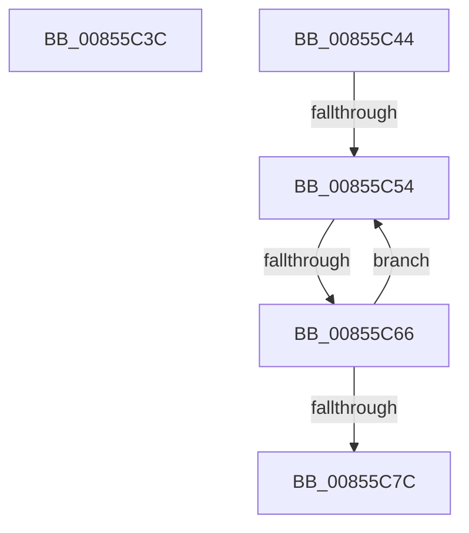

# sub_00855C3C

- RVA: `0x00855C3C`–`0x00855C81` (길이 `69` bytes)
- VA: `0x0000000140855C3C`
- 실행 섹션: `PAGE`
- PDB 이름 있음: `아니요`; PDB Function 태그: `아니요`
- unwind 정보 RVA: `0x0006A254`
- 디코드: `16`개 명령, `69/69` bytes 표시
- 미해석 바이트: `0` (있으면 어셈블리에 `.byte`로 보존)

> 이 문서는 커널 이미지의 기계어와 PDB 기호를 분석해 생성했습니다. 4번과 5번은 함수 원형과 자료형을 바이너리 사용 방식에서 추정한 C 해석이며 원본 소스 복구 결과는 아닙니다.

## 1. Dependencies

- 직접 호출 지점: **0**; 고유 호출 대상: **0**
- 직접 호출자로 확인된 함수: **0**
- RIP 상대 이미지 참조: **0**

### Outgoing calls
- 직접 디코드된 call 명령이 없습니다.

### Direct callers
- 이 함수 시작 RVA로 연결되는 직접 call은 확인되지 않았습니다. 간접 호출은 완전히 역산할 수 없습니다.

### Static image references
- 디코드된 RIP-relative 메모리 참조가 없습니다.

## 2. Other-region calls and transfers

- 다른 실행 섹션으로 향하는 call: **0**
- call이 아닌 외부 분기/꼬리 이동: **4**
  - `0x00855C3F` → [sub_00855A5C + 0x42](Unknown_function_00855A5C.md) (`tail-transfer`)
  - `0x00855C4E` → [sub_00855A5C + 0x5C](Unknown_function_00855A5C.md) (`tail-transfer`)
  - `0x00855C60` → [sub_00855CD6 + 0x22](Unknown_function_00855CD6.md) (`tail-transfer`)
  - `0x00855C7C` → [sub_00855A5C + 0x5C](Unknown_function_00855A5C.md) (`tail-transfer`)

## 3. Assembly (complete function range)

```asm
00855C3C  66 D1 EE                        shr si, 1
00855C3F  E9 5A FE FF FF                  jmp 0x140855a9e
00855C44  48 8B 8D C0 00 00 00            mov rcx, qword ptr [rbp + 0xc0]
00855C4B  48 85 C9                        test rcx, rcx
00855C4E  0F 84 64 FE FF FF               je 0x140855ab8
00855C54  48 8B 51 10                     mov rdx, qword ptr [rcx + 0x10]
00855C58  4C 0F BF C0                     movsx r8, ax
00855C5C  66 83 F8 02                     cmp ax, 2
00855C60  0F 8D 92 00 00 00               jge 0x140855cf8
00855C66  4A 89 54 C4 28                  mov qword ptr [rsp + r8*8 + 0x28], rdx
00855C6B  4C 8B 64 24 38                  mov r12, qword ptr [rsp + 0x38]
00855C70  48 8B 49 18                     mov rcx, qword ptr [rcx + 0x18]
00855C74  66 FF C8                        dec ax
00855C77  48 85 C9                        test rcx, rcx
00855C7A  75 D8                           jne 0x140855c54
00855C7C  E9 37 FE FF FF                  jmp 0x140855ab8
```

## 4. C-style interpretation (structured pseudocode)

```c
__int64 __fastcall sub_00855C3C(void)
{
    __int64 v_rsi;
    unsigned __int64 v_stack_p38;

    v_rsi = (unsigned __int16)((v_rsi) >> (1));
}
```

## 5. (Beta) C Style

```c
void sub_00855C3C(void)
{
    int64_t local_rsi;
    uint64_t v_stack_p38;

    local_rsi = (uint16_t)((local_rsi) >> (1));
}
```

## 6. Execution-region graph

[열기: 2D/3D 그래프와 함수 탐색 컨트롤 패널](../../../control-panel.html?section=page&rva=0x00855C3C&view=graph)

- 2D 그래프는 위에서 아래로 흐르고, 3D 그래프는 빈 공간을 드래그해 회전합니다. Shift+드래그는 이동, 휠은 확대·축소, 함수 노드 선택은 대상 보고서 이동입니다.

### Static fallback


