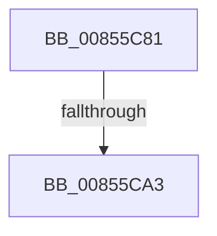

# sub_00855C81

- RVA: `0x00855C81`–`0x00855CB3` (길이 `50` bytes)
- VA: `0x0000000140855C81`
- 실행 섹션: `PAGE`
- PDB 이름 있음: `아니요`; PDB Function 태그: `아니요`
- unwind 정보 RVA: `0x0006A27C`
- 디코드: `11`개 명령, `50/50` bytes 표시
- 미해석 바이트: `0` (있으면 어셈블리에 `.byte`로 보존)

> 이 문서는 커널 이미지의 기계어와 PDB 기호를 분석해 생성했습니다. 4번과 5번은 함수 원형과 자료형을 바이너리 사용 방식에서 추정한 C 해석이며 원본 소스 복구 결과는 아닙니다.

## 1. Dependencies

- 직접 호출 지점: **1**; 고유 호출 대상: **1**
- 직접 호출자로 확인된 함수: **0**
- RIP 상대 이미지 참조: **0**

### Outgoing calls
- `0x00855C92` → [CmpAllocatePool](../../text/3C/CmpAllocatePool_function_003CD504.md) (function, `0x003CD504`)

### Direct callers
- 이 함수 시작 RVA로 연결되는 직접 call은 확인되지 않았습니다. 간접 호출은 완전히 역산할 수 없습니다.

### Static image references
- 디코드된 RIP-relative 메모리 참조가 없습니다.

## 2. Other-region calls and transfers

- 다른 실행 섹션으로 향하는 call: **1**
  - `0x00855C92` → [CmpAllocatePool](../../text/3C/CmpAllocatePool_function_003CD504.md) (`PAGE` → `.text`)
- call이 아닌 외부 분기/꼬리 이동: **2**
  - `0x00855C9D` → [sub_00855972 + 0x61](Unknown_function_00855972.md) (`tail-transfer`)
  - `0x00855CAE` → [sub_00855BAC](Unknown_function_00855BAC.md) (`tail-transfer`)

## 3. Assembly (complete function range)

```asm
00855C81  8B D0                           mov edx, eax
00855C83  B9 00 01 00 00                  mov ecx, 0x100
00855C88  48 C1 E2 03                     shl rdx, 3
00855C8C  41 B8 43 4D 36 35               mov r8d, 0x35364d43
00855C92  E8 6D 78 B7 FF                  call 0x1403cd504
00855C97  4C 8B E0                        mov r12, rax
00855C9A  48 85 C0                        test rax, rax
00855C9D  0F 85 30 FD FF FF               jne 0x1408559d3
00855CA3  4C 8B 64 24 38                  mov r12, qword ptr [rsp + 0x38]
00855CA8  41 BF 9A 00 00 C0               mov r15d, 0xc000009a
00855CAE  E9 F9 FE FF FF                  jmp 0x140855bac
```

## 4. C-style interpretation (structured pseudocode)

```c
__int64 __fastcall sub_00855C81(__int64 a1, __int64 a2, __int64 a3, __int64 a4, __int64 a5, __int64 a6, __int64 a7)
{
    __int64 result;

    a2 = ((unsigned int)((unsigned int)(result))) << (3);
    result = CmpAllocatePool(256, a2, (unsigned int)(0x35364D43ULL), a4);
}
```

## 5. (Beta) C Style

```c
int64_t sub_00855C81(int64_t Arg1, int64_t Arg2, int64_t Arg3, int64_t Arg4, uint64_t Arg5, uint64_t Arg6, int64_t Arg7)
{
    int64_t result;

    Arg2 = ((uint32_t)((uint32_t)(result))) << (3);
    result = CmpAllocatePool(256, Arg2, (uint32_t)(0x35364D43ULL), Arg4);
}
```

## 6. Execution-region graph

[열기: 2D/3D 그래프와 함수 탐색 컨트롤 패널](../../../control-panel.html?section=page&rva=0x00855C81&view=graph)

- 2D 그래프는 위에서 아래로 흐르고, 3D 그래프는 빈 공간을 드래그해 회전합니다. Shift+드래그는 이동, 휠은 확대·축소, 함수 노드 선택은 대상 보고서 이동입니다.

### Static fallback


