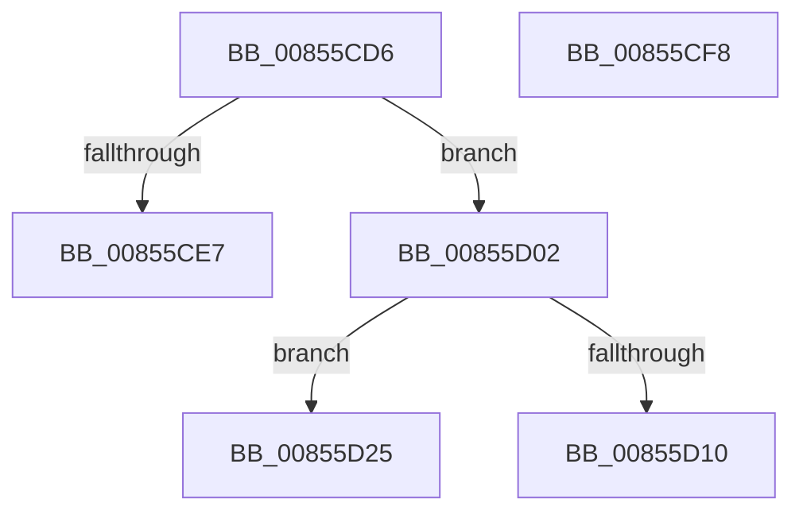

# sub_00855CD6

- RVA: `0x00855CD6`–`0x00855D39` (길이 `99` bytes)
- VA: `0x0000000140855CD6`
- 실행 섹션: `PAGE`
- PDB 이름 있음: `아니요`; PDB Function 태그: `아니요`
- unwind 정보 RVA: `0x0006A2E0`
- 디코드: `26`개 명령, `99/99` bytes 표시
- 미해석 바이트: `0` (있으면 어셈블리에 `.byte`로 보존)

> 이 문서는 커널 이미지의 기계어와 PDB 기호를 분석해 생성했습니다. 4번과 5번은 함수 원형과 자료형을 바이너리 사용 방식에서 추정한 C 해석이며 원본 소스 복구 결과는 아닙니다.

## 1. Dependencies

- 직접 호출 지점: **3**; 고유 호출 대상: **2**
- 직접 호출자로 확인된 함수: **0**
- RIP 상대 이미지 참조: **0**

### Outgoing calls
- `0x00855CEE` → [memcpy](../../text/6C/memcpy_function_006C6840.md) (function, `0x006C6840`)
- `0x00855D1B` → [CmpCopyCompressedName](../84/CmpCopyCompressedName_function_0084E0D0.md) (function, `0x0084E0D0`)
- `0x00855D2F` → [memcpy](../../text/6C/memcpy_function_006C6840.md) (function, `0x006C6840`)

### Direct callers
- 이 함수 시작 RVA로 연결되는 직접 call은 확인되지 않았습니다. 간접 호출은 완전히 역산할 수 없습니다.

### Static image references
- 디코드된 RIP-relative 메모리 참조가 없습니다.

## 2. Other-region calls and transfers

- 다른 실행 섹션으로 향하는 call: **2**
  - `0x00855CEE` → [memcpy](../../text/6C/memcpy_function_006C6840.md) (`PAGE` → `.text`)
  - `0x00855D2F` → [memcpy](../../text/6C/memcpy_function_006C6840.md) (`PAGE` → `.text`)
- call이 아닌 외부 분기/꼬리 이동: **4**
  - `0x00855CF3` → [sub_00855A5C + 0x117](Unknown_function_00855A5C.md) (`tail-transfer`)
  - `0x00855CFD` → [sub_00855C3C + 0x34](Unknown_function_00855C3C.md) (`tail-transfer`)
  - `0x00855D20` → [sub_00855A5C + 0x117](Unknown_function_00855A5C.md) (`tail-transfer`)
  - `0x00855D34` → [sub_00855A5C + 0x117](Unknown_function_00855A5C.md) (`tail-transfer`)

## 3. Assembly (complete function range)

```asm
00855CD6  49 8B 46 08                     mov rax, qword ptr [r14 + 8]
00855CDA  0F B7 CB                        movzx ecx, bx
00855CDD  48 8D 0C 48                     lea rcx, [rax + rcx*2]
00855CE1  48 83 FA 01                     cmp rdx, 1
00855CE5  74 1B                           je 0x140855d02
00855CE7  44 0F B7 C6                     movzx r8d, si
00855CEB  4D 03 C0                        add r8, r8
00855CEE  E8 4D 0B E7 FF                  call 0x1406c6840
00855CF3  E9 7B FE FF FF                  jmp 0x140855b73
00855CF8  4B 89 54 C4 F0                  mov qword ptr [r12 + r8*8 - 0x10], rdx
00855CFD  E9 6E FF FF FF                  jmp 0x140855c70
00855D02  48 8B 57 50                     mov rdx, qword ptr [rdi + 0x50]
00855D06  8B 02                           mov eax, dword ptr [rdx]
00855D08  4C 8D 52 1A                     lea r10, [rdx + 0x1a]
00855D0C  A8 01                           test al, 1
00855D0E  74 15                           je 0x140855d25
00855D10  44 0F B7 CE                     movzx r9d, si
00855D14  4D 8B C2                        mov r8, r10
00855D17  43 8D 14 09                     lea edx, [r9 + r9]
00855D1B  E8 B0 83 FF FF                  call 0x14084e0d0
00855D20  E9 4E FE FF FF                  jmp 0x140855b73
00855D25  44 0F B7 C6                     movzx r8d, si
00855D29  49 8B D2                        mov rdx, r10
00855D2C  4D 03 C0                        add r8, r8
00855D2F  E8 0C 0B E7 FF                  call 0x1406c6840
00855D34  E9 3A FE FF FF                  jmp 0x140855b73
```

## 4. C-style interpretation (structured pseudocode)

```c
__int64 __fastcall sub_00855CD6(__int64 a1, __int64 a2)
{
    __int64 result;

    if (a2 == 1) goto loc_00855D02;
    a3 = ((unsigned __int16)(v_rsi)) + ((unsigned __int16)(v_rsi));
    result = memcpy(*(unsigned __int64 *)(v_r14 + 8) + (unsigned __int16)(v_rbx) * 2, a2, a3, a4);
loc_00855D02:
    if ((((unsigned __int8)((unsigned int)(*(unsigned int *)(*(unsigned __int64 *)(v_rdi + 80))))) & (1)) == 0) goto loc_00855D25;
    result = CmpCopyCompressedName(*(unsigned __int64 *)(v_r14 + 8) + (unsigned __int16)(v_rbx) * 2, (unsigned __int16)(v_rsi) + (unsigned __int16)(v_rsi) * 1, *(unsigned __int64 *)(v_rdi + 80) + 26, (unsigned __int16)(v_rsi));
loc_00855D25:
    a3 = ((unsigned __int16)(v_rsi)) + ((unsigned __int16)(v_rsi));
    result = memcpy(*(unsigned __int64 *)(v_r14 + 8) + (unsigned __int16)(v_rbx) * 2, *(unsigned __int64 *)(v_rdi + 80) + 26, a3, (unsigned __int16)(v_rsi));
}
```

## 5. (Beta) C Style

```c
int64_t sub_00855CD6(int64_t Arg1, int64_t Arg2)
{
    int64_t result;

    if (Arg2 == 1) goto loc_00855D02;
    a3 = ((uint16_t)(local_rsi)) + ((uint16_t)(local_rsi));
    result = memcpy(*(uint64_t *)(local_r14 + 0x8) + (uint16_t)(local_rbx) * 2, Arg2, a3, a4);
loc_00855D02:
    if ((((uint8_t)((uint32_t)(*(uint32_t *)(*(uint64_t *)(local_rdi + 0x50))))) & (1)) == 0) goto loc_00855D25;
    result = CmpCopyCompressedName(*(uint64_t *)(local_r14 + 0x8) + (uint16_t)(local_rbx) * 2, (uint16_t)(local_rsi) + (uint16_t)(local_rsi) * 1, *(uint64_t *)(local_rdi + 0x50) + 26, (uint16_t)(local_rsi));
loc_00855D25:
    a3 = ((uint16_t)(local_rsi)) + ((uint16_t)(local_rsi));
    result = memcpy(*(uint64_t *)(local_r14 + 0x8) + (uint16_t)(local_rbx) * 2, *(uint64_t *)(local_rdi + 0x50) + 26, a3, (uint16_t)(local_rsi));
}
```

## 6. Execution-region graph

[열기: 2D/3D 그래프와 함수 탐색 컨트롤 패널](../../../control-panel.html?section=page&rva=0x00855CD6&view=graph)

- 2D 그래프는 위에서 아래로 흐르고, 3D 그래프는 빈 공간을 드래그해 회전합니다. Shift+드래그는 이동, 휠은 확대·축소, 함수 노드 선택은 대상 보고서 이동입니다.

### Static fallback


