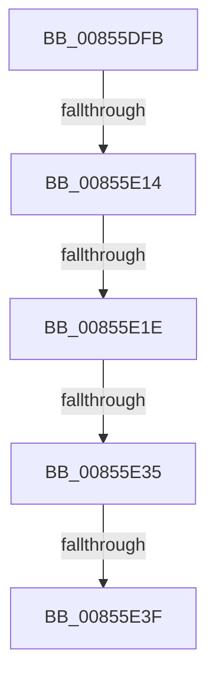

# sub_00855DFB

- RVA: `0x00855DFB`–`0x00855E51` (길이 `86` bytes)
- VA: `0x0000000140855DFB`
- 실행 섹션: `PAGE`
- PDB 이름 있음: `아니요`; PDB Function 태그: `아니요`
- unwind 정보 RVA: `0x0006A314`
- 디코드: `22`개 명령, `86/86` bytes 표시
- 미해석 바이트: `0` (있으면 어셈블리에 `.byte`로 보존)

> 이 문서는 커널 이미지의 기계어와 PDB 기호를 분석해 생성했습니다. 4번과 5번은 함수 원형과 자료형을 바이너리 사용 방식에서 추정한 C 해석이며 원본 소스 복구 결과는 아닙니다.

## 1. Dependencies

- 직접 호출 지점: **2**; 고유 호출 대상: **2**
- 직접 호출자로 확인된 함수: **0**
- RIP 상대 이미지 참조: **0**

### Outgoing calls
- `0x00855E03` → [HvpGetCellMap](../../pagecmrc/BC/HvpGetCellMap_function_00BC9710.md) (function, `0x00BC9710`)
- `0x00855E35` → [HvpGetCellFlat](HvpGetCellFlat_function_00854C60.md) (function, `0x00854C60`)

### Direct callers
- 이 함수 시작 RVA로 연결되는 직접 call은 확인되지 않았습니다. 간접 호출은 완전히 역산할 수 없습니다.

### Static image references
- 디코드된 RIP-relative 메모리 참조가 없습니다.

## 2. Other-region calls and transfers

- 다른 실행 섹션으로 향하는 call: **1**
  - `0x00855E03` → [HvpGetCellMap](../../pagecmrc/BC/HvpGetCellMap_function_00BC9710.md) (`PAGE` → `PAGECMRC`)
- call이 아닌 외부 분기/꼬리 이동: **4**
  - `0x00855E0E` → [sub_00855F00](Unknown_function_00855F00.md) (`tail-transfer`)
  - `0x00855E18` → [sub_00855F00](Unknown_function_00855F00.md) (`tail-transfer`)
  - `0x00855E2F` → [sub_00855ECF](Unknown_function_00855ECF.md) (`tail-transfer`)
  - `0x00855E3D` → [sub_00855E52](Unknown_function_00855E52.md) (`tail-transfer`)

## 3. Assembly (complete function range)

```asm
00855DFB  48 89 74 24 38                  mov qword ptr [rsp + 0x38], rsi
00855E00  48 8B CB                        mov rcx, rbx
00855E03  E8 08 39 37 00                  call 0x140bc9710
00855E08  48 8B F0                        mov rsi, rax
00855E0B  48 85 C0                        test rax, rax
00855E0E  0F 84 EC 00 00 00               je 0x140855f00
00855E14  F6 40 08 02                     test byte ptr [rax + 8], 2
00855E18  0F 85 E2 00 00 00               jne 0x140855f00
00855E1E  F6 83 8C 00 00 00 01            test byte ptr [rbx + 0x8c], 1
00855E25  4C 8D 44 24 48                  lea r8, [rsp + 0x48]
00855E2A  8B D7                           mov edx, edi
00855E2C  48 8B CB                        mov rcx, rbx
00855E2F  0F 84 9A 00 00 00               je 0x140855ecf
00855E35  E8 26 EE FF FF                  call 0x140854c60
00855E3A  48 85 C0                        test rax, rax
00855E3D  75 13                           jne 0x140855e52
00855E3F  48 8B 74 24 38                  mov rsi, qword ptr [rsp + 0x38]
00855E44  B0 01                           mov al, 1
00855E46  48 8B 5C 24 40                  mov rbx, qword ptr [rsp + 0x40]
00855E4B  48 83 C4 20                     add rsp, 0x20
00855E4F  5F                              pop rdi
00855E50  C3                              ret
```

## 4. C-style interpretation (structured pseudocode)

```c
__int64 __fastcall sub_00855DFB(__int64 a1, __int64 a2, __int64 a3, __int64 a4, __int64 a5, __int64 a6, __int64 a7, __int64 a8, __int64 a9)
{
    __int64 result;
    __int64 v_rsp;
    unsigned __int64 v_stack_p38;

    v_stack_p38 = v_rsi;
    result = HvpGetCellMap(v_rbx, a2, a3, a4);
    result = HvpGetCellFlat(v_rbx, (unsigned int)((unsigned int)(v_rdi)), a9, a4);
    v_rsp = (v_rsp) + (32);
    return 1;
}
```

## 5. (Beta) C Style

```c
int64_t sub_00855DFB(int64_t Arg1, int64_t Arg2, int64_t Arg3, int64_t Arg4, uint64_t Arg5, uint64_t Arg6, int64_t Arg7, int64_t Arg8, int64_t Arg9)
{
    int64_t result;
    int64_t local_rsp;
    uint64_t v_stack_p38;

    v_stack_p38 = local_rsi;
    result = HvpGetCellMap(local_rbx, Arg2, Arg3, Arg4);
    result = HvpGetCellFlat(local_rbx, (uint32_t)((uint32_t)(local_rdi)), Arg9, Arg4);
    local_rsp = (local_rsp) + (32);
    return 1;
}
```

## 6. Execution-region graph

[열기: 2D/3D 그래프와 함수 탐색 컨트롤 패널](../../../control-panel.html?section=page&rva=0x00855DFB&view=graph)

- 2D 그래프는 위에서 아래로 흐르고, 3D 그래프는 빈 공간을 드래그해 회전합니다. Shift+드래그는 이동, 휠은 확대·축소, 함수 노드 선택은 대상 보고서 이동입니다.

### Static fallback


