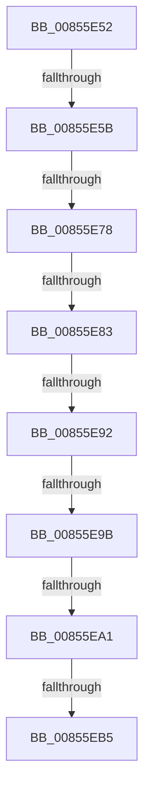

# sub_00855E52

- RVA: `0x00855E52`–`0x00855EC3` (길이 `113` bytes)
- VA: `0x0000000140855E52`
- 실행 섹션: `PAGE`
- PDB 이름 있음: `아니요`; PDB Function 태그: `아니요`
- unwind 정보 RVA: `0x0006A33C`
- 디코드: `34`개 명령, `113/113` bytes 표시
- 미해석 바이트: `0` (있으면 어셈블리에 `.byte`로 보존)

> 이 문서는 커널 이미지의 기계어와 PDB 기호를 분석해 생성했습니다. 4번과 5번은 함수 원형과 자료형을 바이너리 사용 방식에서 추정한 C 해석이며 원본 소스 복구 결과는 아닙니다.

## 1. Dependencies

- 직접 호출 지점: **2**; 고유 호출 대상: **2**
- 직접 호출자로 확인된 함수: **0**
- RIP 상대 이미지 참조: **0**

### Outgoing calls
- `0x00855E63` → [HvpMapEntryGetBinAddress](../../pagecmrc/BC/HvpMapEntryGetBinAddress_function_00BC9770.md) (function, `0x00BC9770`)
- `0x00855EB5` → [HvpReleaseCellPaged](HvpReleaseCellPaged_function_00855F40.md) (function, `0x00855F40`)

### Direct callers
- 이 함수 시작 RVA로 연결되는 직접 call은 확인되지 않았습니다. 간접 호출은 완전히 역산할 수 없습니다.

### Static image references
- 디코드된 RIP-relative 메모리 참조가 없습니다.

## 2. Other-region calls and transfers

- 다른 실행 섹션으로 향하는 call: **1**
  - `0x00855E63` → [HvpMapEntryGetBinAddress](../../pagecmrc/BC/HvpMapEntryGetBinAddress_function_00BC9770.md) (`PAGE` → `PAGECMRC`)
- call이 아닌 외부 분기/꼬리 이동: **7**
  - `0x00855E59` → [sub_00855DFB + 0x44](Unknown_function_00855DFB.md) (`tail-transfer`)
  - `0x00855E76` → [sub_00855ECF + 0xA](Unknown_function_00855ECF.md) (`tail-transfer`)
  - `0x00855E81` → [sub_00855ECF + 0xA](Unknown_function_00855ECF.md) (`tail-transfer`)
  - `0x00855E90` → [sub_00855ECF + 0xA](Unknown_function_00855ECF.md) (`tail-transfer`)
  - `0x00855E99` → [sub_00855ECF + 0xA](Unknown_function_00855ECF.md) (`tail-transfer`)
  - `0x00855E9F` → [sub_00855ECF + 0xA](Unknown_function_00855ECF.md) (`tail-transfer`)
  - `0x00855EB3` → [sub_00855ECF + 0xF](Unknown_function_00855ECF.md) (`tail-transfer`)

## 3. Assembly (complete function range)

```asm
00855E52  48 8D 48 FC                     lea rcx, [rax - 4]
00855E56  48 85 C9                        test rcx, rcx
00855E59  74 E4                           je 0x140855e3f
00855E5B  4C 8D 44 24 30                  lea r8, [rsp + 0x30]
00855E60  48 8B D6                        mov rdx, rsi
00855E63  E8 08 39 37 00                  call 0x140bc9770
00855E68  44 8B C1                        mov r8d, ecx
00855E6B  8B 09                           mov ecx, dword ptr [rcx]
00855E6D  8B D1                           mov edx, ecx
00855E6F  44 2B C0                        sub r8d, eax
00855E72  F7 DA                           neg edx
00855E74  85 C9                           test ecx, ecx
00855E76  79 61                           jns 0x140855ed9
00855E78  8D 4A F8                        lea ecx, [rdx - 8]
00855E7B  81 F9 F8 FF 0F 00               cmp ecx, 0xffff8
00855E81  77 56                           ja 0x140855ed9
00855E83  44 8B 48 08                     mov r9d, dword ptr [rax + 8]
00855E87  8B C2                           mov eax, edx
00855E89  49 8D 49 E0                     lea rcx, [r9 - 0x20]
00855E8D  48 3B C1                        cmp rax, rcx
00855E90  77 47                           ja 0x140855ed9
00855E92  42 8D 04 02                     lea eax, [rdx + r8]
00855E96  41 3B C1                        cmp eax, r9d
00855E99  77 3E                           ja 0x140855ed9
00855E9B  41 83 F8 20                     cmp r8d, 0x20
00855E9F  72 38                           jb 0x140855ed9
00855EA1  40 B7 01                        mov dil, 1
00855EA4  F6 83 8C 00 00 00 01            test byte ptr [rbx + 0x8c], 1
00855EAB  48 8D 54 24 48                  lea rdx, [rsp + 0x48]
00855EB0  48 8B CB                        mov rcx, rbx
00855EB3  75 29                           jne 0x140855ede
00855EB5  E8 86 00 00 00                  call 0x140855f40
00855EBA  40 0F B6 C7                     movzx eax, dil
00855EBE  48 8B 74 24 38                  mov rsi, qword ptr [rsp + 0x38]
```

## 4. C-style interpretation (structured pseudocode)

```c
__int64 __fastcall sub_00855E52(__int64 a1, __int64 a2, __int64 a3, __int64 a4, __int64 a5, __int64 a6, __int64 a7, __int64 a8, __int64 a9)
{
    __int64 result;

    result = HvpMapEntryGetBinAddress(result - 4, v_rsi, a6, a4);
    a3 = (unsigned int)(((unsigned int)((unsigned int)(result - 4))) - ((unsigned int)(result)));
    a2 = (unsigned int)(-((unsigned int)((unsigned int)((unsigned int)(*(unsigned int *)(result - 4))))));
    result = HvpReleaseCellPaged(v_rbx, a9, a3, (unsigned int)(*(unsigned int *)(result + 8)));
    return 1;
}
```

## 5. (Beta) C Style

```c
int64_t sub_00855E52(int64_t Arg1, int64_t Arg2, int64_t Arg3, int64_t Arg4, uint64_t Arg5, int64_t Arg6, int64_t Arg7, uint64_t Arg8, int64_t Arg9)
{
    int64_t result;

    result = HvpMapEntryGetBinAddress(result - 4, local_rsi, Arg6, Arg4);
    Arg3 = (uint32_t)(((uint32_t)((uint32_t)(result - 4))) - ((uint32_t)(result)));
    Arg2 = (uint32_t)(-((uint32_t)((uint32_t)((uint32_t)(*(uint32_t *)(result - 0x4))))));
    result = HvpReleaseCellPaged(local_rbx, Arg9, Arg3, (uint32_t)(*(uint32_t *)(result + 0x8)));
    return 1;
}
```

## 6. Execution-region graph

[열기: 2D/3D 그래프와 함수 탐색 컨트롤 패널](../../../control-panel.html?section=page&rva=0x00855E52&view=graph)

- 2D 그래프는 위에서 아래로 흐르고, 3D 그래프는 빈 공간을 드래그해 회전합니다. Shift+드래그는 이동, 휠은 확대·축소, 함수 노드 선택은 대상 보고서 이동입니다.

### Static fallback


