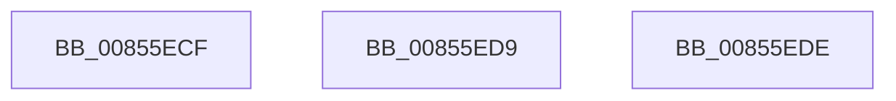

# sub_00855ECF

- RVA: `0x00855ECF`–`0x00855EF7` (길이 `40` bytes)
- VA: `0x0000000140855ECF`
- 실행 섹션: `PAGE`
- PDB 이름 있음: `아니요`; PDB Function 태그: `아니요`
- unwind 정보 RVA: `0x0006A364`
- 디코드: `11`개 명령, `40/40` bytes 표시
- 미해석 바이트: `0` (있으면 어셈블리에 `.byte`로 보존)

> 이 문서는 커널 이미지의 기계어와 PDB 기호를 분석해 생성했습니다. 4번과 5번은 함수 원형과 자료형을 바이너리 사용 방식에서 추정한 C 해석이며 원본 소스 복구 결과는 아닙니다.

## 1. Dependencies

- 직접 호출 지점: **2**; 고유 호출 대상: **2**
- 직접 호출자로 확인된 함수: **0**
- RIP 상대 이미지 참조: **0**

### Outgoing calls
- `0x00855ECF` → [HvpGetCellPaged](HvpGetCellPaged_function_00854CB0.md) (function, `0x00854CB0`)
- `0x00855EDE` → [HvpReleaseCellFlat](HvpReleaseCellFlat_function_0085CC20.md) (function, `0x0085CC20`)

### Direct callers
- 이 함수 시작 RVA로 연결되는 직접 call은 확인되지 않았습니다. 간접 호출은 완전히 역산할 수 없습니다.

### Static image references
- 디코드된 RIP-relative 메모리 참조가 없습니다.

## 2. Other-region calls and transfers

- 다른 실행 섹션으로 향하는 call: **0**
- call이 아닌 외부 분기/꼬리 이동: **2**
  - `0x00855ED4` → [sub_00855DFB + 0x3F](Unknown_function_00855DFB.md) (`tail-transfer`)
  - `0x00855EDC` → [sub_00855E52 + 0x52](Unknown_function_00855E52.md) (`tail-transfer`)

## 3. Assembly (complete function range)

```asm
00855ECF  E8 DC ED FF FF                  call 0x140854cb0
00855ED4  E9 61 FF FF FF                  jmp 0x140855e3a
00855ED9  40 32 FF                        xor dil, dil
00855EDC  EB C6                           jmp 0x140855ea4
00855EDE  E8 3D 6D 00 00                  call 0x14085cc20
00855EE3  48 8B 74 24 38                  mov rsi, qword ptr [rsp + 0x38]
00855EE8  40 0F B6 C7                     movzx eax, dil
00855EEC  48 8B 5C 24 40                  mov rbx, qword ptr [rsp + 0x40]
00855EF1  48 83 C4 20                     add rsp, 0x20
00855EF5  5F                              pop rdi
00855EF6  C3                              ret
```

## 4. C-style interpretation (structured pseudocode)

```c
__int64 __fastcall sub_00855ECF(void)
{
    __int64 result;
    unsigned __int64 v_stack_p38;
    unsigned __int64 v_stack_p40;

    result = HvpGetCellPaged(a1, a2, a3, a4);
}
```

## 5. (Beta) C Style

```c
void sub_00855ECF(void)
{
    int64_t result;
    uint64_t v_stack_p38;
    uint64_t v_stack_p40;

    result = HvpGetCellPaged(a1, a2, a3, a4);
}
```

## 6. Execution-region graph

[열기: 2D/3D 그래프와 함수 탐색 컨트롤 패널](../../../control-panel.html?section=page&rva=0x00855ECF&view=graph)

- 2D 그래프는 위에서 아래로 흐르고, 3D 그래프는 빈 공간을 드래그해 회전합니다. Shift+드래그는 이동, 휠은 확대·축소, 함수 노드 선택은 대상 보고서 이동입니다.

### Static fallback


