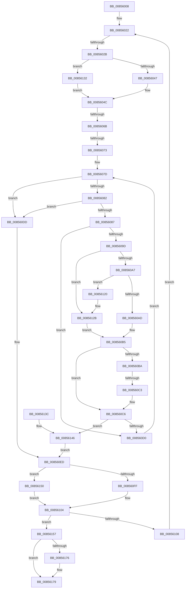

# sub_00856008

- RVA: `0x00856008`–`0x00856195` (길이 `397` bytes)
- VA: `0x0000000140856008`
- 실행 섹션: `PAGE`
- PDB 이름 있음: `아니요`; PDB Function 태그: `아니요`
- unwind 정보 RVA: `0x0006A3B4`
- 디코드: `98`개 명령, `397/397` bytes 표시
- 미해석 바이트: `0` (있으면 어셈블리에 `.byte`로 보존)

> 이 문서는 커널 이미지의 기계어와 PDB 기호를 분석해 생성했습니다. 4번과 5번은 함수 원형과 자료형을 바이너리 사용 방식에서 추정한 C 해석이며 원본 소스 복구 결과는 아닙니다.

## 1. Dependencies

- 직접 호출 지점: **5**; 고유 호출 대상: **5**
- 직접 호출자로 확인된 함수: **0**
- RIP 상대 이미지 참조: **0**

### Outgoing calls
- `0x00856047` → [HvpGetCellFlat](HvpGetCellFlat_function_00854C60.md) (function, `0x00854C60`)
- `0x008560FF` → [HvpReleaseCellPaged](HvpReleaseCellPaged_function_00855F40.md) (function, `0x00855F40`)
- `0x00856123` → [RtlUpcaseUnicodeChar](RtlUpcaseUnicodeChar_function_0085F0F0.md) (function, `0x0085F0F0`)
- `0x00856132` → [HvpGetCellPaged](HvpGetCellPaged_function_00854CB0.md) (function, `0x00854CB0`)
- `0x00856150` → [HvpReleaseCellFlat](HvpReleaseCellFlat_function_0085CC20.md) (function, `0x0085CC20`)

### Direct callers
- 이 함수 시작 RVA로 연결되는 직접 call은 확인되지 않았습니다. 간접 호출은 완전히 역산할 수 없습니다.

### Static image references
- 디코드된 RIP-relative 메모리 참조가 없습니다.

## 2. Other-region calls and transfers

- 다른 실행 섹션으로 향하는 call: **0**
- call이 아닌 외부 분기/꼬리 이동: **5**
  - `0x00856025` → [sub_00856195](Unknown_function_00856195.md) (`tail-transfer`)
  - `0x00856065` → [sub_00856195 + 0x3E](Unknown_function_00856195.md) (`tail-transfer`)
  - `0x0085606D` → [sub_00856195 + 0x25](Unknown_function_00856195.md) (`tail-transfer`)
  - `0x008560BD` → [sub_00856195 + 0xE1](Unknown_function_00856195.md) (`tail-transfer`)
  - `0x00856190` → [CmpFindNameInListCellWithStatus + 0x5C](CmpFindNameInListCellWithStatus_function_00855FA0.md) (`tail-transfer`)

## 3. Assembly (complete function range)

```asm
00856008  48 89 AC 24 80 00 00 00         mov qword ptr [rsp + 0x80], rbp
00856010  48 89 7C 24 50                  mov qword ptr [rsp + 0x50], rdi
00856015  4C 89 6C 24 48                  mov qword ptr [rsp + 0x48], r13
0085601A  4C 89 74 24 40                  mov qword ptr [rsp + 0x40], r14
0085601F  45 8B F4                        mov r14d, r12d
00856022  45 3B F0                        cmp r14d, r8d
00856025  0F 83 6A 01 00 00               jae 0x140856195
0085602B  41 F6 87 8C 00 00 00 01         test byte ptr [r15 + 0x8c], 1
00856033  4C 8D 44 24 30                  lea r8, [rsp + 0x30]
00856038  41 8B C6                        mov eax, r14d
0085603B  49 8B CF                        mov rcx, r15
0085603E  8B 14 86                        mov edx, dword ptr [rsi + rax*4]
00856041  0F 84 EB 00 00 00               je 0x140856132
00856047  E8 14 EC FF FF                  call 0x140854c60
0085604C  8B 8C 24 A0 00 00 00            mov ecx, dword ptr [rsp + 0xa0]
00856053  4C 8D 68 14                     lea r13, [rax + 0x14]
00856057  0F B7 68 02                     movzx ebp, word ptr [rax + 2]
0085605B  81 E1 00 00 01 00               and ecx, 0x10000
00856061  F6 40 10 01                     test byte ptr [rax + 0x10], 1
00856065  0F 84 68 01 00 00               je 0x1408561d3
0085606B  85 C9                           test ecx, ecx
0085606D  0F 85 47 01 00 00               jne 0x1408561ba
00856073  4C 8B 63 08                     mov r12, qword ptr [rbx + 8]
00856077  0F B7 1B                        movzx ebx, word ptr [rbx]
0085607A  66 D1 EB                        shr bx, 1
0085607D  66 85 DB                        test bx, bx
00856080  74 5B                           je 0x1408560dd
00856082  66 85 ED                        test bp, bp
00856085  74 56                           je 0x1408560dd
00856087  41 0F B7 3C 24                  movzx edi, word ptr [r12]
0085608C  49 83 C4 02                     add r12, 2
00856090  41 0F B6 75 00                  movzx esi, byte ptr [r13]
00856095  49 FF C5                        inc r13
00856098  66 3B FE                        cmp di, si
0085609B  74 33                           je 0x1408560d0
0085609D  66 83 FF 61                     cmp di, 0x61
008560A1  0F 82 84 00 00 00               jb 0x14085612b
008560A7  66 83 FF 7A                     cmp di, 0x7a
008560AB  77 73                           ja 0x140856120
008560AD  B8 E0 FF 00 00                  mov eax, 0xffe0
008560B2  66 03 F8                        add di, ax
008560B5  83 FE 61                        cmp esi, 0x61
008560B8  72 0C                           jb 0x1408560c6
008560BA  83 FE 7A                        cmp esi, 0x7a
008560BD  0F 87 B3 01 00 00               ja 0x140856276
008560C3  66 03 F0                        add si, ax
008560C6  0F B7 C6                        movzx eax, si
008560C9  0F B7 FF                        movzx edi, di
008560CC  2B F8                           sub edi, eax
008560CE  75 76                           jne 0x140856146
008560D0  BF FF FF 00 00                  mov edi, 0xffff
008560D5  66 03 DF                        add bx, di
008560D8  66 03 EF                        add bp, di
008560DB  EB A0                           jmp 0x14085607d
008560DD  48 8B B4 24 88 00 00 00         mov rsi, qword ptr [rsp + 0x88]
008560E5  0F B7 C5                        movzx eax, bp
008560E8  0F B7 FB                        movzx edi, bx
008560EB  2B F8                           sub edi, eax
008560ED  41 F6 87 8C 00 00 00 01         test byte ptr [r15 + 0x8c], 1
008560F5  48 8D 54 24 30                  lea rdx, [rsp + 0x30]
008560FA  49 8B CF                        mov rcx, r15
008560FD  75 51                           jne 0x140856150
008560FF  E8 3C FE FF FF                  call 0x140855f40
00856104  85 FF                           test edi, edi
00856106  74 4F                           je 0x140856157
00856108  44 8B 84 24 90 00 00 00         mov r8d, dword ptr [rsp + 0x90]
00856110  41 FF C6                        inc r14d
00856113  48 8B 9C 24 98 00 00 00         mov rbx, qword ptr [rsp + 0x98]
0085611B  E9 02 FF FF FF                  jmp 0x140856022
00856120  0F B7 CF                        movzx ecx, di
00856123  E8 C8 8F 00 00                  call 0x14085f0f0
00856128  0F B7 F8                        movzx edi, ax
0085612B  B8 E0 FF 00 00                  mov eax, 0xffe0
00856130  EB 83                           jmp 0x1408560b5
00856132  E8 79 EB FF FF                  call 0x140854cb0
00856137  E9 10 FF FF FF                  jmp 0x14085604c
0085613C  0F B7 C6                        movzx eax, si
0085613F  0F B7 FD                        movzx edi, bp
00856142  2B F8                           sub edi, eax
00856144  F7 DF                           neg edi
00856146  48 8B B4 24 88 00 00 00         mov rsi, qword ptr [rsp + 0x88]
0085614E  EB 9D                           jmp 0x1408560ed
00856150  E8 CB 6A 00 00                  call 0x14085cc20
00856155  EB AD                           jmp 0x140856104
00856157  41 8B CE                        mov ecx, r14d
0085615A  33 C0                           xor eax, eax
0085615C  8B 14 8E                        mov edx, dword ptr [rsi + rcx*4]
0085615F  48 8B 8C 24 B0 00 00 00         mov rcx, qword ptr [rsp + 0xb0]
00856167  89 11                           mov dword ptr [rcx], edx
00856169  48 8B 8C 24 A8 00 00 00         mov rcx, qword ptr [rsp + 0xa8]
00856171  48 85 C9                        test rcx, rcx
00856174  74 03                           je 0x140856179
00856176  44 89 31                        mov dword ptr [rcx], r14d
00856179  4C 8B 6C 24 48                  mov r13, qword ptr [rsp + 0x48]
0085617E  48 8B 7C 24 50                  mov rdi, qword ptr [rsp + 0x50]
00856183  48 8B AC 24 80 00 00 00         mov rbp, qword ptr [rsp + 0x80]
0085618B  4C 8B 74 24 40                  mov r14, qword ptr [rsp + 0x40]
00856190  E9 67 FE FF FF                  jmp 0x140855ffc
```

## 4. C-style interpretation (structured pseudocode)

```c
__int64 __fastcall sub_00856008(__int64 a1, __int64 a2, int a3, __int64 a4, __int64 a5, __int64 a6, __int64 a7, __int64 a8, __int64 a9, __int64 a10, __int64 a11, __int64 a12, __int64 a13, __int64 a14, __int64 a15, __int64 a16, __int64 a17, unsigned int a18, __int64 a19, unsigned int a20, __int64 a21, __int64 a22)
{
    __int64 result;
    __int64 v_r12;
    __int64 v_r13;
    __int64 v_r14;
    __int64 v_rbp;
    __int64 v_rbx;
    __int64 v_rdi;
    __int64 v_rsi;
    unsigned __int64 v_stack_p40;
    unsigned __int64 v_stack_p48;
    unsigned __int64 v_stack_p50;
    unsigned __int64 v_stack_p80;

    v_stack_p80 = v_rbp;
    v_stack_p50 = v_rdi;
    v_stack_p48 = v_r13;
    v_stack_p40 = v_r14;
loc_00856022:
    if (((*(unsigned __int8 *)(v_r15 + 140)) & (1)) == 0) goto loc_00856132;
    result = HvpGetCellFlat(v_r15, (unsigned int)(*(unsigned int *)(v_rsi + (unsigned int)((unsigned int)((unsigned int)((unsigned int)(v_r12)))) * 4)), a6, a4);
loc_0085604C:
    a1 = (unsigned int)(((unsigned int)(a20)) & (0x10000ULL));
    v_rbx = (unsigned __int16)((*(unsigned __int16 *)(v_rbx)) >> (1));
loc_0085607D:
    if ((unsigned __int16)(v_rbx) == 0) goto loc_008560DD;
    if ((unsigned __int16)(*(unsigned __int16 *)(result + 2)) == 0) goto loc_008560DD;
    v_r12 = (*(unsigned __int64 *)(v_rbx + 8)) + (2);
    v_r13 = (result + 20) + 1;
    if (((unsigned __int16)(*(unsigned __int16 *)(*(unsigned __int64 *)(v_rbx + 8)))) == ((unsigned __int16)(*(unsigned __int8 *)(result + 20)))) goto loc_008560D0;
    if (((unsigned __int16)(*(unsigned __int16 *)(*(unsigned __int64 *)(v_rbx + 8)))) < 97) goto loc_0085612B;
    if (((unsigned __int16)(*(unsigned __int16 *)(*(unsigned __int64 *)(v_rbx + 8)))) > 122) goto loc_00856120;
    v_rdi = (unsigned __int16)((*(unsigned __int16 *)(*(unsigned __int64 *)(v_rbx + 8))) + ((unsigned __int16)((unsigned int)(0xFFE0ULL))));
loc_008560B5:
    if (((unsigned int)(*(unsigned __int8 *)(result + 20))) < 97) goto loc_008560C6;
    v_rsi = (unsigned __int16)((*(unsigned __int8 *)(result + 20)) + ((unsigned __int16)((unsigned int)(0xFFE0ULL))));
loc_008560C6:
    v_rdi = (unsigned int)(((unsigned __int16)(v_rdi)) - ((unsigned int)((unsigned __int16)(v_rsi))));
    if (condition_is_not_equal) goto loc_00856146;
loc_008560D0:
    v_rbx = (unsigned __int16)((v_rbx) + ((unsigned __int16)((unsigned int)(0xFFFFULL))));
    v_rbp = (unsigned __int16)((*(unsigned __int16 *)(result + 2)) + ((unsigned __int16)((unsigned int)(0xFFFFULL))));
    goto loc_0085607D;
loc_008560DD:
    v_rdi = (unsigned int)(((unsigned __int16)(v_rbx)) - ((unsigned int)((unsigned __int16)(v_rbp))));
loc_008560ED:
    if (((*(unsigned __int8 *)(v_r15 + 140)) & (1)) != 0) goto loc_00856150;
    result = HvpReleaseCellPaged(v_r15, a6, a6, a4);
loc_00856104:
    if ((unsigned int)(v_rdi) == 0) goto loc_00856157;
    v_r14 = (unsigned int)(((unsigned int)((unsigned int)(v_r12))) + 1);
    goto loc_00856022;
loc_00856120:
    result = RtlUpcaseUnicodeChar((unsigned __int16)(v_rdi), a6, (unsigned int)(a18), a4);
loc_0085612B:
    goto loc_008560B5;
loc_00856132:
    result = HvpGetCellPaged((unsigned __int16)(v_rdi), a6, (unsigned int)(a18), a4);
    goto loc_0085604C;
loc_00856146:
    goto loc_008560ED;
loc_00856150:
    result = HvpReleaseCellFlat((unsigned __int16)(v_rdi), a6, (unsigned int)(a18), a4);
    goto loc_00856104;
loc_00856157:
    result = 0;
    *(unsigned int *)(a22) = (unsigned int)((unsigned int)(*(unsigned int *)(a17 + (unsigned int)((unsigned int)(v_r14)) * 4)));
    if (a21 != 0) {
        *(unsigned int *)(a21) = (unsigned int)(v_r14);
    }
}
```

## 5. (Beta) C Style

```c
int64_t sub_00856008(int64_t Arg1, int64_t Arg2, int32_t Arg3, int64_t Arg4, uint64_t Arg5, int64_t Arg6, uint64_t Arg7, int64_t Arg8, int64_t Arg9, int64_t Arg10, uint64_t Arg11, uint64_t Arg12, uint64_t Arg13, uint64_t Arg14, uint64_t Arg15, int64_t Arg16, void *Arg17, uint32_t Arg18, int64_t Arg19, uint32_t Arg20, int64_t Arg21, void *Arg22)
{
    uint8_t *arg17 = (uint8_t *)Arg17;
    uint8_t *arg22 = (uint8_t *)Arg22;

    int64_t result;
    int64_t local_r12;
    int64_t local_r13;
    int64_t local_r14;
    int64_t local_rbp;
    int64_t local_rbx;
    int64_t local_rdi;
    int64_t local_rsi;
    uint64_t v_stack_p40;
    uint64_t v_stack_p48;
    uint64_t v_stack_p50;
    uint64_t v_stack_p80;

    v_stack_p80 = local_rbp;
    v_stack_p50 = local_rdi;
    v_stack_p48 = local_r13;
    v_stack_p40 = local_r14;
loc_00856022:
    if (((*(uint8_t *)(local_r15 + 0x8C)) & (1)) == 0) goto loc_00856132;
    result = HvpGetCellFlat(local_r15, (uint32_t)(*(uint32_t *)(local_rsi + (uint32_t)((uint32_t)((uint32_t)((uint32_t)(local_r12)))) * 4)), Arg6, Arg4);
loc_0085604C:
    Arg1 = (uint32_t)(((uint32_t)(Arg20)) & (0x10000ULL));
    local_rbx = (uint16_t)((*(uint16_t *)(local_rbx)) >> (1));
loc_0085607D:
    if ((uint16_t)(local_rbx) == 0) goto loc_008560DD;
    if ((uint16_t)(*(uint16_t *)(result + 0x2)) == 0) goto loc_008560DD;
    local_r12 = (*(uint64_t *)(local_rbx + 0x8)) + (2);
    local_r13 = (result + 20) + 1;
    if (((uint16_t)(*(uint16_t *)(*(uint64_t *)(local_rbx + 0x8)))) == ((uint16_t)(*(uint8_t *)(result + 0x14)))) goto loc_008560D0;
    if (((uint16_t)(*(uint16_t *)(*(uint64_t *)(local_rbx + 0x8)))) < 97) goto loc_0085612B;
    if (((uint16_t)(*(uint16_t *)(*(uint64_t *)(local_rbx + 0x8)))) > 122) goto loc_00856120;
    local_rdi = (uint16_t)((*(uint16_t *)(*(uint64_t *)(local_rbx + 0x8))) + ((uint16_t)((uint32_t)(0xFFE0ULL))));
loc_008560B5:
    if (((uint32_t)(*(uint8_t *)(result + 0x14))) < 97) goto loc_008560C6;
    local_rsi = (uint16_t)((*(uint8_t *)(result + 0x14)) + ((uint16_t)((uint32_t)(0xFFE0ULL))));
loc_008560C6:
    local_rdi = (uint32_t)(((uint16_t)(local_rdi)) - ((uint32_t)((uint16_t)(local_rsi))));
    if (condition_is_not_equal) goto loc_00856146;
loc_008560D0:
    local_rbx = (uint16_t)((local_rbx) + ((uint16_t)((uint32_t)(0xFFFFULL))));
    local_rbp = (uint16_t)((*(uint16_t *)(result + 0x2)) + ((uint16_t)((uint32_t)(0xFFFFULL))));
    goto loc_0085607D;
loc_008560DD:
    local_rdi = (uint32_t)(((uint16_t)(local_rbx)) - ((uint32_t)((uint16_t)(local_rbp))));
loc_008560ED:
    if (((*(uint8_t *)(local_r15 + 0x8C)) & (1)) != 0) goto loc_00856150;
    result = HvpReleaseCellPaged(local_r15, Arg6, Arg6, Arg4);
loc_00856104:
    if ((uint32_t)(local_rdi) == 0) goto loc_00856157;
    local_r14 = (uint32_t)(((uint32_t)((uint32_t)(local_r12))) + 1);
    goto loc_00856022;
loc_00856120:
    result = RtlUpcaseUnicodeChar((uint16_t)(local_rdi), Arg6, (uint32_t)(Arg18), Arg4);
loc_0085612B:
    goto loc_008560B5;
loc_00856132:
    result = HvpGetCellPaged((uint16_t)(local_rdi), Arg6, (uint32_t)(Arg18), Arg4);
    goto loc_0085604C;
loc_00856146:
    goto loc_008560ED;
loc_00856150:
    result = HvpReleaseCellFlat((uint16_t)(local_rdi), Arg6, (uint32_t)(Arg18), Arg4);
    goto loc_00856104;
loc_00856157:
    result = 0;
    *(uint32_t *)(arg22) = (uint32_t)((uint32_t)(*(uint32_t *)(arg17 + (uint32_t)((uint32_t)(local_r14)) * 4)));
    if (Arg21 != 0) {
        *(uint32_t *)(Arg21) = (uint32_t)(local_r14);
    }
}
```

### 관측된 메모리 오프셋

구조체 형식이 확인되지 않은 접근은 인자 기준의 오프셋으로만 기록했습니다.

| 기준 인자 | 오프셋 표현 | 폭 (bit) | 접근 |
|---|---:|---:|---|
| `Arg17` | `+ 0x0 + rcx*4` | `32` | `R` |
| `Arg22` | `+ 0x0` | `32` | `W` |

## 6. Execution-region graph

[열기: 2D/3D 그래프와 함수 탐색 컨트롤 패널](../../../control-panel.html?section=page&rva=0x00856008&view=graph)

- 2D 그래프는 위에서 아래로 흐르고, 3D 그래프는 빈 공간을 드래그해 회전합니다. Shift+드래그는 이동, 휠은 확대·축소, 함수 노드 선택은 대상 보고서 이동입니다.

### Static fallback


