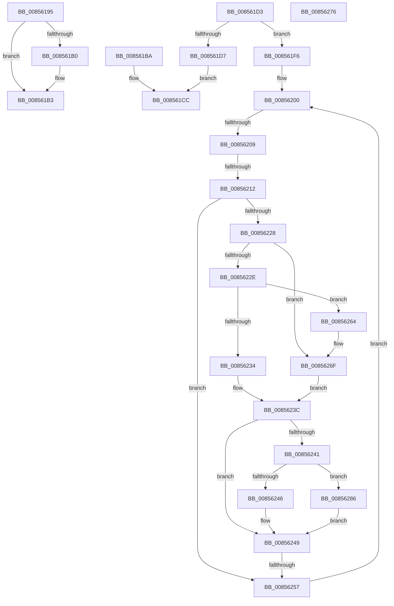

# sub_00856195

- RVA: `0x00856195`–`0x00856293` (길이 `254` bytes)
- VA: `0x0000000140856195`
- 실행 섹션: `PAGE`
- PDB 이름 있음: `아니요`; PDB Function 태그: `아니요`
- unwind 정보 RVA: `0x0006A3D4`
- 디코드: `71`개 명령, `254/254` bytes 표시
- 미해석 바이트: `0` (있으면 어셈블리에 `.byte`로 보존)

> 이 문서는 커널 이미지의 기계어와 PDB 기호를 분석해 생성했습니다. 4번과 5번은 함수 원형과 자료형을 바이너리 사용 방식에서 추정한 C 해석이며 원본 소스 복구 결과는 아닙니다.

## 1. Dependencies

- 직접 호출 지점: **5**; 고유 호출 대상: **3**
- 직접 호출자로 확인된 함수: **0**
- RIP 상대 이미지 참조: **0**

### Outgoing calls
- `0x008561C7` → [CmpCompareTwoCompressedNames](../84/CmpCompareTwoCompressedNames_function_00847610.md) (function, `0x00847610`)
- `0x008561EF` → [RtlCompareUnicodeStrings](../97/RtlCompareUnicodeStrings_function_009727E0.md) (function, `0x009727E0`)
- `0x00856267` → [RtlUpcaseUnicodeChar](RtlUpcaseUnicodeChar_function_0085F0F0.md) (function, `0x0085F0F0`)
- `0x00856279` → [RtlUpcaseUnicodeChar](RtlUpcaseUnicodeChar_function_0085F0F0.md) (function, `0x0085F0F0`)
- `0x00856289` → [RtlUpcaseUnicodeChar](RtlUpcaseUnicodeChar_function_0085F0F0.md) (function, `0x0085F0F0`)

### Direct callers
- 이 함수 시작 RVA로 연결되는 직접 call은 확인되지 않았습니다. 간접 호출은 완전히 역산할 수 없습니다.

### Static image references
- 디코드된 RIP-relative 메모리 참조가 없습니다.

## 2. Other-region calls and transfers

- 다른 실행 섹션으로 향하는 call: **0**
- call이 아닌 외부 분기/꼬리 이동: **6**
  - `0x008561B8` → [sub_00856008 + 0x171](Unknown_function_00856008.md) (`tail-transfer`)
  - `0x008561CE` → [sub_00856008 + 0xE5](Unknown_function_00856008.md) (`tail-transfer`)
  - `0x00856203` → [sub_00856008 + 0x134](Unknown_function_00856008.md) (`tail-transfer`)
  - `0x0085620C` → [sub_00856008 + 0x134](Unknown_function_00856008.md) (`tail-transfer`)
  - `0x00856251` → [sub_00856008 + 0x13C](Unknown_function_00856008.md) (`tail-transfer`)
  - `0x00856281` → [sub_00856008 + 0xBE](Unknown_function_00856008.md) (`tail-transfer`)

## 3. Assembly (complete function range)

```asm
00856195  48 8B 8C 24 B0 00 00 00         mov rcx, qword ptr [rsp + 0xb0]
0085619D  48 8B 84 24 A8 00 00 00         mov rax, qword ptr [rsp + 0xa8]
008561A5  C7 01 FF FF FF FF               mov dword ptr [rcx], 0xffffffff
008561AB  48 85 C0                        test rax, rax
008561AE  74 03                           je 0x1408561b3
008561B0  44 89 00                        mov dword ptr [rax], r8d
008561B3  B8 34 00 00 C0                  mov eax, 0xc0000034
008561B8  EB BF                           jmp 0x140856179
008561BA  0F B7 13                        movzx edx, word ptr [rbx]
008561BD  44 8B CD                        mov r9d, ebp
008561C0  48 8B 4B 08                     mov rcx, qword ptr [rbx + 8]
008561C4  4D 8B C5                        mov r8, r13
008561C7  E8 44 14 FF FF                  call 0x140847610
008561CC  8B F8                           mov edi, eax
008561CE  E9 1A FF FF FF                  jmp 0x1408560ed
008561D3  85 C9                           test ecx, ecx
008561D5  75 1F                           jne 0x1408561f6
008561D7  0F B7 13                        movzx edx, word ptr [rbx]
008561DA  4C 8B CD                        mov r9, rbp
008561DD  48 8B 4B 08                     mov rcx, qword ptr [rbx + 8]
008561E1  4D 8B C5                        mov r8, r13
008561E4  49 D1 E9                        shr r9, 1
008561E7  48 D1 EA                        shr rdx, 1
008561EA  C6 44 24 20 01                  mov byte ptr [rsp + 0x20], 1
008561EF  E8 EC C5 11 00                  call 0x1409727e0
008561F4  EB D6                           jmp 0x1408561cc
008561F6  4C 8B 63 08                     mov r12, qword ptr [rbx + 8]
008561FA  0F B7 33                        movzx esi, word ptr [rbx]
008561FD  66 D1 ED                        shr bp, 1
00856200  66 85 ED                        test bp, bp
00856203  0F 84 33 FF FF FF               je 0x14085613c
00856209  66 85 F6                        test si, si
0085620C  0F 84 2A FF FF FF               je 0x14085613c
00856212  41 0F B7 5D 00                  movzx ebx, word ptr [r13]
00856217  49 83 C5 02                     add r13, 2
0085621B  41 0F B6 3C 24                  movzx edi, byte ptr [r12]
00856220  49 FF C4                        inc r12
00856223  66 3B DF                        cmp bx, di
00856226  74 2F                           je 0x140856257
00856228  66 83 FB 61                     cmp bx, 0x61
0085622C  72 41                           jb 0x14085626f
0085622E  66 83 FB 7A                     cmp bx, 0x7a
00856232  77 30                           ja 0x140856264
00856234  B8 E0 FF 00 00                  mov eax, 0xffe0
00856239  66 03 D8                        add bx, ax
0085623C  83 FF 61                        cmp edi, 0x61
0085623F  72 08                           jb 0x140856249
00856241  83 FF 7A                        cmp edi, 0x7a
00856244  77 40                           ja 0x140856286
00856246  66 03 F8                        add di, ax
00856249  0F B7 C7                        movzx eax, di
0085624C  0F B7 FB                        movzx edi, bx
0085624F  2B F8                           sub edi, eax
00856251  0F 85 ED FE FF FF               jne 0x140856144
00856257  B8 FF FF 00 00                  mov eax, 0xffff
0085625C  66 03 E8                        add bp, ax
0085625F  66 03 F0                        add si, ax
00856262  EB 9C                           jmp 0x140856200
00856264  0F B7 CB                        movzx ecx, bx
00856267  E8 84 8E 00 00                  call 0x14085f0f0
0085626C  0F B7 D8                        movzx ebx, ax
0085626F  B8 E0 FF 00 00                  mov eax, 0xffe0
00856274  EB C6                           jmp 0x14085623c
00856276  0F B7 CE                        movzx ecx, si
00856279  E8 72 8E 00 00                  call 0x14085f0f0
0085627E  0F B7 F0                        movzx esi, ax
00856281  E9 40 FE FF FF                  jmp 0x1408560c6
00856286  0F B7 CF                        movzx ecx, di
00856289  E8 62 8E 00 00                  call 0x14085f0f0
0085628E  0F B7 F8                        movzx edi, ax
00856291  EB B6                           jmp 0x140856249
```

## 4. C-style interpretation (structured pseudocode)

```c
__int64 __fastcall sub_00856195(__int64 a1, __int64 a2, int a3, __int64 a4, __int64 a5, __int64 a6, __int64 a7, __int64 a8, __int64 a9, __int64 a10, __int64 a11, __int64 a12, __int64 a13, __int64 a14, __int64 a15, __int64 a16, __int64 a17, __int64 a18, __int64 a19, __int64 a20, __int64 a21, __int64 a22)
{
    unsigned __int8 v_stack_p20;

    *(unsigned int *)(a22) = 0xFFFFFFFFULL;
    if (a21 != 0) {
        *(unsigned int *)(a21) = a3;
    }
}
```

## 5. (Beta) C Style

```c
int64_t sub_00856195(int64_t Arg1, int64_t Arg2, int32_t Arg3, int64_t Arg4, uint64_t Arg5, uint64_t Arg6, uint64_t Arg7, uint64_t Arg8, uint64_t Arg9, uint64_t Arg10, uint64_t Arg11, uint64_t Arg12, uint64_t Arg13, uint64_t Arg14, uint64_t Arg15, uint64_t Arg16, uint64_t Arg17, uint64_t Arg18, uint64_t Arg19, uint64_t Arg20, int64_t Arg21, void *Arg22)
{
    uint8_t *arg22 = (uint8_t *)Arg22;

    uint8_t v_stack_p20;

    *(uint32_t *)(arg22) = 0xFFFFFFFFULL;
    if (Arg21 != 0) {
        *(uint32_t *)(Arg21) = Arg3;
    }
}
```

### 관측된 메모리 오프셋

구조체 형식이 확인되지 않은 접근은 인자 기준의 오프셋으로만 기록했습니다.

| 기준 인자 | 오프셋 표현 | 폭 (bit) | 접근 |
|---|---:|---:|---|
| `Arg22` | `+ 0x0` | `32` | `W` |

## 6. Execution-region graph

[열기: 2D/3D 그래프와 함수 탐색 컨트롤 패널](../../../control-panel.html?section=page&rva=0x00856195&view=graph)

- 2D 그래프는 위에서 아래로 흐르고, 3D 그래프는 빈 공간을 드래그해 회전합니다. Shift+드래그는 이동, 휠은 확대·축소, 함수 노드 선택은 대상 보고서 이동입니다.

### Static fallback


