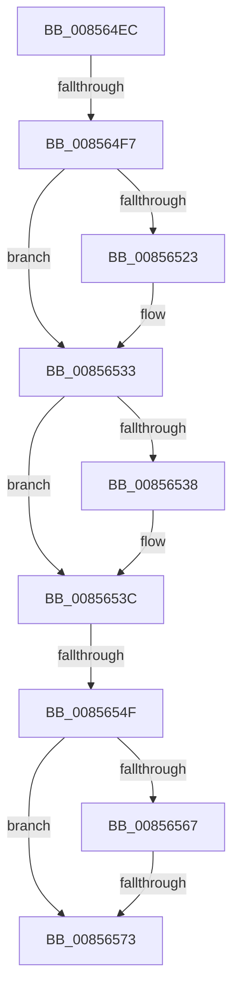

# sub_008564EC

- RVA: `0x008564EC`–`0x00856589` (길이 `157` bytes)
- VA: `0x00000001408564EC`
- 실행 섹션: `PAGE`
- PDB 이름 있음: `아니요`; PDB Function 태그: `아니요`
- unwind 정보 RVA: `0x0006A41C`
- 디코드: `41`개 명령, `157/157` bytes 표시
- 미해석 바이트: `0` (있으면 어셈블리에 `.byte`로 보존)

> 이 문서는 커널 이미지의 기계어와 PDB 기호를 분석해 생성했습니다. 4번과 5번은 함수 원형과 자료형을 바이너리 사용 방식에서 추정한 C 해석이며 원본 소스 복구 결과는 아닙니다.

## 1. Dependencies

- 직접 호출 지점: **4**; 고유 호출 대상: **4**
- 직접 호출자로 확인된 함수: **0**
- RIP 상대 이미지 참조: **1**

### Outgoing calls
- `0x008564F7` → [HvpReleaseCellPaged](HvpReleaseCellPaged_function_00855F40.md) (function, `0x00855F40`)
- `0x0085650C` → [KeAbPreAcquire](../../text/21/KeAbPreAcquire_function_00210230.md) (function, `0x00210230`)
- `0x0085652E` → [ExfAcquirePushLockSharedEx](../../text/21/ExfAcquirePushLockSharedEx_function_0021044C.md) (function, `0x0021044C`)
- `0x0085654F` → [HvpGetCellFlat](HvpGetCellFlat_function_00854C60.md) (function, `0x00854C60`)

### Direct callers
- 이 함수 시작 RVA로 연결되는 직접 call은 확인되지 않았습니다. 간접 호출은 완전히 역산할 수 없습니다.

### Static image references
- `0x00856567` → RVA `0x00E0EC94` (`.data`; read)

## 2. Other-region calls and transfers

- 다른 실행 섹션으로 향하는 call: **2**
  - `0x0085650C` → [KeAbPreAcquire](../../text/21/KeAbPreAcquire_function_00210230.md) (`PAGE` → `.text`)
  - `0x0085652E` → [ExfAcquirePushLockSharedEx](../../text/21/ExfAcquirePushLockSharedEx_function_0021044C.md) (`PAGE` → `.text`)
- call이 아닌 외부 분기/꼬리 이동: **4**
  - `0x008564F1` → [sub_00856607](Unknown_function_00856607.md) (`tail-transfer`)
  - `0x0085654D` → [sub_008565B6](Unknown_function_008565B6.md) (`tail-transfer`)
  - `0x00856571` → [sub_008565B6 + 0x7](Unknown_function_008565B6.md) (`tail-transfer`)
  - `0x00856587` → [sub_00856589 + 0x9](Unknown_function_00856589.md) (`tail-transfer`)

## 3. Assembly (complete function range)

```asm
008564EC  4C 89 74 24 48                  mov qword ptr [rsp + 0x48], r14
008564F1  0F 85 10 01 00 00               jne 0x140856607
008564F7  E8 44 FA FF FF                  call 0x140855f40
008564FC  48 8B 7B 20                     mov rdi, qword ptr [rbx + 0x20]
00856500  45 33 C0                        xor r8d, r8d
00856503  48 83 C7 48                     add rdi, 0x48
00856507  33 D2                           xor edx, edx
00856509  48 8B CF                        mov rcx, rdi
0085650C  E8 1F 9D 9B FF                  call 0x140210230
00856511  48 8B F0                        mov rsi, rax
00856514  41 BE 11 00 00 00               mov r14d, 0x11
0085651A  33 C0                           xor eax, eax
0085651C  F0 4C 0F B1 37                  lock cmpxchg qword ptr [rdi], r14
00856521  74 10                           je 0x140856533
00856523  4C 8B CF                        mov r9, rdi
00856526  4C 8B C6                        mov r8, rsi
00856529  33 D2                           xor edx, edx
0085652B  48 8B CF                        mov rcx, rdi
0085652E  E8 19 9F 9B FF                  call 0x14021044c
00856533  48 85 F6                        test rsi, rsi
00856536  74 04                           je 0x14085653c
00856538  C6 46 0A 01                     mov byte ptr [rsi + 0xa], 1
0085653C  48 8B 4B 20                     mov rcx, qword ptr [rbx + 0x20]
00856540  4C 8B C5                        mov r8, rbp
00856543  8B 53 28                        mov edx, dword ptr [rbx + 0x28]
00856546  F6 81 8C 00 00 00 01            test byte ptr [rcx + 0x8c], 1
0085654D  74 67                           je 0x1408565b6
0085654F  E8 0C E7 FF FF                  call 0x140854c60
00856554  48 8B 4B 20                     mov rcx, qword ptr [rbx + 0x20]
00856558  48 8B F8                        mov rdi, rax
0085655B  F7 81 A0 00 00 00 01 80 00 00   test dword ptr [rcx + 0xa0], 0x8001
00856565  75 0C                           jne 0x140856573
00856567  0F B6 05 26 87 5B 00            movzx eax, byte ptr [rip + 0x5b8726]
0085656E  84 47 0C                        test byte ptr [rdi + 0xc], al
00856571  74 4A                           je 0x1408565bd
00856573  48 8B 5B 20                     mov rbx, qword ptr [rbx + 0x20]
00856577  49 8B C6                        mov rax, r14
0085657A  4C 8B 74 24 48                  mov r14, qword ptr [rsp + 0x48]
0085657F  33 C9                           xor ecx, ecx
00856581  F0 48 0F B1 4B 48               lock cmpxchg qword ptr [rbx + 0x48], rcx
00856587  74 09                           je 0x140856592
```

## 4. C-style interpretation (structured pseudocode)

```c
__int64 __fastcall sub_008564EC(__int64 a1, int a2, int a3, __int64 a4, __int64 a5, __int64 a6, __int64 a7, __int64 a8, __int64 a9)
{
    __int64 result;
    __int64 v_rdi;
    unsigned __int64 v_stack_p48;

    v_stack_p48 = v_r14;
    result = HvpReleaseCellPaged(a1, a2, a3, a4);
    a3 = 0;
    v_rdi = (*(unsigned __int64 *)(v_rbx + 32)) + (72);
    a2 = 0;
    result = KeAbPreAcquire(v_rdi, a2, a3, a4);
    result = 0;
    if (!(condition_is_equal)) {
        a4 = v_rdi;
        a3 = 0;
        a2 = 0;
        a1 = v_rdi;
        result = ExfAcquirePushLockSharedEx(a1, a2, a3, a4);
    }
    if (result != 0) {
        *(unsigned __int8 *)(result + 10) = 1;
    }
    result = HvpGetCellFlat(*(unsigned __int64 *)(v_rbx + 32), (unsigned int)(*(unsigned int *)(v_rbx + 40)), v_rbp, a4);
    if (((*(unsigned int *)(*(unsigned __int64 *)(v_rbx + 32) + 160)) & (0x8001ULL)) != 0) goto loc_00856573;
loc_00856573:
    a1 = 0;
}
```

## 5. (Beta) C Style

```c
int64_t sub_008564EC(int64_t Arg1, int32_t Arg2, int32_t Arg3, int64_t Arg4, uint64_t Arg5, uint64_t Arg6, uint64_t Arg7, uint64_t Arg8, int64_t Arg9)
{
    int64_t result;
    int64_t local_rdi;
    uint64_t v_stack_p48;

    v_stack_p48 = local_r14;
    result = HvpReleaseCellPaged(Arg1, Arg2, Arg3, Arg4);
    Arg3 = 0;
    local_rdi = (*(uint64_t *)(local_rbx + 0x20)) + (72);
    Arg2 = 0;
    result = KeAbPreAcquire(local_rdi, Arg2, Arg3, Arg4);
    result = 0;
    if (!(condition_is_equal)) {
        Arg4 = local_rdi;
        Arg3 = 0;
        Arg2 = 0;
        Arg1 = local_rdi;
        result = ExfAcquirePushLockSharedEx(Arg1, Arg2, Arg3, Arg4);
    }
    if (result != 0) {
        *(uint8_t *)(result + 0xA) = 1;
    }
    result = HvpGetCellFlat(*(uint64_t *)(local_rbx + 0x20), (uint32_t)(*(uint32_t *)(local_rbx + 0x28)), local_rbp, Arg4);
    if (((*(uint32_t *)(*(uint64_t *)(local_rbx + 0x20) + 0xA0)) & (0x8001ULL)) != 0) goto loc_00856573;
loc_00856573:
    Arg1 = 0;
}
```

## 6. Execution-region graph

[열기: 2D/3D 그래프와 함수 탐색 컨트롤 패널](../../../control-panel.html?section=page&rva=0x008564EC&view=graph)

- 2D 그래프는 위에서 아래로 흐르고, 3D 그래프는 빈 공간을 드래그해 회전합니다. Shift+드래그는 이동, 휠은 확대·축소, 함수 노드 선택은 대상 보고서 이동입니다.

### Static fallback


