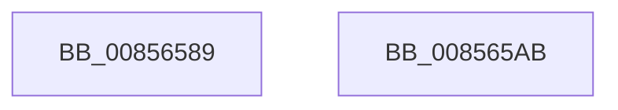

# sub_00856589

- RVA: `0x00856589`–`0x008565B6` (길이 `45` bytes)
- VA: `0x0000000140856589`
- 실행 섹션: `PAGE`
- PDB 이름 있음: `아니요`; PDB Function 태그: `아니요`
- unwind 정보 RVA: `0x0006A430`
- 디코드: `14`개 명령, `45/45` bytes 표시
- 미해석 바이트: `0` (있으면 어셈블리에 `.byte`로 보존)

> 이 문서는 커널 이미지의 기계어와 PDB 기호를 분석해 생성했습니다. 4번과 5번은 함수 원형과 자료형을 바이너리 사용 방식에서 추정한 C 해석이며 원본 소스 복구 결과는 아닙니다.

## 1. Dependencies

- 직접 호출 지점: **3**; 고유 호출 대상: **3**
- 직접 호출자로 확인된 함수: **0**
- RIP 상대 이미지 참조: **0**

### Outgoing calls
- `0x0085658D` → [ExfReleasePushLockShared](../../text/26/ExfReleasePushLockShared_function_00263440.md) (function, `0x00263440`)
- `0x00856596` → [KeAbPostRelease](../../text/2E/KeAbPostRelease_function_002E1600.md) (function, `0x002E1600`)
- `0x008565AC` → [HvpGetCellPaged](HvpGetCellPaged_function_00854CB0.md) (function, `0x00854CB0`)

### Direct callers
- 이 함수 시작 RVA로 연결되는 직접 call은 확인되지 않았습니다. 간접 호출은 완전히 역산할 수 없습니다.

### Static image references
- 디코드된 RIP-relative 메모리 참조가 없습니다.

## 2. Other-region calls and transfers

- 다른 실행 섹션으로 향하는 call: **2**
  - `0x0085658D` → [ExfReleasePushLockShared](../../text/26/ExfReleasePushLockShared_function_00263440.md) (`PAGE` → `.text`)
  - `0x00856596` → [KeAbPostRelease](../../text/2E/KeAbPostRelease_function_002E1600.md) (`PAGE` → `.text`)
- call이 아닌 외부 분기/꼬리 이동: **1**
  - `0x008565B1` → [CmpGetKeyNodeForKcb + 0x32](CmpGetKeyNodeForKcb_function_00856480.md) (`tail-transfer`)

## 3. Assembly (complete function range)

```asm
00856589  48 8D 4B 48                     lea rcx, [rbx + 0x48]
0085658D  E8 AE CE A0 FF                  call 0x140263440
00856592  48 8D 4B 48                     lea rcx, [rbx + 0x48]
00856596  E8 65 B0 A8 FF                  call 0x1402e1600
0085659B  48 8B C7                        mov rax, rdi
0085659E  48 8B 5C 24 50                  mov rbx, qword ptr [rsp + 0x50]
008565A3  48 83 C4 20                     add rsp, 0x20
008565A7  5F                              pop rdi
008565A8  5E                              pop rsi
008565A9  5D                              pop rbp
008565AA  C3                              ret
008565AB  CC                              int3
008565AC  E8 FF E6 FF FF                  call 0x140854cb0
008565B1  E9 FC FE FF FF                  jmp 0x1408564b2
```

## 4. C-style interpretation (structured pseudocode)

```c
__int64 __fastcall sub_00856589(__int64 a1, __int64 a2, __int64 a3, __int64 a4, __int64 a5, __int64 a6, __int64 a7, __int64 a8, __int64 a9, __int64 a10)
{
    __int64 result;
    __int64 v_rsp;

    result = ExfReleasePushLockShared(v_rbx + 72, a2, a3, a4);
    result = KeAbPostRelease(v_rbx + 72, a2, a3, a4);
    v_rsp = (v_rsp) + (32);
    return v_rdi;
}
```

## 5. (Beta) C Style

```c
int64_t sub_00856589(int64_t Arg1, int64_t Arg2, int64_t Arg3, int64_t Arg4, uint64_t Arg5, uint64_t Arg6, uint64_t Arg7, uint64_t Arg8, uint64_t Arg9, int64_t Arg10)
{
    int64_t result;
    int64_t local_rsp;

    result = ExfReleasePushLockShared(local_rbx + 72, Arg2, Arg3, Arg4);
    result = KeAbPostRelease(local_rbx + 72, Arg2, Arg3, Arg4);
    local_rsp = (local_rsp) + (32);
    return local_rdi;
}
```

## 6. Execution-region graph

[열기: 2D/3D 그래프와 함수 탐색 컨트롤 패널](../../../control-panel.html?section=page&rva=0x00856589&view=graph)

- 2D 그래프는 위에서 아래로 흐르고, 3D 그래프는 빈 공간을 드래그해 회전합니다. Shift+드래그는 이동, 휠은 확대·축소, 함수 노드 선택은 대상 보고서 이동입니다.

### Static fallback


