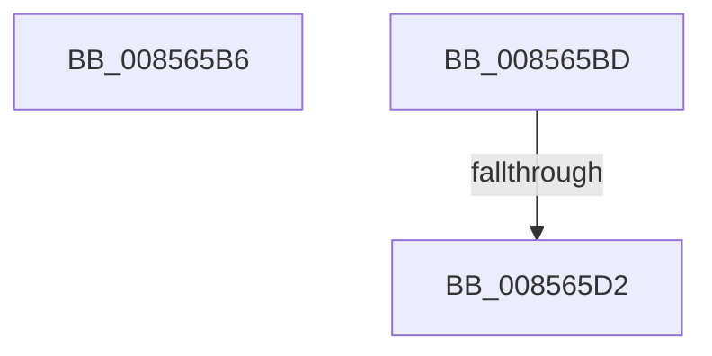

# sub_008565B6

- RVA: `0x008565B6`–`0x008565DE` (길이 `40` bytes)
- VA: `0x00000001408565B6`
- 실행 섹션: `PAGE`
- PDB 이름 있음: `아니요`; PDB Function 태그: `아니요`
- unwind 정보 RVA: `0x0006A444`
- 디코드: `11`개 명령, `40/40` bytes 표시
- 미해석 바이트: `0` (있으면 어셈블리에 `.byte`로 보존)

> 이 문서는 커널 이미지의 기계어와 PDB 기호를 분석해 생성했습니다. 4번과 5번은 함수 원형과 자료형을 바이너리 사용 방식에서 추정한 C 해석이며 원본 소스 복구 결과는 아닙니다.

## 1. Dependencies

- 직접 호출 지점: **2**; 고유 호출 대상: **2**
- 직접 호출자로 확인된 함수: **0**
- RIP 상대 이미지 참조: **1**

### Outgoing calls
- `0x008565B6` → [HvpGetCellPaged](HvpGetCellPaged_function_00854CB0.md) (function, `0x00854CB0`)
- `0x008565C9` → [HvpMarkCellDirty](HvpMarkCellDirty_function_00858080.md) (function, `0x00858080`)

### Direct callers
- 이 함수 시작 RVA로 연결되는 직접 call은 확인되지 않았습니다. 간접 호출은 완전히 역산할 수 없습니다.

### Static image references
- `0x008565D2` → RVA `0x00E0EC94` (`.data`; read)

## 2. Other-region calls and transfers

- 다른 실행 섹션으로 향하는 call: **0**
- call이 아닌 외부 분기/꼬리 이동: **3**
  - `0x008565BB` → [sub_008564EC + 0x68](Unknown_function_008564EC.md) (`tail-transfer`)
  - `0x008565D0` → [sub_008564EC + 0x87](Unknown_function_008564EC.md) (`tail-transfer`)
  - `0x008565DC` → [sub_008564EC + 0x87](Unknown_function_008564EC.md) (`tail-transfer`)

## 3. Assembly (complete function range)

```asm
008565B6  E8 F5 E6 FF FF                  call 0x140854cb0
008565BB  EB 97                           jmp 0x140856554
008565BD  8B 53 28                        mov edx, dword ptr [rbx + 0x28]
008565C0  41 B9 01 00 00 00               mov r9d, 1
008565C6  45 33 C0                        xor r8d, r8d
008565C9  E8 B2 1A 00 00                  call 0x140858080
008565CE  85 C0                           test eax, eax
008565D0  78 A1                           js 0x140856573
008565D2  0F B6 0D BB 86 5B 00            movzx ecx, byte ptr [rip + 0x5b86bb]
008565D9  08 4F 0C                        or byte ptr [rdi + 0xc], cl
008565DC  EB 95                           jmp 0x140856573
```

## 4. C-style interpretation (structured pseudocode)

```c
__int64 __fastcall sub_008565B6(__int64 a1, __int64 a2, int a3)
{
    __int64 result;

    result = HvpGetCellPaged(a1, a2, a3, a4);
}
```

## 5. (Beta) C Style

```c
int64_t sub_008565B6(int64_t Arg1, int64_t Arg2, int32_t Arg3)
{
    int64_t result;

    result = HvpGetCellPaged(Arg1, Arg2, Arg3, a4);
}
```

## 6. Execution-region graph

[열기: 2D/3D 그래프와 함수 탐색 컨트롤 패널](../../../control-panel.html?section=page&rva=0x008565B6&view=graph)

- 2D 그래프는 위에서 아래로 흐르고, 3D 그래프는 빈 공간을 드래그해 회전합니다. Shift+드래그는 이동, 휠은 확대·축소, 함수 노드 선택은 대상 보고서 이동입니다.

### Static fallback


