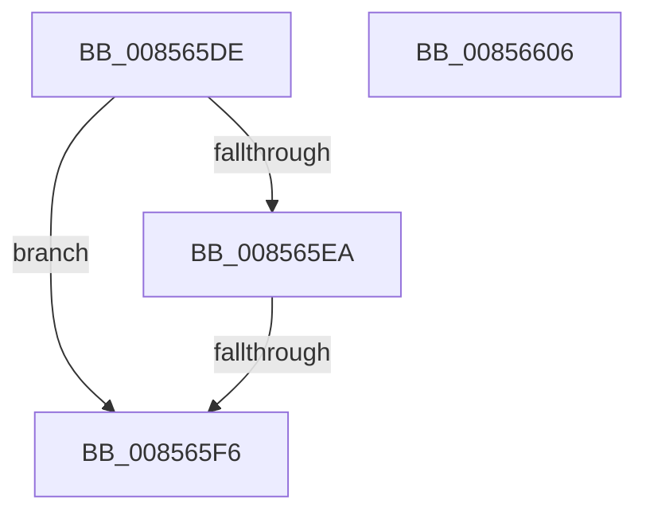

# sub_008565DE

- RVA: `0x008565DE`–`0x00856607` (길이 `41` bytes)
- VA: `0x00000001408565DE`
- 실행 섹션: `PAGE`
- PDB 이름 있음: `아니요`; PDB Function 태그: `아니요`
- unwind 정보 RVA: `0x0006A458`
- 디코드: `13`개 명령, `41/41` bytes 표시
- 미해석 바이트: `0` (있으면 어셈블리에 `.byte`로 보존)

> 이 문서는 커널 이미지의 기계어와 PDB 기호를 분석해 생성했습니다. 4번과 5번은 함수 원형과 자료형을 바이너리 사용 방식에서 추정한 C 해석이며 원본 소스 복구 결과는 아닙니다.

## 1. Dependencies

- 직접 호출 지점: **0**; 고유 호출 대상: **0**
- 직접 호출자로 확인된 함수: **0**
- RIP 상대 이미지 참조: **1**

### Outgoing calls
- 직접 디코드된 call 명령이 없습니다.

### Direct callers
- 이 함수 시작 RVA로 연결되는 직접 call은 확인되지 않았습니다. 간접 호출은 완전히 역산할 수 없습니다.

### Static image references
- `0x008565EA` → RVA `0x00E0EC94` (`.data`; read)

## 2. Other-region calls and transfers

- 다른 실행 섹션으로 향하는 call: **0**
- call이 아닌 외부 분기/꼬리 이동: **1**
  - `0x008565F4` → [sub_00856611](Unknown_function_00856611.md) (`tail-transfer`)

## 3. Assembly (complete function range)

```asm
008565DE  F7 81 A0 00 00 00 01 80 00 00   test dword ptr [rcx + 0xa0], 0x8001
008565E8  75 0C                           jne 0x1408565f6
008565EA  0F B6 05 A3 86 5B 00            movzx eax, byte ptr [rip + 0x5b86a3]
008565F1  84 46 0C                        test byte ptr [rsi + 0xc], al
008565F4  74 1B                           je 0x140856611
008565F6  48 8B C6                        mov rax, rsi
008565F9  48 8B 5C 24 50                  mov rbx, qword ptr [rsp + 0x50]
008565FE  48 83 C4 20                     add rsp, 0x20
00856602  5F                              pop rdi
00856603  5E                              pop rsi
00856604  5D                              pop rbp
00856605  C3                              ret
00856606  CC                              int3
```

## 4. C-style interpretation (structured pseudocode)

```c
__int64 __fastcall sub_008565DE(__int64 a1, __int64 a2, __int64 a3, __int64 a4, __int64 a5, __int64 a6, __int64 a7, __int64 a8, __int64 a9, __int64 a10)
{
    __int64 v_rsp;

    if (((*(unsigned int *)(a1 + 160)) & (0x8001ULL)) != 0) goto loc_008565F6;
loc_008565F6:
    v_rsp = (v_rsp) + (32);
    return v_rsi;
}
```

## 5. (Beta) C Style

```c
int64_t sub_008565DE(void *Arg1, int64_t Arg2, int64_t Arg3, int64_t Arg4, uint64_t Arg5, uint64_t Arg6, uint64_t Arg7, uint64_t Arg8, uint64_t Arg9, int64_t Arg10)
{
    uint8_t *arg1 = (uint8_t *)Arg1;

    int64_t local_rsp;

    if (((*(uint32_t *)(arg1 + 0xA0)) & (0x8001ULL)) != 0) goto loc_008565F6;
loc_008565F6:
    local_rsp = (local_rsp) + (32);
    return local_rsi;
}
```

### 관측된 메모리 오프셋

구조체 형식이 확인되지 않은 접근은 인자 기준의 오프셋으로만 기록했습니다.

| 기준 인자 | 오프셋 표현 | 폭 (bit) | 접근 |
|---|---:|---:|---|
| `Arg1` | `+ 0xA0` | `32` | `R` |

## 6. Execution-region graph

[열기: 2D/3D 그래프와 함수 탐색 컨트롤 패널](../../../control-panel.html?section=page&rva=0x008565DE&view=graph)

- 2D 그래프는 위에서 아래로 흐르고, 3D 그래프는 빈 공간을 드래그해 회전합니다. Shift+드래그는 이동, 휠은 확대·축소, 함수 노드 선택은 대상 보고서 이동입니다.

### Static fallback


