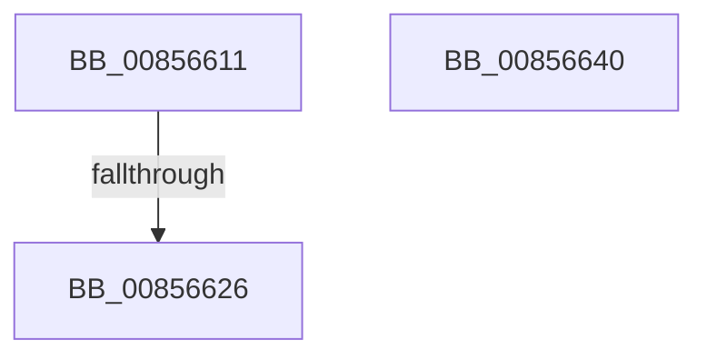

# sub_00856611

- RVA: `0x00856611`–`0x00856641` (길이 `48` bytes)
- VA: `0x0000000140856611`
- 실행 섹션: `PAGE`
- PDB 이름 있음: `아니요`; PDB Function 태그: `아니요`
- unwind 정보 RVA: `0x0006A480`
- 디코드: `16`개 명령, `48/48` bytes 표시
- 미해석 바이트: `0` (있으면 어셈블리에 `.byte`로 보존)

> 이 문서는 커널 이미지의 기계어와 PDB 기호를 분석해 생성했습니다. 4번과 5번은 함수 원형과 자료형을 바이너리 사용 방식에서 추정한 C 해석이며 원본 소스 복구 결과는 아닙니다.

## 1. Dependencies

- 직접 호출 지점: **1**; 고유 호출 대상: **1**
- 직접 호출자로 확인된 함수: **0**
- RIP 상대 이미지 참조: **1**

### Outgoing calls
- `0x0085661D` → [HvpMarkCellDirty](HvpMarkCellDirty_function_00858080.md) (function, `0x00858080`)

### Direct callers
- 이 함수 시작 RVA로 연결되는 직접 call은 확인되지 않았습니다. 간접 호출은 완전히 역산할 수 없습니다.

### Static image references
- `0x00856626` → RVA `0x00E0EC94` (`.data`; read)

## 2. Other-region calls and transfers

- 다른 실행 섹션으로 향하는 call: **0**
- call이 아닌 외부 분기/꼬리 이동: **1**
  - `0x00856624` → [sub_008565DE + 0x18](Unknown_function_008565DE.md) (`tail-transfer`)

## 3. Assembly (complete function range)

```asm
00856611  8B 53 28                        mov edx, dword ptr [rbx + 0x28]
00856614  41 B9 01 00 00 00               mov r9d, 1
0085661A  45 33 C0                        xor r8d, r8d
0085661D  E8 5E 1A 00 00                  call 0x140858080
00856622  85 C0                           test eax, eax
00856624  78 D0                           js 0x1408565f6
00856626  0F B6 05 67 86 5B 00            movzx eax, byte ptr [rip + 0x5b8667]
0085662D  08 46 0C                        or byte ptr [rsi + 0xc], al
00856630  48 8B C6                        mov rax, rsi
00856633  48 8B 5C 24 50                  mov rbx, qword ptr [rsp + 0x50]
00856638  48 83 C4 20                     add rsp, 0x20
0085663C  5F                              pop rdi
0085663D  5E                              pop rsi
0085663E  5D                              pop rbp
0085663F  C3                              ret
00856640  CC                              int3
```

## 4. C-style interpretation (structured pseudocode)

```c
__int64 __fastcall sub_00856611(__int64 a1, __int64 a2, int a3, __int64 a4, __int64 a5, __int64 a6, __int64 a7, __int64 a8, __int64 a9, __int64 a10)
{
    __int64 result;
    __int64 v_rsp;

    a3 = 0;
    result = HvpMarkCellDirty(a1, (unsigned int)(*(unsigned int *)(v_rbx + 40)), a3, 1);
    v_rsp = (v_rsp) + (32);
    return v_rsi;
}
```

## 5. (Beta) C Style

```c
int64_t sub_00856611(int64_t Arg1, int64_t Arg2, int32_t Arg3, int64_t Arg4, uint64_t Arg5, uint64_t Arg6, uint64_t Arg7, uint64_t Arg8, uint64_t Arg9, int64_t Arg10)
{
    int64_t result;
    int64_t local_rsp;

    Arg3 = 0;
    result = HvpMarkCellDirty(Arg1, (uint32_t)(*(uint32_t *)(local_rbx + 0x28)), Arg3, 1);
    local_rsp = (local_rsp) + (32);
    return local_rsi;
}
```

## 6. Execution-region graph

[열기: 2D/3D 그래프와 함수 탐색 컨트롤 패널](../../../control-panel.html?section=page&rva=0x00856611&view=graph)

- 2D 그래프는 위에서 아래로 흐르고, 3D 그래프는 빈 공간을 드래그해 회전합니다. Shift+드래그는 이동, 휠은 확대·축소, 함수 노드 선택은 대상 보고서 이동입니다.

### Static fallback


