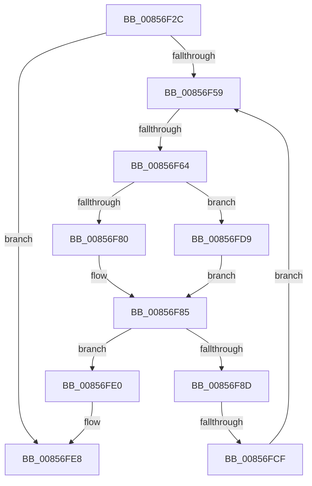

# sub_00856F2C

- RVA: `0x00856F2C`–`0x00857001` (길이 `213` bytes)
- VA: `0x0000000140856F2C`
- 실행 섹션: `PAGE`
- PDB 이름 있음: `아니요`; PDB Function 태그: `아니요`
- unwind 정보 RVA: `0x0006A53C`
- 디코드: `47`개 명령, `213/213` bytes 표시
- 미해석 바이트: `0` (있으면 어셈블리에 `.byte`로 보존)

> 이 문서는 커널 이미지의 기계어와 PDB 기호를 분석해 생성했습니다. 4번과 5번은 함수 원형과 자료형을 바이너리 사용 방식에서 추정한 C 해석이며 원본 소스 복구 결과는 아닙니다.

## 1. Dependencies

- 직접 호출 지점: **5**; 고유 호출 대상: **5**
- 직접 호출자로 확인된 함수: **0**
- RIP 상대 이미지 참조: **0**

### Outgoing calls
- `0x00856F43` → [ExAllocatePool2](../../poolcode/B8/ExAllocatePool2_function_00B820F0.md) (function, `0x00B820F0`)
- `0x00856F80` → [HvpGetCellFlat](HvpGetCellFlat_function_00854C60.md) (function, `0x00854C60`)
- `0x00856FAB` → [memcpy](../../text/6C/memcpy_function_006C6840.md) (function, `0x006C6840`)
- `0x00856FCF` → [HvpReleaseCellPaged](HvpReleaseCellPaged_function_00855F40.md) (function, `0x00855F40`)
- `0x00856FD9` → [HvpGetCellPaged](HvpGetCellPaged_function_00854CB0.md) (function, `0x00854CB0`)

### Direct callers
- 이 함수 시작 RVA로 연결되는 직접 call은 확인되지 않았습니다. 간접 호출은 완전히 역산할 수 없습니다.

### Static image references
- 디코드된 RIP-relative 메모리 참조가 없습니다.

## 2. Other-region calls and transfers

- 다른 실행 섹션으로 향하는 call: **2**
  - `0x00856F43` → [ExAllocatePool2](../../poolcode/B8/ExAllocatePool2_function_00B820F0.md) (`PAGE` → `POOLCODE`)
  - `0x00856FAB` → [memcpy](../../text/6C/memcpy_function_006C6840.md) (`PAGE` → `.text`)
- call이 아닌 외부 분기/꼬리 이동: **3**
  - `0x00856F5E` → [sub_00857073](Unknown_function_00857073.md) (`tail-transfer`)
  - `0x00856FC9` → [sub_00857051](Unknown_function_00857051.md) (`tail-transfer`)
  - `0x00856FFF` → [sub_00857065](Unknown_function_00857065.md) (`tail-transfer`)

## 3. Assembly (complete function range)

```asm
00856F2C  4C 89 64 24 60                  mov qword ptr [rsp + 0x60], r12
00856F31  B9 00 01 00 00                  mov ecx, 0x100
00856F36  44 8B 67 04                     mov r12d, dword ptr [rdi + 4]
00856F3A  41 B8 43 4D 76 64               mov r8d, 0x64764d43
00856F40  41 8B D4                        mov edx, r12d
00856F43  E8 A8 B1 32 00                  call 0x140b820f0
00856F48  48 89 44 24 78                  mov qword ptr [rsp + 0x78], rax
00856F4D  48 8B F8                        mov rdi, rax
00856F50  48 85 C0                        test rax, rax
00856F53  0F 84 8F 00 00 00               je 0x140856fe8
00856F59  66 41 3B 6F 02                  cmp bp, word ptr [r15 + 2]
00856F5E  0F 83 0F 01 00 00               jae 0x140857073
00856F64  F6 83 8C 00 00 00 01            test byte ptr [rbx + 0x8c], 1
00856F6B  4C 8D 84 24 88 00 00 00         lea r8, [rsp + 0x88]
00856F73  0F B7 FD                        movzx edi, bp
00856F76  48 8B CB                        mov rcx, rbx
00856F79  41 8B 54 BD 00                  mov edx, dword ptr [r13 + rdi*4]
00856F7E  74 59                           je 0x140856fd9
00856F80  E8 DB DC FF FF                  call 0x140854c60
00856F85  48 8B D0                        mov rdx, rax
00856F88  48 85 C0                        test rax, rax
00856F8B  74 53                           je 0x140856fe0
00856F8D  B9 D8 3F 00 00                  mov ecx, 0x3fd8
00856F92  45 8B C4                        mov r8d, r12d
00856F95  44 3B E1                        cmp r12d, ecx
00856F98  44 0F 47 C1                     cmova r8d, ecx
00856F9C  48 69 CF D8 3F 00 00            imul rcx, rdi, 0x3fd8
00856FA3  48 8B 7C 24 78                  mov rdi, qword ptr [rsp + 0x78]
00856FA8  48 03 CF                        add rcx, rdi
00856FAB  E8 90 F8 E6 FF                  call 0x1406c6840
00856FB0  41 81 C4 28 C0 FF FF            add r12d, 0xffffc028
00856FB7  48 8D 94 24 88 00 00 00         lea rdx, [rsp + 0x88]
00856FBF  F6 83 8C 00 00 00 01            test byte ptr [rbx + 0x8c], 1
00856FC6  48 8B CB                        mov rcx, rbx
00856FC9  0F 85 82 00 00 00               jne 0x140857051
00856FCF  E8 6C EF FF FF                  call 0x140855f40
00856FD4  66 FF C5                        inc bp
00856FD7  EB 80                           jmp 0x140856f59
00856FD9  E8 D2 DC FF FF                  call 0x140854cb0
00856FDE  EB A5                           jmp 0x140856f85
00856FE0  48 8B 7C 24 78                  mov rdi, qword ptr [rsp + 0x78]
00856FE5  40 32 ED                        xor bpl, bpl
00856FE8  F6 83 8C 00 00 00 01            test byte ptr [rbx + 0x8c], 1
00856FEF  48 8D 94 24 80 00 00 00         lea rdx, [rsp + 0x80]
00856FF7  4C 8B 64 24 60                  mov r12, qword ptr [rsp + 0x60]
00856FFC  48 8B CB                        mov rcx, rbx
00856FFF  75 64                           jne 0x140857065
```

## 4. C-style interpretation (structured pseudocode)

```c
__int64 __fastcall sub_00856F2C(__int64 a1, __int64 a2, __int64 a3, __int64 a4, __int64 a5, __int64 a6, __int64 a7, __int64 a8, __int64 a9, __int64 a10, __int64 a11, __int64 a12, __int64 a13, __int64 a14, __int64 a15, __int64 a16, __int64 a17)
{
    __int64 result;
    __int64 v_r12;
    __int64 v_rbp;
    unsigned __int64 v_stack_p60;
    unsigned __int64 v_stack_p78;

    v_stack_p60 = v_r12;
    result = ExAllocatePool2(256, (unsigned int)((unsigned int)((unsigned int)(*(unsigned int *)(v_rdi + 4)))), (unsigned int)(0x64764D43ULL), a4);
    v_stack_p78 = result;
    if (result == 0) goto loc_00856FE8;
loc_00856F59:
    if (((*(unsigned __int8 *)(v_rbx + 140)) & (1)) == 0) goto loc_00856FD9;
    result = HvpGetCellFlat(v_rbx, (unsigned int)(*(unsigned int *)(v_r13 + (unsigned __int16)(v_rbp) * 4)), a17, a4);
loc_00856F85:
    if (result == 0) goto loc_00856FE0;
    a3 = (unsigned int)((unsigned int)((unsigned int)(*(unsigned int *)(v_rdi + 4))));
    if (((unsigned int)((unsigned int)(*(unsigned int *)(v_rdi + 4)))) > ((unsigned int)((unsigned int)(0x3FD8ULL)))) { a3 = (unsigned int)((unsigned int)(0x3FD8ULL)); }
    a1 = ((unsigned int)(0x3FD8ULL)) * ((unsigned __int16)(v_rbp));
    a1 = (a1) + (a15);
    result = memcpy(a1, result, a3, a4);
    v_r12 = (unsigned int)(((unsigned int)(*(unsigned int *)(v_rdi + 4))) + (0xFFFFC028ULL));
    result = HvpReleaseCellPaged(v_rbx, a17, a3, a4);
    v_rbp = (unsigned __int16)((v_rbp) + 1);
    goto loc_00856F59;
loc_00856FD9:
    result = HvpGetCellPaged(v_rbx, a17, a3, a4);
    goto loc_00856F85;
loc_00856FE0:
    v_rbp = 0;
loc_00856FE8:
}
```

## 5. (Beta) C Style

```c
int64_t sub_00856F2C(int64_t Arg1, int64_t Arg2, int64_t Arg3, int64_t Arg4, uint64_t Arg5, uint64_t Arg6, uint64_t Arg7, uint64_t Arg8, uint64_t Arg9, uint64_t Arg10, uint64_t Arg11, int64_t Arg12, uint64_t Arg13, uint64_t Arg14, int64_t Arg15, int64_t Arg16, int64_t Arg17)
{
    int64_t result;
    int64_t local_r12;
    int64_t local_rbp;
    uint64_t v_stack_p60;
    uint64_t v_stack_p78;

    v_stack_p60 = local_r12;
    result = ExAllocatePool2(256, (uint32_t)((uint32_t)((uint32_t)(*(uint32_t *)(local_rdi + 0x4)))), (uint32_t)(0x64764D43ULL), Arg4);
    v_stack_p78 = result;
    if (result == 0) goto loc_00856FE8;
loc_00856F59:
    if (((*(uint8_t *)(local_rbx + 0x8C)) & (1)) == 0) goto loc_00856FD9;
    result = HvpGetCellFlat(local_rbx, (uint32_t)(*(uint32_t *)(local_r13 + (uint16_t)(local_rbp) * 4)), Arg17, Arg4);
loc_00856F85:
    if (result == 0) goto loc_00856FE0;
    Arg3 = (uint32_t)((uint32_t)((uint32_t)(*(uint32_t *)(local_rdi + 0x4))));
    if (((uint32_t)((uint32_t)(*(uint32_t *)(local_rdi + 0x4)))) > ((uint32_t)((uint32_t)(0x3FD8ULL)))) { Arg3 = (uint32_t)((uint32_t)(0x3FD8ULL)); }
    Arg1 = ((uint32_t)(0x3FD8ULL)) * ((uint16_t)(local_rbp));
    Arg1 = (Arg1) + (Arg15);
    result = memcpy(Arg1, result, Arg3, Arg4);
    local_r12 = (uint32_t)(((uint32_t)(*(uint32_t *)(local_rdi + 0x4))) + (0xFFFFC028ULL));
    result = HvpReleaseCellPaged(local_rbx, Arg17, Arg3, Arg4);
    local_rbp = (uint16_t)((local_rbp) + 1);
    goto loc_00856F59;
loc_00856FD9:
    result = HvpGetCellPaged(local_rbx, Arg17, Arg3, Arg4);
    goto loc_00856F85;
loc_00856FE0:
    local_rbp = 0;
loc_00856FE8:
}
```

## 6. Execution-region graph

[열기: 2D/3D 그래프와 함수 탐색 컨트롤 패널](../../../control-panel.html?section=page&rva=0x00856F2C&view=graph)

- 2D 그래프는 위에서 아래로 흐르고, 3D 그래프는 빈 공간을 드래그해 회전합니다. Shift+드래그는 이동, 휠은 확대·축소, 함수 노드 선택은 대상 보고서 이동입니다.

### Static fallback


