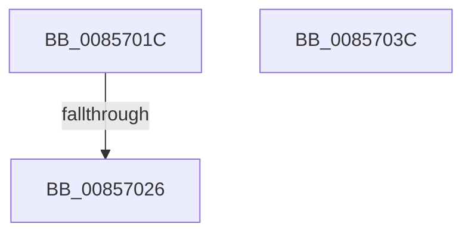

# sub_0085701C

- RVA: `0x0085701C`–`0x00857047` (길이 `43` bytes)
- VA: `0x000000014085701C`
- 실행 섹션: `PAGE`
- PDB 이름 있음: `아니요`; PDB Function 태그: `아니요`
- unwind 정보 RVA: `0x0006A560`
- 디코드: `17`개 명령, `43/43` bytes 표시
- 미해석 바이트: `0` (있으면 어셈블리에 `.byte`로 보존)

> 이 문서는 커널 이미지의 기계어와 PDB 기호를 분석해 생성했습니다. 4번과 5번은 함수 원형과 자료형을 바이너리 사용 방식에서 추정한 C 해석이며 원본 소스 복구 결과는 아닙니다.

## 1. Dependencies

- 직접 호출 지점: **2**; 고유 호출 대상: **2**
- 직접 호출자로 확인된 함수: **0**
- RIP 상대 이미지 참조: **0**

### Outgoing calls
- `0x0085701C` → [HvpReleaseCellPaged](HvpReleaseCellPaged_function_00855F40.md) (function, `0x00855F40`)
- `0x0085703D` → [HvpGetCellPaged](HvpGetCellPaged_function_00854CB0.md) (function, `0x00854CB0`)

### Direct callers
- 이 함수 시작 RVA로 연결되는 직접 call은 확인되지 않았습니다. 간접 호출은 완전히 역산할 수 없습니다.

### Static image references
- 디코드된 RIP-relative 메모리 참조가 없습니다.

## 2. Other-region calls and transfers

- 다른 실행 섹션으로 향하는 call: **0**
- call이 아닌 외부 분기/꼬리 이동: **2**
  - `0x00857024` → [sub_0085707B](Unknown_function_0085707B.md) (`tail-transfer`)
  - `0x00857042` → [CmpGetValueData + 0x13F](CmpGetValueData_function_00856DB0.md) (`tail-transfer`)

## 3. Assembly (complete function range)

```asm
0085701C  E8 1F EF FF FF                  call 0x140855f40
00857021  40 84 ED                        test bpl, bpl
00857024  74 55                           je 0x14085707b
00857026  48 89 3E                        mov qword ptr [rsi], rdi
00857029  B0 01                           mov al, 1
0085702B  41 C6 06 01                     mov byte ptr [r14], 1
0085702F  48 83 C4 28                     add rsp, 0x28
00857033  41 5F                           pop r15
00857035  41 5E                           pop r14
00857037  5F                              pop rdi
00857038  5E                              pop rsi
00857039  5D                              pop rbp
0085703A  5B                              pop rbx
0085703B  C3                              ret
0085703C  CC                              int3
0085703D  E8 6E DC FF FF                  call 0x140854cb0
00857042  E9 A8 FE FF FF                  jmp 0x140856eef
```

## 4. C-style interpretation (structured pseudocode)

```c
__int64 __fastcall sub_0085701C(void)
{
    __int64 result;
    __int64 v_rsp;

    result = HvpReleaseCellPaged(a1, a2, a3, a4);
    *(unsigned __int64 *)(v_rsi) = v_rdi;
    *(unsigned __int8 *)(v_r14) = 1;
    v_rsp = (v_rsp) + (40);
    return 1;
}
```

## 5. (Beta) C Style

```c
void sub_0085701C(void)
{
    int64_t result;
    int64_t local_rsp;

    result = HvpReleaseCellPaged(a1, a2, a3, a4);
    *(uint64_t *)(local_rsi) = local_rdi;
    *(uint8_t *)(local_r14) = 1;
    local_rsp = (local_rsp) + (40);
    return 1;
}
```

## 6. Execution-region graph

[열기: 2D/3D 그래프와 함수 탐색 컨트롤 패널](../../../control-panel.html?section=page&rva=0x0085701C&view=graph)

- 2D 그래프는 위에서 아래로 흐르고, 3D 그래프는 빈 공간을 드래그해 회전합니다. Shift+드래그는 이동, 휠은 확대·축소, 함수 노드 선택은 대상 보고서 이동입니다.

### Static fallback


