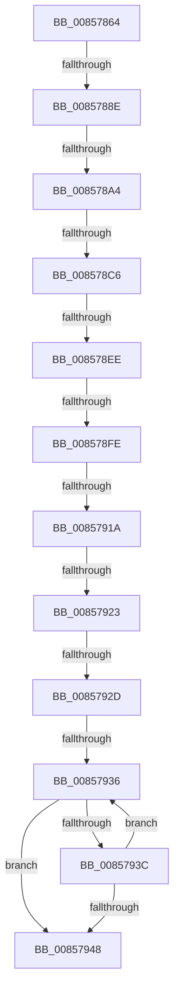

# sub_00857864

- RVA: `0x00857864`–`0x00857959` (길이 `245` bytes)
- VA: `0x0000000140857864`
- 실행 섹션: `PAGE`
- PDB 이름 있음: `아니요`; PDB Function 태그: `아니요`
- unwind 정보 RVA: `0x0006A614`
- 디코드: `54`개 명령, `245/245` bytes 표시
- 미해석 바이트: `0` (있으면 어셈블리에 `.byte`로 보존)

> 이 문서는 커널 이미지의 기계어와 PDB 기호를 분석해 생성했습니다. 4번과 5번은 함수 원형과 자료형을 바이너리 사용 방식에서 추정한 C 해석이며 원본 소스 복구 결과는 아닙니다.

## 1. Dependencies

- 직접 호출 지점: **4**; 고유 호출 대상: **3**
- 직접 호출자로 확인된 함수: **0**
- RIP 상대 이미지 참조: **0**

### Outgoing calls
- `0x0085787F` → [RtlUnicodeStringCopy](../../text/3D/RtlUnicodeStringCopy_function_003D4130.md) (function, `0x003D4130`)
- `0x008578A4` → [HvpReleaseCellPaged](HvpReleaseCellPaged_function_00855F40.md) (function, `0x00855F40`)
- `0x008578C6` → [HvpReleaseCellPaged](HvpReleaseCellPaged_function_00855F40.md) (function, `0x00855F40`)
- `0x008578D7` → [CmpUnlockKcbStack](../84/CmpUnlockKcbStack_function_00848460.md) (function, `0x00848460`)

### Direct callers
- 이 함수 시작 RVA로 연결되는 직접 call은 확인되지 않았습니다. 간접 호출은 완전히 역산할 수 없습니다.

### Static image references
- 디코드된 RIP-relative 메모리 참조가 없습니다.

## 2. Other-region calls and transfers

- 다른 실행 섹션으로 향하는 call: **1**
  - `0x0085787F` → [RtlUnicodeStringCopy](../../text/3D/RtlUnicodeStringCopy_function_003D4130.md) (`PAGE` → `.text`)
- call이 아닌 외부 분기/꼬리 이동: **10**
  - `0x00857888` → [sub_00857E9A + 0x8](Unknown_function_00857E9A.md) (`tail-transfer`)
  - `0x0085789E` → [sub_00857ED3 + 0xA](Unknown_function_00857ED3.md) (`tail-transfer`)
  - `0x008578C0` → [sub_00857ED3](Unknown_function_00857ED3.md) (`tail-transfer`)
  - `0x008578E8` → [sub_00857CAB](Unknown_function_00857CAB.md) (`tail-transfer`)
  - `0x008578F8` → [sub_008579BE + 0x23](Unknown_function_008579BE.md) (`tail-transfer`)
  - `0x00857914` → [sub_00857F58](Unknown_function_00857F58.md) (`tail-transfer`)
  - `0x0085791D` → [sub_008579BE + 0x23](Unknown_function_008579BE.md) (`tail-transfer`)
  - `0x00857927` → [sub_008579BE](Unknown_function_008579BE.md) (`tail-transfer`)
  - `0x00857930` → [sub_008579BE + 0x23](Unknown_function_008579BE.md) (`tail-transfer`)
  - `0x00857954` → [sub_008579BE + 0x23](Unknown_function_008579BE.md) (`tail-transfer`)

## 3. Assembly (complete function range)

```asm
00857864  0F 29 B4 24 F0 01 00 00         movaps xmmword ptr [rsp + 0x1f0], xmm6
0085786C  48 8D 55 A0                     lea rdx, [rbp - 0x60]
00857870  66 89 5C 24 50                  mov word ptr [rsp + 0x50], bx
00857875  48 8D 4C 24 50                  lea rcx, [rsp + 0x50]
0085787A  66 89 7C 24 52                  mov word ptr [rsp + 0x52], di
0085787F  E8 AC C8 B7 FF                  call 0x1403d4130
00857884  38 5C 24 42                     cmp byte ptr [rsp + 0x42], bl
00857888  0F 85 14 06 00 00               jne 0x140857ea2
0085788E  41 F6 84 24 8C 00 00 00 01      test byte ptr [r12 + 0x8c], 1
00857897  48 8D 55 C8                     lea rdx, [rbp - 0x38]
0085789B  49 8B CC                        mov rcx, r12
0085789E  0F 85 39 06 00 00               jne 0x140857edd
008578A4  E8 97 E6 FF FF                  call 0x140855f40
008578A9  41 F6 84 24 8C 00 00 00 01      test byte ptr [r12 + 0x8c], 1
008578B2  48 8D 55 90                     lea rdx, [rbp - 0x70]
008578B6  48 8B C3                        mov rax, rbx
008578B9  48 89 5D C0                     mov qword ptr [rbp - 0x40], rbx
008578BD  49 8B CC                        mov rcx, r12
008578C0  0F 85 0D 06 00 00               jne 0x140857ed3
008578C6  E8 75 E6 FF FF                  call 0x140855f40
008578CB  48 8B 4D B0                     mov rcx, qword ptr [rbp - 0x50]
008578CF  45 33 E4                        xor r12d, r12d
008578D2  4C 89 64 24 68                  mov qword ptr [rsp + 0x68], r12
008578D7  E8 84 0B FF FF                  call 0x140848460
008578DC  0F 28 74 24 50                  movaps xmm6, xmmword ptr [rsp + 0x50]
008578E1  88 5C 24 40                     mov byte ptr [rsp + 0x40], bl
008578E5  45 84 F6                        test r14b, r14b
008578E8  0F 84 BD 03 00 00               je 0x140857cab
008578EE  66 0F 7F 75 A0                  movdqa xmmword ptr [rbp - 0x60], xmm6
008578F3  66 39 5C 24 50                  cmp word ptr [rsp + 0x50], bx
008578F8  0F 86 E3 00 00 00               jbe 0x1408579e1
008578FE  48 8B 4D A8                     mov rcx, qword ptr [rbp - 0x58]
00857902  BF FE FF 00 00                  mov edi, 0xfffe
00857907  0F B7 55 A2                     movzx edx, word ptr [rbp - 0x5e]
0085790B  0F B7 45 A0                     movzx eax, word ptr [rbp - 0x60]
0085790F  90                              nop
00857910  66 83 39 5C                     cmp word ptr [rcx], 0x5c
00857914  0F 84 3E 06 00 00               je 0x140857f58
0085791A  66 85 C0                        test ax, ax
0085791D  0F 84 BE 00 00 00               je 0x1408579e1
00857923  66 83 39 5C                     cmp word ptr [rcx], 0x5c
00857927  0F 85 91 00 00 00               jne 0x1408579be
0085792D  66 85 C0                        test ax, ax
00857930  0F 84 AB 00 00 00               je 0x1408579e1
00857936  66 83 39 5C                     cmp word ptr [rcx], 0x5c
0085793A  75 0C                           jne 0x140857948
0085793C  48 83 C1 02                     add rcx, 2
00857940  66 03 D7                        add dx, di
00857943  66 03 C7                        add ax, di
00857946  75 EE                           jne 0x140857936
00857948  66 89 45 A0                     mov word ptr [rbp - 0x60], ax
0085794C  48 89 4D A8                     mov qword ptr [rbp - 0x58], rcx
00857950  66 89 55 A2                     mov word ptr [rbp - 0x5e], dx
00857954  E9 88 00 00 00                  jmp 0x1408579e1
```

## 4. C-style interpretation (structured pseudocode)

```c
__int64 __fastcall sub_00857864(__int64 a1, __int64 a2, __int64 a3, __int64 a4, __int64 a5, __int64 a6, __int64 a7, __int64 a8, __int64 a9, unsigned __int16 a10)
{
    __int64 result;
    __int64 v_r12;
    unsigned __int64 v_stack_p1F0;
    unsigned __int8 v_stack_p40;
    unsigned __int8 v_stack_p42;
    unsigned __int16 v_stack_p50;
    unsigned __int16 v_stack_p52;
    unsigned __int64 v_stack_p68;

    v_stack_p1F0 = v_xmm6;
    v_stack_p50 = (unsigned __int16)(v_rbx);
    v_stack_p52 = (unsigned __int16)(v_rdi);
    result = RtlUnicodeStringCopy(a10, v_rbp - 96, a3, a4);
    result = HvpReleaseCellPaged(v_r12, v_rbp - 56, a3, a4);
    *(unsigned __int64 *)(v_rbp - 64) = v_rbx;
    result = HvpReleaseCellPaged(v_r12, v_rbp - 112, a3, a4);
    v_r12 = 0;
    v_stack_p68 = 0;
    result = CmpUnlockKcbStack(*(unsigned __int64 *)(v_rbp - 80), v_rbp - 112, a3, a4);
    v_stack_p40 = (unsigned __int8)(v_rbx);
    *(unsigned __int64 *)(v_rbp - 96) = v_xmm6;
loc_00857936:
    if ((*(unsigned __int16 *)(*(unsigned __int64 *)(v_rbp - 88))) != 92) goto loc_00857948;
    a1 = (*(unsigned __int64 *)(v_rbp - 88)) + (2);
    a2 = (unsigned __int16)((*(unsigned __int16 *)(v_rbp - 94)) + ((unsigned __int16)((unsigned int)(0xFFFEULL))));
    result = (unsigned __int16)((*(unsigned __int16 *)(v_rbp - 96)) + ((unsigned __int16)((unsigned int)(0xFFFEULL))));
    if (condition_is_not_equal) goto loc_00857936;
loc_00857948:
    *(unsigned __int16 *)(v_rbp - 96) = (unsigned __int16)(result);
    *(unsigned __int64 *)(v_rbp - 88) = a1;
    *(unsigned __int16 *)(v_rbp - 94) = (unsigned __int16)(a2);
}
```

## 5. (Beta) C Style

```c
int64_t sub_00857864(int64_t Arg1, int64_t Arg2, int64_t Arg3, int64_t Arg4, uint64_t Arg5, uint64_t Arg6, uint64_t Arg7, uint64_t Arg8, uint64_t Arg9, uint16_t Arg10)
{
    int64_t result;
    int64_t local_r12;
    uint64_t v_stack_p1F0;
    uint8_t v_stack_p40;
    uint8_t v_stack_p42;
    uint16_t v_stack_p50;
    uint16_t v_stack_p52;
    uint64_t v_stack_p68;

    v_stack_p1F0 = v_xmm6;
    v_stack_p50 = (uint16_t)(local_rbx);
    v_stack_p52 = (uint16_t)(local_rdi);
    result = RtlUnicodeStringCopy(Arg10, local_rbp - 96, Arg3, Arg4);
    result = HvpReleaseCellPaged(local_r12, local_rbp - 56, Arg3, Arg4);
    *(uint64_t *)(local_rbp - 0x40) = local_rbx;
    result = HvpReleaseCellPaged(local_r12, local_rbp - 112, Arg3, Arg4);
    local_r12 = 0;
    v_stack_p68 = 0;
    result = CmpUnlockKcbStack(*(uint64_t *)(local_rbp - 0x50), local_rbp - 112, Arg3, Arg4);
    v_stack_p40 = (uint8_t)(local_rbx);
    *(uint64_t *)(local_rbp - 0x60) = v_xmm6;
loc_00857936:
    if ((*(uint16_t *)(*(uint64_t *)(local_rbp - 0x58))) != 92) goto loc_00857948;
    Arg1 = (*(uint64_t *)(local_rbp - 0x58)) + (2);
    Arg2 = (uint16_t)((*(uint16_t *)(local_rbp - 0x5E)) + ((uint16_t)((uint32_t)(0xFFFEULL))));
    result = (uint16_t)((*(uint16_t *)(local_rbp - 0x60)) + ((uint16_t)((uint32_t)(0xFFFEULL))));
    if (condition_is_not_equal) goto loc_00857936;
loc_00857948:
    *(uint16_t *)(local_rbp - 0x60) = (uint16_t)(result);
    *(uint64_t *)(local_rbp - 0x58) = Arg1;
    *(uint16_t *)(local_rbp - 0x5E) = (uint16_t)(Arg2);
}
```

## 6. Execution-region graph

[열기: 2D/3D 그래프와 함수 탐색 컨트롤 패널](../../../control-panel.html?section=page&rva=0x00857864&view=graph)

- 2D 그래프는 위에서 아래로 흐르고, 3D 그래프는 빈 공간을 드래그해 회전합니다. Shift+드래그는 이동, 휠은 확대·축소, 함수 노드 선택은 대상 보고서 이동입니다.

### Static fallback


