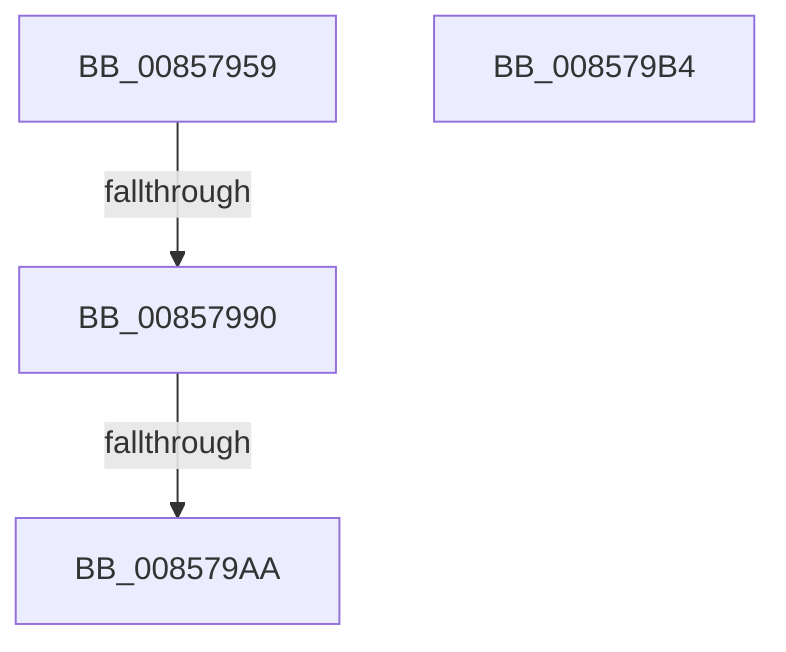

# sub_00857959

- RVA: `0x00857959`–`0x008579BE` (길이 `101` bytes)
- VA: `0x0000000140857959`
- 실행 섹션: `PAGE`
- PDB 이름 있음: `아니요`; PDB Function 태그: `아니요`
- unwind 정보 RVA: `0x0006A628`
- 디코드: `24`개 명령, `101/101` bytes 표시
- 미해석 바이트: `0` (있으면 어셈블리에 `.byte`로 보존)

> 이 문서는 커널 이미지의 기계어와 PDB 기호를 분석해 생성했습니다. 4번과 5번은 함수 원형과 자료형을 바이너리 사용 방식에서 추정한 C 해석이며 원본 소스 복구 결과는 아닙니다.

## 1. Dependencies

- 직접 호출 지점: **2**; 고유 호출 대상: **2**
- 직접 호출자로 확인된 함수: **0**
- RIP 상대 이미지 참조: **1**

### Outgoing calls
- `0x00857970` → [KeBugCheckEx](../../text/4F/KeBugCheckEx_function_004FD660.md) (function, `0x004FD660`)
- `0x008579AA` → [ExFreePool](../../poolcode/B8/ExFreePool_function_00B82850.md) (function, `0x00B82850`)

### Direct callers
- 이 함수 시작 RVA로 연결되는 직접 call은 확인되지 않았습니다. 간접 호출은 완전히 역산할 수 없습니다.

### Static image references
- `0x00857997` → RVA `0x00B82850` (`ExFreePool`; read)

## 2. Other-region calls and transfers

- 다른 실행 섹션으로 향하는 call: **2**
  - `0x00857970` → [KeBugCheckEx](../../text/4F/KeBugCheckEx_function_004FD660.md) (`PAGE` → `.text`)
  - `0x008579AA` → [ExFreePool](../../poolcode/B8/ExFreePool_function_00B82850.md) (`PAGE` → `POOLCODE`)
- call이 아닌 외부 분기/꼬리 이동: **4**
  - `0x0085798A` → [CmpGetSymbolicLinkTarget + 0x513](CmpGetSymbolicLinkTarget_function_008570A0.md) (`tail-transfer`)
  - `0x008579A4` → [sub_00858022 + 0x43](Unknown_function_00858022.md) (`tail-transfer`)
  - `0x008579AF` → [CmpGetSymbolicLinkTarget + 0x518](CmpGetSymbolicLinkTarget_function_008570A0.md) (`tail-transfer`)
  - `0x008579B9` → [CmpGetSymbolicLinkTarget + 0x4CB](CmpGetSymbolicLinkTarget_function_008570A0.md) (`tail-transfer`)

## 3. Assembly (complete function range)

```asm
00857959  4C 8B 44 24 48                  mov r8, qword ptr [rsp + 0x48]
0085795E  45 33 ED                        xor r13d, r13d
00857961  45 33 C9                        xor r9d, r9d
00857964  4C 89 6C 24 20                  mov qword ptr [rsp + 0x20], r13
00857969  41 8D 55 24                     lea edx, [r13 + 0x24]
0085796D  8D 4A 2D                        lea ecx, [rdx + 0x2d]
00857970  E8 EB 5C CA FF                  call 0x1404fd660
00857975  CC                              int3
00857976  FF 41 20                        inc dword ptr [rcx + 0x20]
00857979  49 8B 88 88 08 00 00            mov rcx, qword ptr [r8 + 0x888]
00857980  FF 41 1C                        inc dword ptr [rcx + 0x1c]
00857983  0F B7 41 10                     movzx eax, word ptr [rcx + 0x10]
00857987  66 39 01                        cmp word ptr [rcx], ax
0085798A  0F 82 23 FC FF FF               jb 0x1408575b3
00857990  FF 41 20                        inc dword ptr [rcx + 0x20]
00857993  48 8B 41 38                     mov rax, qword ptr [rcx + 0x38]
00857997  48 8D 0D B2 AE 32 00            lea rcx, [rip + 0x32aeb2]
0085799E  48 3B C1                        cmp rax, rcx
008579A1  48 8B CA                        mov rcx, rdx
008579A4  0F 85 BB 06 00 00               jne 0x140858065
008579AA  E8 A1 AE 32 00                  call 0x140b82850
008579AF  E9 04 FC FF FF                  jmp 0x1408575b8
008579B4  BF 9A 00 00 C0                  mov edi, 0xc000009a
008579B9  E9 AD FB FF FF                  jmp 0x14085756b
```

## 4. C-style interpretation (structured pseudocode)

```c
__int64 __fastcall sub_00857959(__int64 a1, __int64 a2, __int64 a3, int a4, __int64 a5, __int64 a6, __int64 a7, __int64 a8, __int64 a9)
{
    __int64 result;
    __int64 v_r13;
    unsigned __int64 v_stack_p20;

    v_r13 = 0;
    a4 = 0;
    v_stack_p20 = 0;
    result = KeBugCheckEx(v_r13 + 36 + 45, v_r13 + 36, a9, a4);
    result = ExFreePool(v_r13 + 36, v_r13 + 36, a9, a4);
}
```

## 5. (Beta) C Style

```c
int64_t sub_00857959(int64_t Arg1, int64_t Arg2, int64_t Arg3, int32_t Arg4, uint64_t Arg5, uint64_t Arg6, uint64_t Arg7, uint64_t Arg8, int64_t Arg9)
{
    int64_t result;
    int64_t local_r13;
    uint64_t v_stack_p20;

    local_r13 = 0;
    Arg4 = 0;
    v_stack_p20 = 0;
    result = KeBugCheckEx(local_r13 + 36 + 45, local_r13 + 36, Arg9, Arg4);
    result = ExFreePool(local_r13 + 36, local_r13 + 36, Arg9, Arg4);
}
```

## 6. Execution-region graph

[열기: 2D/3D 그래프와 함수 탐색 컨트롤 패널](../../../control-panel.html?section=page&rva=0x00857959&view=graph)

- 2D 그래프는 위에서 아래로 흐르고, 3D 그래프는 빈 공간을 드래그해 회전합니다. Shift+드래그는 이동, 휠은 확대·축소, 함수 노드 선택은 대상 보고서 이동입니다.

### Static fallback


