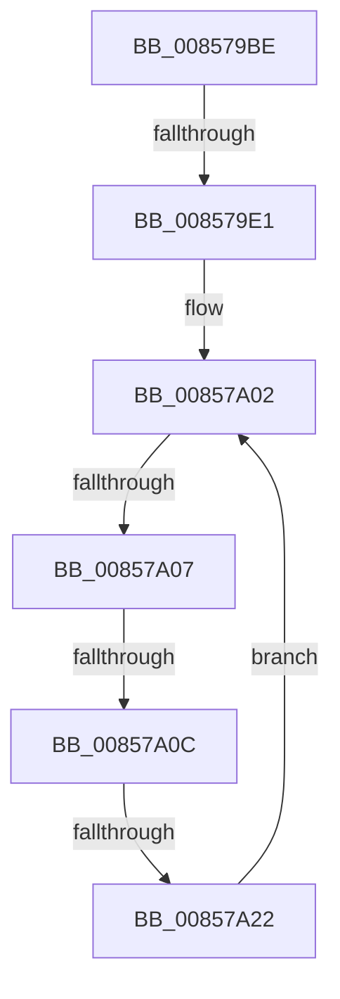

# sub_008579BE

- RVA: `0x008579BE`–`0x00857A2A` (길이 `108` bytes)
- VA: `0x00000001408579BE`
- 실행 섹션: `PAGE`
- PDB 이름 있음: `아니요`; PDB Function 태그: `아니요`
- unwind 정보 RVA: `0x0006A638`
- 디코드: `29`개 명령, `108/108` bytes 표시
- 미해석 바이트: `0` (있으면 어셈블리에 `.byte`로 보존)

> 이 문서는 커널 이미지의 기계어와 PDB 기호를 분석해 생성했습니다. 4번과 5번은 함수 원형과 자료형을 바이너리 사용 방식에서 추정한 C 해석이며 원본 소스 복구 결과는 아닙니다.

## 1. Dependencies

- 직접 호출 지점: **0**; 고유 호출 대상: **0**
- 직접 호출자로 확인된 함수: **0**
- RIP 상대 이미지 참조: **2**

### Outgoing calls
- 직접 디코드된 call 명령이 없습니다.

### Direct callers
- 이 함수 시작 RVA로 연결되는 직접 call은 확인되지 않았습니다. 간접 호출은 완전히 역산할 수 없습니다.

### Static image references
- `0x008579EB` → RVA `0x00FD9F98` (`PAGEDATA`; read)
- `0x008579F5` → RVA `0x00FD9FA0` (`PAGEDATA`; read)

## 2. Other-region calls and transfers

- 다른 실행 섹션으로 향하는 call: **0**
- call이 아닌 외부 분기/꼬리 이동: **4**
  - `0x008579DB` → [sub_00857864 + 0xBF](Unknown_function_00857864.md) (`tail-transfer`)
  - `0x00857A05` → [sub_00857A33 + 0x24](Unknown_function_00857A33.md) (`tail-transfer`)
  - `0x00857A0A` → [sub_00857A33 + 0x24](Unknown_function_00857A33.md) (`tail-transfer`)
  - `0x00857A20` → [sub_00857A33](Unknown_function_00857A33.md) (`tail-transfer`)

## 3. Assembly (complete function range)

```asm
008579BE  48 83 C1 02                     add rcx, 2
008579C2  66 03 C7                        add ax, di
008579C5  66 03 D7                        add dx, di
008579C8  48 89 4D A8                     mov qword ptr [rbp - 0x58], rcx
008579CC  66 83 C3 02                     add bx, 2
008579D0  66 89 45 A0                     mov word ptr [rbp - 0x60], ax
008579D4  66 89 55 A2                     mov word ptr [rbp - 0x5e], dx
008579D8  66 85 C0                        test ax, ax
008579DB  0F 85 42 FF FF FF               jne 0x140857923
008579E1  4C 8B 6C 24 58                  mov r13, qword ptr [rsp + 0x58]
008579E6  B8 E0 FF 00 00                  mov eax, 0xffe0
008579EB  0F B7 3D A6 25 78 00            movzx edi, word ptr [rip + 0x7825a6]
008579F2  4D 8B F5                        mov r14, r13
008579F5  4C 8B 3D A4 25 78 00            mov r15, qword ptr [rip + 0x7825a4]
008579FC  66 D1 EB                        shr bx, 1
008579FF  66 D1 EF                        shr di, 1
00857A02  66 85 DB                        test bx, bx
00857A05  74 50                           je 0x140857a57
00857A07  66 85 FF                        test di, di
00857A0A  74 4B                           je 0x140857a57
00857A0C  41 0F B7 0E                     movzx ecx, word ptr [r14]
00857A10  49 83 C6 02                     add r14, 2
00857A14  45 0F B7 27                     movzx r12d, word ptr [r15]
00857A18  49 83 C7 02                     add r15, 2
00857A1C  66 41 3B CC                     cmp cx, r12w
00857A20  75 11                           jne 0x140857a33
00857A22  66 03 DE                        add bx, si
00857A25  66 03 FE                        add di, si
00857A28  EB D8                           jmp 0x140857a02
```

## 4. C-style interpretation (structured pseudocode)

```c
__int64 __fastcall sub_008579BE(__int64 a1, unsigned __int16 a2, __int64 a3, __int64 a4, __int64 a5, __int64 a6, __int64 a7, __int64 a8, __int64 a9, __int64 a10, __int64 a11)
{
    __int64 result;
    __int64 v_r14;
    __int64 v_r15;
    __int64 v_rbx;
    __int64 v_rdi;

    a1 = (a1) + (2);
    result = (unsigned __int16)((result) + ((unsigned __int16)(v_rdi)));
    a2 = (unsigned __int16)((a2) + ((unsigned __int16)(v_rdi)));
    *(unsigned __int64 *)(v_rbp - 88) = a1;
    v_rbx = (unsigned __int16)((v_rbx) + (2));
    *(unsigned __int16 *)(v_rbp - 96) = (unsigned __int16)(result);
    *(unsigned __int16 *)(v_rbp - 94) = a2;
    v_rbx = (unsigned __int16)((v_rbx) >> (1));
    v_rdi = (unsigned __int16)((*(unsigned __int16 *)(v_rip + 7873958)) >> (1));
loc_00857A02:
    v_r14 = (a11) + (2);
    v_r15 = (*(unsigned __int64 *)(v_rip + 7873956)) + (2);
    v_rbx = (unsigned __int16)((v_rbx) + ((unsigned __int16)(v_rsi)));
    v_rdi = (unsigned __int16)((v_rdi) + ((unsigned __int16)(v_rsi)));
    goto loc_00857A02;
}
```

## 5. (Beta) C Style

```c
int64_t sub_008579BE(int64_t Arg1, uint16_t Arg2, int64_t Arg3, int64_t Arg4, uint64_t Arg5, uint64_t Arg6, uint64_t Arg7, uint64_t Arg8, uint64_t Arg9, uint64_t Arg10, void *Arg11)
{
    uint8_t *arg11 = (uint8_t *)Arg11;

    int64_t result;
    int64_t local_r14;
    int64_t local_r15;
    int64_t local_rbx;
    int64_t local_rdi;

    Arg1 = (Arg1) + (2);
    result = (uint16_t)((result) + ((uint16_t)(local_rdi)));
    Arg2 = (uint16_t)((Arg2) + ((uint16_t)(local_rdi)));
    *(uint64_t *)(local_rbp - 0x58) = Arg1;
    local_rbx = (uint16_t)((local_rbx) + (2));
    *(uint16_t *)(local_rbp - 0x60) = (uint16_t)(result);
    *(uint16_t *)(local_rbp - 0x5E) = Arg2;
    local_rbx = (uint16_t)((local_rbx) >> (1));
    local_rdi = (uint16_t)((*(uint16_t *)(v_rip + 0x7825A6)) >> (1));
loc_00857A02:
    local_r14 = (Arg11) + (2);
    local_r15 = (*(uint64_t *)(v_rip + 0x7825A4)) + (2);
    local_rbx = (uint16_t)((local_rbx) + ((uint16_t)(local_rsi)));
    local_rdi = (uint16_t)((local_rdi) + ((uint16_t)(local_rsi)));
    goto loc_00857A02;
}
```

### 관측된 메모리 오프셋

구조체 형식이 확인되지 않은 접근은 인자 기준의 오프셋으로만 기록했습니다.

| 기준 인자 | 오프셋 표현 | 폭 (bit) | 접근 |
|---|---:|---:|---|
| `Arg11` | `+ 0x0` | `16` | `R` |

## 6. Execution-region graph

[열기: 2D/3D 그래프와 함수 탐색 컨트롤 패널](../../../control-panel.html?section=page&rva=0x008579BE&view=graph)

- 2D 그래프는 위에서 아래로 흐르고, 3D 그래프는 빈 공간을 드래그해 회전합니다. Shift+드래그는 이동, 휠은 확대·축소, 함수 노드 선택은 대상 보고서 이동입니다.

### Static fallback


