# sub_00857A33

- RVA: `0x00857A33`–`0x00857CA1` (길이 `622` bytes)
- VA: `0x0000000140857A33`
- 실행 섹션: `PAGE`
- PDB 이름 있음: `아니요`; PDB Function 태그: `아니요`
- unwind 정보 RVA: `0x0006A65C`
- 디코드: `144`개 명령, `622/622` bytes 표시
- 미해석 바이트: `0` (있으면 어셈블리에 `.byte`로 보존)

> 이 문서는 커널 이미지의 기계어와 PDB 기호를 분석해 생성했습니다. 4번과 5번은 함수 원형과 자료형을 바이너리 사용 방식에서 추정한 C 해석이며 원본 소스 복구 결과는 아닙니다.

## 1. Dependencies

- 직접 호출 지점: **15**; 고유 호출 대상: **14**
- 직접 호출자로 확인된 함수: **0**
- RIP 상대 이미지 참조: **2**

### Outgoing calls
- `0x00857A6D` → [CmpComputeComponentHashes](CmpComputeComponentHashes_function_0085F2F0.md) (function, `0x0085F2F0`)
- `0x00857A85` → [CmpValidateComponents](../99/CmpValidateComponents_function_0099DE00.md) (function, `0x0099DE00`)
- `0x00857ACC` → [CmpPerformCompleteKcbCacheLookup](../84/CmpPerformCompleteKcbCacheLookup_function_0084FD20.md) (function, `0x0084FD20`)
- `0x00857AF5` → [CmpStartKcbStackForTopLayerKcb](../84/CmpStartKcbStackForTopLayerKcb_function_00848390.md) (function, `0x00848390`)
- `0x00857B06` → [CmpLockKcbStackShared](../94/CmpLockKcbStackShared_function_00948000.md) (function, `0x00948000`)
- `0x00857B10` → [CmpConstructAndCacheName](../9F/CmpConstructAndCacheName_function_009FE6F0.md) (function, `0x009FE6F0`)
- `0x00857B1B` → [CmpUnlockKcbStack](../84/CmpUnlockKcbStack_function_00848460.md) (function, `0x00848460`)
- `0x00857B32` → [CmpUnlockHashEntryByKcb](../86/CmpUnlockHashEntryByKcb_function_00864370.md) (function, `0x00864370`)
- `0x00857B40` → [CmpLockKcbStackTopExclusiveRestShared](../84/CmpLockKcbStackTopExclusiveRestShared_function_00846B04.md) (function, `0x00846B04`)
- `0x00857B50` → [CmpIsKeyStackDeleted](../84/CmpIsKeyStackDeleted_function_008426E0.md) (function, `0x008426E0`)
- `0x00857B7A` → [HvpGetCellFlat](HvpGetCellFlat_function_00854C60.md) (function, `0x00854C60`)
- `0x00857BA0` → [CmpFindNameInListWithStatus](../84/CmpFindNameInListWithStatus_function_00846B80.md) (function, `0x00846B80`)
- `0x00857BC1` → [HvpReleaseCellPaged](HvpReleaseCellPaged_function_00855F40.md) (function, `0x00855F40`)
- `0x00857BF2` → [HvpGetCellFlat](HvpGetCellFlat_function_00854C60.md) (function, `0x00854C60`)
- `0x00857C2E` → [CmpGetValueData](CmpGetValueData_function_00856DB0.md) (function, `0x00856DB0`)

### Direct callers
- 이 함수 시작 RVA로 연결되는 직접 call은 확인되지 않았습니다. 간접 호출은 완전히 역산할 수 없습니다.

### Static image references
- `0x00857A95` → RVA `0x00FD9B68` (`PAGEDATA`; read)
- `0x00857B94` → RVA `0x00FD9C00` (`PAGEDATA`; read)

## 2. Other-region calls and transfers

- 다른 실행 섹션으로 향하는 call: **0**
- call이 아닌 외부 분기/꼬리 이동: **22**
  - `0x00857A3D` → [sub_00857EF1](Unknown_function_00857EF1.md) (`tail-transfer`)
  - `0x00857A4A` → [sub_00857F36](Unknown_function_00857F36.md) (`tail-transfer`)
  - `0x00857A55` → [sub_008579BE + 0x64](Unknown_function_008579BE.md) (`tail-transfer`)
  - `0x00857A5A` → [sub_00857E9A](Unknown_function_00857E9A.md) (`tail-transfer`)
  - `0x00857A74` → [sub_00857E9A](Unknown_function_00857E9A.md) (`tail-transfer`)
  - `0x00857A8F` → [sub_00857CAB + 0x5](Unknown_function_00857CAB.md) (`tail-transfer`)
  - `0x00857AD3` → [sub_00857CAB + 0x5](Unknown_function_00857CAB.md) (`tail-transfer`)
  - `0x00857ADE` → [sub_00857E06 + 0x14](Unknown_function_00857E06.md) (`tail-transfer`)
  - `0x00857AFC` → [sub_00857E06 + 0x26](Unknown_function_00857E06.md) (`tail-transfer`)
  - `0x00857B22` → [sub_00857E06 + 0x26](Unknown_function_00857E06.md) (`tail-transfer`)
  - `0x00857B57` → [sub_0085800D](Unknown_function_0085800D.md) (`tail-transfer`)
  - `0x00857B74` → [sub_00857E06](Unknown_function_00857E06.md) (`tail-transfer`)
  - `0x00857BBB` → [sub_00857EF1 + 0xD](Unknown_function_00857EF1.md) (`tail-transfer`)
  - `0x00857BC8` → [sub_00857CAB + 0xF](Unknown_function_00857CAB.md) (`tail-transfer`)
  - `0x00857BEC` → [sub_00857E06 + 0xA](Unknown_function_00857E06.md) (`tail-transfer`)
  - `0x00857C00` → [sub_00857D7A + 0x56](Unknown_function_00857D7A.md) (`tail-transfer`)
  - `0x00857C35` → [sub_00857D7A + 0x56](Unknown_function_00857D7A.md) (`tail-transfer`)
  - `0x00857C40` → [sub_00857D7A + 0x56](Unknown_function_00857D7A.md) (`tail-transfer`)
  - `0x00857C49` → [sub_00857D7A + 0x56](Unknown_function_00857D7A.md) (`tail-transfer`)
  - `0x00857C69` → [sub_00857D7A + 0x4B](Unknown_function_00857D7A.md) (`tail-transfer`)
  - `0x00857C72` → [sub_00857D7A + 0x4B](Unknown_function_00857D7A.md) (`tail-transfer`)
  - `0x00857C92` → [sub_00857D7A](Unknown_function_00857D7A.md) (`tail-transfer`)

## 3. Assembly (complete function range)

```asm
00857A33  66 83 F9 61                     cmp cx, 0x61
00857A37  72 0D                           jb 0x140857a46
00857A39  66 83 F9 7A                     cmp cx, 0x7a
00857A3D  0F 87 AE 04 00 00               ja 0x140857ef1
00857A43  66 03 C8                        add cx, ax
00857A46  66 41 3B CC                     cmp cx, r12w
00857A4A  0F 85 E6 04 00 00               jne 0x140857f36
00857A50  B8 E0 FF 00 00                  mov eax, 0xffe0
00857A55  EB CB                           jmp 0x140857a22
00857A57  66 3B DF                        cmp bx, di
00857A5A  0F 85 3A 04 00 00               jne 0x140857e9a
00857A60  4C 8D 45 30                     lea r8, [rbp + 0x30]
00857A64  48 8D 54 24 70                  lea rdx, [rsp + 0x70]
00857A69  48 8D 4D A0                     lea rcx, [rbp - 0x60]
00857A6D  E8 7E 78 00 00                  call 0x14085f2f0
00857A72  85 C0                           test eax, eax
00857A74  0F 88 20 04 00 00               js 0x140857e9a
00857A7A  0F BF 5C 24 70                  movsx ebx, word ptr [rsp + 0x70]
00857A7F  48 8D 55 30                     lea rdx, [rbp + 0x30]
00857A83  8B CB                           mov ecx, ebx
00857A85  E8 76 63 14 00                  call 0x14099de00
00857A8A  45 33 E4                        xor r12d, r12d
00857A8D  85 C0                           test eax, eax
00857A8F  0F 88 1B 02 00 00               js 0x140857cb0
00857A95  48 8B 0D CC 20 78 00            mov rcx, qword ptr [rip + 0x7820cc]
00857A9C  48 8D 44 24 74                  lea rax, [rsp + 0x74]
00857AA1  48 89 44 24 38                  mov qword ptr [rsp + 0x38], rax
00857AA6  4C 8D 4D 30                     lea r9, [rbp + 0x30]
00857AAA  48 8D 44 24 41                  lea rax, [rsp + 0x41]
00857AAF  44 8B C3                        mov r8d, ebx
00857AB2  48 89 44 24 30                  mov qword ptr [rsp + 0x30], rax
00857AB7  33 D2                           xor edx, edx
00857AB9  48 8B 49 08                     mov rcx, qword ptr [rcx + 8]
00857ABD  48 8D 44 24 48                  lea rax, [rsp + 0x48]
00857AC2  48 89 44 24 28                  mov qword ptr [rsp + 0x28], rax
00857AC7  4C 89 64 24 20                  mov qword ptr [rsp + 0x20], r12
00857ACC  E8 4F 82 FF FF                  call 0x14084fd20
00857AD1  85 C0                           test eax, eax
00857AD3  0F 88 D7 01 00 00               js 0x140857cb0
00857AD9  66 39 5C 24 74                  cmp word ptr [rsp + 0x74], bx
00857ADE  0F 85 36 03 00 00               jne 0x140857e1a
00857AE4  4C 8B 7C 24 48                  mov r15, qword ptr [rsp + 0x48]
00857AE9  48 8D 4D 10                     lea rcx, [rbp + 0x10]
00857AED  49 8B D7                        mov rdx, r15
00857AF0  4C 89 7C 24 48                  mov qword ptr [rsp + 0x48], r15
00857AF5  E8 96 08 FF FF                  call 0x140848390
00857AFA  85 C0                           test eax, eax
00857AFC  0F 88 2A 03 00 00               js 0x140857e2c
00857B02  48 8D 4D 10                     lea rcx, [rbp + 0x10]
00857B06  E8 F5 04 0F 00                  call 0x140948000
00857B0B  33 D2                           xor edx, edx
00857B0D  49 8B CF                        mov rcx, r15
00857B10  E8 DB 6B 1A 00                  call 0x1409fe6f0
00857B15  48 8D 4D 10                     lea rcx, [rbp + 0x10]
00857B19  8B D8                           mov ebx, eax
00857B1B  E8 40 09 FF FF                  call 0x140848460
00857B20  85 DB                           test ebx, ebx
00857B22  0F 88 04 03 00 00               js 0x140857e2c
00857B28  44 38 64 24 41                  cmp byte ptr [rsp + 0x41], r12b
00857B2D  74 0D                           je 0x140857b3c
00857B2F  49 8B CF                        mov rcx, r15
00857B32  E8 39 C8 00 00                  call 0x140864370
00857B37  44 88 64 24 41                  mov byte ptr [rsp + 0x41], r12b
00857B3C  48 8B 4D B0                     mov rcx, qword ptr [rbp - 0x50]
00857B40  E8 BF EF FE FF                  call 0x140846b04
00857B45  48 8B 4D B0                     mov rcx, qword ptr [rbp - 0x50]
00857B49  33 D2                           xor edx, edx
00857B4B  C6 44 24 40 01                  mov byte ptr [rsp + 0x40], 1
00857B50  E8 8B AB FE FF                  call 0x1408426e0
00857B55  84 C0                           test al, al
00857B57  0F 85 B0 04 00 00               jne 0x14085800d
00857B5D  48 8B 7D 88                     mov rdi, qword ptr [rbp - 0x78]
00857B61  4C 8D 44 24 78                  lea r8, [rsp + 0x78]
00857B66  48 8B 4F 20                     mov rcx, qword ptr [rdi + 0x20]
00857B6A  8B 57 28                        mov edx, dword ptr [rdi + 0x28]
00857B6D  F6 81 8C 00 00 00 01            test byte ptr [rcx + 0x8c], 1
00857B74  0F 84 8C 02 00 00               je 0x140857e06
00857B7A  E8 E1 D0 FF FF                  call 0x140854c60
00857B7F  48 8B 4F 20                     mov rcx, qword ptr [rdi + 0x20]
00857B83  48 8D 50 24                     lea rdx, [rax + 0x24]
00857B87  48 8D 44 24 44                  lea rax, [rsp + 0x44]
00857B8C  45 33 C9                        xor r9d, r9d
00857B8F  48 89 44 24 28                  mov qword ptr [rsp + 0x28], rax
00857B94  4C 8D 05 65 20 78 00            lea r8, [rip + 0x782065]
00857B9B  4C 89 64 24 20                  mov qword ptr [rsp + 0x20], r12
00857BA0  E8 DB EF FE FF                  call 0x140846b80
00857BA5  4C 8B 47 20                     mov r8, qword ptr [rdi + 0x20]
00857BA9  48 8D 54 24 78                  lea rdx, [rsp + 0x78]
00857BAE  8B D8                           mov ebx, eax
00857BB0  49 8B C8                        mov rcx, r8
00857BB3  41 F6 80 8C 00 00 00 01         test byte ptr [r8 + 0x8c], 1
00857BBB  0F 85 3D 03 00 00               jne 0x140857efe
00857BC1  E8 7A E3 FF FF                  call 0x140855f40
00857BC6  85 DB                           test ebx, ebx
00857BC8  0F 88 EC 00 00 00               js 0x140857cba
00857BCE  4C 8B 67 20                     mov r12, qword ptr [rdi + 0x20]
00857BD2  4C 8D 45 90                     lea r8, [rbp - 0x70]
00857BD6  8B 5C 24 44                     mov ebx, dword ptr [rsp + 0x44]
00857BDA  49 8B CC                        mov rcx, r12
00857BDD  4C 89 65 D8                     mov qword ptr [rbp - 0x28], r12
00857BE1  8B D3                           mov edx, ebx
00857BE3  41 F6 84 24 8C 00 00 00 01      test byte ptr [r12 + 0x8c], 1
00857BEC  0F 84 1E 02 00 00               je 0x140857e10
00857BF2  E8 69 D0 FF FF                  call 0x140854c60
00857BF7  83 78 0C 06                     cmp dword ptr [rax + 0xc], 6
00857BFB  48 89 44 24 68                  mov qword ptr [rsp + 0x68], rax
00857C00  0F 85 CA 01 00 00               jne 0x140857dd0
00857C06  48 8D 4D C8                     lea rcx, [rbp - 0x38]
00857C0A  4C 8B C0                        mov r8, rax
00857C0D  48 89 4C 24 30                  mov qword ptr [rsp + 0x30], rcx
00857C12  4C 8D 4D 80                     lea r9, [rbp - 0x80]
00857C16  48 8D 4C 24 42                  lea rcx, [rsp + 0x42]
00857C1B  8B D3                           mov edx, ebx
00857C1D  48 89 4C 24 28                  mov qword ptr [rsp + 0x28], rcx
00857C22  48 8D 4D C0                     lea rcx, [rbp - 0x40]
00857C26  48 89 4C 24 20                  mov qword ptr [rsp + 0x20], rcx
00857C2B  49 8B CC                        mov rcx, r12
00857C2E  E8 7D F1 FF FF                  call 0x140856db0
00857C33  84 C0                           test al, al
00857C35  0F 84 95 01 00 00               je 0x140857dd0
00857C3B  8B 5D 80                        mov ebx, dword ptr [rbp - 0x80]
00857C3E  3B DE                           cmp ebx, esi
00857C40  0F 87 8A 01 00 00               ja 0x140857dd0
00857C46  F6 C3 01                        test bl, 1
00857C49  0F 85 81 01 00 00               jne 0x140857dd0
00857C4F  44 0F B7 64 24 50               movzx r12d, word ptr [rsp + 0x50]
00857C55  4C 8B 6C 24 58                  mov r13, qword ptr [rsp + 0x58]
00857C5A  48 8B 45 C0                     mov rax, qword ptr [rbp - 0x40]
00857C5E  66 41 D1 EC                     shr r12w, 1
00857C62  66 D1 EB                        shr bx, 1
00857C65  66 45 85 E4                     test r12w, r12w
00857C69  0F 84 56 01 00 00               je 0x140857dc5
00857C6F  66 85 DB                        test bx, bx
00857C72  0F 84 4D 01 00 00               je 0x140857dc5
00857C78  41 0F B7 7D 00                  movzx edi, word ptr [r13]
00857C7D  49 83 C5 02                     add r13, 2
00857C81  44 0F B7 30                     movzx r14d, word ptr [rax]
00857C85  48 83 C0 02                     add rax, 2
00857C89  48 89 44 24 78                  mov qword ptr [rsp + 0x78], rax
00857C8E  66 41 3B FE                     cmp di, r14w
00857C92  0F 85 E2 00 00 00               jne 0x140857d7a
00857C98  66 44 03 E6                     add r12w, si
00857C9C  66 03 DE                        add bx, si
00857C9F  EB C4                           jmp 0x140857c65
```

## 4. C-style interpretation (structured pseudocode)

```c
__int64 __fastcall sub_00857A33(unsigned __int16 a1)
{
    unsigned __int64 v_stack_p20;
    unsigned __int64 v_stack_p28;
    unsigned __int64 v_stack_p30;
    unsigned __int64 v_stack_p38;
    unsigned __int8 v_stack_p40;
    unsigned __int64 v_stack_p41;
    unsigned __int64 v_stack_p42;
    unsigned __int64 v_stack_p44;
    unsigned __int64 v_stack_p48;
    unsigned __int16 v_stack_p50;
    unsigned __int64 v_stack_p58;
    unsigned __int64 v_stack_p68;
    unsigned __int64 v_stack_p70;
    unsigned __int64 v_stack_p74;
    unsigned __int64 v_stack_p78;

    if (a1 < 97) goto loc_00857A46;
    a1 = (unsigned __int16)((a1) + ((unsigned __int16)(result)));
loc_00857A46:
}
```

## 5. (Beta) C Style

```c
int64_t sub_00857A33(uint16_t Arg1)
{
    uint64_t v_stack_p20;
    uint64_t v_stack_p28;
    uint64_t v_stack_p30;
    uint64_t v_stack_p38;
    uint8_t v_stack_p40;
    uint64_t v_stack_p41;
    uint64_t v_stack_p42;
    uint64_t v_stack_p44;
    uint64_t v_stack_p48;
    uint16_t v_stack_p50;
    uint64_t v_stack_p58;
    uint64_t v_stack_p68;
    uint64_t v_stack_p70;
    uint64_t v_stack_p74;
    uint64_t v_stack_p78;

    if (Arg1 < 97) goto loc_00857A46;
    Arg1 = (uint16_t)((Arg1) + ((uint16_t)(result)));
loc_00857A46:
}
```

## 6. Execution-region graph

[열기: 2D/3D 그래프와 함수 탐색 컨트롤 패널](../../../control-panel.html?section=page&rva=0x00857A33&view=graph)

- 2D 그래프는 위에서 아래로 흐르고, 3D 그래프는 빈 공간을 드래그해 회전합니다. Shift+드래그는 이동, 휠은 확대·축소, 함수 노드 선택은 대상 보고서 이동입니다.

### Static fallback

```mermaid
flowchart TD
  bb_00857A33[BB_00857A33]
  bb_00857A39[BB_00857A39]
  bb_00857A43[BB_00857A43]
  bb_00857A46[BB_00857A46]
  bb_00857A50[BB_00857A50]
  bb_00857A57[BB_00857A57]
  bb_00857A60[BB_00857A60]
  bb_00857A7A[BB_00857A7A]
  bb_00857A95[BB_00857A95]
  bb_00857AD9[BB_00857AD9]
  bb_00857AE4[BB_00857AE4]
  bb_00857B02[BB_00857B02]
  bb_00857B28[BB_00857B28]
  bb_00857B2F[BB_00857B2F]
  bb_00857B3C[BB_00857B3C]
  bb_00857B5D[BB_00857B5D]
  bb_00857B7A[BB_00857B7A]
  bb_00857BC1[BB_00857BC1]
  bb_00857BCE[BB_00857BCE]
  bb_00857BF2[BB_00857BF2]
  bb_00857C06[BB_00857C06]
  bb_00857C3B[BB_00857C3B]
  bb_00857C46[BB_00857C46]
  bb_00857C4F[BB_00857C4F]
  bb_00857C65[BB_00857C65]
  bb_00857C6F[BB_00857C6F]
  bb_00857C78[BB_00857C78]
  bb_00857C98[BB_00857C98]
  bb_00857A33 -->|branch| bb_00857A46
  bb_00857A33 -->|fallthrough| bb_00857A39
  bb_00857A39 -->|fallthrough| bb_00857A43
  bb_00857A43 -->|flow| bb_00857A46
  bb_00857A46 -->|fallthrough| bb_00857A50
  bb_00857A57 -->|fallthrough| bb_00857A60
  bb_00857A60 -->|fallthrough| bb_00857A7A
  bb_00857A7A -->|fallthrough| bb_00857A95
  bb_00857A95 -->|fallthrough| bb_00857AD9
  bb_00857AD9 -->|fallthrough| bb_00857AE4
  bb_00857AE4 -->|fallthrough| bb_00857B02
  bb_00857B02 -->|fallthrough| bb_00857B28
  bb_00857B28 -->|branch| bb_00857B3C
  bb_00857B28 -->|fallthrough| bb_00857B2F
  bb_00857B2F -->|flow| bb_00857B3C
  bb_00857B3C -->|fallthrough| bb_00857B5D
  bb_00857B5D -->|fallthrough| bb_00857B7A
  bb_00857B7A -->|fallthrough| bb_00857BC1
  bb_00857BC1 -->|fallthrough| bb_00857BCE
  bb_00857BCE -->|fallthrough| bb_00857BF2
  bb_00857BF2 -->|fallthrough| bb_00857C06
  bb_00857C06 -->|fallthrough| bb_00857C3B
  bb_00857C3B -->|fallthrough| bb_00857C46
  bb_00857C46 -->|fallthrough| bb_00857C4F
  bb_00857C4F -->|flow| bb_00857C65
  bb_00857C65 -->|fallthrough| bb_00857C6F
  bb_00857C6F -->|fallthrough| bb_00857C78
  bb_00857C78 -->|fallthrough| bb_00857C98
  bb_00857C98 -->|branch| bb_00857C65
```


