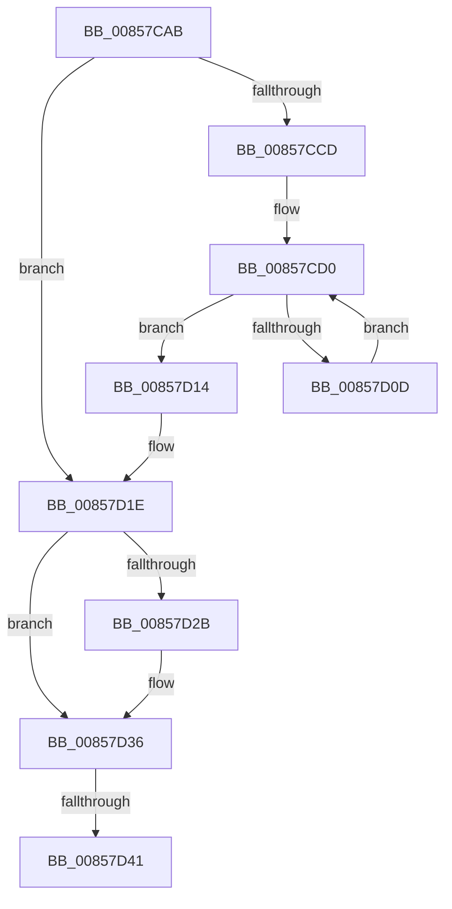

# sub_00857CAB

- RVA: `0x00857CAB`–`0x00857D7A` (길이 `207` bytes)
- VA: `0x0000000140857CAB`
- 실행 섹션: `PAGE`
- PDB 이름 있음: `아니요`; PDB Function 태그: `아니요`
- unwind 정보 RVA: `0x0006A680`
- 디코드: `51`개 명령, `207/207` bytes 표시
- 미해석 바이트: `0` (있으면 어셈블리에 `.byte`로 보존)

> 이 문서는 커널 이미지의 기계어와 PDB 기호를 분석해 생성했습니다. 4번과 5번은 함수 원형과 자료형을 바이너리 사용 방식에서 추정한 C 해석이며 원본 소스 복구 결과는 아닙니다.

## 1. Dependencies

- 직접 호출 지점: **4**; 고유 호출 대상: **4**
- 직접 호출자로 확인된 함수: **0**
- RIP 상대 이미지 참조: **0**

### Outgoing calls
- `0x00857CD6` → [CmpGetComponentNameAtIndex](../9A/CmpGetComponentNameAtIndex_function_009A7A50.md) (function, `0x009A7A50`)
- `0x00857D02` → [RtlUnicodeStringCat](../../text/3E/RtlUnicodeStringCat_function_003E6030.md) (function, `0x003E6030`)
- `0x00857D2D` → [ExFreePoolWithTag](../../poolcode/B8/ExFreePoolWithTag_function_00B82870.md) (function, `0x00B82870`)
- `0x00857D57` → [RtlInitUnicodeString](../../text/42/RtlInitUnicodeString_function_0042A780.md) (function, `0x0042A780`)

### Direct callers
- 이 함수 시작 RVA로 연결되는 직접 call은 확인되지 않았습니다. 간접 호출은 완전히 역산할 수 없습니다.

### Static image references
- 디코드된 RIP-relative 메모리 참조가 없습니다.

## 2. Other-region calls and transfers

- 다른 실행 섹션으로 향하는 call: **3**
  - `0x00857D02` → [RtlUnicodeStringCat](../../text/3E/RtlUnicodeStringCat_function_003E6030.md) (`PAGE` → `.text`)
  - `0x00857D2D` → [ExFreePoolWithTag](../../poolcode/B8/ExFreePoolWithTag_function_00B82870.md) (`PAGE` → `POOLCODE`)
  - `0x00857D57` → [RtlInitUnicodeString](../../text/42/RtlInitUnicodeString_function_0042A780.md) (`PAGE` → `.text`)
- call이 아닌 외부 분기/꼬리 이동: **2**
  - `0x00857D3B` → [sub_0085800D + 0x8](Unknown_function_0085800D.md) (`tail-transfer`)
  - `0x00857D75` → [CmpGetSymbolicLinkTarget + 0x475](CmpGetSymbolicLinkTarget_function_008570A0.md) (`tail-transfer`)

## 3. Assembly (complete function range)

```asm
00857CAB  4C 8B 6C 24 58                  mov r13, qword ptr [rsp + 0x58]
00857CB0  4C 8B 7C 24 48                  mov r15, qword ptr [rsp + 0x48]
00857CB5  4C 89 7C 24 48                  mov qword ptr [rsp + 0x48], r15
00857CBA  44 0F B6 74 24 40               movzx r14d, byte ptr [rsp + 0x40]
00857CC0  0F BF 7D B8                     movsx edi, word ptr [rbp - 0x48]
00857CC4  0F BF 5C 24 60                  movsx ebx, word ptr [rsp + 0x60]
00857CC9  3B DF                           cmp ebx, edi
00857CCB  73 51                           jae 0x140857d1e
00857CCD  0F 1F 00                        nop dword ptr [rax]
00857CD0  48 8B 4D D0                     mov rcx, qword ptr [rbp - 0x30]
00857CD4  8B D3                           mov edx, ebx
00857CD6  E8 75 FD 14 00                  call 0x1409a7a50
00857CDB  44 0F B7 7C 24 50               movzx r15d, word ptr [rsp + 0x50]
00857CE1  48 8B D0                        mov rdx, rax
00857CE4  41 8B CF                        mov ecx, r15d
00857CE7  66 41 83 C7 02                  add r15w, 2
00857CEC  48 D1 E9                        shr rcx, 1
00857CEF  66 44 89 7C 24 50               mov word ptr [rsp + 0x50], r15w
00857CF5  66 41 C7 44 4D 00 5C 00         mov word ptr [r13 + rcx*2], 0x5c
00857CFD  48 8D 4C 24 50                  lea rcx, [rsp + 0x50]
00857D02  E8 29 E3 B8 FF                  call 0x1403e6030
00857D07  FF C3                           inc ebx
00857D09  3B DF                           cmp ebx, edi
00857D0B  73 07                           jae 0x140857d14
00857D0D  4C 8B 6C 24 58                  mov r13, qword ptr [rsp + 0x58]
00857D12  EB BC                           jmp 0x140857cd0
00857D14  0F 28 74 24 50                  movaps xmm6, xmmword ptr [rsp + 0x50]
00857D19  4C 8B 7C 24 48                  mov r15, qword ptr [rsp + 0x48]
00857D1E  48 8B 5D F0                     mov rbx, qword ptr [rbp - 0x10]
00857D22  48 8B 4B 08                     mov rcx, qword ptr [rbx + 8]
00857D26  48 85 C9                        test rcx, rcx
00857D29  74 0B                           je 0x140857d36
00857D2B  33 D2                           xor edx, edx
00857D2D  E8 3E AB 32 00                  call 0x140b82870
00857D32  4C 89 63 08                     mov qword ptr [rbx + 8], r12
00857D36  80 7C 24 41 00                  cmp byte ptr [rsp + 0x41], 0
00857D3B  0F 85 D4 02 00 00               jne 0x140858015
00857D41  48 8B 45 F8                     mov rax, qword ptr [rbp - 8]
00857D45  48 8D 4C 24 50                  lea rcx, [rsp + 0x50]
00857D4A  33 D2                           xor edx, edx
00857D4C  4C 89 64 24 48                  mov qword ptr [rsp + 0x48], r12
00857D51  4C 89 38                        mov qword ptr [rax], r15
00857D54  0F 11 33                        movups xmmword ptr [rbx], xmm6
00857D57  E8 24 2A BD FF                  call 0x14042a780
00857D5C  48 8B 4D 00                     mov rcx, qword ptr [rbp]
00857D60  41 8B FC                        mov edi, r12d
00857D63  48 8B 45 E0                     mov rax, qword ptr [rbp - 0x20]
00857D67  45 32 FF                        xor r15b, r15b
00857D6A  0F 28 B4 24 F0 01 00 00         movaps xmm6, xmmword ptr [rsp + 0x1f0]
00857D72  48 89 01                        mov qword ptr [rcx], rax
00857D75  E9 9B F7 FF FF                  jmp 0x140857515
```

## 4. C-style interpretation (structured pseudocode)

```c
__int64 __fastcall sub_00857CAB(__int64 a1, __int64 a2, __int64 a3, __int64 a4, __int64 a5, __int64 a6, __int64 a7, unsigned __int8 a8, __int64 a9, unsigned __int16 a10, __int64 a11, unsigned __int16 a12, __int64 a13, __int64 a14, __int64 a15, __int64 a16, __int64 a17, __int64 a18, __int64 a19, __int64 a20, __int64 a21, __int64 a22, __int64 a23, __int64 a24, __int64 a25, __int64 a26, __int64 a27, __int64 a28, __int64 a29, __int64 a30, __int64 a31, __int64 a32, __int64 a33, __int64 a34, __int64 a35, __int64 a36, __int64 a37, __int64 a38, __int64 a39, __int64 a40, __int64 a41, __int64 a42, __int64 a43, __int64 a44, __int64 a45, __int64 a46, __int64 a47, __int64 a48, __int64 a49, __int64 a50, __int64 a51, __int64 a52, __int64 a53, __int64 a54, __int64 a55, __int64 a56, __int64 a57, __int64 a58, __int64 a59, __int64 a60, __int64 a61, __int64 a62)
{
    __int64 result;
    __int64 v_r15;
    __int64 v_rbx;
    unsigned __int8 v_stack_p41;
    unsigned __int64 v_stack_p48;
    unsigned __int16 v_stack_p50;

    v_stack_p48 = a9;
    if (((unsigned int)((__int16)(a12))) >= ((unsigned int)((__int16)(*(unsigned __int16 *)(v_rbp - 72))))) goto loc_00857D1E;
loc_00857CD0:
    result = CmpGetComponentNameAtIndex(*(unsigned __int64 *)(v_rbp - 48), (unsigned int)((unsigned int)((__int16)(a12))), a3, a4);
    v_r15 = (unsigned __int16)((a10) + (2));
    a1 = ((unsigned int)(a10)) >> (1);
    v_stack_p50 = (unsigned __int16)(v_r15);
    *(unsigned __int16 *)(a11 + a1 * 2) = 92;
    result = RtlUnicodeStringCat(a10, result, a3, a4);
    v_rbx = (unsigned int)(((__int16)(a12)) + 1);
    if (((unsigned int)(v_rbx)) >= ((unsigned int)((__int16)(*(unsigned __int16 *)(v_rbp - 72))))) goto loc_00857D14;
    goto loc_00857CD0;
loc_00857D14:
loc_00857D1E:
    if (*(unsigned __int64 *)(*(unsigned __int64 *)(v_rbp - 16) + 8) != 0) {
        a2 = 0;
        result = ExFreePoolWithTag(*(unsigned __int64 *)(*(unsigned __int64 *)(v_rbp - 16) + 8), a2, a3, a4);
        *(unsigned __int64 *)(*(unsigned __int64 *)(v_rbp - 16) + 8) = v_r12;
    }
    a2 = 0;
    v_stack_p48 = v_r12;
    *(unsigned __int64 *)(*(unsigned __int64 *)(v_rbp - 8)) = a9;
    *(unsigned __int64 *)(*(unsigned __int64 *)(v_rbp - 16)) = v_xmm6;
    result = RtlInitUnicodeString(a10, a2, a3, a4);
    v_r15 = 0;
    *(unsigned __int64 *)(*(unsigned __int64 *)(v_rbp)) = *(unsigned __int64 *)(v_rbp - 32);
}
```

## 5. (Beta) C Style

```c
int64_t sub_00857CAB(int64_t Arg1, int64_t Arg2, int64_t Arg3, int64_t Arg4, uint64_t Arg5, uint64_t Arg6, uint64_t Arg7, uint8_t Arg8, int64_t Arg9, uint16_t Arg10, void *Arg11, uint16_t Arg12, uint64_t Arg13, uint64_t Arg14, uint64_t Arg15, uint64_t Arg16, uint64_t Arg17, uint64_t Arg18, uint64_t Arg19, uint64_t Arg20, uint64_t Arg21, uint64_t Arg22, uint64_t Arg23, uint64_t Arg24, uint64_t Arg25, uint64_t Arg26, uint64_t Arg27, uint64_t Arg28, uint64_t Arg29, uint64_t Arg30, uint64_t Arg31, uint64_t Arg32, uint64_t Arg33, uint64_t Arg34, uint64_t Arg35, uint64_t Arg36, uint64_t Arg37, uint64_t Arg38, uint64_t Arg39, uint64_t Arg40, uint64_t Arg41, uint64_t Arg42, uint64_t Arg43, uint64_t Arg44, uint64_t Arg45, uint64_t Arg46, uint64_t Arg47, uint64_t Arg48, uint64_t Arg49, uint64_t Arg50, uint64_t Arg51, uint64_t Arg52, uint64_t Arg53, uint64_t Arg54, uint64_t Arg55, uint64_t Arg56, uint64_t Arg57, uint64_t Arg58, uint64_t Arg59, uint64_t Arg60, uint64_t Arg61, int64_t Arg62)
{
    uint8_t *arg11 = (uint8_t *)Arg11;

    int64_t result;
    int64_t local_r15;
    int64_t local_rbx;
    uint8_t v_stack_p41;
    uint64_t v_stack_p48;
    uint16_t v_stack_p50;

    v_stack_p48 = Arg9;
    if (((uint32_t)((int16_t)(Arg12))) >= ((uint32_t)((int16_t)(*(uint16_t *)(local_rbp - 0x48))))) goto loc_00857D1E;
loc_00857CD0:
    result = CmpGetComponentNameAtIndex(*(uint64_t *)(local_rbp - 0x30), (uint32_t)((uint32_t)((int16_t)(Arg12))), Arg3, Arg4);
    local_r15 = (uint16_t)((Arg10) + (2));
    Arg1 = ((uint32_t)(Arg10)) >> (1);
    v_stack_p50 = (uint16_t)(local_r15);
    *(uint16_t *)(arg11 + Arg1 * 2) = 92;
    result = RtlUnicodeStringCat(Arg10, result, Arg3, Arg4);
    local_rbx = (uint32_t)(((int16_t)(Arg12)) + 1);
    if (((uint32_t)(local_rbx)) >= ((uint32_t)((int16_t)(*(uint16_t *)(local_rbp - 0x48))))) goto loc_00857D14;
    goto loc_00857CD0;
loc_00857D14:
loc_00857D1E:
    if (*(uint64_t *)(*(uint64_t *)(local_rbp - 0x10) + 0x8) != 0) {
        Arg2 = 0;
        result = ExFreePoolWithTag(*(uint64_t *)(*(uint64_t *)(local_rbp - 0x10) + 0x8), Arg2, Arg3, Arg4);
        *(uint64_t *)(*(uint64_t *)(local_rbp - 0x10) + 0x8) = local_r12;
    }
    Arg2 = 0;
    v_stack_p48 = local_r12;
    *(uint64_t *)(*(uint64_t *)(local_rbp - 0x8)) = Arg9;
    *(uint64_t *)(*(uint64_t *)(local_rbp - 0x10)) = v_xmm6;
    result = RtlInitUnicodeString(Arg10, Arg2, Arg3, Arg4);
    local_r15 = 0;
    *(uint64_t *)(*(uint64_t *)(local_rbp)) = *(uint64_t *)(local_rbp - 0x20);
}
```

### 관측된 메모리 오프셋

구조체 형식이 확인되지 않은 접근은 인자 기준의 오프셋으로만 기록했습니다.

| 기준 인자 | 오프셋 표현 | 폭 (bit) | 접근 |
|---|---:|---:|---|
| `Arg11` | `+ 0x0 + rcx*2` | `16` | `W` |

## 6. Execution-region graph

[열기: 2D/3D 그래프와 함수 탐색 컨트롤 패널](../../../control-panel.html?section=page&rva=0x00857CAB&view=graph)

- 2D 그래프는 위에서 아래로 흐르고, 3D 그래프는 빈 공간을 드래그해 회전합니다. Shift+드래그는 이동, 휠은 확대·축소, 함수 노드 선택은 대상 보고서 이동입니다.

### Static fallback


