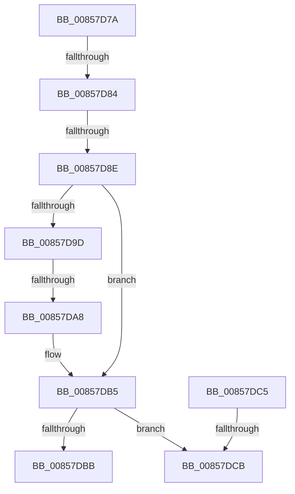

# sub_00857D7A

- RVA: `0x00857D7A`–`0x00857DDE` (길이 `100` bytes)
- VA: `0x0000000140857D7A`
- 실행 섹션: `PAGE`
- PDB 이름 있음: `아니요`; PDB Function 태그: `아니요`
- unwind 정보 RVA: `0x0006A694`
- 디코드: `23`개 명령, `100/100` bytes 표시
- 미해석 바이트: `0` (있으면 어셈블리에 `.byte`로 보존)

> 이 문서는 커널 이미지의 기계어와 PDB 기호를 분석해 생성했습니다. 4번과 5번은 함수 원형과 자료형을 바이너리 사용 방식에서 추정한 C 해석이며 원본 소스 복구 결과는 아닙니다.

## 1. Dependencies

- 직접 호출 지점: **1**; 고유 호출 대상: **1**
- 직접 호출자로 확인된 함수: **0**
- RIP 상대 이미지 참조: **0**

### Outgoing calls
- `0x00857DAC` → [RtlUpcaseUnicodeChar](RtlUpcaseUnicodeChar_function_0085F0F0.md) (function, `0x0085F0F0`)

### Direct callers
- 이 함수 시작 RVA로 연결되는 직접 call은 확인되지 않았습니다. 간접 호출은 완전히 역산할 수 없습니다.

### Static image references
- 디코드된 RIP-relative 메모리 참조가 없습니다.

## 2. Other-region calls and transfers

- 다른 실행 섹션으로 향하는 call: **0**
- call이 아닌 외부 분기/꼬리 이동: **6**
  - `0x00857D7E` → [sub_00857EF1 + 0x22](Unknown_function_00857EF1.md) (`tail-transfer`)
  - `0x00857D88` → [sub_00857EF1 + 0x17](Unknown_function_00857EF1.md) (`tail-transfer`)
  - `0x00857DA2` → [sub_00B16C17](../B1/Unknown_function_00B16C17.md) (`tail-transfer`)
  - `0x00857DC0` → [sub_00857A33 + 0x265](Unknown_function_00857A33.md) (`tail-transfer`)
  - `0x00857DC9` → [sub_00857E06 + 0x2F](Unknown_function_00857E06.md) (`tail-transfer`)
  - `0x00857DD9` → [sub_00857CAB + 0x15](Unknown_function_00857CAB.md) (`tail-transfer`)

## 3. Assembly (complete function range)

```asm
00857D7A  66 83 FF 61                     cmp di, 0x61
00857D7E  0F 82 8F 01 00 00               jb 0x140857f13
00857D84  66 83 FF 7A                     cmp di, 0x7a
00857D88  0F 87 7A 01 00 00               ja 0x140857f08
00857D8E  B8 E0 FF 00 00                  mov eax, 0xffe0
00857D93  66 03 F8                        add di, ax
00857D96  66 41 83 FE 61                  cmp r14w, 0x61
00857D9B  72 18                           jb 0x140857db5
00857D9D  66 41 83 FE 7A                  cmp r14w, 0x7a
00857DA2  0F 86 6F EE 2B 00               jbe 0x140b16c17
00857DA8  41 0F B7 CE                     movzx ecx, r14w
00857DAC  E8 3F 73 00 00                  call 0x14085f0f0
00857DB1  44 0F B7 F0                     movzx r14d, ax
00857DB5  66 41 3B FE                     cmp di, r14w
00857DB9  75 10                           jne 0x140857dcb
00857DBB  48 8B 44 24 78                  mov rax, qword ptr [rsp + 0x78]
00857DC0  E9 D3 FE FF FF                  jmp 0x140857c98
00857DC5  66 44 3B E3                     cmp r12w, bx
00857DC9  74 6A                           je 0x140857e35
00857DCB  4C 8B 6C 24 58                  mov r13, qword ptr [rsp + 0x58]
00857DD0  44 0F B6 74 24 40               movzx r14d, byte ptr [rsp + 0x40]
00857DD6  45 33 E4                        xor r12d, r12d
00857DD9  E9 E2 FE FF FF                  jmp 0x140857cc0
```

## 4. C-style interpretation (structured pseudocode)

```c
__int64 __fastcall sub_00857D7A(__int64 a1, __int64 a2, __int64 a3, __int64 a4, __int64 a5, __int64 a6, __int64 a7, unsigned __int8 a8, __int64 a9, __int64 a10, __int64 a11, __int64 a12, __int64 a13, __int64 a14, __int64 a15)
{
    __int64 result;
    __int64 v_r12;
    __int64 v_rdi;

    v_rdi = (unsigned __int16)((v_rdi) + ((unsigned __int16)((unsigned int)(0xFFE0ULL))));
    if (((unsigned __int16)(v_r14)) < 97) goto loc_00857DB5;
    result = RtlUpcaseUnicodeChar((unsigned __int16)(v_r14), a2, a3, a4);
loc_00857DB5:
    if (((unsigned __int16)(v_rdi)) != ((unsigned __int16)((unsigned __int16)(result)))) goto loc_00857DCB;
loc_00857DCB:
    v_r12 = 0;
}
```

## 5. (Beta) C Style

```c
int64_t sub_00857D7A(int64_t Arg1, int64_t Arg2, int64_t Arg3, int64_t Arg4, uint64_t Arg5, uint64_t Arg6, uint64_t Arg7, uint8_t Arg8, uint64_t Arg9, uint64_t Arg10, int64_t Arg11, uint64_t Arg12, uint64_t Arg13, uint64_t Arg14, int64_t Arg15)
{
    int64_t result;
    int64_t local_r12;
    int64_t local_rdi;

    local_rdi = (uint16_t)((local_rdi) + ((uint16_t)((uint32_t)(0xFFE0ULL))));
    if (((uint16_t)(local_r14)) < 97) goto loc_00857DB5;
    result = RtlUpcaseUnicodeChar((uint16_t)(local_r14), Arg2, Arg3, Arg4);
loc_00857DB5:
    if (((uint16_t)(local_rdi)) != ((uint16_t)((uint16_t)(result)))) goto loc_00857DCB;
loc_00857DCB:
    local_r12 = 0;
}
```

## 6. Execution-region graph

[열기: 2D/3D 그래프와 함수 탐색 컨트롤 패널](../../../control-panel.html?section=page&rva=0x00857D7A&view=graph)

- 2D 그래프는 위에서 아래로 흐르고, 3D 그래프는 빈 공간을 드래그해 회전합니다. Shift+드래그는 이동, 휠은 확대·축소, 함수 노드 선택은 대상 보고서 이동입니다.

### Static fallback


