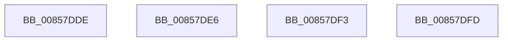

# sub_00857DDE

- RVA: `0x00857DDE`–`0x00857E06` (길이 `40` bytes)
- VA: `0x0000000140857DDE`
- 실행 섹션: `PAGE`
- PDB 이름 있음: `아니요`; PDB Function 태그: `아니요`
- unwind 정보 RVA: `0x0006A6A8`
- 디코드: `9`개 명령, `40/40` bytes 표시
- 미해석 바이트: `0` (있으면 어셈블리에 `.byte`로 보존)

> 이 문서는 커널 이미지의 기계어와 PDB 기호를 분석해 생성했습니다. 4번과 5번은 함수 원형과 자료형을 바이너리 사용 방식에서 추정한 C 해석이며 원본 소스 복구 결과는 아닙니다.

## 1. Dependencies

- 직접 호출 지점: **1**; 고유 호출 대상: **1**
- 직접 호출자로 확인된 함수: **0**
- RIP 상대 이미지 참조: **0**

### Outgoing calls
- `0x00857DF3` → [HvpGetCellPaged](HvpGetCellPaged_function_00854CB0.md) (function, `0x00854CB0`)

### Direct callers
- 이 함수 시작 RVA로 연결되는 직접 call은 확인되지 않았습니다. 간접 호출은 완전히 역산할 수 없습니다.

### Static image references
- 디코드된 RIP-relative 메모리 참조가 없습니다.

## 2. Other-region calls and transfers

- 다른 실행 섹션으로 향하는 call: **0**
- call이 아닌 외부 분기/꼬리 이동: **4**
  - `0x00857DE1` → [CmpGetSymbolicLinkTarget + 0x5E1](CmpGetSymbolicLinkTarget_function_008570A0.md) (`tail-transfer`)
  - `0x00857DEE` → [CmpGetSymbolicLinkTarget + 0x475](CmpGetSymbolicLinkTarget_function_008570A0.md) (`tail-transfer`)
  - `0x00857DF8` → [CmpGetSymbolicLinkTarget + 0x66F](CmpGetSymbolicLinkTarget_function_008570A0.md) (`tail-transfer`)
  - `0x00857E01` → [CmpGetSymbolicLinkTarget + 0x5B3](CmpGetSymbolicLinkTarget_function_008570A0.md) (`tail-transfer`)

## 3. Assembly (complete function range)

```asm
00857DDE  66 FF CE                        dec si
00857DE1  E9 9B F8 FF FF                  jmp 0x140857681
00857DE6  BF 34 00 00 C0                  mov edi, 0xc0000034
00857DEB  41 B6 01                        mov r14b, 1
00857DEE  E9 22 F7 FF FF                  jmp 0x140857515
00857DF3  E8 B8 CE FF FF                  call 0x140854cb0
00857DF8  E9 12 F9 FF FF                  jmp 0x14085770f
00857DFD  48 8B 7D B0                     mov rdi, qword ptr [rbp - 0x50]
00857E01  E9 4D F8 FF FF                  jmp 0x140857653
```

## 4. C-style interpretation (structured pseudocode)

```c
__int64 __fastcall sub_00857DDE(void)
{
    __int64 v_rsi;

    v_rsi = (unsigned __int16)((v_rsi) - 1);
}
```

## 5. (Beta) C Style

```c
void sub_00857DDE(void)
{
    int64_t local_rsi;

    local_rsi = (uint16_t)((local_rsi) - 1);
}
```

## 6. Execution-region graph

[열기: 2D/3D 그래프와 함수 탐색 컨트롤 패널](../../../control-panel.html?section=page&rva=0x00857DDE&view=graph)

- 2D 그래프는 위에서 아래로 흐르고, 3D 그래프는 빈 공간을 드래그해 회전합니다. Shift+드래그는 이동, 휠은 확대·축소, 함수 노드 선택은 대상 보고서 이동입니다.

### Static fallback


