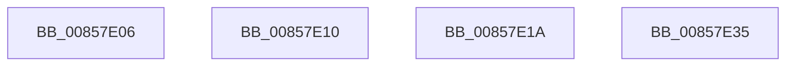

# sub_00857E06

- RVA: `0x00857E06`–`0x00857E6F` (길이 `105` bytes)
- VA: `0x0000000140857E06`
- 실행 섹션: `PAGE`
- PDB 이름 있음: `아니요`; PDB Function 태그: `아니요`
- unwind 정보 RVA: `0x0006A6B8`
- 디코드: `24`개 명령, `105/105` bytes 표시
- 미해석 바이트: `0` (있으면 어셈블리에 `.byte`로 보존)

> 이 문서는 커널 이미지의 기계어와 PDB 기호를 분석해 생성했습니다. 4번과 5번은 함수 원형과 자료형을 바이너리 사용 방식에서 추정한 C 해석이며 원본 소스 복구 결과는 아닙니다.

## 1. Dependencies

- 직접 호출 지점: **6**; 고유 호출 대상: **5**
- 직접 호출자로 확인된 함수: **0**
- RIP 상대 이미지 참조: **0**

### Outgoing calls
- `0x00857E06` → [HvpGetCellPaged](HvpGetCellPaged_function_00854CB0.md) (function, `0x00854CB0`)
- `0x00857E10` → [HvpGetCellPaged](HvpGetCellPaged_function_00854CB0.md) (function, `0x00854CB0`)
- `0x00857E1F` → [CmpDereferenceKeyControlBlock](CmpDereferenceKeyControlBlock_function_00851310.md) (function, `0x00851310`)
- `0x00857E40` → [CmpCleanUpKcbCachedSymlink](../84/CmpCleanUpKcbCachedSymlink_function_0084DF6C.md) (function, `0x0084DF6C`)
- `0x00857E4C` → [CmpReferenceKeyControlBlockUnsafe](../87/CmpReferenceKeyControlBlockUnsafe_function_00874DA0.md) (function, `0x00874DA0`)
- `0x00857E5A` → [CmpUnlockKcbStack](../84/CmpUnlockKcbStack_function_00848460.md) (function, `0x00848460`)

### Direct callers
- 이 함수 시작 RVA로 연결되는 직접 call은 확인되지 않았습니다. 간접 호출은 완전히 역산할 수 없습니다.

### Static image references
- 디코드된 RIP-relative 메모리 참조가 없습니다.

## 2. Other-region calls and transfers

- 다른 실행 섹션으로 향하는 call: **0**
- call이 아닌 외부 분기/꼬리 이동: **4**
  - `0x00857E0B` → [sub_00857A33 + 0x14C](Unknown_function_00857A33.md) (`tail-transfer`)
  - `0x00857E15` → [sub_00857A33 + 0x1C4](Unknown_function_00857A33.md) (`tail-transfer`)
  - `0x00857E30` → [sub_00857CAB + 0x15](Unknown_function_00857CAB.md) (`tail-transfer`)
  - `0x00857E6A` → [sub_00857CAB + 0x15](Unknown_function_00857CAB.md) (`tail-transfer`)

## 3. Assembly (complete function range)

```asm
00857E06  E8 A5 CE FF FF                  call 0x140854cb0
00857E0B  E9 6F FD FF FF                  jmp 0x140857b7f
00857E10  E8 9B CE FF FF                  call 0x140854cb0
00857E15  E9 DD FD FF FF                  jmp 0x140857bf7
00857E1A  48 8B 4C 24 48                  mov rcx, qword ptr [rsp + 0x48]
00857E1F  E8 EC 94 FF FF                  call 0x140851310
00857E24  4D 8B FC                        mov r15, r12
00857E27  4C 89 64 24 48                  mov qword ptr [rsp + 0x48], r12
00857E2C  45 0F B6 F4                     movzx r14d, r12b
00857E30  E9 8B FE FF FF                  jmp 0x140857cc0
00857E35  48 8B 7D 88                     mov rdi, qword ptr [rbp - 0x78]
00857E39  48 8B 55 08                     mov rdx, qword ptr [rbp + 8]
00857E3D  48 8B CF                        mov rcx, rdi
00857E40  E8 27 61 FF FF                  call 0x14084df6c
00857E45  49 8B CF                        mov rcx, r15
00857E48  4C 89 7F 68                     mov qword ptr [rdi + 0x68], r15
00857E4C  E8 4F CF 01 00                  call 0x140874da0
00857E51  48 8B 4D B0                     mov rcx, qword ptr [rbp - 0x50]
00857E55  66 83 4F 08 08                  or word ptr [rdi + 8], 8
00857E5A  E8 01 06 FF FF                  call 0x140848460
00857E5F  4C 8B 6C 24 58                  mov r13, qword ptr [rsp + 0x58]
00857E64  45 32 F6                        xor r14b, r14b
00857E67  45 33 E4                        xor r12d, r12d
00857E6A  E9 51 FE FF FF                  jmp 0x140857cc0
```

## 4. C-style interpretation (structured pseudocode)

```c
__int64 __fastcall sub_00857E06(void)
{
    __int64 result;
    unsigned __int64 v_stack_p48;
    unsigned __int64 v_stack_p58;

    result = HvpGetCellPaged(a1, a2, a3, a4);
}
```

## 5. (Beta) C Style

```c
void sub_00857E06(void)
{
    int64_t result;
    uint64_t v_stack_p48;
    uint64_t v_stack_p58;

    result = HvpGetCellPaged(a1, a2, a3, a4);
}
```

## 6. Execution-region graph

[열기: 2D/3D 그래프와 함수 탐색 컨트롤 패널](../../../control-panel.html?section=page&rva=0x00857E06&view=graph)

- 2D 그래프는 위에서 아래로 흐르고, 3D 그래프는 빈 공간을 드래그해 회전합니다. Shift+드래그는 이동, 휠은 확대·축소, 함수 노드 선택은 대상 보고서 이동입니다.

### Static fallback


