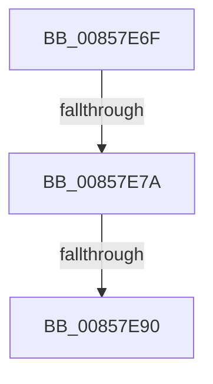

# sub_00857E6F

- RVA: `0x00857E6F`–`0x00857E9A` (길이 `43` bytes)
- VA: `0x0000000140857E6F`
- 실행 섹션: `PAGE`
- PDB 이름 있음: `아니요`; PDB Function 태그: `아니요`
- unwind 정보 RVA: `0x0006A6CC`
- 디코드: `8`개 명령, `43/43` bytes 표시
- 미해석 바이트: `0` (있으면 어셈블리에 `.byte`로 보존)

> 이 문서는 커널 이미지의 기계어와 PDB 기호를 분석해 생성했습니다. 4번과 5번은 함수 원형과 자료형을 바이너리 사용 방식에서 추정한 C 해석이며 원본 소스 복구 결과는 아닙니다.

## 1. Dependencies

- 직접 호출 지점: **1**; 고유 호출 대상: **1**
- 직접 호출자로 확인된 함수: **0**
- RIP 상대 이미지 참조: **0**

### Outgoing calls
- `0x00857E90` → [HvpReleaseCellPaged](HvpReleaseCellPaged_function_00855F40.md) (function, `0x00855F40`)

### Direct callers
- 이 함수 시작 RVA로 연결되는 직접 call은 확인되지 않았습니다. 간접 호출은 완전히 역산할 수 없습니다.

### Static image references
- 디코드된 RIP-relative 메모리 참조가 없습니다.

## 2. Other-region calls and transfers

- 다른 실행 섹션으로 향하는 call: **0**
- call이 아닌 외부 분기/꼬리 이동: **3**
  - `0x00857E74` → [sub_00857F1D](Unknown_function_00857F1D.md) (`tail-transfer`)
  - `0x00857E8A` → [sub_00857F4E](Unknown_function_00857F4E.md) (`tail-transfer`)
  - `0x00857E95` → [CmpGetSymbolicLinkTarget + 0x499](CmpGetSymbolicLinkTarget_function_008570A0.md) (`tail-transfer`)

## 3. Assembly (complete function range)

```asm
00857E6F  80 7C 24 42 00                  cmp byte ptr [rsp + 0x42], 0
00857E74  0F 85 A3 00 00 00               jne 0x140857f1d
00857E7A  41 F6 84 24 8C 00 00 00 01      test byte ptr [r12 + 0x8c], 1
00857E83  48 8D 55 C8                     lea rdx, [rbp - 0x38]
00857E87  49 8B CC                        mov rcx, r12
00857E8A  0F 85 BE 00 00 00               jne 0x140857f4e
00857E90  E8 AB E0 FF FF                  call 0x140855f40
00857E95  E9 9F F6 FF FF                  jmp 0x140857539
```

## 4. C-style interpretation (structured pseudocode)

```c
__int64 __fastcall sub_00857E6F(void)
{
    __int64 result;
    unsigned __int8 v_stack_p42;

    result = HvpReleaseCellPaged(v_r12, v_rbp - 56, a3, a4);
}
```

## 5. (Beta) C Style

```c
void sub_00857E6F(void)
{
    int64_t result;
    uint8_t v_stack_p42;

    result = HvpReleaseCellPaged(local_r12, local_rbp - 56, a3, a4);
}
```

## 6. Execution-region graph

[열기: 2D/3D 그래프와 함수 탐색 컨트롤 패널](../../../control-panel.html?section=page&rva=0x00857E6F&view=graph)

- 2D 그래프는 위에서 아래로 흐르고, 3D 그래프는 빈 공간을 드래그해 회전합니다. Shift+드래그는 이동, 휠은 확대·축소, 함수 노드 선택은 대상 보고서 이동입니다.

### Static fallback


