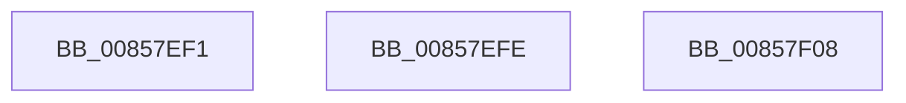

# sub_00857EF1

- RVA: `0x00857EF1`–`0x00857F1D` (길이 `44` bytes)
- VA: `0x0000000140857EF1`
- 실행 섹션: `PAGE`
- PDB 이름 있음: `아니요`; PDB Function 태그: `아니요`
- unwind 정보 RVA: `0x0006A724`
- 디코드: `10`개 명령, `44/44` bytes 표시
- 미해석 바이트: `0` (있으면 어셈블리에 `.byte`로 보존)

> 이 문서는 커널 이미지의 기계어와 PDB 기호를 분석해 생성했습니다. 4번과 5번은 함수 원형과 자료형을 바이너리 사용 방식에서 추정한 C 해석이며 원본 소스 복구 결과는 아닙니다.

## 1. Dependencies

- 직접 호출 지점: **3**; 고유 호출 대상: **2**
- 직접 호출자로 확인된 함수: **0**
- RIP 상대 이미지 참조: **0**

### Outgoing calls
- `0x00857EF1` → [RtlUpcaseUnicodeChar](RtlUpcaseUnicodeChar_function_0085F0F0.md) (function, `0x0085F0F0`)
- `0x00857EFE` → [HvpReleaseCellFlat](HvpReleaseCellFlat_function_0085CC20.md) (function, `0x0085CC20`)
- `0x00857F0B` → [RtlUpcaseUnicodeChar](RtlUpcaseUnicodeChar_function_0085F0F0.md) (function, `0x0085F0F0`)

### Direct callers
- 이 함수 시작 RVA로 연결되는 직접 call은 확인되지 않았습니다. 간접 호출은 완전히 역산할 수 없습니다.

### Static image references
- 디코드된 RIP-relative 메모리 참조가 없습니다.

## 2. Other-region calls and transfers

- 다른 실행 섹션으로 향하는 call: **0**
- call이 아닌 외부 분기/꼬리 이동: **3**
  - `0x00857EF9` → [sub_00857A33 + 0x13](Unknown_function_00857A33.md) (`tail-transfer`)
  - `0x00857F03` → [sub_00857A33 + 0x193](Unknown_function_00857A33.md) (`tail-transfer`)
  - `0x00857F18` → [sub_00857D7A + 0x1C](Unknown_function_00857D7A.md) (`tail-transfer`)

## 3. Assembly (complete function range)

```asm
00857EF1  E8 FA 71 00 00                  call 0x14085f0f0
00857EF6  0F B7 C8                        movzx ecx, ax
00857EF9  E9 48 FB FF FF                  jmp 0x140857a46
00857EFE  E8 1D 4D 00 00                  call 0x14085cc20
00857F03  E9 BE FC FF FF                  jmp 0x140857bc6
00857F08  0F B7 CF                        movzx ecx, di
00857F0B  E8 E0 71 00 00                  call 0x14085f0f0
00857F10  0F B7 F8                        movzx edi, ax
00857F13  B8 E0 FF 00 00                  mov eax, 0xffe0
00857F18  E9 79 FE FF FF                  jmp 0x140857d96
```

## 4. C-style interpretation (structured pseudocode)

```c
__int64 __fastcall sub_00857EF1(void)
{
    __int64 result;

    result = RtlUpcaseUnicodeChar(a1, a2, a3, a4);
}
```

## 5. (Beta) C Style

```c
void sub_00857EF1(void)
{
    int64_t result;

    result = RtlUpcaseUnicodeChar(a1, a2, a3, a4);
}
```

## 6. Execution-region graph

[열기: 2D/3D 그래프와 함수 탐색 컨트롤 패널](../../../control-panel.html?section=page&rva=0x00857EF1&view=graph)

- 2D 그래프는 위에서 아래로 흐르고, 3D 그래프는 빈 공간을 드래그해 회전합니다. Shift+드래그는 이동, 휠은 확대·축소, 함수 노드 선택은 대상 보고서 이동입니다.

### Static fallback


