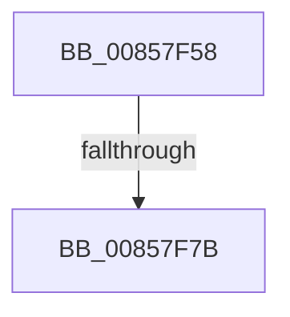

# sub_00857F58

- RVA: `0x00857F58`–`0x00857F80` (길이 `40` bytes)
- VA: `0x0000000140857F58`
- 실행 섹션: `PAGE`
- PDB 이름 있음: `아니요`; PDB Function 태그: `아니요`
- unwind 정보 RVA: `0x0006A76C`
- 디코드: `10`개 명령, `40/40` bytes 표시
- 미해석 바이트: `0` (있으면 어셈블리에 `.byte`로 보존)

> 이 문서는 커널 이미지의 기계어와 PDB 기호를 분석해 생성했습니다. 4번과 5번은 함수 원형과 자료형을 바이너리 사용 방식에서 추정한 C 해석이며 원본 소스 복구 결과는 아닙니다.

## 1. Dependencies

- 직접 호출 지점: **0**; 고유 호출 대상: **0**
- 직접 호출자로 확인된 함수: **0**
- RIP 상대 이미지 참조: **0**

### Outgoing calls
- 직접 디코드된 call 명령이 없습니다.

### Direct callers
- 이 함수 시작 RVA로 연결되는 직접 call은 확인되지 않았습니다. 간접 호출은 완전히 역산할 수 없습니다.

### Static image references
- 디코드된 RIP-relative 메모리 참조가 없습니다.

## 2. Other-region calls and transfers

- 다른 실행 섹션으로 향하는 call: **0**
- call이 아닌 외부 분기/꼬리 이동: **2**
  - `0x00857F75` → [sub_008579BE + 0x23](Unknown_function_008579BE.md) (`tail-transfer`)
  - `0x00857F7B` → [sub_00857864 + 0xAC](Unknown_function_00857864.md) (`tail-transfer`)

## 3. Assembly (complete function range)

```asm
00857F58  48 83 C1 02                     add rcx, 2
00857F5C  66 03 C7                        add ax, di
00857F5F  66 03 D7                        add dx, di
00857F62  48 89 4D A8                     mov qword ptr [rbp - 0x58], rcx
00857F66  66 83 C3 02                     add bx, 2
00857F6A  66 89 45 A0                     mov word ptr [rbp - 0x60], ax
00857F6E  66 89 55 A2                     mov word ptr [rbp - 0x5e], dx
00857F72  66 85 C0                        test ax, ax
00857F75  0F 84 66 FA FF FF               je 0x1408579e1
00857F7B  E9 90 F9 FF FF                  jmp 0x140857910
```

## 4. C-style interpretation (structured pseudocode)

```c
__int64 __fastcall sub_00857F58(__int64 a1, unsigned __int16 a2)
{
    __int64 result;
    __int64 v_rbx;

    a1 = (a1) + (2);
    result = (unsigned __int16)((result) + ((unsigned __int16)(v_rdi)));
    a2 = (unsigned __int16)((a2) + ((unsigned __int16)(v_rdi)));
    *(unsigned __int64 *)(v_rbp - 88) = a1;
    v_rbx = (unsigned __int16)((v_rbx) + (2));
    *(unsigned __int16 *)(v_rbp - 96) = (unsigned __int16)(result);
    *(unsigned __int16 *)(v_rbp - 94) = a2;
}
```

## 5. (Beta) C Style

```c
int64_t sub_00857F58(int64_t Arg1, uint16_t Arg2)
{
    int64_t result;
    int64_t local_rbx;

    Arg1 = (Arg1) + (2);
    result = (uint16_t)((result) + ((uint16_t)(local_rdi)));
    Arg2 = (uint16_t)((Arg2) + ((uint16_t)(local_rdi)));
    *(uint64_t *)(local_rbp - 0x58) = Arg1;
    local_rbx = (uint16_t)((local_rbx) + (2));
    *(uint16_t *)(local_rbp - 0x60) = (uint16_t)(result);
    *(uint16_t *)(local_rbp - 0x5E) = Arg2;
}
```

## 6. Execution-region graph

[열기: 2D/3D 그래프와 함수 탐색 컨트롤 패널](../../../control-panel.html?section=page&rva=0x00857F58&view=graph)

- 2D 그래프는 위에서 아래로 흐르고, 3D 그래프는 빈 공간을 드래그해 회전합니다. Shift+드래그는 이동, 휠은 확대·축소, 함수 노드 선택은 대상 보고서 이동입니다.

### Static fallback


