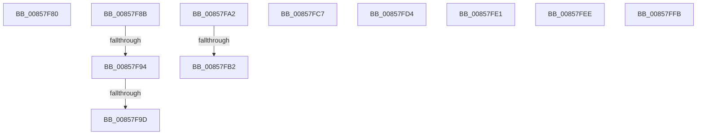

# sub_00857F80

- RVA: `0x00857F80`–`0x0085800D` (길이 `141` bytes)
- VA: `0x0000000140857F80`
- 실행 섹션: `PAGE`
- PDB 이름 있음: `아니요`; PDB Function 태그: `아니요`
- unwind 정보 RVA: `0x0006A780`
- 디코드: `32`개 명령, `141/141` bytes 표시
- 미해석 바이트: `0` (있으면 어셈블리에 `.byte`로 보존)

> 이 문서는 커널 이미지의 기계어와 PDB 기호를 분석해 생성했습니다. 4번과 5번은 함수 원형과 자료형을 바이너리 사용 방식에서 추정한 C 해석이며 원본 소스 복구 결과는 아닙니다.

## 1. Dependencies

- 직접 호출 지점: **0**; 고유 호출 대상: **0**
- 직접 호출자로 확인된 함수: **0**
- RIP 상대 이미지 참조: **0**

### Outgoing calls
- 직접 디코드된 call 명령이 없습니다.

### Direct callers
- 이 함수 시작 RVA로 연결되는 직접 call은 확인되지 않았습니다. 간접 호출은 완전히 역산할 수 없습니다.

### Static image references
- 디코드된 RIP-relative 메모리 참조가 없습니다.

## 2. Other-region calls and transfers

- 다른 실행 섹션으로 향하는 call: **0**
- call이 아닌 외부 분기/꼬리 이동: **11**
  - `0x00857F86` → [CmpGetSymbolicLinkTarget + 0x18A](CmpGetSymbolicLinkTarget_function_008570A0.md) (`tail-transfer`)
  - `0x00857F8E` → [CmpGetSymbolicLinkTarget + 0x40B](CmpGetSymbolicLinkTarget_function_008570A0.md) (`tail-transfer`)
  - `0x00857F97` → [CmpGetSymbolicLinkTarget + 0x40B](CmpGetSymbolicLinkTarget_function_008570A0.md) (`tail-transfer`)
  - `0x00857F9D` → [CmpGetSymbolicLinkTarget + 0x3BB](CmpGetSymbolicLinkTarget_function_008570A0.md) (`tail-transfer`)
  - `0x00857FAC` → [sub_00B16BE8](../B1/Unknown_function_00B16BE8.md) (`tail-transfer`)
  - `0x00857FC2` → [CmpGetSymbolicLinkTarget + 0x5E1](CmpGetSymbolicLinkTarget_function_008570A0.md) (`tail-transfer`)
  - `0x00857FCF` → [CmpGetSymbolicLinkTarget + 0x47A](CmpGetSymbolicLinkTarget_function_008570A0.md) (`tail-transfer`)
  - `0x00857FDC` → [CmpGetSymbolicLinkTarget + 0x47A](CmpGetSymbolicLinkTarget_function_008570A0.md) (`tail-transfer`)
  - `0x00857FE9` → [CmpGetSymbolicLinkTarget + 0x475](CmpGetSymbolicLinkTarget_function_008570A0.md) (`tail-transfer`)
  - `0x00857FF6` → [CmpGetSymbolicLinkTarget + 0x475](CmpGetSymbolicLinkTarget_function_008570A0.md) (`tail-transfer`)
  - `0x00858008` → [CmpGetSymbolicLinkTarget + 0x48C](CmpGetSymbolicLinkTarget_function_008570A0.md) (`tail-transfer`)

## 3. Assembly (complete function range)

```asm
00857F80  B1 01                           mov cl, 1
00857F82  48 83 E7 FE                     and rdi, 0xfffffffffffffffe
00857F86  E9 9F F2 FF FF                  jmp 0x14085722a
00857F8B  66 85 D2                        test dx, dx
00857F8E  0F 85 17 F5 FF FF               jne 0x1408574ab
00857F94  66 85 C0                        test ax, ax
00857F97  0F 85 0E F5 FF FF               jne 0x1408574ab
00857F9D  E9 B9 F4 FF FF                  jmp 0x14085745b
00857FA2  48 8D 93 18 01 00 00            lea rdx, [rbx + 0x118]
00857FA9  83 3A 00                        cmp dword ptr [rdx], 0
00857FAC  0F 85 36 EC 2B 00               jne 0x140b16be8
00857FB2  4C 8B 45 E0                     mov r8, qword ptr [rbp - 0x20]
00857FB6  BF FF FF FF FF                  mov edi, 0xffffffff
00857FBB  89 7C 24 44                     mov dword ptr [rsp + 0x44], edi
00857FBF  66 FF CE                        dec si
00857FC2  E9 BA F6 FF FF                  jmp 0x140857681
00857FC7  BF 34 00 00 C0                  mov edi, 0xc0000034
00857FCC  41 B6 01                        mov r14b, 1
00857FCF  E9 46 F5 FF FF                  jmp 0x14085751a
00857FD4  BF 9A 00 00 C0                  mov edi, 0xc000009a
00857FD9  41 B6 01                        mov r14b, 1
00857FDC  E9 39 F5 FF FF                  jmp 0x14085751a
00857FE1  BF 34 00 00 C0                  mov edi, 0xc0000034
00857FE6  41 B6 01                        mov r14b, 1
00857FE9  E9 27 F5 FF FF                  jmp 0x140857515
00857FEE  BF 34 00 00 C0                  mov edi, 0xc0000034
00857FF3  41 B6 01                        mov r14b, 1
00857FF6  E9 1A F5 FF FF                  jmp 0x140857515
00857FFB  48 8B 74 24 68                  mov rsi, qword ptr [rsp + 0x68]
00858000  BF 9A 00 00 C0                  mov edi, 0xc000009a
00858005  41 B6 01                        mov r14b, 1
00858008  E9 1F F5 FF FF                  jmp 0x14085752c
```

## 4. C-style interpretation (structured pseudocode)

```c
void __fastcall sub_00857F80(__int64 a1, unsigned __int16 a2)
{
    __int64 v_rdi;
    unsigned int v_stack_p44;
    unsigned __int64 v_stack_p68;

    v_rdi = (v_rdi) & (-2);
}
```

## 5. (Beta) C Style

```c
void sub_00857F80(int64_t Arg1, uint16_t Arg2)
{
    int64_t local_rdi;
    uint32_t v_stack_p44;
    uint64_t v_stack_p68;

    local_rdi = (local_rdi) & (-2);
}
```

## 6. Execution-region graph

[열기: 2D/3D 그래프와 함수 탐색 컨트롤 패널](../../../control-panel.html?section=page&rva=0x00857F80&view=graph)

- 2D 그래프는 위에서 아래로 흐르고, 3D 그래프는 빈 공간을 드래그해 회전합니다. Shift+드래그는 이동, 휠은 확대·축소, 함수 노드 선택은 대상 보고서 이동입니다.

### Static fallback


