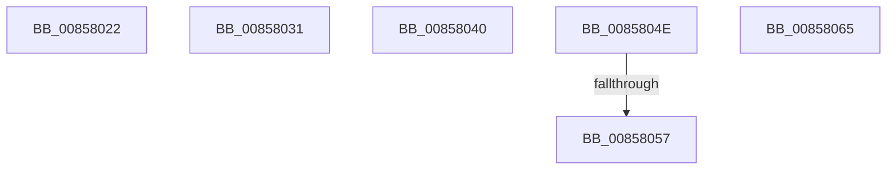

# sub_00858022

- RVA: `0x00858022`–`0x0085806F` (길이 `77` bytes)
- VA: `0x0000000140858022`
- 실행 섹션: `PAGE`
- PDB 이름 있음: `아니요`; PDB Function 태그: `아니요`
- unwind 정보 RVA: `0x0006A7A4`
- 디코드: `19`개 명령, `77/77` bytes 표시
- 미해석 바이트: `0` (있으면 어셈블리에 `.byte`로 보존)

> 이 문서는 커널 이미지의 기계어와 PDB 기호를 분석해 생성했습니다. 4번과 5번은 함수 원형과 자료형을 바이너리 사용 방식에서 추정한 C 해석이며 원본 소스 복구 결과는 아닙니다.

## 1. Dependencies

- 직접 호출 지점: **5**; 고유 호출 대상: **4**
- 직접 호출자로 확인된 함수: **0**
- RIP 상대 이미지 참조: **0**

### Outgoing calls
- `0x00858027` → [ExFreePoolWithTag](../../poolcode/B8/ExFreePoolWithTag_function_00B82870.md) (function, `0x00B82870`)
- `0x00858036` → [ExFreePoolWithTag](../../poolcode/B8/ExFreePoolWithTag_function_00B82870.md) (function, `0x00B82870`)
- `0x00858044` → [CmpUnlockKcbStack](../84/CmpUnlockKcbStack_function_00848460.md) (function, `0x00848460`)
- `0x0085805A` → [CmpUnlockKcb](../../pagecmrc/BC/CmpUnlockKcb_function_00BC92C0.md) (function, `0x00BC92C0`)
- `0x00858065` → [guard_dispatch_icall](../../text/6B/guard_dispatch_icall_function_006BAAD0.md) (function, `0x006BAAD0`)

### Direct callers
- 이 함수 시작 RVA로 연결되는 직접 call은 확인되지 않았습니다. 간접 호출은 완전히 역산할 수 없습니다.

### Static image references
- 디코드된 RIP-relative 메모리 참조가 없습니다.

## 2. Other-region calls and transfers

- 다른 실행 섹션으로 향하는 call: **4**
  - `0x00858027` → [ExFreePoolWithTag](../../poolcode/B8/ExFreePoolWithTag_function_00B82870.md) (`PAGE` → `POOLCODE`)
  - `0x00858036` → [ExFreePoolWithTag](../../poolcode/B8/ExFreePoolWithTag_function_00B82870.md) (`PAGE` → `POOLCODE`)
  - `0x0085805A` → [CmpUnlockKcb](../../pagecmrc/BC/CmpUnlockKcb_function_00BC92C0.md) (`PAGE` → `PAGECMRC`)
  - `0x00858065` → [guard_dispatch_icall](../../text/6B/guard_dispatch_icall_function_006BAAD0.md) (`PAGE` → `.text`)
- call이 아닌 외부 분기/꼬리 이동: **6**
  - `0x0085802C` → [CmpGetSymbolicLinkTarget + 0x488](CmpGetSymbolicLinkTarget_function_008570A0.md) (`tail-transfer`)
  - `0x0085803B` → [CmpGetSymbolicLinkTarget + 0x4C2](CmpGetSymbolicLinkTarget_function_008570A0.md) (`tail-transfer`)
  - `0x00858049` → [CmpGetSymbolicLinkTarget + 0x4CB](CmpGetSymbolicLinkTarget_function_008570A0.md) (`tail-transfer`)
  - `0x00858051` → [sub_00B16C20](../B1/Unknown_function_00B16C20.md) (`tail-transfer`)
  - `0x00858060` → [sub_00B16C20](../B1/Unknown_function_00B16C20.md) (`tail-transfer`)
  - `0x0085806A` → [CmpGetSymbolicLinkTarget + 0x518](CmpGetSymbolicLinkTarget_function_008570A0.md) (`tail-transfer`)

## 3. Assembly (complete function range)

```asm
00858022  33 D2                           xor edx, edx
00858024  48 8B CB                        mov rcx, rbx
00858027  E8 44 A8 32 00                  call 0x140b82870
0085802C  E9 F7 F4 FF FF                  jmp 0x140857528
00858031  33 D2                           xor edx, edx
00858033  48 8B CB                        mov rcx, rbx
00858036  E8 35 A8 32 00                  call 0x140b82870
0085803B  E9 22 F5 FF FF                  jmp 0x140857562
00858040  48 8B 4D B0                     mov rcx, qword ptr [rbp - 0x50]
00858044  E8 17 04 FF FF                  call 0x140848460
00858049  E9 1D F5 FF FF                  jmp 0x14085756b
0085804E  45 84 FF                        test r15b, r15b
00858051  0F 84 C9 EB 2B 00               je 0x140b16c20
00858057  48 8B CB                        mov rcx, rbx
0085805A  E8 61 12 37 00                  call 0x140bc92c0
0085805F  90                              nop
00858060  E9 BB EB 2B 00                  jmp 0x140b16c20
00858065  E8 66 2A E6 FF                  call 0x1406baad0
0085806A  E9 49 F5 FF FF                  jmp 0x1408575b8
```

## 4. C-style interpretation (structured pseudocode)

```c
__int64 __fastcall sub_00858022(__int64 a1, int a2)
{
    __int64 result;

    a2 = 0;
    result = ExFreePoolWithTag(v_rbx, a2, a3, a4);
}
```

## 5. (Beta) C Style

```c
int64_t sub_00858022(int64_t Arg1, int32_t Arg2)
{
    int64_t result;

    Arg2 = 0;
    result = ExFreePoolWithTag(local_rbx, Arg2, a3, a4);
}
```

## 6. Execution-region graph

[열기: 2D/3D 그래프와 함수 탐색 컨트롤 패널](../../../control-panel.html?section=page&rva=0x00858022&view=graph)

- 2D 그래프는 위에서 아래로 흐르고, 3D 그래프는 빈 공간을 드래그해 회전합니다. Shift+드래그는 이동, 휠은 확대·축소, 함수 노드 선택은 대상 보고서 이동입니다.

### Static fallback


