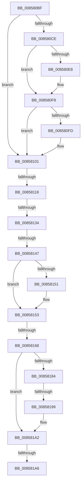

# sub_008580BF

- RVA: `0x008580BF`–`0x008581C6` (길이 `263` bytes)
- VA: `0x00000001408580BF`
- 실행 섹션: `PAGE`
- PDB 이름 있음: `아니요`; PDB Function 태그: `아니요`
- unwind 정보 RVA: `0x0006A7F8`
- 디코드: `73`개 명령, `263/263` bytes 표시
- 미해석 바이트: `0` (있으면 어셈블리에 `.byte`로 보존)

> 이 문서는 커널 이미지의 기계어와 PDB 기호를 분석해 생성했습니다. 4번과 5번은 함수 원형과 자료형을 바이너리 사용 방식에서 추정한 C 해석이며 원본 소스 복구 결과는 아닙니다.

## 1. Dependencies

- 직접 호출 지점: **7**; 고유 호출 대상: **7**
- 직접 호출자로 확인된 함수: **0**
- RIP 상대 이미지 참조: **0**

### Outgoing calls
- `0x008580D7` → [KeAbPreAcquire](../../text/21/KeAbPreAcquire_function_00210230.md) (function, `0x00210230`)
- `0x008580F3` → [ExfAcquirePushLockExclusiveEx](../../text/20/ExfAcquirePushLockExclusiveEx_function_0020FC90.md) (function, `0x0020FC90`)
- `0x00858118` → [HvpGetCellFlat](HvpGetCellFlat_function_00854C60.md) (function, `0x00854C60`)
- `0x00858139` → [HvpGetCellMap](../../pagecmrc/BC/HvpGetCellMap_function_00BC9710.md) (function, `0x00BC9710`)
- `0x00858168` → [HvpReleaseCellPaged](HvpReleaseCellPaged_function_00855F40.md) (function, `0x00855F40`)
- `0x00858178` → [HvpMarkDirty](HvpMarkDirty_function_008593C0.md) (function, `0x008593C0`)
- `0x0085819D` → [KeAbPostRelease](../../text/2E/KeAbPostRelease_function_002E1600.md) (function, `0x002E1600`)

### Direct callers
- 이 함수 시작 RVA로 연결되는 직접 call은 확인되지 않았습니다. 간접 호출은 완전히 역산할 수 없습니다.

### Static image references
- 디코드된 RIP-relative 메모리 참조가 없습니다.

## 2. Other-region calls and transfers

- 다른 실행 섹션으로 향하는 call: **4**
  - `0x008580D7` → [KeAbPreAcquire](../../text/21/KeAbPreAcquire_function_00210230.md) (`PAGE` → `.text`)
  - `0x008580F3` → [ExfAcquirePushLockExclusiveEx](../../text/20/ExfAcquirePushLockExclusiveEx_function_0020FC90.md) (`PAGE` → `.text`)
  - `0x00858139` → [HvpGetCellMap](../../pagecmrc/BC/HvpGetCellMap_function_00BC9710.md) (`PAGE` → `PAGECMRC`)
  - `0x0085819D` → [KeAbPostRelease](../../text/2E/KeAbPostRelease_function_002E1600.md) (`PAGE` → `.text`)
- call이 아닌 외부 분기/꼬리 이동: **6**
  - `0x00858112` → [sub_008581C7](Unknown_function_008581C7.md) (`tail-transfer`)
  - `0x0085812E` → [sub_008581C7 + 0xA](Unknown_function_008581C7.md) (`tail-transfer`)
  - `0x00858141` → [sub_008581ED + 0x19](Unknown_function_008581ED.md) (`tail-transfer`)
  - `0x00858162` → [sub_008581ED](Unknown_function_008581ED.md) (`tail-transfer`)
  - `0x00858197` → [sub_008581ED + 0xA](Unknown_function_008581ED.md) (`tail-transfer`)
  - `0x008581A4` → [sub_008581ED + 0x15](Unknown_function_008581ED.md) (`tail-transfer`)

## 3. Assembly (complete function range)

```asm
008580BF  48 89 74 24 68                  mov qword ptr [rsp + 0x68], rsi
008580C4  48 89 7C 24 70                  mov qword ptr [rsp + 0x70], rdi
008580C9  45 84 C0                        test r8b, r8b
008580CC  75 33                           jne 0x140858101
008580CE  45 33 C0                        xor r8d, r8d
008580D1  33 D2                           xor edx, edx
008580D3  48 83 C1 50                     add rcx, 0x50
008580D7  E8 54 81 9B FF                  call 0x140210230
008580DC  F0 48 0F BA 6B 50 00            lock bts qword ptr [rbx + 0x50], 0
008580E3  48 8B F8                        mov rdi, rax
008580E6  73 10                           jae 0x1408580f8
008580E8  4C 8D 43 50                     lea r8, [rbx + 0x50]
008580EC  48 8B D0                        mov rdx, rax
008580EF  48 8D 4B 50                     lea rcx, [rbx + 0x50]
008580F3  E8 98 7B 9B FF                  call 0x14020fc90
008580F8  48 85 FF                        test rdi, rdi
008580FB  74 04                           je 0x140858101
008580FD  C6 47 0A 01                     mov byte ptr [rdi + 0xa], 1
00858101  F6 83 8C 00 00 00 01            test byte ptr [rbx + 0x8c], 1
00858108  4C 8D 44 24 60                  lea r8, [rsp + 0x60]
0085810D  8B D5                           mov edx, ebp
0085810F  48 8B CB                        mov rcx, rbx
00858112  0F 84 AF 00 00 00               je 0x1408581c7
00858118  E8 43 CB FF FF                  call 0x140854c60
0085811D  48 8B C8                        mov rcx, rax
00858120  48 8D 40 FC                     lea rax, [rax - 4]
00858124  48 85 C9                        test rcx, rcx
00858127  4C 0F 45 F0                     cmovne r14, rax
0085812B  4D 85 F6                        test r14, r14
0085812E  0F 84 9D 00 00 00               je 0x1408581d1
00858134  8B D5                           mov edx, ebp
00858136  48 8B CB                        mov rcx, rbx
00858139  E8 D2 15 37 00                  call 0x140bc9710
0085813E  48 85 C0                        test rax, rax
00858141  0F 84 BF 00 00 00               je 0x140858206
00858147  41 8B 3E                        mov edi, dword ptr [r14]
0085814A  83 C5 FC                        add ebp, -4
0085814D  85 FF                           test edi, edi
0085814F  79 02                           jns 0x140858153
00858151  F7 DF                           neg edi
00858153  F6 83 8C 00 00 00 01            test byte ptr [rbx + 0x8c], 1
0085815A  48 8D 54 24 60                  lea rdx, [rsp + 0x60]
0085815F  48 8B CB                        mov rcx, rbx
00858162  0F 85 85 00 00 00               jne 0x1408581ed
00858168  E8 D3 DD FF FF                  call 0x140855f40
0085816D  45 8B CC                        mov r9d, r12d
00858170  44 8B C7                        mov r8d, edi
00858173  8B D5                           mov edx, ebp
00858175  48 8B CB                        mov rcx, rbx
00858178  E8 43 12 00 00                  call 0x1408593c0
0085817D  8B F0                           mov esi, eax
0085817F  45 84 FF                        test r15b, r15b
00858182  75 1E                           jne 0x1408581a2
00858184  48 C7 C2 FF FF FF FF            mov rdx, 0xffffffffffffffff
0085818B  F0 48 0F C1 53 50               lock xadd qword ptr [rbx + 0x50], rdx
00858191  80 E2 06                        and dl, 6
00858194  80 FA 02                        cmp dl, 2
00858197  74 5E                           je 0x1408581f7
00858199  48 8D 4B 50                     lea rcx, [rbx + 0x50]
0085819D  E8 5E 94 A8 FF                  call 0x1402e1600
008581A2  85 F6                           test esi, esi
008581A4  78 5C                           js 0x140858202
008581A6  C6 83 8D 00 00 00 01            mov byte ptr [rbx + 0x8d], 1
008581AD  33 C0                           xor eax, eax
008581AF  48 8B 74 24 68                  mov rsi, qword ptr [rsp + 0x68]
008581B4  48 8B 7C 24 70                  mov rdi, qword ptr [rsp + 0x70]
008581B9  48 83 C4 30                     add rsp, 0x30
008581BD  41 5F                           pop r15
008581BF  41 5E                           pop r14
008581C1  41 5C                           pop r12
008581C3  5D                              pop rbp
008581C4  5B                              pop rbx
008581C5  C3                              ret
```

## 4. C-style interpretation (structured pseudocode)

```c
__int64 __fastcall sub_008580BF(__int64 a1, int a2, int a3, __int64 a4, __int64 a5, __int64 a6, __int64 a7, __int64 a8, __int64 a9, __int64 a10, __int64 a11, __int64 a12, __int64 a13, __int64 a14)
{
    __int64 result;
    __int64 v_r14;
    __int64 v_rbp;
    __int64 v_rdi;
    __int64 v_rsp;
    unsigned __int64 v_stack_p68;
    unsigned __int64 v_stack_p70;

    v_stack_p68 = v_rsi;
    v_stack_p70 = v_rdi;
    if ((unsigned __int8)(a3) != 0) goto loc_00858101;
    a3 = 0;
    a2 = 0;
    a1 = (a1) + (80);
    result = KeAbPreAcquire(a1, a2, a3, a4);
    if (!(condition_is_above_or_equal)) {
        a3 = v_rbx + 80;
        a2 = result;
        a1 = v_rbx + 80;
        result = ExfAcquirePushLockExclusiveEx(a1, a2, a3, a4);
    }
    if (result != 0) {
        *(unsigned __int8 *)(result + 10) = 1;
    }
    result = HvpGetCellFlat(v_rbx, (unsigned int)((unsigned int)(v_rbp)), a12, a4);
    if (result != 0) { v_r14 = result - 4; }
    result = HvpGetCellMap(v_rbx, (unsigned int)((unsigned int)(v_rbp)), a12, a4);
    v_rbp = (unsigned int)((v_rbp) + (-4));
    v_rdi = (unsigned int)(*(unsigned int *)(v_r14));
    if (sign_flag) {
        v_rdi = (unsigned int)(-((unsigned int)(*(unsigned int *)(v_r14))));
    }
    result = HvpReleaseCellPaged(v_rbx, a12, a12, a4);
    result = HvpMarkDirty(v_rbx, (unsigned int)((unsigned int)(v_rbp)), (unsigned int)((unsigned int)(v_rdi)), (unsigned int)((unsigned int)(v_r12)));
    if ((unsigned __int8)(v_r15) != 0) goto loc_008581A2;
    a2 = (unsigned __int8)((-1) & (6));
    result = KeAbPostRelease(v_rbx + 80, a2, (unsigned int)((unsigned int)(v_rdi)), (unsigned int)((unsigned int)(v_r12)));
loc_008581A2:
    *(unsigned __int8 *)(v_rbx + 141) = 1;
    result = 0;
    v_rsp = (v_rsp) + (48);
    return result;
}
```

## 5. (Beta) C Style

```c
int64_t sub_008580BF(int64_t Arg1, int32_t Arg2, int32_t Arg3, int64_t Arg4, uint64_t Arg5, uint64_t Arg6, uint64_t Arg7, uint64_t Arg8, uint64_t Arg9, uint64_t Arg10, uint64_t Arg11, int64_t Arg12, int64_t Arg13, int64_t Arg14)
{
    int64_t result;
    int64_t local_r14;
    int64_t local_rbp;
    int64_t local_rdi;
    int64_t local_rsp;
    uint64_t v_stack_p68;
    uint64_t v_stack_p70;

    v_stack_p68 = local_rsi;
    v_stack_p70 = local_rdi;
    if ((uint8_t)(Arg3) != 0) goto loc_00858101;
    Arg3 = 0;
    Arg2 = 0;
    Arg1 = (Arg1) + (80);
    result = KeAbPreAcquire(Arg1, Arg2, Arg3, Arg4);
    if (!(condition_is_above_or_equal)) {
        Arg3 = local_rbx + 80;
        Arg2 = result;
        Arg1 = local_rbx + 80;
        result = ExfAcquirePushLockExclusiveEx(Arg1, Arg2, Arg3, Arg4);
    }
    if (result != 0) {
        *(uint8_t *)(result + 0xA) = 1;
    }
    result = HvpGetCellFlat(local_rbx, (uint32_t)((uint32_t)(local_rbp)), Arg12, Arg4);
    if (result != 0) { local_r14 = result - 4; }
    result = HvpGetCellMap(local_rbx, (uint32_t)((uint32_t)(local_rbp)), Arg12, Arg4);
    local_rbp = (uint32_t)((local_rbp) + (-4));
    local_rdi = (uint32_t)(*(uint32_t *)(local_r14));
    if (sign_flag) {
        local_rdi = (uint32_t)(-((uint32_t)(*(uint32_t *)(local_r14))));
    }
    result = HvpReleaseCellPaged(local_rbx, Arg12, Arg12, Arg4);
    result = HvpMarkDirty(local_rbx, (uint32_t)((uint32_t)(local_rbp)), (uint32_t)((uint32_t)(local_rdi)), (uint32_t)((uint32_t)(local_r12)));
    if ((uint8_t)(local_r15) != 0) goto loc_008581A2;
    Arg2 = (uint8_t)((-1) & (6));
    result = KeAbPostRelease(local_rbx + 80, Arg2, (uint32_t)((uint32_t)(local_rdi)), (uint32_t)((uint32_t)(local_r12)));
loc_008581A2:
    *(uint8_t *)(local_rbx + 0x8D) = 1;
    result = 0;
    local_rsp = (local_rsp) + (48);
    return result;
}
```

## 6. Execution-region graph

[열기: 2D/3D 그래프와 함수 탐색 컨트롤 패널](../../../control-panel.html?section=page&rva=0x008580BF&view=graph)

- 2D 그래프는 위에서 아래로 흐르고, 3D 그래프는 빈 공간을 드래그해 회전합니다. Shift+드래그는 이동, 휠은 확대·축소, 함수 노드 선택은 대상 보고서 이동입니다.

### Static fallback


