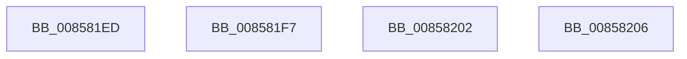

# sub_008581ED

- RVA: `0x008581ED`–`0x0085822D` (길이 `64` bytes)
- VA: `0x00000001408581ED`
- 실행 섹션: `PAGE`
- PDB 이름 있음: `아니요`; PDB Function 태그: `아니요`
- unwind 정보 RVA: `0x0006A850`
- 디코드: `17`개 명령, `64/64` bytes 표시
- 미해석 바이트: `0` (있으면 어셈블리에 `.byte`로 보존)

> 이 문서는 커널 이미지의 기계어와 PDB 기호를 분석해 생성했습니다. 4번과 5번은 함수 원형과 자료형을 바이너리 사용 방식에서 추정한 C 해석이며 원본 소스 복구 결과는 아닙니다.

## 1. Dependencies

- 직접 호출 지점: **4**; 고유 호출 대상: **4**
- 직접 호출자로 확인된 함수: **0**
- RIP 상대 이미지 참조: **0**

### Outgoing calls
- `0x008581ED` → [HvpReleaseCellFlat](HvpReleaseCellFlat_function_0085CC20.md) (function, `0x0085CC20`)
- `0x008581FB` → [ExfTryToWakePushLock](../../text/26/ExfTryToWakePushLock_function_00265DD0.md) (function, `0x00265DD0`)
- `0x0085821D` → [KeBugCheckEx](../../text/4F/KeBugCheckEx_function_004FD660.md) (function, `0x004FD660`)
- `0x00858226` → [HvUnlockHiveWriter](HvUnlockHiveWriter_function_008598E4.md) (function, `0x008598E4`)

### Direct callers
- 이 함수 시작 RVA로 연결되는 직접 call은 확인되지 않았습니다. 간접 호출은 완전히 역산할 수 없습니다.

### Static image references
- 디코드된 RIP-relative 메모리 참조가 없습니다.

## 2. Other-region calls and transfers

- 다른 실행 섹션으로 향하는 call: **2**
  - `0x008581FB` → [ExfTryToWakePushLock](../../text/26/ExfTryToWakePushLock_function_00265DD0.md) (`PAGE` → `.text`)
  - `0x0085821D` → [KeBugCheckEx](../../text/4F/KeBugCheckEx_function_004FD660.md) (`PAGE` → `.text`)
- call이 아닌 외부 분기/꼬리 이동: **4**
  - `0x008581F2` → [sub_008580BF + 0xAE](Unknown_function_008580BF.md) (`tail-transfer`)
  - `0x00858200` → [sub_008580BF + 0xDA](Unknown_function_008580BF.md) (`tail-transfer`)
  - `0x00858204` → [sub_008580BF + 0xF0](Unknown_function_008580BF.md) (`tail-transfer`)
  - `0x0085822B` → [sub_008581C7 + 0xF](Unknown_function_008581C7.md) (`tail-transfer`)

## 3. Assembly (complete function range)

```asm
008581ED  E8 2E 4A 00 00                  call 0x14085cc20
008581F2  E9 76 FF FF FF                  jmp 0x14085816d
008581F7  48 8D 4B 50                     lea rcx, [rbx + 0x50]
008581FB  E8 D0 DB A0 FF                  call 0x140265dd0
00858200  EB 97                           jmp 0x140858199
00858202  8B C6                           mov eax, esi
00858204  EB A9                           jmp 0x1408581af
00858206  BA 01 00 00 00                  mov edx, 1
0085820B  48 C7 44 24 20 A7 02 00 00      mov qword ptr [rsp + 0x20], 0x2a7
00858214  4C 8B CD                        mov r9, rbp
00858217  4C 8B C3                        mov r8, rbx
0085821A  8D 4A 50                        lea ecx, [rdx + 0x50]
0085821D  E8 3E 54 CA FF                  call 0x1404fd660
00858222  CC                              int3
00858223  48 8B CB                        mov rcx, rbx
00858226  E8 B9 16 00 00                  call 0x1408598e4
0085822B  EB A9                           jmp 0x1408581d6
```

## 4. C-style interpretation (structured pseudocode)

```c
__int64 __fastcall sub_008581ED(void)
{
    __int64 result;
    unsigned __int64 v_stack_p20;

    result = HvpReleaseCellFlat(a1, a2, a3, a4);
}
```

## 5. (Beta) C Style

```c
void sub_008581ED(void)
{
    int64_t result;
    uint64_t v_stack_p20;

    result = HvpReleaseCellFlat(a1, a2, a3, a4);
}
```

## 6. Execution-region graph

[열기: 2D/3D 그래프와 함수 탐색 컨트롤 패널](../../../control-panel.html?section=page&rva=0x008581ED&view=graph)

- 2D 그래프는 위에서 아래로 흐르고, 3D 그래프는 빈 공간을 드래그해 회전합니다. Shift+드래그는 이동, 휠은 확대·축소, 함수 노드 선택은 대상 보고서 이동입니다.

### Static fallback


