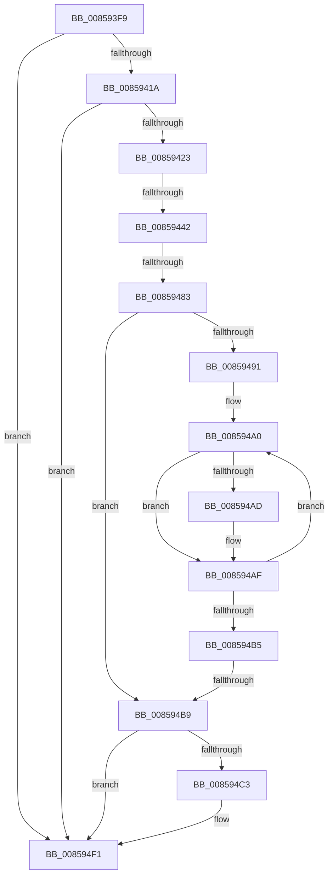

# sub_008593F9

- RVA: `0x008593F9`–`0x0085950A` (길이 `273` bytes)
- VA: `0x00000001408593F9`
- 실행 섹션: `PAGE`
- PDB 이름 있음: `아니요`; PDB Function 태그: `아니요`
- unwind 정보 RVA: `0x0006A998`
- 디코드: `70`개 명령, `273/273` bytes 표시
- 미해석 바이트: `0` (있으면 어셈블리에 `.byte`로 보존)

> 이 문서는 커널 이미지의 기계어와 PDB 기호를 분석해 생성했습니다. 4번과 5번은 함수 원형과 자료형을 바이너리 사용 방식에서 추정한 C 해석이며 원본 소스 복구 결과는 아닙니다.

## 1. Dependencies

- 직접 호출 지점: **1**; 고유 호출 대상: **1**
- 직접 호출자로 확인된 함수: **0**
- RIP 상대 이미지 참조: **1**

### Outgoing calls
- `0x008594EC` → [CmpArmLazyWriter](../../text/20/CmpArmLazyWriter_function_00204770.md) (function, `0x00204770`)

### Direct callers
- 이 함수 시작 RVA로 연결되는 직접 call은 확인되지 않았습니다. 간접 호출은 완전히 역산할 수 없습니다.

### Static image references
- `0x008594C3` → RVA `0x00E0ECB4` (`.data`; read)

## 2. Other-region calls and transfers

- 다른 실행 섹션으로 향하는 call: **1**
  - `0x008594EC` → [CmpArmLazyWriter](../../text/20/CmpArmLazyWriter_function_00204770.md) (`PAGE` → `.text`)
- call이 아닌 외부 분기/꼬리 이동: **3**
  - `0x0085943C` → [sub_00859517](Unknown_function_00859517.md) (`tail-transfer`)
  - `0x0085947D` → [sub_0085972A](Unknown_function_0085972A.md) (`tail-transfer`)
  - `0x008594B7` → [sub_00859517 + 0x8](Unknown_function_00859517.md) (`tail-transfer`)

## 3. Assembly (complete function range)

```asm
008593F9  48 89 9C 24 88 00 00 00         mov qword ptr [rsp + 0x88], rbx
00859401  48 89 74 24 50                  mov qword ptr [rsp + 0x50], rsi
00859406  48 89 7C 24 48                  mov qword ptr [rsp + 0x48], rdi
0085940B  4C 89 64 24 40                  mov qword ptr [rsp + 0x40], r12
00859410  41 F6 C0 01                     test r8b, 1
00859414  0F 85 D7 00 00 00               jne 0x1408594f1
0085941A  45 85 F6                        test r14d, r14d
0085941D  0F 88 CE 00 00 00               js 0x1408594f1
00859423  8B 95 88 00 00 00               mov edx, dword ptr [rbp + 0x88]
00859429  41 8D 75 FF                     lea esi, [r13 - 1]
0085942D  41 03 F6                        add esi, r14d
00859430  41 8B CE                        mov ecx, r14d
00859433  C1 EE 09                        shr esi, 9
00859436  C1 E9 09                        shr ecx, 9
00859439  83 FA 01                        cmp edx, 1
0085943C  0F 86 D5 00 00 00               jbe 0x140859517
00859442  03 F2                           add esi, edx
00859444  8D 42 FF                        lea eax, [rdx - 1]
00859447  F7 D0                           not eax
00859449  44 8B C8                        mov r9d, eax
0085944C  23 F0                           and esi, eax
0085944E  44 23 C9                        and r9d, ecx
00859451  FF CE                           dec esi
00859453  83 C6 10                        add esi, 0x10
00859456  41 8D 41 08                     lea eax, [r9 + 8]
0085945A  83 E0 F8                        and eax, 0xfffffff8
0085945D  83 E6 F8                        and esi, 0xfffffff8
00859460  83 EE 09                        sub esi, 9
00859463  85 C0                           test eax, eax
00859465  44 8D 48 F8                     lea r9d, [rax - 8]
00859469  44 0F 44 C8                     cmove r9d, eax
0085946D  8B 85 18 01 00 00               mov eax, dword ptr [rbp + 0x118]
00859473  C1 E8 09                        shr eax, 9
00859476  44 89 4C 24 30                  mov dword ptr [rsp + 0x30], r9d
0085947B  3B F0                           cmp esi, eax
0085947D  0F 83 A7 02 00 00               jae 0x14085972a
00859483  45 33 D2                        xor r10d, r10d
00859486  41 8B C1                        mov eax, r9d
00859489  41 8B FA                        mov edi, r10d
0085948C  44 3B CE                        cmp r9d, esi
0085948F  77 28                           ja 0x1408594b9
00859491  48 8B 55 60                     mov rdx, qword ptr [rbp + 0x60]
00859495  66 66 66 0F 1F 84 00 00 00 00 00  nop word ptr [rax + rax]
008594A0  8B C8                           mov ecx, eax
008594A2  48 0F A3 0A                     bt qword ptr [rdx], rcx
008594A6  0F 92 C1                        setb cl
008594A9  84 C9                           test cl, cl
008594AB  75 02                           jne 0x1408594af
008594AD  FF C7                           inc edi
008594AF  FF C0                           inc eax
008594B1  3B C6                           cmp eax, esi
008594B3  76 EB                           jbe 0x1408594a0
008594B5  85 FF                           test edi, edi
008594B7  75 66                           jne 0x14085951f
008594B9  8B 85 A0 00 00 00               mov eax, dword ptr [rbp + 0xa0]
008594BF  A8 02                           test al, 2
008594C1  75 2E                           jne 0x1408594f1
008594C3  8B 05 EB 57 5B 00               mov eax, dword ptr [rip + 0x5b57eb]
008594C9  48 8D 94 24 80 00 00 00         lea rdx, [rsp + 0x80]
008594D1  48 69 C8 80 96 98 00            imul rcx, rax, 0x989680
008594D8  45 33 C0                        xor r8d, r8d
008594DB  48 03 8D 28 10 00 00            add rcx, qword ptr [rbp + 0x1028]
008594E2  48 89 8C 24 80 00 00 00         mov qword ptr [rsp + 0x80], rcx
008594EA  33 C9                           xor ecx, ecx
008594EC  E8 7F B2 9A FF                  call 0x140204770
008594F1  33 C0                           xor eax, eax
008594F3  48 8B 7C 24 48                  mov rdi, qword ptr [rsp + 0x48]
008594F8  48 8B 74 24 50                  mov rsi, qword ptr [rsp + 0x50]
008594FD  48 8B 9C 24 88 00 00 00         mov rbx, qword ptr [rsp + 0x88]
00859505  4C 8B 64 24 40                  mov r12, qword ptr [rsp + 0x40]
```

## 4. C-style interpretation (structured pseudocode)

```c
__int64 __fastcall sub_008593F9(__int64 a1, __int64 a2, int a3, __int64 a4, __int64 a5, __int64 a6, __int64 a7, __int64 a8, __int64 a9, __int64 a10, __int64 a11, __int64 a12, __int64 a13, __int64 a14, __int64 a15, __int64 a16, __int64 a17)
{
    __int64 result;
    __int64 v_r10;
    __int64 v_rdi;
    __int64 v_rsi;
    unsigned int v_stack_p30;
    unsigned __int64 v_stack_p40;
    unsigned __int64 v_stack_p48;
    unsigned __int64 v_stack_p50;
    unsigned __int64 v_stack_p80;
    unsigned __int64 v_stack_p88;

    v_stack_p88 = v_rbx;
    v_stack_p50 = v_rsi;
    v_stack_p48 = v_rdi;
    v_stack_p40 = v_r12;
    if ((((unsigned __int8)(a3)) & (1)) != 0) goto loc_008594F1;
    if (sign_flag) goto loc_008594F1;
    v_rsi = (unsigned int)((v_r13 - 1) + ((unsigned int)(v_r14)));
    v_rsi = (unsigned int)((v_rsi) >> (9));
    a1 = (unsigned int)(((unsigned int)((unsigned int)(v_r14))) >> (9));
    v_rsi = (unsigned int)((v_rsi) + ((unsigned int)((unsigned int)(*(unsigned int *)(v_rbp + 136)))));
    result = (unsigned int)(~((unsigned int)(*(unsigned int *)(v_rbp + 136)) - 1));
    v_rsi = (unsigned int)((v_rsi) & ((unsigned int)(result)));
    a4 = (unsigned int)(((unsigned int)((unsigned int)(result))) & ((unsigned int)(a1)));
    v_rsi = (unsigned int)((v_rsi) - 1);
    v_rsi = (unsigned int)((v_rsi) + (16));
    result = (unsigned int)((a4 + 8) & (0xFFFFFFF8ULL));
    v_rsi = (unsigned int)((v_rsi) & (0xFFFFFFF8ULL));
    v_rsi = (unsigned int)((v_rsi) - (9));
    a4 = result - 8;
    if ((unsigned int)(result) == 0) { a4 = (unsigned int)(result); }
    result = (unsigned int)(((unsigned int)(*(unsigned int *)(v_rbp + 280))) >> (9));
    v_stack_p30 = (unsigned int)(a4);
    v_r10 = 0;
    if (((unsigned int)(a4)) > ((unsigned int)(v_rsi))) goto loc_008594B9;
loc_008594A0:
    a1 = (((unsigned int)(a4)) < ((unsigned int)(v_rsi))) ? 1 : 0;
    v_rdi = 0;
    if ((unsigned __int8)(a1) == 0) {
        v_rdi = (unsigned int)((0) + 1);
    }
    result = (unsigned int)(((unsigned int)((unsigned int)(a4))) + 1);
    if (((unsigned int)(result)) <= ((unsigned int)(v_rsi))) goto loc_008594A0;
loc_008594B9:
    result = (unsigned int)(*(unsigned int *)(v_rbp + 160));
    if ((((unsigned __int8)((unsigned int)(*(unsigned int *)(v_rbp + 160)))) & (2)) == 0) {
        result = *(unsigned int *)(v_rip + 5986283);
        a2 = a16;
        a1 = (a1) * (result);
        a3 = 0;
        a1 = (a1) + (*(unsigned __int64 *)(v_rbp + 4136));
        v_stack_p80 = a1;
        a1 = 0;
        result = CmpArmLazyWriter(a1, a2, a3, a4);
    }
    result = 0;
    return result;
}
```

## 5. (Beta) C Style

```c
int64_t sub_008593F9(int64_t Arg1, int64_t Arg2, int32_t Arg3, int64_t Arg4, uint64_t Arg5, uint64_t Arg6, uint64_t Arg7, int64_t Arg8, int64_t Arg9, int64_t Arg10, uint64_t Arg11, uint64_t Arg12, uint64_t Arg13, uint64_t Arg14, uint64_t Arg15, int64_t Arg16, int64_t Arg17)
{
    int64_t result;
    int64_t local_r10;
    int64_t local_rdi;
    int64_t local_rsi;
    uint32_t v_stack_p30;
    uint64_t v_stack_p40;
    uint64_t v_stack_p48;
    uint64_t v_stack_p50;
    uint64_t v_stack_p80;
    uint64_t v_stack_p88;

    v_stack_p88 = local_rbx;
    v_stack_p50 = local_rsi;
    v_stack_p48 = local_rdi;
    v_stack_p40 = local_r12;
    if ((((uint8_t)(Arg3)) & (1)) != 0) goto loc_008594F1;
    if (sign_flag) goto loc_008594F1;
    local_rsi = (uint32_t)((local_r13 - 1) + ((uint32_t)(local_r14)));
    local_rsi = (uint32_t)((local_rsi) >> (9));
    Arg1 = (uint32_t)(((uint32_t)((uint32_t)(local_r14))) >> (9));
    local_rsi = (uint32_t)((local_rsi) + ((uint32_t)((uint32_t)(*(uint32_t *)(local_rbp + 0x88)))));
    result = (uint32_t)(~((uint32_t)(*(uint32_t *)(local_rbp + 0x88)) - 1));
    local_rsi = (uint32_t)((local_rsi) & ((uint32_t)(result)));
    Arg4 = (uint32_t)(((uint32_t)((uint32_t)(result))) & ((uint32_t)(Arg1)));
    local_rsi = (uint32_t)((local_rsi) - 1);
    local_rsi = (uint32_t)((local_rsi) + (16));
    result = (uint32_t)((Arg4 + 8) & (0xFFFFFFF8ULL));
    local_rsi = (uint32_t)((local_rsi) & (0xFFFFFFF8ULL));
    local_rsi = (uint32_t)((local_rsi) - (9));
    Arg4 = result - 8;
    if ((uint32_t)(result) == 0) { Arg4 = (uint32_t)(result); }
    result = (uint32_t)(((uint32_t)(*(uint32_t *)(local_rbp + 0x118))) >> (9));
    v_stack_p30 = (uint32_t)(Arg4);
    local_r10 = 0;
    if (((uint32_t)(Arg4)) > ((uint32_t)(local_rsi))) goto loc_008594B9;
loc_008594A0:
    Arg1 = (((uint32_t)(Arg4)) < ((uint32_t)(local_rsi))) ? 1 : 0;
    local_rdi = 0;
    if ((uint8_t)(Arg1) == 0) {
        local_rdi = (uint32_t)((0) + 1);
    }
    result = (uint32_t)(((uint32_t)((uint32_t)(Arg4))) + 1);
    if (((uint32_t)(result)) <= ((uint32_t)(local_rsi))) goto loc_008594A0;
loc_008594B9:
    result = (uint32_t)(*(uint32_t *)(local_rbp + 0xA0));
    if ((((uint8_t)((uint32_t)(*(uint32_t *)(local_rbp + 0xA0)))) & (2)) == 0) {
        result = *(uint32_t *)(v_rip + 0x5B57EB);
        Arg2 = Arg16;
        Arg1 = (Arg1) * (result);
        Arg3 = 0;
        Arg1 = (Arg1) + (*(uint64_t *)(local_rbp + 0x1028));
        v_stack_p80 = Arg1;
        Arg1 = 0;
        result = CmpArmLazyWriter(Arg1, Arg2, Arg3, Arg4);
    }
    result = 0;
    return result;
}
```

## 6. Execution-region graph

[열기: 2D/3D 그래프와 함수 탐색 컨트롤 패널](../../../control-panel.html?section=page&rva=0x008593F9&view=graph)

- 2D 그래프는 위에서 아래로 흐르고, 3D 그래프는 빈 공간을 드래그해 회전합니다. Shift+드래그는 이동, 휠은 확대·축소, 함수 노드 선택은 대상 보고서 이동입니다.

### Static fallback


