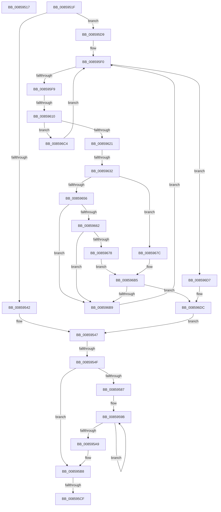

# sub_00859517

- RVA: `0x00859517`–`0x008596EE` (길이 `471` bytes)
- VA: `0x0000000140859517`
- 실행 섹션: `PAGE`
- PDB 이름 있음: `아니요`; PDB Function 태그: `아니요`
- unwind 정보 RVA: `0x0006A9CC`
- 디코드: `111`개 명령, `471/471` bytes 표시
- 미해석 바이트: `0` (있으면 어셈블리에 `.byte`로 보존)

> 이 문서는 커널 이미지의 기계어와 PDB 기호를 분석해 생성했습니다. 4번과 5번은 함수 원형과 자료형을 바이너리 사용 방식에서 추정한 C 해석이며 원본 소스 복구 결과는 아닙니다.

## 1. Dependencies

- 직접 호출 지점: **13**; 고유 호출 대상: **12**
- 직접 호출자로 확인된 함수: **0**
- RIP 상대 이미지 참조: **1**

### Outgoing calls
- `0x00859530` → [HvpGetBinContextInitialize](../../pagecmrc/BC/HvpGetBinContextInitialize_function_00BC98D0.md) (function, `0x00BC98D0`)
- `0x00859563` → [RtlSetBits](../../text/3E/RtlSetBits_function_003E1610.md) (function, `0x003E1610`)
- `0x00859573` → [CmpLogDirtyVectorUse](../9B/CmpLogDirtyVectorUse_function_009B69D4.md) (function, `0x009B69D4`)
- `0x0085957E` → [CmpLogHiveDirtyEvent](../A5/CmpLogHiveDirtyEvent_function_00A50A6C.md) (function, `0x00A50A6C`)
- `0x008595B3` → [CmpIssueNewDirtyCallback](../A6/CmpIssueNewDirtyCallback_function_00A6F050.md) (function, `0x00A6F050`)
- `0x008595CF` → [CmpForceFlushForCoalescing](../A6/CmpForceFlushForCoalescing_function_00A636F0.md) (function, `0x00A636F0`)
- `0x008595FF` → [HvpGetCellMap](../../pagecmrc/BC/HvpGetCellMap_function_00BC9710.md) (function, `0x00BC9710`)
- `0x00859624` → [HvpMapEntryGetFreeBin](../9B/HvpMapEntryGetFreeBin_function_009B5A40.md) (function, `0x009B5A40`)
- `0x0085963E` → [HvpGetCellMap](../../pagecmrc/BC/HvpGetCellMap_function_00BC9710.md) (function, `0x00BC9710`)
- `0x0085966F` → [HvpViewMapCOWAndUnsealRange](../9B/HvpViewMapCOWAndUnsealRange_function_009B5B44.md) (function, `0x009B5B44`)
- `0x00859687` → [HvpMapEntryGetBinAddress](../../pagecmrc/BC/HvpMapEntryGetBinAddress_function_00BC9770.md) (function, `0x00BC9770`)
- `0x00859697` → [HvpMapEntryReleaseBinAddress](../../pagecmrc/BC/HvpMapEntryReleaseBinAddress_function_00BC9790.md) (function, `0x00BC9790`)
- `0x008596AB` → [HvpProtectBinPartial](../9B/HvpProtectBinPartial_function_009B5D84.md) (function, `0x009B5D84`)

### Direct callers
- 이 함수 시작 RVA로 연결되는 직접 call은 확인되지 않았습니다. 간접 호출은 완전히 역산할 수 없습니다.

### Static image references
- `0x008595BA` → RVA `0x00EF554C` (`.data`; read/write)

## 2. Other-region calls and transfers

- 다른 실행 섹션으로 향하는 call: **6**
  - `0x00859530` → [HvpGetBinContextInitialize](../../pagecmrc/BC/HvpGetBinContextInitialize_function_00BC98D0.md) (`PAGE` → `PAGECMRC`)
  - `0x00859563` → [RtlSetBits](../../text/3E/RtlSetBits_function_003E1610.md) (`PAGE` → `.text`)
  - `0x008595FF` → [HvpGetCellMap](../../pagecmrc/BC/HvpGetCellMap_function_00BC9710.md) (`PAGE` → `PAGECMRC`)
  - `0x0085963E` → [HvpGetCellMap](../../pagecmrc/BC/HvpGetCellMap_function_00BC9710.md) (`PAGE` → `PAGECMRC`)
  - `0x00859687` → [HvpMapEntryGetBinAddress](../../pagecmrc/BC/HvpMapEntryGetBinAddress_function_00BC9770.md) (`PAGE` → `PAGECMRC`)
  - `0x00859697` → [HvpMapEntryReleaseBinAddress](../../pagecmrc/BC/HvpMapEntryReleaseBinAddress_function_00BC9790.md) (`PAGE` → `PAGECMRC`)
- call이 아닌 외부 분기/꼬리 이동: **6**
  - `0x0085951A` → [sub_008593F9 + 0x5A](Unknown_function_008593F9.md) (`tail-transfer`)
  - `0x00859549` → [sub_00859700 + 0xC](Unknown_function_00859700.md) (`tail-transfer`)
  - `0x008595C9` → [sub_008593F9 + 0xC0](Unknown_function_008593F9.md) (`tail-transfer`)
  - `0x008595D4` → [sub_008593F9 + 0xC0](Unknown_function_008593F9.md) (`tail-transfer`)
  - `0x0085960A` → [sub_0085972A + 0x8](Unknown_function_0085972A.md) (`tail-transfer`)
  - `0x0085962C` → [sub_00859700](Unknown_function_00859700.md) (`tail-transfer`)

## 3. Assembly (complete function range)

```asm
00859517  44 8B C9                        mov r9d, ecx
0085951A  E9 34 FF FF FF                  jmp 0x140859453
0085951F  48 8D 8C 24 80 00 00 00         lea rcx, [rsp + 0x80]
00859527  66 44 89 94 24 80 00 00 00      mov word ptr [rsp + 0x80], r10w
00859530  E8 9B 03 37 00                  call 0x140bc98d0
00859535  41 2B F1                        sub esi, r9d
00859538  41 F6 C0 11                     test r8b, 0x11
0085953C  0F 84 97 00 00 00               je 0x1408595d9
00859542  B8 01 00 00 00                  mov eax, 1
00859547  84 C0                           test al, al
00859549  0F 84 BD 01 00 00               je 0x14085970c
0085954F  8B 5D 68                        mov ebx, dword ptr [rbp + 0x68]
00859552  44 8D 46 01                     lea r8d, [rsi + 1]
00859556  48 8D 4D 58                     lea rcx, [rbp + 0x58]
0085955A  41 8B D1                        mov edx, r9d
0085955D  8D 04 3B                        lea eax, [rbx + rdi]
00859560  89 45 68                        mov dword ptr [rbp + 0x68], eax
00859563  E8 A8 80 B8 FF                  call 0x1403e1610
00859568  45 8B CD                        mov r9d, r13d
0085956B  45 8B C6                        mov r8d, r14d
0085956E  33 D2                           xor edx, edx
00859570  48 8B CD                        mov rcx, rbp
00859573  E8 5C D4 15 00                  call 0x1409b69d4
00859578  41 8B D7                        mov edx, r15d
0085957B  48 8B CD                        mov rcx, rbp
0085957E  E8 E9 74 1F 00                  call 0x140a50a6c
00859583  85 DB                           test ebx, ebx
00859585  75 31                           jne 0x1408595b8
00859587  49 B8 B0 03 00 00 80 F7 FF FF   movabs r8, 0xfffff780000003b0
00859591  49 B9 08 00 00 00 80 F7 FF FF   movabs r9, 0xfffff78000000008
0085959B  49 8B 08                        mov rcx, qword ptr [r8]
0085959E  49 8B 11                        mov rdx, qword ptr [r9]
008595A1  49 8B 00                        mov rax, qword ptr [r8]
008595A4  48 3B C8                        cmp rcx, rax
008595A7  75 F2                           jne 0x14085959b
008595A9  48 2B D1                        sub rdx, rcx
008595AC  48 89 95 28 10 00 00            mov qword ptr [rbp + 0x1028], rdx
008595B3  E8 98 5A 21 00                  call 0x140a6f050
008595B8  8B C7                           mov eax, edi
008595BA  F0 0F C1 05 8A BF 69 00         lock xadd dword ptr [rip + 0x69bf8a], eax
008595C2  03 C7                           add eax, edi
008595C4  3D 00 80 00 00                  cmp eax, 0x8000
008595C9  0F 8C EA FE FF FF               jl 0x1408594b9
008595CF  E8 1C A1 20 00                  call 0x140a636f0
008595D4  E9 E0 FE FF FF                  jmp 0x1408594b9
008595D9  45 8B E1                        mov r12d, r9d
008595DC  44 8D 7E 01                     lea r15d, [rsi + 1]
008595E0  41 C1 E4 09                     shl r12d, 9
008595E4  41 C1 E7 09                     shl r15d, 9
008595E8  0F 1F 84 00 00 00 00 00         nop dword ptr [rax + rax]
008595F0  45 85 FF                        test r15d, r15d
008595F3  0F 84 DE 00 00 00               je 0x1408596d7
008595F9  41 8B D4                        mov edx, r12d
008595FC  48 8B CD                        mov rcx, rbp
008595FF  E8 0C 01 37 00                  call 0x140bc9710
00859604  4C 8B D0                        mov r10, rax
00859607  48 85 C0                        test rax, rax
0085960A  0F 84 22 01 00 00               je 0x140859732
00859610  4C 8B 40 08                     mov r8, qword ptr [rax + 8]
00859614  49 F7 C0 F0 FF FF FF            test r8, -0x10
0085961B  0F 84 A3 00 00 00               je 0x1408596c4
00859621  48 8B C8                        mov rcx, rax
00859624  E8 17 C4 15 00                  call 0x1409b5a40
00859629  48 85 C0                        test rax, rax
0085962C  0F 85 CE 00 00 00               jne 0x140859700
00859632  44 8B 19                        mov r11d, dword ptr [rcx]
00859635  41 8B D4                        mov edx, r12d
00859638  48 8B CD                        mov rcx, rbp
0085963B  41 2B D3                        sub edx, r11d
0085963E  E8 CD 00 37 00                  call 0x140bc9710
00859643  8B 58 10                        mov ebx, dword ptr [rax + 0x10]
00859646  41 2B DB                        sub ebx, r11d
00859649  44 3B FB                        cmp r15d, ebx
0085964C  41 0F 42 DF                     cmovb ebx, r15d
00859650  41 F6 C0 08                     test r8b, 8
00859654  75 26                           jne 0x14085967c
00859656  F7 85 A0 00 00 00 00 00 02 00   test dword ptr [rbp + 0xa0], 0x20000
00859660  74 57                           je 0x1408596b9
00859662  48 8D 8D E0 00 00 00            lea rcx, [rbp + 0xe0]
00859669  44 8B C3                        mov r8d, ebx
0085966C  41 8B D4                        mov edx, r12d
0085966F  E8 D0 C4 15 00                  call 0x1409b5b44
00859674  85 C0                           test eax, eax
00859676  79 41                           jns 0x1408596b9
00859678  33 C0                           xor eax, eax
0085967A  EB 39                           jmp 0x1408596b5
0085967C  4C 8D 84 24 80 00 00 00         lea r8, [rsp + 0x80]
00859684  49 8B D2                        mov rdx, r10
00859687  E8 E4 00 37 00                  call 0x140bc9770
0085968C  4C 8D 84 24 80 00 00 00         lea r8, [rsp + 0x80]
00859694  48 8B D0                        mov rdx, rax
00859697  E8 F4 00 37 00                  call 0x140bc9790
0085969C  C6 44 24 28 01                  mov byte ptr [rsp + 0x28], 1
008596A1  45 8B CB                        mov r9d, r11d
008596A4  48 8B CD                        mov rcx, rbp
008596A7  89 5C 24 20                     mov dword ptr [rsp + 0x20], ebx
008596AB  E8 D4 C6 15 00                  call 0x1409b5d84
008596B0  F7 D0                           not eax
008596B2  C1 E8 1F                        shr eax, 0x1f
008596B5  85 C0                           test eax, eax
008596B7  74 23                           je 0x1408596dc
008596B9  44 2B FB                        sub r15d, ebx
008596BC  44 03 E3                        add r12d, ebx
008596BF  E9 2C FF FF FF                  jmp 0x1408595f0
008596C4  41 81 C4 00 10 00 00            add r12d, 0x1000
008596CB  41 81 C7 00 F0 FF FF            add r15d, 0xfffff000
008596D2  E9 19 FF FF FF                  jmp 0x1408595f0
008596D7  B8 01 00 00 00                  mov eax, 1
008596DC  44 8B BC 24 98 00 00 00         mov r15d, dword ptr [rsp + 0x98]
008596E4  44 8B 4C 24 30                  mov r9d, dword ptr [rsp + 0x30]
008596E9  E9 59 FE FF FF                  jmp 0x140859547
```

## 4. C-style interpretation (structured pseudocode)

```c
__int64 __fastcall sub_00859517(int a1, __int64 a2, unsigned __int8 a3)
{
    unsigned int v_stack_p20;
    unsigned __int8 v_stack_p28;
    unsigned int v_stack_p30;
    unsigned __int64 v_stack_p80;
    unsigned int v_stack_p98;
}
```

## 5. (Beta) C Style

```c
int64_t sub_00859517(int32_t Arg1, int64_t Arg2, uint8_t Arg3)
{
    uint32_t v_stack_p20;
    uint8_t v_stack_p28;
    uint32_t v_stack_p30;
    uint64_t v_stack_p80;
    uint32_t v_stack_p98;
}
```

## 6. Execution-region graph

[열기: 2D/3D 그래프와 함수 탐색 컨트롤 패널](../../../control-panel.html?section=page&rva=0x00859517&view=graph)

- 2D 그래프는 위에서 아래로 흐르고, 3D 그래프는 빈 공간을 드래그해 회전합니다. Shift+드래그는 이동, 휠은 확대·축소, 함수 노드 선택은 대상 보고서 이동입니다.

### Static fallback


