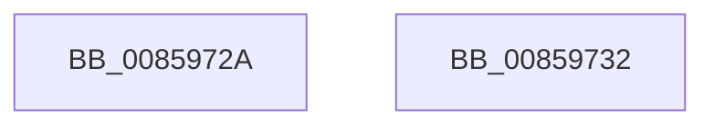

# sub_0085972A

- RVA: `0x0085972A`–`0x0085974F` (길이 `37` bytes)
- VA: `0x000000014085972A`
- 실행 섹션: `PAGE`
- PDB 이름 있음: `아니요`; PDB Function 태그: `아니요`
- unwind 정보 RVA: `0x0006AA30`
- 디코드: `9`개 명령, `37/37` bytes 표시
- 미해석 바이트: `0` (있으면 어셈블리에 `.byte`로 보존)

> 이 문서는 커널 이미지의 기계어와 PDB 기호를 분석해 생성했습니다. 4번과 5번은 함수 원형과 자료형을 바이너리 사용 방식에서 추정한 C 해석이며 원본 소스 복구 결과는 아닙니다.

## 1. Dependencies

- 직접 호출 지점: **1**; 고유 호출 대상: **1**
- 직접 호출자로 확인된 함수: **0**
- RIP 상대 이미지 참조: **0**

### Outgoing calls
- `0x00859749` → [KeBugCheckEx](../../text/4F/KeBugCheckEx_function_004FD660.md) (function, `0x004FD660`)

### Direct callers
- 이 함수 시작 RVA로 연결되는 직접 call은 확인되지 않았습니다. 간접 호출은 완전히 역산할 수 없습니다.

### Static image references
- 디코드된 RIP-relative 메모리 참조가 없습니다.

## 2. Other-region calls and transfers

- 다른 실행 섹션으로 향하는 call: **1**
  - `0x00859749` → [KeBugCheckEx](../../text/4F/KeBugCheckEx_function_004FD660.md) (`PAGE` → `.text`)
- call이 아닌 외부 분기/꼬리 이동: **1**
  - `0x0085972D` → [sub_008593F9 + 0x8A](Unknown_function_008593F9.md) (`tail-transfer`)

## 3. Assembly (complete function range)

```asm
0085972A  8D 70 FF                        lea esi, [rax - 1]
0085972D  E9 51 FD FF FF                  jmp 0x140859483
00859732  BA 01 00 00 00                  mov edx, 1
00859737  45 8B CC                        mov r9d, r12d
0085973A  4C 8B C5                        mov r8, rbp
0085973D  48 C7 44 24 20 45 04 00 00      mov qword ptr [rsp + 0x20], 0x445
00859746  8D 4A 50                        lea ecx, [rdx + 0x50]
00859749  E8 12 3F CA FF                  call 0x1404fd660
0085974E  CC                              int3
```

## 4. C-style interpretation (structured pseudocode)

```c
__int64 __fastcall sub_0085972A(void)
{
    unsigned __int64 v_stack_p20;
}
```

## 5. (Beta) C Style

```c
void sub_0085972A(void)
{
    uint64_t v_stack_p20;
}
```

## 6. Execution-region graph

[열기: 2D/3D 그래프와 함수 탐색 컨트롤 패널](../../../control-panel.html?section=page&rva=0x0085972A&view=graph)

- 2D 그래프는 위에서 아래로 흐르고, 3D 그래프는 빈 공간을 드래그해 회전합니다. Shift+드래그는 이동, 휠은 확대·축소, 함수 노드 선택은 대상 보고서 이동입니다.

### Static fallback


