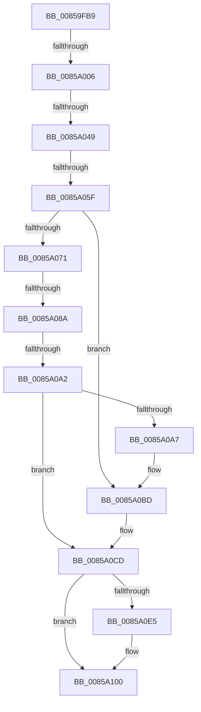

# sub_00859FB9

- RVA: `0x00859FB9`–`0x0085A12B` (길이 `370` bytes)
- VA: `0x0000000140859FB9`
- 실행 섹션: `PAGE`
- PDB 이름 있음: `아니요`; PDB Function 태그: `아니요`
- unwind 정보 RVA: `0x0006AAB8`
- 디코드: `93`개 명령, `370/370` bytes 표시
- 미해석 바이트: `0` (있으면 어셈블리에 `.byte`로 보존)

> 이 문서는 커널 이미지의 기계어와 PDB 기호를 분석해 생성했습니다. 4번과 5번은 함수 원형과 자료형을 바이너리 사용 방식에서 추정한 C 해석이며 원본 소스 복구 결과는 아닙니다.

## 1. Dependencies

- 직접 호출 지점: **7**; 고유 호출 대상: **7**
- 직접 호출자로 확인된 함수: **0**
- RIP 상대 이미지 참조: **0**

### Outgoing calls
- `0x00859FF1` → [HvpGetCellContextInitialize](HvpGetCellContextInitialize_function_00855F10.md) (function, `0x00855F10`)
- `0x0085A011` → [HvLockHiveWriter](HvLockHiveWriter_function_00859894.md) (function, `0x00859894`)
- `0x0085A038` → [HvpFindFreeCell](HvpFindFreeCell_function_00859920.md) (function, `0x00859920`)
- `0x0085A0B8` → [HvpRemoveFreeCellHint](HvpRemoveFreeCellHint_function_0085A270.md) (function, `0x0085A270`)
- `0x0085A0C8` → [HvpEnlistFreeCell](HvpEnlistFreeCell_function_0085A430.md) (function, `0x0085A430`)
- `0x0085A0D0` → [HvUnlockHiveWriter](HvUnlockHiveWriter_function_008598E4.md) (function, `0x008598E4`)
- `0x0085A0FB` → [HvpGetCellContextMove](HvpGetCellContextMove_function_00859F58.md) (function, `0x00859F58`)

### Direct callers
- 이 함수 시작 RVA로 연결되는 직접 call은 확인되지 않았습니다. 간접 호출은 완전히 역산할 수 없습니다.

### Static image references
- 디코드된 RIP-relative 메모리 참조가 없습니다.

## 2. Other-region calls and transfers

- 다른 실행 섹션으로 향하는 call: **0**
- call이 아닌 외부 분기/꼬리 이동: **6**
  - `0x0085A000` → [sub_0085A14A](Unknown_function_0085A14A.md) (`tail-transfer`)
  - `0x0085A043` → [sub_0085A1C1](Unknown_function_0085A1C1.md) (`tail-transfer`)
  - `0x0085A059` → [sub_0085A164](Unknown_function_0085A164.md) (`tail-transfer`)
  - `0x0085A084` → [sub_0085A164 + 0x19](Unknown_function_0085A164.md) (`tail-transfer`)
  - `0x0085A09C` → [sub_0085A164 + 0x37](Unknown_function_0085A164.md) (`tail-transfer`)
  - `0x0085A125` → [sub_0085A240](Unknown_function_0085A240.md) (`tail-transfer`)

## 3. Assembly (complete function range)

```asm
00859FB9  48 89 58 08                     mov qword ptr [rax + 8], rbx
00859FBD  4C 8B F1                        mov r14, rcx
00859FC0  48 89 68 10                     mov qword ptr [rax + 0x10], rbp
00859FC4  48 8D 48 C0                     lea rcx, [rax - 0x40]
00859FC8  48 89 78 F0                     mov qword ptr [rax - 0x10], rdi
00859FCC  4C 89 60 E8                     mov qword ptr [rax - 0x18], r12
00859FD0  4C 89 68 E0                     mov qword ptr [rax - 0x20], r13
00859FD4  4D 8B E9                        mov r13, r9
00859FD7  4C 89 78 D8                     mov qword ptr [rax - 0x28], r15
00859FDB  45 8B F8                        mov r15d, r8d
00859FDE  8B FA                           mov edi, edx
00859FE0  33 D2                           xor edx, edx
00859FE2  48 89 50 C0                     mov qword ptr [rax - 0x40], rdx
00859FE6  48 89 50 C8                     mov qword ptr [rax - 0x38], rdx
00859FEA  C7 40 B8 FF FF FF FF            mov dword ptr [rax - 0x48], 0xffffffff
00859FF1  E8 1A BF FF FF                  call 0x140855f10
00859FF6  8B DF                           mov ebx, edi
00859FF8  C1 EB 03                        shr ebx, 3
00859FFB  FF CB                           dec ebx
00859FFD  83 FB 10                        cmp ebx, 0x10
0085A000  0F 83 44 01 00 00               jae 0x14085a14a
0085A006  49 8B CE                        mov rcx, r14
0085A009  48 89 B4 24 90 00 00 00         mov qword ptr [rsp + 0x90], rsi
0085A011  E8 7E F8 FF FF                  call 0x140859894
0085A016  48 8D 44 24 38                  lea rax, [rsp + 0x38]
0085A01B  45 8B CF                        mov r9d, r15d
0085A01E  48 89 44 24 28                  mov qword ptr [rsp + 0x28], rax
0085A023  44 8B C7                        mov r8d, edi
0085A026  48 8D 44 24 40                  lea rax, [rsp + 0x40]
0085A02B  8B D3                           mov edx, ebx
0085A02D  49 8B CE                        mov rcx, r14
0085A030  48 89 44 24 20                  mov qword ptr [rsp + 0x20], rax
0085A035  40 B5 01                        mov bpl, 1
0085A038  E8 E3 F8 FF FF                  call 0x140859920
0085A03D  44 8B E0                        mov r12d, eax
0085A040  83 F8 FF                        cmp eax, -1
0085A043  0F 84 78 01 00 00               je 0x14085a1c1
0085A049  48 8B 5C 24 40                  mov rbx, qword ptr [rsp + 0x40]
0085A04E  44 8B 03                        mov r8d, dword ptr [rbx]
0085A051  41 8B F0                        mov esi, r8d
0085A054  2B F7                           sub esi, edi
0085A056  83 FE 08                        cmp esi, 8
0085A059  0F 82 05 01 00 00               jb 0x14085a164
0085A05F  89 34 1F                        mov dword ptr [rdi + rbx], esi
0085A062  41 8D 2C 3C                     lea ebp, [r12 + rdi]
0085A066  F7 DF                           neg edi
0085A068  89 3B                           mov dword ptr [rbx], edi
0085A06A  83 7C 24 30 FF                  cmp dword ptr [rsp + 0x30], -1
0085A06F  75 4C                           jne 0x14085a0bd
0085A071  41 C1 E8 03                     shr r8d, 3
0085A075  41 FF C8                        dec r8d
0085A078  C7 44 24 34 00 00 00 00         mov dword ptr [rsp + 0x34], 0
0085A080  41 83 F8 10                     cmp r8d, 0x10
0085A084  0F 83 F3 00 00 00               jae 0x14085a17d
0085A08A  8B C6                           mov eax, esi
0085A08C  C7 44 24 34 00 00 00 00         mov dword ptr [rsp + 0x34], 0
0085A094  C1 E8 03                        shr eax, 3
0085A097  FF C8                           dec eax
0085A099  83 F8 10                        cmp eax, 0x10
0085A09C  0F 83 F9 00 00 00               jae 0x14085a19b
0085A0A2  44 3B C0                        cmp r8d, eax
0085A0A5  74 26                           je 0x14085a0cd
0085A0A7  45 8B CF                        mov r9d, r15d
0085A0AA  C7 44 24 20 00 00 00 00         mov dword ptr [rsp + 0x20], 0
0085A0B2  41 8B D4                        mov edx, r12d
0085A0B5  49 8B CE                        mov rcx, r14
0085A0B8  E8 B3 01 00 00                  call 0x14085a270
0085A0BD  45 8B CF                        mov r9d, r15d
0085A0C0  44 8B C6                        mov r8d, esi
0085A0C3  8B D5                           mov edx, ebp
0085A0C5  49 8B CE                        mov rcx, r14
0085A0C8  E8 63 03 00 00                  call 0x14085a430
0085A0CD  49 8B CE                        mov rcx, r14
0085A0D0  E8 0F F8 FF FF                  call 0x1408598e4
0085A0D5  48 8B 8C 24 A0 00 00 00         mov rcx, qword ptr [rsp + 0xa0]
0085A0DD  40 32 ED                        xor bpl, bpl
0085A0E0  48 85 C9                        test rcx, rcx
0085A0E3  74 1B                           je 0x14085a100
0085A0E5  48 8D 43 04                     lea rax, [rbx + 4]
0085A0E9  33 DB                           xor ebx, ebx
0085A0EB  48 89 01                        mov qword ptr [rcx], rax
0085A0EE  48 8D 54 24 38                  lea rdx, [rsp + 0x38]
0085A0F3  48 8B 8C 24 A8 00 00 00         mov rcx, qword ptr [rsp + 0xa8]
0085A0FB  E8 58 FE FF FF                  call 0x140859f58
0085A100  45 89 65 00                     mov dword ptr [r13], r12d
0085A104  33 F6                           xor esi, esi
0085A106  4C 8B 7C 24 50                  mov r15, qword ptr [rsp + 0x50]
0085A10B  48 85 DB                        test rbx, rbx
0085A10E  48 8B 9C 24 80 00 00 00         mov rbx, qword ptr [rsp + 0x80]
0085A116  4C 8B 6C 24 58                  mov r13, qword ptr [rsp + 0x58]
0085A11B  4C 8B 64 24 60                  mov r12, qword ptr [rsp + 0x60]
0085A120  48 8B 7C 24 68                  mov rdi, qword ptr [rsp + 0x68]
0085A125  0F 85 15 01 00 00               jne 0x14085a240
```

## 4. C-style interpretation (structured pseudocode)

```c
__int64 __fastcall sub_00859FB9(__int64 a1, int a2, int a3, __int64 a4, __int64 a5, unsigned int a6, __int64 a7, __int64 a8, __int64 a9, __int64 a10, __int64 a11, __int64 a12, __int64 a13, __int64 a14, __int64 a15, __int64 a16, __int64 a17, __int64 a18, __int64 a19, __int64 a20, __int64 a21)
{
    __int64 result;
    __int64 v_rbp;
    __int64 v_rbx;
    __int64 v_rdi;
    __int64 v_rsi;
    unsigned __int64 v_stack_p20;
    unsigned __int64 v_stack_p28;
    unsigned int v_stack_p34;
    unsigned __int64 v_stack_p90;

    *(unsigned __int64 *)(result + 8) = v_rbx;
    *(unsigned __int64 *)(result + 16) = v_rbp;
    *(unsigned __int64 *)(result - 16) = v_rdi;
    *(unsigned __int64 *)(result - 24) = v_r12;
    *(unsigned __int64 *)(result - 32) = v_r13;
    *(unsigned __int64 *)(result - 40) = v_r15;
    a2 = 0;
    *(unsigned __int64 *)(result - 64) = 0;
    *(unsigned __int64 *)(result - 56) = 0;
    *(unsigned int *)(result - 72) = 0xFFFFFFFFULL;
    result = HvpGetCellContextInitialize(result - 64, a2, a3, a4);
    v_rbx = (unsigned int)(((unsigned int)((unsigned int)((unsigned int)(a2)))) >> (3));
    v_rbx = (unsigned int)((v_rbx) - 1);
    v_stack_p90 = v_rsi;
    result = HvLockHiveWriter(a1, a2, a3, a4);
    v_stack_p28 = a7;
    v_stack_p20 = a8;
    result = HvpFindFreeCell(a1, (unsigned int)((unsigned int)(v_rbx)), (unsigned int)((unsigned int)((unsigned int)(a2))), (unsigned int)((unsigned int)((unsigned int)(a3))));
    v_rsi = (unsigned int)(((unsigned int)((unsigned int)((unsigned int)(*(unsigned int *)(a8))))) - ((unsigned int)((unsigned int)(a2))));
    *(unsigned int *)((unsigned int)(a2) + a8 * 1) = (unsigned int)(v_rsi);
    v_rdi = (unsigned int)(-((unsigned int)(a2)));
    *(unsigned int *)(a8) = (unsigned int)(v_rdi);
    if (a6 != -1) goto loc_0085A0BD;
    a3 = (unsigned int)(((unsigned int)(*(unsigned int *)(a8))) >> (3));
    a3 = (unsigned int)((a3) - 1);
    v_stack_p34 = 0;
    v_stack_p34 = 0;
    result = (unsigned int)(((unsigned int)((unsigned int)(v_rsi))) >> (3));
    result = (unsigned int)((result) - 1);
    if (a3 == ((unsigned int)(result))) goto loc_0085A0CD;
    v_stack_p20 = 0;
    result = HvpRemoveFreeCellHint(a1, (unsigned int)((unsigned int)((unsigned int)((unsigned int)(result)))), a3, (unsigned int)((unsigned int)((unsigned int)(a3))));
loc_0085A0BD:
    result = HvpEnlistFreeCell(a1, (unsigned int)((unsigned int)((unsigned int)((unsigned int)(result)) + (unsigned int)(a2) * 1)), (unsigned int)((unsigned int)(v_rsi)), (unsigned int)((unsigned int)((unsigned int)(a3))));
loc_0085A0CD:
    result = HvUnlockHiveWriter(a1, (unsigned int)((unsigned int)((unsigned int)((unsigned int)(result)) + (unsigned int)(a2) * 1)), (unsigned int)((unsigned int)(v_rsi)), (unsigned int)((unsigned int)((unsigned int)(a3))));
    v_rbp = 0;
    v_rbx = a8;
    if (a20 != 0) {
        result = a8 + 4;
        v_rbx = 0;
        *(unsigned __int64 *)(a20) = result;
        a2 = a7;
        a1 = a21;
        result = HvpGetCellContextMove(a1, a2, (unsigned int)((unsigned int)(v_rsi)), (unsigned int)((unsigned int)((unsigned int)(a3))));
    }
    *(unsigned int *)(a4) = (unsigned int)((unsigned int)((unsigned int)(result)));
    v_rsi = 0;
}
```

## 5. (Beta) C Style

```c
int64_t sub_00859FB9(int64_t Arg1, void *Arg2, int32_t Arg3, void *Arg4, uint64_t Arg5, uint32_t Arg6, int64_t Arg7, void *Arg8, uint64_t Arg9, int64_t Arg10, int64_t Arg11, int64_t Arg12, int64_t Arg13, uint64_t Arg14, uint64_t Arg15, int64_t Arg16, uint64_t Arg17, uint64_t Arg18, uint64_t Arg19, int64_t Arg20, int64_t Arg21)
{
    uint8_t *arg2 = (uint8_t *)Arg2;
    uint8_t *arg4 = (uint8_t *)Arg4;
    uint8_t *arg8 = (uint8_t *)Arg8;

    int64_t result;
    int64_t local_rbp;
    int64_t local_rbx;
    int64_t local_rdi;
    int64_t local_rsi;
    uint64_t v_stack_p20;
    uint64_t v_stack_p28;
    uint32_t v_stack_p34;
    uint64_t v_stack_p90;

    *(uint64_t *)(result + 0x8) = local_rbx;
    *(uint64_t *)(result + 0x10) = local_rbp;
    *(uint64_t *)(result - 0x10) = local_rdi;
    *(uint64_t *)(result - 0x18) = local_r12;
    *(uint64_t *)(result - 0x20) = local_r13;
    *(uint64_t *)(result - 0x28) = local_r15;
    Arg2 = 0;
    *(uint64_t *)(result - 0x40) = 0;
    *(uint64_t *)(result - 0x38) = 0;
    *(uint32_t *)(result - 0x48) = 0xFFFFFFFFULL;
    result = HvpGetCellContextInitialize(result - 64, Arg2, Arg3, Arg4);
    local_rbx = (uint32_t)(((uint32_t)((uint32_t)((uint32_t)(Arg2)))) >> (3));
    local_rbx = (uint32_t)((local_rbx) - 1);
    v_stack_p90 = local_rsi;
    result = HvLockHiveWriter(Arg1, Arg2, Arg3, Arg4);
    v_stack_p28 = Arg7;
    v_stack_p20 = Arg8;
    result = HvpFindFreeCell(Arg1, (uint32_t)((uint32_t)(local_rbx)), (uint32_t)((uint32_t)((uint32_t)(Arg2))), (uint32_t)((uint32_t)((uint32_t)(Arg3))));
    local_rsi = (uint32_t)(((uint32_t)((uint32_t)((uint32_t)(*(uint32_t *)(arg8))))) - ((uint32_t)((uint32_t)(Arg2))));
    *(uint32_t *)((uint32_t)(arg2) + arg8 * 1) = (uint32_t)(local_rsi);
    local_rdi = (uint32_t)(-((uint32_t)(Arg2)));
    *(uint32_t *)(arg8) = (uint32_t)(local_rdi);
    if (Arg6 != -1) goto loc_0085A0BD;
    Arg3 = (uint32_t)(((uint32_t)(*(uint32_t *)(arg8))) >> (3));
    Arg3 = (uint32_t)((Arg3) - 1);
    v_stack_p34 = 0;
    v_stack_p34 = 0;
    result = (uint32_t)(((uint32_t)((uint32_t)(local_rsi))) >> (3));
    result = (uint32_t)((result) - 1);
    if (Arg3 == ((uint32_t)(result))) goto loc_0085A0CD;
    v_stack_p20 = 0;
    result = HvpRemoveFreeCellHint(Arg1, (uint32_t)((uint32_t)((uint32_t)((uint32_t)(result)))), Arg3, (uint32_t)((uint32_t)((uint32_t)(Arg3))));
loc_0085A0BD:
    result = HvpEnlistFreeCell(Arg1, (uint32_t)((uint32_t)((uint32_t)((uint32_t)(result)) + (uint32_t)(Arg2) * 1)), (uint32_t)((uint32_t)(local_rsi)), (uint32_t)((uint32_t)((uint32_t)(Arg3))));
loc_0085A0CD:
    result = HvUnlockHiveWriter(Arg1, (uint32_t)((uint32_t)((uint32_t)((uint32_t)(result)) + (uint32_t)(Arg2) * 1)), (uint32_t)((uint32_t)(local_rsi)), (uint32_t)((uint32_t)((uint32_t)(Arg3))));
    local_rbp = 0;
    local_rbx = Arg8;
    if (Arg20 != 0) {
        result = Arg8 + 4;
        local_rbx = 0;
        *(uint64_t *)(Arg20) = result;
        Arg2 = Arg7;
        Arg1 = Arg21;
        result = HvpGetCellContextMove(Arg1, Arg2, (uint32_t)((uint32_t)(local_rsi)), (uint32_t)((uint32_t)((uint32_t)(Arg3))));
    }
    *(uint32_t *)(arg4) = (uint32_t)((uint32_t)((uint32_t)(result)));
    local_rsi = 0;
}
```

### 관측된 메모리 오프셋

구조체 형식이 확인되지 않은 접근은 인자 기준의 오프셋으로만 기록했습니다.

| 기준 인자 | 오프셋 표현 | 폭 (bit) | 접근 |
|---|---:|---:|---|
| `Arg2` | `+ 0x0 + rbx*1` | `32` | `W` |
| `Arg4` | `+ 0x0` | `32` | `W` |
| `Arg8` | `+ 0x0` | `32` | `R` |
| `Arg8` | `+ 0x0` | `32` | `W` |
| `Arg8` | `+ 0x4` | `64` | `R` |

## 6. Execution-region graph

[열기: 2D/3D 그래프와 함수 탐색 컨트롤 패널](../../../control-panel.html?section=page&rva=0x00859FB9&view=graph)

- 2D 그래프는 위에서 아래로 흐르고, 3D 그래프는 빈 공간을 드래그해 회전합니다. Shift+드래그는 이동, 휠은 확대·축소, 함수 노드 선택은 대상 보고서 이동입니다.

### Static fallback


