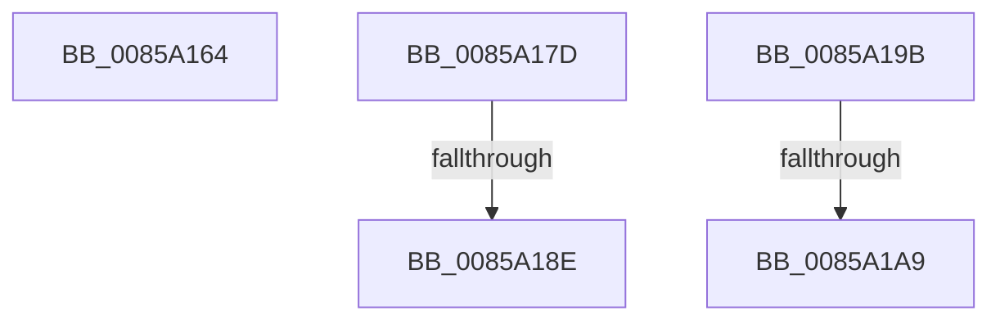

# sub_0085A164

- RVA: `0x0085A164`–`0x0085A1B4` (길이 `80` bytes)
- VA: `0x000000014085A164`
- 실행 섹션: `PAGE`
- PDB 이름 있음: `아니요`; PDB Function 태그: `아니요`
- unwind 정보 RVA: `0x0006AB3C`
- 디코드: `20`개 명령, `80/80` bytes 표시
- 미해석 바이트: `0` (있으면 어셈블리에 `.byte`로 보존)

> 이 문서는 커널 이미지의 기계어와 PDB 기호를 분석해 생성했습니다. 4번과 5번은 함수 원형과 자료형을 바이너리 사용 방식에서 추정한 C 해석이며 원본 소스 복구 결과는 아닙니다.

## 1. Dependencies

- 직접 호출 지점: **1**; 고유 호출 대상: **1**
- 직접 호출자로 확인된 함수: **0**
- RIP 상대 이미지 참조: **0**

### Outgoing calls
- `0x0085A16D` → [HvpDelistFreeCell](HvpDelistFreeCell_function_0085A99C.md) (function, `0x0085A99C`)

### Direct callers
- 이 함수 시작 RVA로 연결되는 직접 call은 확인되지 않았습니다. 간접 호출은 완전히 역산할 수 없습니다.

### Static image references
- 디코드된 RIP-relative 메모리 참조가 없습니다.

## 2. Other-region calls and transfers

- 다른 실행 섹션으로 향하는 call: **0**
- call이 아닌 외부 분기/꼬리 이동: **5**
  - `0x0085A178` → [sub_00859FB9 + 0x114](Unknown_function_00859FB9.md) (`tail-transfer`)
  - `0x0085A188` → [sub_0085A221](Unknown_function_0085A221.md) (`tail-transfer`)
  - `0x0085A196` → [sub_00859FB9 + 0xD1](Unknown_function_00859FB9.md) (`tail-transfer`)
  - `0x0085A1A3` → [sub_0085A221 + 0xB](Unknown_function_0085A221.md) (`tail-transfer`)
  - `0x0085A1AF` → [sub_00859FB9 + 0xE9](Unknown_function_00859FB9.md) (`tail-transfer`)

## 3. Assembly (complete function range)

```asm
0085A164  45 8B C7                        mov r8d, r15d
0085A167  41 8B D4                        mov edx, r12d
0085A16A  49 8B CE                        mov rcx, r14
0085A16D  E8 2A 08 00 00                  call 0x14085a99c
0085A172  8B 03                           mov eax, dword ptr [rbx]
0085A174  F7 D8                           neg eax
0085A176  89 03                           mov dword ptr [rbx], eax
0085A178  E9 50 FF FF FF                  jmp 0x14085a0cd
0085A17D  41 C1 E8 04                     shr r8d, 4
0085A181  41 81 F8 FF 00 00 00            cmp r8d, 0xff
0085A188  0F 87 93 00 00 00               ja 0x14085a221
0085A18E  45 0F BD C0                     bsr r8d, r8d
0085A192  41 83 C0 10                     add r8d, 0x10
0085A196  E9 EF FE FF FF                  jmp 0x14085a08a
0085A19B  C1 E8 04                        shr eax, 4
0085A19E  3D FF 00 00 00                  cmp eax, 0xff
0085A1A3  0F 87 83 00 00 00               ja 0x14085a22c
0085A1A9  0F BD C0                        bsr eax, eax
0085A1AC  83 C0 10                        add eax, 0x10
0085A1AF  E9 EE FE FF FF                  jmp 0x14085a0a2
```

## 4. C-style interpretation (structured pseudocode)

```c
__int64 __fastcall sub_0085A164(void)
{
    __int64 result;

    result = HvpDelistFreeCell(v_r14, (unsigned int)((unsigned int)(v_r12)), (unsigned int)((unsigned int)(v_r15)), a4);
    result = (unsigned int)(-((unsigned int)(*(unsigned int *)(v_rbx))));
    *(unsigned int *)(v_rbx) = (unsigned int)(result);
}
```

## 5. (Beta) C Style

```c
void sub_0085A164(void)
{
    int64_t result;

    result = HvpDelistFreeCell(local_r14, (uint32_t)((uint32_t)(local_r12)), (uint32_t)((uint32_t)(local_r15)), a4);
    result = (uint32_t)(-((uint32_t)(*(uint32_t *)(local_rbx))));
    *(uint32_t *)(local_rbx) = (uint32_t)(result);
}
```

## 6. Execution-region graph

[열기: 2D/3D 그래프와 함수 탐색 컨트롤 패널](../../../control-panel.html?section=page&rva=0x0085A164&view=graph)

- 2D 그래프는 위에서 아래로 흐르고, 3D 그래프는 빈 공간을 드래그해 회전합니다. Shift+드래그는 이동, 휠은 확대·축소, 함수 노드 선택은 대상 보고서 이동입니다.

### Static fallback


